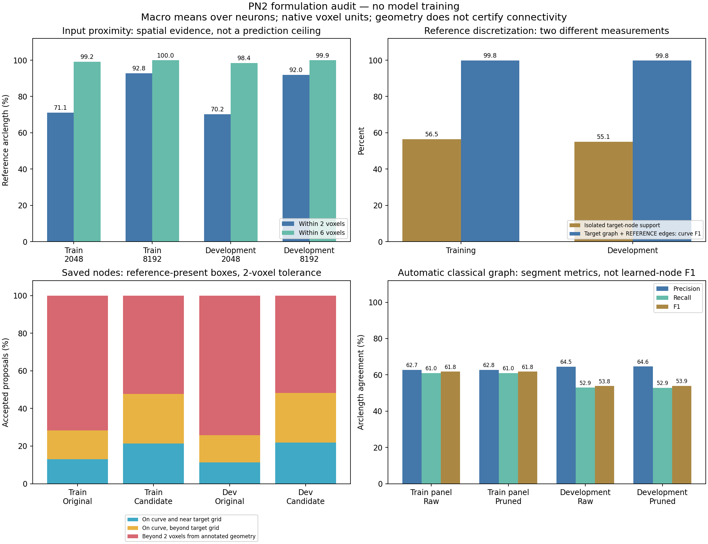

# Curve formulation audit results — 3 November 2026

The completed CPU audit supports testing locally identifiable curve supervision.
It does not establish that dense voting will learn, that PointNeXt preserves all
useful evidence, or that the current learned reconstructions are good. It gives
no reason to restart Phase 1 from zero. Keep its image-only preparation and the
encoder as the working baseline while discussing the proposal task.

There are **two observed problems**: exact interior-node placement is a stricter,
phase-dependent task than curve reconstruction, and many saved predictions are
also genuinely displaced from annotated geometry. Correcting the metric
interpretation cannot explain away those errors.

The [frozen protocol](curve_formulation_audit_protocol.md) and
[portable evidence](evidence/curve_formulation_audit_20261103.json) identify the
data, recipes, source hashes and results. All values below use native voxel
coordinates and macro means over neurons after pooling their scored boxes.
Repeatedly inspected development data remain development data.



## Scope and verification

- All 611 reference-present boxes: 460 from 33 training neurons and 151 from
  seven development neurons. Unknown boxes are not relabeled as background.
- Frozen 2048/8192 clouds and four saved prediction states; no model execution,
  optimizer update, new guide filtering or reference-guided input selection.
- Forty real reference subdivision/phase controls; the same preserved polyline
  geometry gives curve F1 = 1, including at 0.001-voxel tolerance.
- Fixed classical extraction on five training contexts and all seven development
  images, covering 608 image boxes. Full image-derived graphs are extracted
  before references are opened for scoring.
- Thirty-six CPU tests passed. Independent review verified data/source bindings,
  nested-budget support, graph coordinates and coverage. Two real-box comparisons
  against the existing segment scorer had maximum P/R/F1 difference **0.0**.

The full geometry audit took 7.03 minutes; the 12-image classical baseline took
3.01 minutes using already cached guides. These CPU diagnostic costs **exclude**
the original Sato preparation cost. No GPU training was launched.

## Input proximity: useful evidence, not a prediction ceiling

Fraction of annotated curve arclength with a selected input point nearby:

| Partition / input budget | Within 2 voxels | Within 6 voxels | Within 8 voxels |
|---|---:|---:|---:|
| Training / 2048 | 71.10% | 99.19% | 99.78% |
| Training / 8192 | 92.82% | 99.96% | 100.00% |
| Development / 2048 | 70.24% | 98.45% | 99.57% |
| Development / 8192 | 91.98% | 99.93% | 100.00% |

The larger budget materially improves close spatial support. Its worse learned
result at the tested schedule cannot be explained simply as less geometric input
coverage. More points alone did not solve the current task.

For the fixed apparent-thin/dim strata, development support within two voxels
rises from **40.56% to 83.23%**, and within six voxels from **97.48% to 99.85%**.
Training thin/dim support within two voxels rises from **39.87% to 70.17%**.
These profile labels use training-defined image-width/contrast cutoffs, not
certified anatomical caliber. Spatial retention does not prove sufficient
local contrast survives or that the encoder preserves it.

Local failures remain: the weakest development neuron's 2048-point support
within six voxels is **92.80%**. A high macro mean does not make every branch
recoverable. Conversely, low support within two voxels is not a hard ceiling
for a head allowed to predict offsets. Nearness within six voxels makes a local
offset experiment plausible; it does not prove identifiability or learnability.
The encoder's radius/K/downsampling behavior remains a separate question.

## The current target graph can represent the curves

| Reference-only representation | Training | Development |
|---|---:|---:|
| Isolated target nodes: curve length within 2 voxels | 56.47% | 55.11% |
| Same target nodes **with reference edges**: curve F1 at 2 voxels | 99.82% | 99.75% |

The approximately eight-voxel node grid leaves expected gaps when measured as
isolated points. Connecting those nodes with their **known reference edges**
represents the original curves very well. The second row is an oracle encoding
check, **not a learned reconstruction result**. We supplied no reference edges
to saved learned predictions.

This corrects an earlier interpretation: low curve-to-node proximity alone
does not prove missing biological branches. Historical exact-node gates remain
failed; they have not been rewritten. Their relationship to final graph quality
needs this representation distinction. Curve geometry also cannot certify
correct connections at crossings, cycles or nearby branches.

## Saved predictions: metric mismatch and real localization errors

Latest epoch-25 states, accepted at the unchanged cutoff 0.5; reference-present
development boxes only:

| Measurement | Original objective | Consistent-objective candidate |
|---|---:|---:|
| One-to-one exact target-node precision, 2 voxels | 9.01% | 20.31% |
| Accepted positions within 2 voxels of reference geometry | 25.85% | 48.18% |
| Curve arclength within 2 voxels of accepted node centers | 27.20% | 17.94% |
| Curve arclength within 2 voxels of all 512 node centers | 30.67% | 30.09% |

These precision values use a different domain from earlier full-grid node
precision of 4.66% / 15.88%. Unknown-region outputs remain disclosed; they are
not verified false biological structures.

For the candidate, **26.36% of all accepted positions** lie near annotated
curves but beyond two voxels from every target-grid node. Exact node placement
therefore rejects some geometrically sensible positions. However, **51.82%**
of accepted positions are also beyond two voxels from annotated geometry.
Rejection reduces curve-to-node support, but retaining all 512 positions still
gives only about 30% under this spacing-dependent diagnostic. Neither changing
a cutoff nor reinterpreting node phase establishes a good model. This point
support must not be compared directly with edge-based reconstruction F1.

## Fixed automatic classical baseline

Whole-image guide Otsu thresholding, 3D Lee thinning and a 26-neighbor voxel graph;
one pruning pass removes only terminal leaf-to-junction spurs shorter than two
voxels. Raw and pruned outputs are retained. Extraction uses no SWC.

| Partition / graph | Curve precision at 2 | Curve recall at 2 | Curve F1 at 2 |
|---|---:|---:|---:|
| Five training contexts / raw | 62.74% | 61.01% | 61.78% |
| Five training contexts / pruned | 62.78% | 60.99% | 61.78% |
| Seven development images / raw | 64.53% | 52.93% | 53.85% |
| Seven development images / pruned | 64.60% | 52.90% | 53.87% |

At six voxels the pruned development curve F1 is **68.52%**. Pruning has a tiny
effect. Development F1 at two voxels ranges from **5.95% to 86.43%** across
images: the fixed baseline is useful but far from universal. Full-grid reference
agreement is not biological precision where annotation completeness is unknown;
reference-present precision is also reported (65.11% for pruned development).

These are **segment/arclength metrics**, not learned node-match F1. The current
learned states have no predicted edges, so direct ranking is invalid. The
classical graph may have wrong joins and cycles despite good geometry. It is
a diagnostic baseline, not a promoted PN2 replacement, PN1 reproduction, or
qualified rooted SWC reconstruction.

## Original-image review

Gray backgrounds are unchanged affine-normalized raw-image projections; green
lines are reference curves, not predictions. Cyan accepted nodes lie near both
curve and target grid, gold nodes lie near the curve beyond the target grid,
red nodes are beyond two voxels from reference geometry. Rejected nodes are gray.
Outside-box accepted counts are disclosed and included in quantitative scoring.

- [Fruitfly 32 / box 20](learning/curve_formulation_fruitfly32_box20_20261103.png)
- [Frog 22 / box 5](learning/curve_formulation_frog22_box5_20261103.png)
- [Development 94 / box 14](learning/curve_formulation_dev94_box14_20261103.png)

The first two belong to the fixed four-box training diagnostic. Development 94
was inspected post hoc because the classical baseline was weakest there;
box 14 has that neuron's greatest reference curve length. This is a failure
illustration, not a new gate. Faint branches and a prominent soma challenge both
methods. It does not establish misregistration or justify correcting the SWC.

## Decision and unresolved work

The next useful comparison is a **bounded local curve-supervised proposal
experiment**, rather than another full-cohort exact-node fit or Phase 1 rebuild.
Existing caches, coordinate checks and encoder infrastructure remain useful.
The audit does not isolate the encoder from the head or establish a sole cause.

Before implementation, agree an explicit head contract: support supervision in
incompletely traced regions, projection ties at adjacent branches, clipped-boundary
behavior, offset range/weighting and clustering that preserves close branches
and junctions. A narrow support field can give weak positive gradients where
seeds are several voxels from the curve despite high six-voxel proximity.

A dense voting head replacing set proposals changes the Transformer's current
responsibility. Moving it after clustering or omitting it must be discussed as
that architecture departure; it is not silently authorized as the final product
by this audit. No dense head was implemented here. A training-only small-data
ladder should establish curve fidelity before another cohort-scale run, with
fixed comparisons, exposures and stopping rules. Global consolidation, valid
GAT labels, connectivity, radii and final automatic SWC quality remain open.

## Saved artifacts

Generated local outputs under `PN2/tmp`:

```text
curve_formulation_audit_20261103/             report.json and 611-row boxes.jsonl
curve_classical_timing_20261103/              one-image timing
curve_classical_baseline_20261103/            12 reports and raw/pruned graph packets
curve_formulation_review_20261103/            independent bindings/scorer checks
curve_formulation_views_20261103_verified/    fixed original-image views
curve_formulation_diagnostic94_20261103/      declared post-hoc weak-case view
```

Portable evidence retains aggregate results and artifact/figure hashes. Source,
configuration and tests are visible; generated arrays and logs stay ignored.
No historical checkpoint or gate changed.
