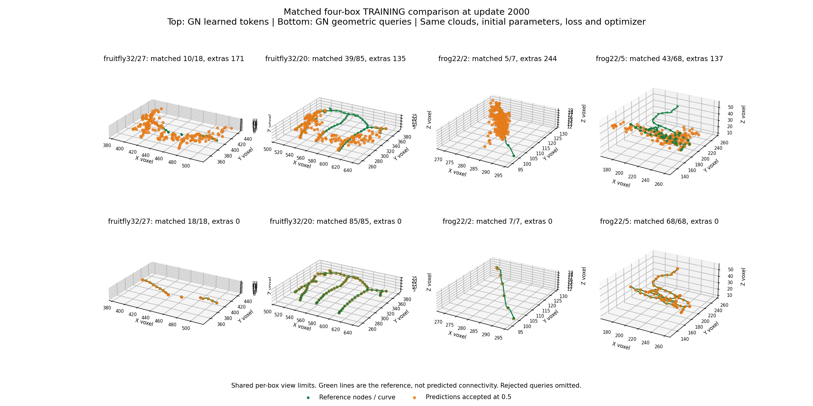

# Geometric queries pass the four-box node-learnability gate

31 October 2026. **The completed geometric-query fit passes the original gate
in all four training boxes: 178/178 reference nodes matched within two voxels,
zero accepted extras, ordinary inference at cutoff 0.5.** Train/eval consistency
also passes. This is a substantial matched training-task improvement over the
saved GN learned-token fit, not a new-image or reconstruction quality result.

The user launched the reviewed command and completed 2000 updates (500 per
box), in 49 minutes observed. The raw report measures 48.54 minutes after the
initial evaluation. No extension, retry, post-hoc threshold change, oracle
proposal selection or learned checkpoint transfer was used.

## Matched comparison

Same four exposed training boxes from two neurons: fruitfly 32/27,32/20 and frog
22/2,22/5. Same frozen Sato 2048-point clouds, targets 18/85/7/68, GN8 PointNeXt,
512 queries, fresh named parameter values/count, three-layer Transformer,
matching/loss, AdamW LR 0.0001, clipping, deterministic FP32 settings, cutoff and
2000-update cap. Both arms use one initialization. The geometric candidate
changes query content initialization and position parameterization together;
this comparison does not isolate their individual effects.

| Training box | Previous GN matched / targets + extras | Geometric matched / targets + extras | Geometric precision / recall at 2 voxels | Mean assigned position error |
|---|---:|---:|---:|---:|
| fruitfly 32/27 | 10/18 +171 | 18/18 +0 | 100% / 100% | 0.290 voxels |
| fruitfly 32/20 | 39/85 +135 | 85/85 +0 | 100% / 100% | 0.381 voxels |
| frog 22/2 | 5/7 +244 | 7/7 +0 | 100% / 100% | 0.238 voxels |
| frog 22/5 | 43/68 +137 | 68/68 +0 | 100% / 100% | 0.182 voxels |

The criterion was >=95% precision AND recall within two voxels in every box.
It is unchanged; the predictions need not equal reference coordinates exactly.
The independently recomputed means above are distances under the saved loss
assignments. These are reference-agreement metrics, not certified correspondence
to every biological process visible in the images.

Top: saved GN learned-token baseline; bottom: geometric queries. Orange shows
every prediction accepted at 0.5. Green nodes/lines are reference geometry used
for evaluation, **not predicted connectivity**. Rejected queries are omitted;
the per-box view limits are shared. This figure is not a GAT or SWC result.

## Confidence and training trajectory

At the terminal checkpoint the minimum assigned-positive score is 0.9876 across
all boxes; the maximum assigned-unused score is 0.0574. The same 0.5 cutoff
therefore separates them with a wide margin on these training inputs. Geometry
and used-slot selection both learned; the pass is not produced by accepting a
large cloud and selecting correct nodes with the reference.

| Update | fruitfly 32/27 matched + extras | fruitfly 32/20 | frog 22/2 | frog 22/5 |
|---|---:|---:|---:|---:|
| 0 | 0 +0 | 0 +0 | 0 +0 | 0 +0 |
| 8 | 0 +0 | 0 +0 | 0 +0 | 0 +0 |
| 500 | 18 +63 | 83 +56 | 7 +27 | 59 +86 |
| 1000 | 18 +0 | 85 +2 | 7 +1 | 68 +5 |
| 2000 | 18 +0 | 85 +0 | 7 +0 | 68 +0 |

At update 1000, all target nodes already have accepted geometric matches but
two frog boxes still fail precision because of extras. The terminal checkpoint
meets both responsibilities. The earlier [CPU evidence](geometric_query_implementation.md)
separates raw starting locations from the actual untrained head; their limited
two-voxel coverage alone could not produce this result. Closer initial positions
were a prior, whereas the final clean node set requires learned movement and
classification.

## Independent saved-evidence verification

Raw fit: `tmp/geometric_query_train_20261031/report.json`.
Read-only audit: `tmp/geometric_query_review_20261031/report.json`.
Portable [evidence](evidence/geometric_query_fit_20261031.json).

`scripts/review_geometric_query_fit.py` runs no model forward or optimizer.
It reads only the already exposed training references and saved predictions,
hash-checks current source/recipe and the original CUDA timing prefix, and
independently recomputes 44 mode/box/checkpoint node-count comparisons (40
geometric plus four terminal baseline comparisons). Sixty saved train/eval
array pairs are bitwise equal. All 2000 update-journal rows are finite.

All five checkpoint completion hashes verify. CPU inspection confirms finite
terminal model state, no BatchNorm running buffers, Adam step 2000, and an exact
match to the evaluated terminal model hash. The reviewed parent/PowerShell
launcher identities and 90-minute external allowance match the run's recorded
launch metadata. The fit reproduced the passed timing's model/Adam/RNG prefix.
No changed source, new loss or new data were introduced by the review.

## Research implication and next decision

This supports the geometric-query formulation as a meaningful solution to the
observed four-box learnability failure. It gives positive evidence that this
PointNeXt/Transformer combination, input representation and node objective can
fit these examples together. It does not prove that query design was the sole
historical problem, that the native encoder reproduces an official benchmark,
or that its learned features are generally adequate.

We should now freeze this candidate as the successful sanity-check reference
and prepare a broader neuron-disjoint training/development protocol. Stop tuning
these four boxes. The next protocol should specify image-derived cloud budgets,
variable target counts and overflow, missing/partial local supervision, ordinary
inference, branch-type node metrics and fixed development decisions before a
new run. Exposed neurons remain training/development material; genuinely
untouched test data must remain reserved.

That broader protocol is a proposal for discussion, not a launched experiment.
No extension, new GPU command, normalization/loss sweep, automatic GAT handoff
or full-pipeline claim follows this report. Radius remains unsupervised in this
task. Connectivity, cross-crop consolidation, final SWC geometry/topology and
robustness on new inputs still require their own evidence. PN1 superiority and
product universality remain unestablished.
