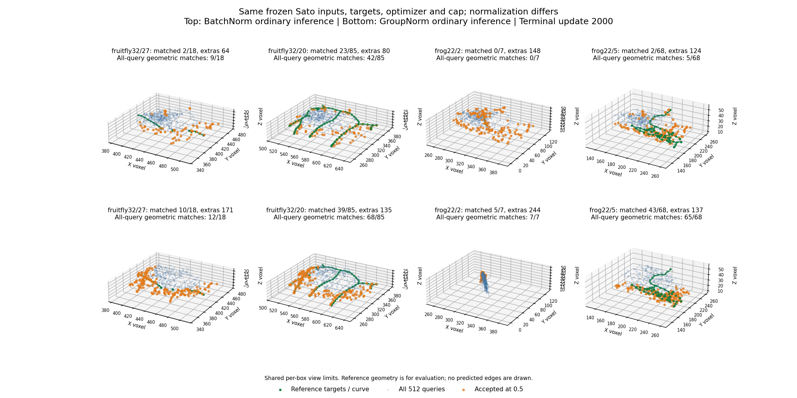

# GN8 fit: consistency corrected, node learnability still fails

31 October 2026. The user completed the unchanged 2000-update normalization-only
fit on the RTX 3070 Ti Laptop GPU. **Execution passes; train/eval consistency
passes; the frozen four-box node-learnability gate fails.** This closes the
declared normalization comparison. It does not schedule another normalizer,
threshold adjustment, LR change, extension or connectivity fit.

## What was compared

The saved Sato/BatchNorm fit and fresh Sato/GroupNorm fit use the same four
training boxes, frozen image-only 2048-point clouds, targets, 512 learned queries,
initial named parameter values, Transformer, matching/loss, AdamW settings and
2000-update cap (500 updates per box). Only the sixteen encoder normalizers
change. Each arm has one initialization; these are learnability observations,
not replicated estimates of generalization. See the [control](groupnorm_node_control.md)
and [passed timing](groupnorm_node_timing_results.md).

Raw fit: `tmp/groupnorm_node_train_20261031/report.json`.
Read-only audit: `tmp/groupnorm_node_review_final_20261031/report.json`.
Portable [evidence summary](evidence/groupnorm_node_fit_20261031.json).
User-reported elapsed time: 31m55s; the report measures 31.35 minutes after the
initial evaluation. This is within the timing estimate plus evaluation overhead.

## Terminal ordinary inference

The cutoff remains 0.5. Matches are maximum-cardinality one-to-one matches
within two voxels. An extra is an accepted prediction unmatched to the specified
reference nodes, not a certified biological false positive.

| Training box | Targets | BN matched + extras | GN matched + extras | GN precision / recall | GN matches using all 512 predictions |
|---|---:|---:|---:|---:|---:|
| fruitfly 32/27 | 18 | 2 + 64 | 10 + 171 | 5.5% / 55.6% | 12/18 |
| fruitfly 32/20 | 85 | 23 + 80 | 39 + 135 | 22.4% / 45.9% | 68/85 |
| frog 22/2 | 7 | 0 + 148 | 5 + 244 | 2.0% / 71.4% | 7/7 |
| frog 22/5 | 68 | 2 + 124 | 43 + 137 | 23.9% / 63.2% | 65/68 |

The gate requires at least 95% precision and 95% recall in **every** box.
None passes. GN improves ordinary-inference geometric availability and recall
in this comparison, while accepting more extras. This is not a clean node set
and is not a reconstruction improvement claim.

Top: saved BN; bottom: fresh GN. Green shows reference geometry, faint blue all
512 predicted centers, orange those accepted at 0.5. Each column shares its view
limits. These are saved predictions, not oracle-selected nodes; no predicted
edges or microscopy image are drawn.

## Separate findings

**Normalization is resolved on the tested inputs.** At updates 0, 8, 500, 1000
and 2000, ordinary eval and train-mode diagnostic predictions have bitwise-equal
centers, logits and scores in all four boxes. The read-only review independently
reproduces all 40 mode/box/checkpoint node-count comparisons and verifies 60
array equalities. Five checkpoint completion hashes verify, terminal state
matches the evaluated state, Adam reaches 2000, parameters are finite, and no
BatchNorm running buffers remain. This supports the normalization contract on
these examples, not universal numerical guarantees.

**Geometry learns partially; selection remains poor.** Terminal mean distances
for the loss's assigned predictions are 1.768, 1.457, 0.488 and 0.948 voxels,
respectively. All 512 predictions can match every target at six voxels in each
box. At two voxels, both fruitfly boxes remain below 95% recall even before
confidence filtering. Therefore no confidence cutoff can make this checkpoint
pass the complete gate. Six-voxel results do not replace the declared criterion.

**Extras are not solely a node-grid counting artifact.** Of the accepted GN
predictions, 25/181, 60/174, 187/249 and 64/180 lie within two voxels of the
continuous clipped reference curve. The small frog box has extensive redundancy
near its curve; the other boxes also contain many predictions away from it.
Continuous-curve proximity is diagnostic, not a new acceptance metric or a
verified account of all visible anatomy.

**Query scores show a concerning pattern, without establishing its cause.**
The two fruitfly boxes' 512 confidence values have Pearson correlation 0.9885,
but their saved assigned-positive query sets overlap in only three slots
(18 and 85 positives). Scores are insufficiently separated for the required
selection. This does not prove that images are ignored, that matching changes
between consecutive updates, or that classifier capacity is insufficient.
Sparse saved checkpoints cannot settle those causal questions.

## What this means for the research direction

The BN discrepancy was a real implementation/design issue. Correcting it was
necessary for trustworthy inference, but it was not the whole node-learning
problem. We should not now move the failure into another normalizer setting or
expect GATv2 to repair an unqualified node interface.

The current Transformer receives image-conditioned memory, but its decoder
queries start as image-independent learned embeddings, with centers predicted
relative to the crop center. A concrete [geometric query proposal](geometric_query_proposal.md)
examines image-derived query locations/features and learned offsets. It retains
PointNeXt, Transformer and the intended downstream GATv2. It is **prospective**:
no changed query model or fit has been implemented or launched.

The result does not rank PN2 against PN1, select Sato over the threshold control
on learned quality, establish held-out performance, or qualify Phase 1 as
universally adequate. The four boxes remain exposed training material. Reserved
data were not opened by this review.
