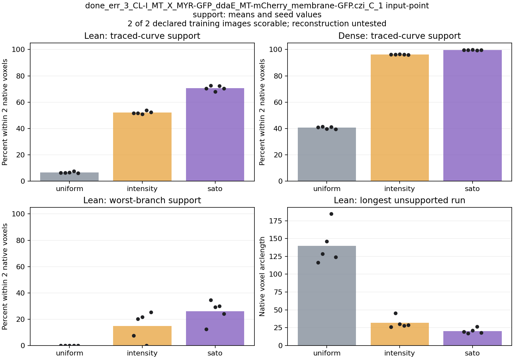
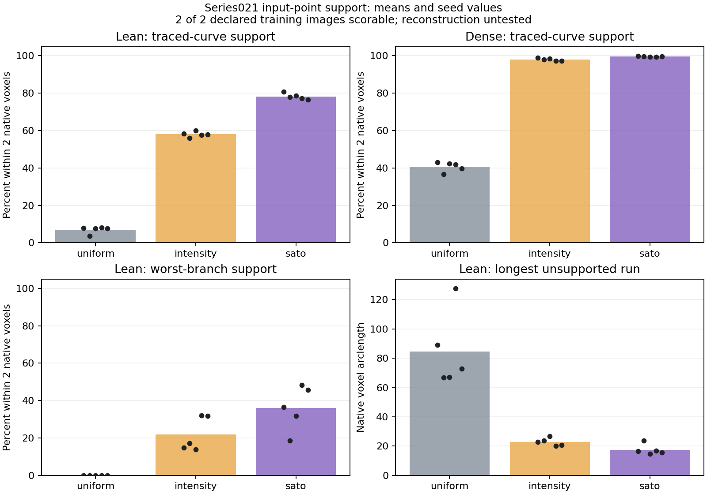

# Frozen-cloud rescore with preserved reference metadata

22 October 2026. **Both declared training images were scored. The fixed
comparative gate passes, supporting broader input qualification.** This is
spatial support by image-derived points, not reconstruction quality, training
learnability, development improvement or generalization. The lean clouds still
leave substantial local gaps.

## What changed, and what did not

The [reference policy](reference_type_policy.md) was declared and committed as
`23cbb6f` before new scores. The user authorized the bounded CPU rescore.
References were read with explicit `opaque_integer` type handling: all tags and
every supplied node/link remain intact. The meaning of the fruitfly code `-73`
remains unknown. Scores measure agreement with the **entire supplied curve**;
they do not certify its anatomy or establish anatomical class labels. Standard
predicted-output validation retains its nonnegative-type default.

The [original recipe and criteria](phase1_sampling_protocol.md) are unchanged:
three controls, two densities, five seeds, the same native coordinate frames,
two-/six-voxel tolerances and numerical refinement. All 60 original point-cloud
files were reused. No filtering, sampling, source correction, manual masking,
alignment, model inference or training was rerun.

The original [strict-reader report](phase1_sampling_results.md) remains an
incomplete result; its saved Boolean was not rewritten. This rescore has its
own directory, metadata, figures and verdict.

## Matched results

Mean arclength support within **two native voxels** across five seeds:

| Image / budget | Whole-image points | Uniform | Intensity weighted | Sato weighted |
|---|---:|---:|---:|---:|
| Fruitfly / lean | 23,011 | 6.53% | 51.98% | **70.68%** |
| Fruitfly / dense | 184,062 | 40.55% | 96.26% | **99.70%** |
| Series021 / lean | 30,720 | 6.95% | 58.02% | **78.19%** |
| Series021 / dense | 245,760 | 40.70% | 97.96% | **99.54%** |

Lean gains over intensity are **18.70 percentage points** for fruitfly and
**20.17 points** for Series021. Each of the five paired gains is positive.
Sato also improves the declared local mean comparisons against both controls.
These are two convenience-selected training contexts, not independent unseen
tests. Native voxel distances do not establish matched physical tolerances
across acquisitions; results stay separate by image.

The remaining local losses matter:

| Sato measure, mean across seeds | Fruitfly lean | Fruitfly dense | Series021 lean | Series021 dense |
|---|---:|---:|---:|---:|
| Worst-branch support within two voxels | 26.05% | 90.34% | 36.11% | 91.63% |
| Longest unsupported run, native voxel arclength | 20.28 | 1.81 | 17.44 | 2.33 |
| Endpoint support within two voxels | 40.00% | 95.56% | 61.82% | 100% |
| Junction support within two voxels | 75.00% | 100% | 95.56% | 100% |

The lean setting is a useful budget stress test, **not a sufficiently qualified
product representation**. Denser sampling preserves much more local support
here. This does not set the final encoder budget: the two densities are
input-cloud budgets, separate from future proposal/query and graph-node counts.
Nor does it prove how a learned model responds to these gaps.

Only 5.64% and 1.60% of lean Sato points lie within two voxels of the fruitfly
and Series021 traces respectively. This shows limited concentration around the
provided curves under this allocation; it is not biological foreground
precision. Neurites have thickness and visible untraced structures can be real.
No unmatched point becomes a true-background label in this experiment.

## Gate, integrity and execution

**48/48** predefined per-image/control comparisons pass. Numerical refinement
changes primary support by at most **0.31 percentage points**, below the fixed
one-point margin. No reference quadrature samples are outside the declared
image extent. The overlays show the supplied curves following visible processes
in XY/XZ projections; this is a gross frame check, not a certificate of precise
calibration, biological completeness or correct wiring.

Integrity checks confirm:

- All **60 frozen cloud file hashes** are unchanged.
- Both reference byte hashes, the original recipe and original saved reports
  are unchanged. No nodes or type values were edited or discarded.
- All **30 previously scored Series021 outputs replay exactly**, including
  every recorded geometry metric and numerical-refinement difference.
- **149 synthetic tests pass**, including signed metadata preservation,
  unchanged strict defaults, continued rejection of malformed geometry, and
  equality of scores when only reference type metadata changes.

Rescoring took **1001.59 seconds (16 minutes 42 seconds)** on CPU. Original
guide-generation time and memory are recorded in the first report; no guide
was regenerated and no GPU was used here.

The machine verdict is `promising_for_replication`, conditional on the stated
reference interpretation. It authorizes no automatic model training. Its scope
is deliberately narrower than “Phase 1 solved” or “PN2 improves reconstruction.”

## Research direction

Keep Sato-guided selection as a candidate worth qualifying, with the intensity
control retained. The evidence supports examining this simple image-derived
guide before adding another learned image model or sampler. It does not justify
promoting it as a universal preparation policy or perfecting two examples through
parameter tuning.

The next proposed step is a prospectively declared, more varied training-input
qualification with the same controls, including local retention and resource
cost. Agree its case identities and scope before running it. Physical calibration,
annotation quality, allocation outside the traced arbor, large-volume scaling
and information loss inside the future encoder remain open. No new sampling
settings, additional images or training runs are launched by this report.

## Evidence and reproduction

[Full result summary and hashes](phase1/geometry_rescore_20261022_summary.json),
[reference structure/metadata audit](phase1/reference_type_audit_20261022.json),
[reference policy and source citations](reference_type_policy.md), and
[commands](../scripts/README.md).

Raw scores and new overlays are under ignored
`tmp/phase1_sampling_20261022/evaluation_opaque_integer/`; the original strict
`evaluation/` and original overlay remain preserved. The timestamped console
log is under `tmp/phase1_console/`. Use `evaluate-geometry` only with a fresh
output directory; this completed run should not be overwritten.
