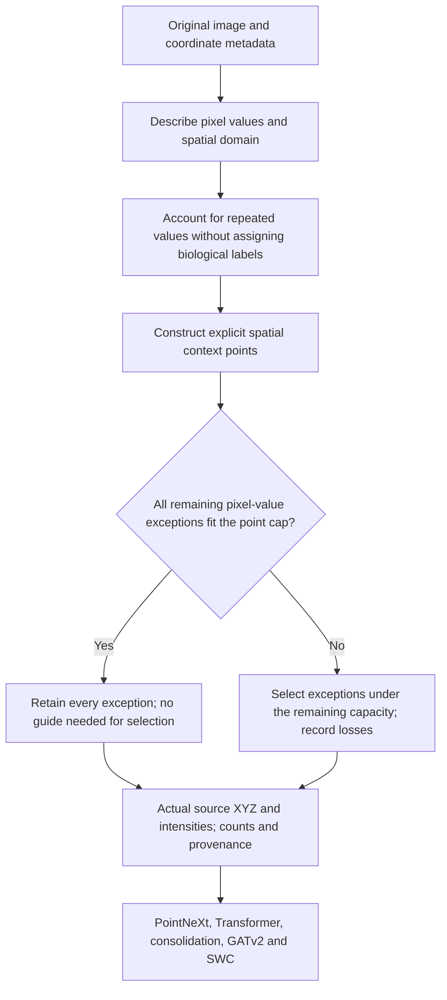

# Phase 1 input-retention revision

23 October 2026. **Discussion draft; no new sampler, encoder adapter or training
is implemented by this document.** It follows the completed
[qualification](phase1_qualification_results.md). The failed historical checks
remain unchanged. The proposed change is to Phase 1 selection and point-count
behavior; PointNeXt, Transformer proposals and GATv2 retain their intended roles.

Follow-up: the [six-source accounting check](input_retention_accounting_results.md)
is complete. Only 13/135 nonconstant boxes fit the dense exception-count bound,
before context. The retain-all branch is a conditional opportunity, not a
general replacement for finite-cloud selection. No new source cache, cloud
policy or encoder adapter has been promoted.

## Decision to review

Replace an unconditional volume-proportional point quota with a maximum encoder
input budget and explicit accounting of what the image contains. Preserve
available intensity detail when it fits, supply spatial context, and identify
where compression remains necessary. Keep a structural guide as a candidate
preference in the compression case, rather than requiring it everywhere.

The intended path is:

Everything from repeated-value accounting through the new cloud policy above
is proposed. The diagram is not an execution record or a replacement for the
[current execution record and results](phase1_qualification_results.md).

## Two different representations

**Source representation:** the original image remains authoritative. For a
fixed image-defined box, choose its most frequent pixel value `v0`, breaking
ties by the smaller value. Store its domain, origin and `v0`, plus the locations
and original values of every pixel differing from `v0`. This can reconstruct
that box exactly. Exceptions may be brighter or darker and may include noise.
Neither `v0` nor an exception is a foreground/background label.

This describes an exact encoding, not a proposed segmentation. If a sparse
encoding would use more bytes than the decoded dense array, keep the dense
representation instead. There is no fitted sparsity cutoff. No new cache
format needs to be built merely to perform the initial accounting; the source
images are already retained. Any later byte comparison must use decoded dense
arrays as its comparator, not confuse them with already compressed PBD files.

**Model representation:** PointNeXt receives a finite set of explicit points.
Keeping the full source image or an exact source packet does not make this
finite view lossless. A cloud of exceptions alone also does not automatically
provide sufficient spatial context. Its geometry and intensity features must
be assessed in the form the encoder actually consumes.

## Candidate model-input policy

Use one image-only rule across sources; never use an SWC, neuron ID or measured
reconstruction score to switch methods or choose counts.

1. Start with deterministic image-defined boxes. The existing 128-cube boxes
   can remain the first accounting unit; they are not automatically the final
   overlapping inference crops or a physical resolution specification.
2. Establish a maximum actual source-point count `B` per encoder input. This
   is a capacity limit, not a requirement to fill every box with `B` points.
3. Supply a deterministic spatial context lattice of source voxel locations,
   including their real intensities. Deduplicate it against detail points.
   Its spacing must be chosen with the encoder's coordinate frame and local
   receptive fields, rather than inferred from a percentage of random draws.
4. Retain all remaining pixel-value exceptions if they fit the capacity left
   after context. In this case point selection needs no Sato calculation.
5. If they do not fit, make the loss explicit. Intensity and Sato preferences
   are the two named candidates to compare on the same exception domain and
   remaining point count. Neither is promoted by this draft. A low guide
   response must retain nonzero selection opportunity; it is not a negative
   label. No per-image winner is selected from reference results.
6. Export actual source coordinates/intensities, counts, box transforms,
   normalization, default-value metadata, context/detail membership, selection
   policy and any capacity failure. Input counts, query slots and graph nodes
   remain separate budgets.

Restricting detail draws to exceptions changes the old sampling domain. The
default-valued field remains represented by source metadata and explicit
context. Whether the encoder can use that context adequately is an untested
hypothesis, not a proof that removing default-valued points is harmless.

A constant box remains a declared observation with context and provenance.
It is not silently discarded or assigned a verified no-neuron label. Short
clouds require an explicit encoder policy; fabricated duplicate points must
not masquerade as observations. Empty/corrupt/unsupported inputs and genuine
capacity failures must remain visible.

Use declared physical coordinates only when calibration is available; otherwise
state voxel units. Context spacing is an image/encoder specification and must
not be selected by fitting an SWC.

## Encoder agreement required before implementation

The numbers `B`, context spacing, coordinate normalization, stage sampling and
neighborhood schedule are not frozen here. They must form one coherent input
configuration. The old 2,048-point cap and the probe's 32,768 points per full
dense box are neither automatically adopted nor treated as proven GPU limits.
Context cannot silently consume the entire cap; too little remaining capacity
is a reported design failure, not permission to drop context or difficult boxes.

Prefer the existing XYZ/intensity feature meaning for the first adapter.
Adding local image patches, cell-size features or another image network would
be a separate feature/architecture change to explain and assess. Source
default-value metadata does not automatically become a learned input channel.

The [official PointNeXt FAQ](https://guochengqian.github.io/PointNeXt/faq/)
requires input features/configuration to agree with preprocessing and cautions
that neighborhood radii from its supplied tasks need not transfer to a custom
detector. Its practical benchmark path also uses custom CUDA operators. These
facts motivate checking the chosen Windows operator implementation and actual
input shapes before claiming a usable capacity; they do not certify the old
native prototype or justify silently replacing it. No package installation,
operator replacement or GPU profiling is performed by this draft.

## Smallest next check and its stopping point

First prepare a CPU-only accounting check on the **six already inspected
training images** (aliases 32, 46, 22, 75, 85 and 126). Read no additional
images or SWCs. Reuse the existing boxes and both recorded probe budgets as
comparators, not product defaults. Do not filter, sample new clouds or rescore
the references in this first check.

The stable identities in the [original two-case manifest](../configs/phase1_raw_review.json)
and [four-case manifest](../configs/phase1_qualification_cases.json) define the
cohort; aliases are only readable labels.

Report per box: voxel count, `v0`, exact exception count, dense/sparse byte
cost, and whether exceptions alone fit each old quota. Such a fit is a lower
bound on required capacity: context and encoder features are not included.
Keep all boxes, including constant boxes and over-capacity boxes. Verify exact
round trips on synthetic constant, bright/dark-detail and noisy examples before
using any new encoding with real data. No image values or labels may change.

Success means exact accounting and evidence about where this policy could
avoid needless selection. It does not mean better clouds or reconstruction.
If savings occur only in sparse sources, retain that bounded conclusion; do
not force a new sparse cache onto noisy inputs. Stop at one report and the
encoder/context decision. No parameter sweep, full guide rerun or training
follows automatically.

After that review, choose one point cap/context configuration and an explicit
PointNeXt implementation. Prepare a visible bounded device check for the user
to launch. Only then implement and compare the proposed clouds with the frozen
controls under a prospective protocol. Since actual counts may shrink, call
that a maximum-budget comparison, not falsely a count-matched guide ablation.
Use contrast retention and spatial metrics together; neither identifies true
foreground by itself. Preserve the existing source guides when applicable
rather than recomputing them merely for this change.

## Destination and separate supervision issue

This is one input-interface decision on the way to the full automatic
image-to-SWC candidate. A smaller source packet is engineering evidence; a
better cloud is representation evidence; learnability and reconstruction remain
separate tests. Do not spend another series of fits perfecting a local proxy.

The [three graph-encoding ambiguities](training_reference_contract_audit.md)
need clarification before affected relations are used as positive or negative
connectivity labels. They do not block image-only accounting and do not justify
automatic node welding, source exclusions or relabeling unknown regions.
