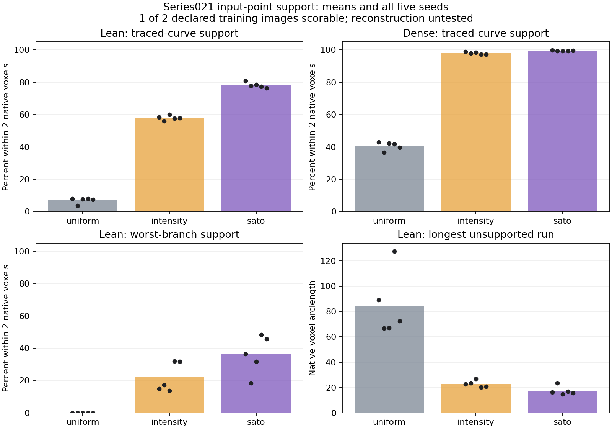

# First raw-image sampling probe

22 October 2026. **Cloud generation succeeded for both original images; the
two-image retention comparison is incomplete.** One training image was scored.
On it, Sato weighting improved spatial support over intensity weighting at
matched counts, including the declared local comparisons. The other reference
contains negative type codes rejected by the current reader. No reconstruction,
learnability, development improvement or generalization was tested.

The [protocol](phase1_sampling_protocol.md), parameters and implementation were
committed and pushed as `1a6a8a3` before real cloud generation or reference
scoring. No scales, weights, budgets, seeds, tolerances or decision margins
changed after outcomes. The [machine-readable summary](phase1/sampling_20261022_summary.json)
preserves the recipe, artifact hashes, reference limitation and complete
five-seed summaries.

## Execution and source evidence

Input was the original scalar image files, not old clouds, masks, checkpoints
or trace-derived crops. Generation computed the full-image guide, then selected
distinct original voxels from disjoint image-defined tiles. SWCs were read only
after all clouds were saved. Point packets include unchanged native XYZ,
source indices and original intensity values. No model was imported or trained.

| Original training image | Storage / native XYZ | Tiles | Lean points / image | Dense points / image |
|---|---|---:|---:|---:|
| Fruitfly larva, historical alias 32 | uint8 / 1017 x 429 x 27 | 32 | 23,011 | 184,062 |
| Cultured cell Series021, alias 46 | uint16 / 512 x 512 x 60 | 16 | 30,720 | 245,760 |

Each count applies independently to all three controls and five seeds: **60
saved clouds**. A separate reference-free packet audit checked all 7,253,295
point records across those clouds, including the unscorable-reference case:
hashes, actual distinct counts, source bounds, XYZ/index recovery and intensity
values/dtypes all passed. Duplicates across different draws are expected;
duplicates within a cloud are absent. No source image or reference was changed.

The complete synthetic suite passed **138 tests** before measurement. Analytic
fixtures caught a rounded boundary in the existing segment-distance candidate
search; it was fixed before scoring, without changing exact projection distances
or score tolerances. Float32 guide-affinity checks use a documented numerical
bound near clipped zero eigenvalues. These are execution checks, not biological
results. After measurement, reporting was clarified and the CLI regression was
extended to retain unscorable cases explicitly; saved scores were not rerun or
rewritten.

## What could be scored

Series021 has 509 reference nodes, one component, 11 degree-one endpoints and
nine degree-at-least-three junctions; traced length is 789.71 native voxels.
The overlay shows the trace following the visible process in XY/XZ projections,
with no gross axis/registration discrepancy apparent. This visual check does
not certify subvoxel origin conventions, physical calibration, annotation
completeness or connectivity. No reference quadrature samples lie outside the
image extent. Coordinates remain native voxels; acquisition spacing is unknown.

Means below are across the same five seeds. Support is arclength within two
native voxels of a selected source point; it is not reconstruction recall.

| Budget | Uniform | Intensity weighted | Sato weighted |
|---|---:|---:|---:|
| Lean: 30,720 whole-image points; 1,920 per tile | 6.95% | 58.02% | **78.19%** |
| Dense: 245,760 whole-image points; 15,360 per tile | 40.70% | 97.96% | **99.54%** |

At the lean budget, Sato adds **20.17 percentage points** over intensity
weighting. All five paired gains are positive; seed ranges are 56.02-59.96%
for intensity and 76.38-80.85% for Sato. These draws measure sampling variability
on one neuron, not population uncertainty or generalization.

Local measurements also improved, rather than the average hiding a measured
regression:

| Mean lean-budget measure at two voxels | Uniform | Intensity weighted | Sato weighted |
|---|---:|---:|---:|
| Worst branch support | 0.00% | 21.91% | 36.11% |
| Branch 10th-percentile support | 0.00% | 39.52% | 57.72% |
| Longest unsupported run, native voxels | 84.67 | 22.80 | 17.44 |
| Endpoint support | 9.09% | 47.27% | 61.82% |
| Junction support | 4.44% | 91.11% | 95.56% |

**The lean representation still has substantial local losses.** Sato's mean
worst-branch support is only 36.11%, with a worst-draw value of 18.51%; mean
maximum gap remains 17.44 voxels. The denser Sato arm reaches mean worst-branch
support 91.63%, mean maximum gap 2.33 voxels, and 100% endpoint/junction support.
This exposes a retention/budget tradeoff; it does not choose the final encoder
budget or prove that a downstream model reconstructs missing intervals.

At six voxels, lean support is 83.04%, 99.48% and 99.77% respectively; dense
support is 100% for all three. Thus broad proximity can look excellent while
fine support and local gaps remain weak. Two-voxel support stays primary.
Halving quadrature step from 0.5 to 0.25 changes primary support by at most
**0.31 percentage points**, within the predefined one-point numerical margin.

Only 1.60% of lean Sato points, versus 0.80% for intensity and 0.065% for uniform,
lie within two voxels of the trace. This flags limited point efficiency under
fixed per-tile allocation. It does not establish a biological false-positive
rate: the reference is a narrow curve, neurites have thickness, and other
visible structures may be untraced. These points are not automatically true
background. This probe does not isolate guide selectivity from allocation to
tiles without the traced neuron.

## Why the second case is unscorable here

The fruitfly reference was generated by Vaa3D's `sort_neuron_swc` plugin. Line
126 contains node 123 with type `-73`; 46 rows have that code. Other types include
3, 18, 21, 24, 25, 28, 76, 77 and 82. The header gives no meaning for these tags.
The current strict parser requires nonnegative type values, so it stops before
reference geometry scoring. This is a source-format compatibility finding,
not evidence that the traced geometry is wrong.

The [SWC format paper](https://pmc.ncbi.nlm.nih.gov/articles/PMC10654402/) describes
standard domain types and custom values above seven; it does not establish the
meaning of this file's negative code. Do not silently turn it into type zero,
discard those nodes, choose a replacement SWC or relax the rule based on sampled
coverage. Source hashes and type counts are preserved in the summary.

The case remains declared and explicitly unscorable. The original console's
`case=1` was a **scorable-case ordinal**, referring to Series021, not the first
declared image. Subsequent code prints stable case IDs and unscorable-reference
reasons immediately, and distinguishes an incomplete run from unmet numerical
criteria. The original console and report remain unchanged.

## Resources and decision

Whole-image CPU guide calculation took 232.58 seconds for fruitfly and 333.81
seconds for Series021: **9 minutes 26 seconds total**. Complete decoding,
filtering, selection, hashing and compressed output took 11 minutes 12 seconds.
Generation peaked at **2.65 GiB process working set**, not GPU memory. The
separate offline reference evaluation took 9 minutes 59 seconds, largely exact
point-to-segment agreement for millions of saved points. Evaluation time is not
product inference time. These numbers describe this unoptimized implementation
on this machine, not a hardware comparison.

All 24 declared control comparisons on the **one scored image** passed, as did
numerical refinement. The overall two-image advancement verdict is **incomplete**
because one reference is unscorable. The recorded Boolean remains false; no
new denominator or threshold turns that into a pass.

Sato has earned continued consideration on Series021. Phase 1 has not been
qualified, and the lean cloud is not uniformly well supported. No PointNeXt,
Transformer or GATv2 training follows automatically.

The next bounded decision is the reference annotation convention: determine
whether a general, semantics-preserving reference adapter is justified. If so,
declare that policy separately and rescore the **already frozen fruitfly
clouds**, preserving this strict-reader report. Otherwise retain its limitation
and prospectively specify additional training contexts. Neither path requires
rerunning filters, changing sampling parameters or starting training. Future
comparisons should preflight reference format separately after fixing case IDs;
reference validation need not feed labels into image-only generation.

## Reproduction and saved evidence

[Commands and isolated runtime](../scripts/README.md),
[fixed recipe](../configs/phase1_sampling_probe.json),
[complete dependency lock](../configs/phase1_cpu_lock.txt), and
[visible result summary](phase1/sampling_20261022_summary.json).

Local generated evidence is under ignored
`tmp/phase1_sampling_20261022/`: `clouds.json`, `packet_verification.json`,
`evaluation/report.json`, per-case guide arrays/point packets and the
Series021 `case_01/reference_cloud_overlay.png`. Timestamped console logs are
under `tmp/phase1_console/`. Generation and original evaluation used source
commit `1a6a8a3`; reporting-only fixes afterward do not change those artifacts.
