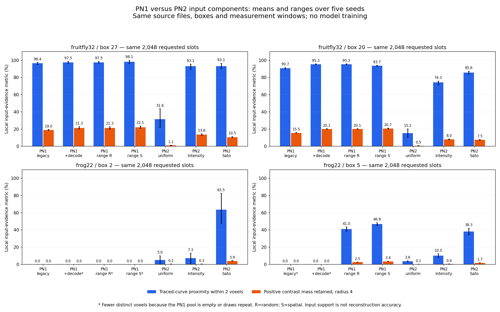

# PN1 versus PN2: what the voxel-input comparison establishes

29 October 2026. **Complete; mixed result.** PN2 Sato retains traced-region evidence
that the PN1-style hard gate can exclude, including after decoder/range controls.
The current PN2 selectors do not uniformly outperform thresholded sampling at a
matched point budget. Phase 1 is not established as a general improvement over PN1.

## Scope and fairness

This executes the user-requested [fixed plan](pn1_input_comparison_plan.md) and
[configuration](../configs/pn1_input_comparison.json): identical original source
bytes, four common boxes from two already-inspected training neurons, 304 fixed
measurement windows, seven preparation arms, two requested budgets and five
seeds. All **280 records** completed, including explicit empty candidate pools.
No GPU, model weights, learned inference, training or PN1 source repair was used.

The comparator is the current local PN1 reimplementation on `main`, not a claim
about the original published algorithm. Its actual sampling/threshold functions
are compiled unchanged from hash-pinned source; its decoder is called read-only.
The seven arms separate legacy decoding, decoder correction alone, a labeled
source-range control with random/spatial sampling, and PN2 uniform/intensity/Sato.
The range control uses round(0.2 * verified whole-image observed maximum), fixed
before scoring; it is not silently substituted into PN1's historical result.

We hold the boxes fixed instead of running PN1's native overlapping 193-wide crop
schedule. This isolates point preparation on the same voxels. Minimum-foreground
eligibility is recorded, but the full scheduler is not simulated. PN1 also uses
image information later in its graph initializer; that is not evaluated here.
The current-code default of 2048 points is used prospectively; historical proposal
archives do not serialize per-patch point count. RNG is paired by independent
box/seed/budget initialization, not a replay of historical global patch RNG state.

## Decoder fidelity is a separate engineering improvement

| Source | Voxels whose value differs from the verified reader | Mean absolute raw-intensity error | PN1 / verified range |
|---|---:|---:|---|
| Fruitfly 32 | 13.92% | 2.05 | 0..255 / 0..255 |
| Frog 22 | 88.92% | 116.86 | 0..65535 / 5..4095 |

These quantify the PBD8 bit-order and PBD16 difference issues already documented
in the [reset audit](research_reset_evidence.md). They are literal value differences,
not percentages of morphology destroyed. The verified decoder passes the existing
format fixtures; this comparison also tests source-defined examples where the
legacy reader differs. Fixing decoding is not evidence of a Sato or PointNeXt gain.

PN1's storage-range 20% proposal threshold is 51 for uint8 and 13107 for uint16.
A saved guarded30 archive for this exact frog identity records threshold 13107
and random point sampling. Correcting decoding without changing this gate leaves
no eligible frog voxels. Therefore the stronger comparison includes correctly
decoded source-range controls: threshold 51 for fruitfly and 819 for frog.

## Matched primary budget: 2048 requested slots

Below: mean traced-curve arclength within **two native voxels** of a retained source
point, over five seeds. This is an input-support proxy, not node recall or final
reconstruction accuracy. Scores use the same references, coordinate frame and
0.5-voxel quadrature; gaps split when a curve leaves/reenters a box.

| Source / box | PN1 legacy | PN1 range random | PN1 range spatial | PN2 intensity | PN2 Sato |
|---|---:|---:|---:|---:|---:|
| Fruitfly / 27 | 96.42% | 97.50% | 98.12% | 93.12% | 93.12% |
| Fruitfly / 20 | 90.69% | 95.28% | 93.65% | 74.28% | 85.61% |
| Frog / 2 | 0.00% | 0.00% | 0.00% | 7.35% | 63.50% |
| Frog / 5 | 0.00% | 41.03% | 46.95% | 10.01% | 38.29% |

The source-range arms are explicit PN1-style controls, not additional PN2 methods.
All seven arms, including PN1 decode-only and PN2 uniform, appear in the figure
and saved evidence. Where PN1's pool is too small, its requested slot count is
filled by native replacement sampling; distinct counts are disclosed below.

**Counterexamples matter:** both thresholded PN1 controls beat current PN2 Sato
in the fruitfly boxes at 2048 slots. The calibrated spatial control also beats
Sato in frog box 5 on this coverage metric, although Sato has a shorter longest
gap (29.08 versus 45.75 voxels). This is a multi-criterion tradeoff, not a uniform win.

Local positive contrast mass at R=4 gives a complementary result:

| Source / box | PN1 legacy | PN1 range random | PN1 range spatial | PN2 intensity | PN2 Sato |
|---|---:|---:|---:|---:|---:|
| Fruitfly / 27 | 19.01% | 21.32% | 22.12% | 13.58% | 10.49% |
| Fruitfly / 20 | 15.53% | 20.14% | 20.65% | 7.98% | 7.50% |
| Frog / 2 | 0.00% | 0.00% | 0.00% | 0.32% | 3.92% |
| Frog / 5 | 0.00% | 2.52% | 3.40% | 0.35% | 1.69% |

These are arc-weighted local fractions of sum(max(I-background,0)), not unique
whole-neuron intensity mass. Positive noise and other structures can contribute.
The metric favors bright evidence and is not the sole reconstruction objective.
All selected locations are scored against the verified image, including locations
chosen from the legacy decode. Attribute fidelity is recorded separately so its
incorrect stored intensities are not silently treated as correct observations.

## Dense matched slot budget: structural benefit beyond reader repairs

Each arm is also tested at the same requested count as the existing dense PN2
box. This raises the PN1 budget too, separating selection from a larger PN2 cap.

| Source / box | Requested slots | PN1 range random: curve support @2 | PN1 range spatial | PN2 Sato |
|---|---:|---:|---:|---:|
| Fruitfly / 27 | 2,430 | 98.48% | 97.27% | 95.90% |
| Fruitfly / 20 | 6,912 | 98.64% | 98.72% | 99.48% |
| Frog / 2 | 20,736 | 0.00% | 0.00% | 100.00% |
| Frog / 5 | 20,736 | 60.23% | 60.07% | 95.42% |

The full source-range PN1 candidate pool, **before any sampling**, supports only
62.32% of the curve in frog box 5 at two voxels and leaves a 42.11-voxel unsupported
interval. Dense Sato selection supports 95.42% and leaves a 4.40-voxel mean longest
gap. Thus this particular advantage does not depend solely on decoder repair,
random versus spatial sampling, or the replacement artifact below: the global
hard gate already removes reference-near evidence. In frog box 2, all 195
source-range candidates are away from the traced measurement region; Sato keeps
nearby evidence the gate excludes. Uniform and intensity PN2 controls are much
weaker there, showing that avoiding the gate alone does not explain all of the
structural guide's measured benefit.

This is a bound on the proximity of retained source points to the supplied curve,
not a mathematical bound on learned skeleton inference. A model can infer centers
from surrounding evidence, and no learned reconstruction is assessed here.

## Duplicate counts, limits and verification

Fruitfly PN1 arms have enough candidates for all requested slots to be distinct.
Frog box 2 has 2322 legacy candidates, zero decoder-only candidates, and 195
source-range candidates. Frog box 5 has 128 legacy candidates, zero decoder-only
candidates and 20580 source-range candidates. Shortage is not concealed.

At 20736 requested slots in frog box 5, the native PN1 random helper draws with
replacement because 20580 is slightly smaller than the request. It retains only
13048.6 distinct voxels on average (13125.8 with the spatial helper). Duplicates
are counted once in all information measures. This policy artifact is not
repaired, and no Sato architectural advantage is inferred merely from it. The
full-candidate result above provides the stronger hard-gate comparison.

Five comparison-specific tests and thirteen prior measurement tests pass.
All 280 saved clouds were checked for actual/distinct/duplicate counts; PN2
attributes equal verified source attributes. Dense PN2 contrast fractions replay
the preceding audit **exactly**. Verified decoded hashes match frozen source
manifests, PN1 source hashes match the configured baseline, and sampled PN1 curve
support never exceeds its full candidate pool's support. Core scoring took 60.8
seconds on CPU, excluding setup/plotting and previous guide generation. Matched
point budgets do not imply matched preprocessing time.

Only two exposed training neurons/four boxes are compared. Physical calibration
and completeness of annotations remain uncertain. The six apparent-thin/dim
windows are too few for a broad thin/dim claim. No new test/development images,
reference repairs, manual masks or neuron-specific threshold tuning were used.

Raw records and point packets: `tmp/pn1_input_comparison_20261029/`.
The visible [evidence summary](evidence/pn1_input_comparison_20261029.json) contains
raw hashes, baseline source pins, decoder results, all-arm/all-radius means,
unique counts, gap metrics and paired-seed differences. Original PN1 files,
checkpoints and historical metrics remain unchanged.

## Decision

The answer to "more information than PN1?" is **yes in specific weak-signal
regions, but not consistently at a matched budget**. Correct decoding is a
confirmed foundational improvement over this local PN1 implementation. Soft
structural sampling preserves some evidence a hard global gate discards, while
thresholded sampling is more efficient on the tested bright fruitfly regions.

Do not finalize Sato as a universal Phase 1 default or describe this as a PN2
reconstruction improvement. Retain a correctly decoded, range-aware thresholded
control in the next learned comparison. Any new automatic combination/adaptation
needs an explicit design and prospective test; choosing the winning method by
neuron identity or reference scores is not a deployable policy. No such policy,
loss, model change or training run was introduced by this comparison.
