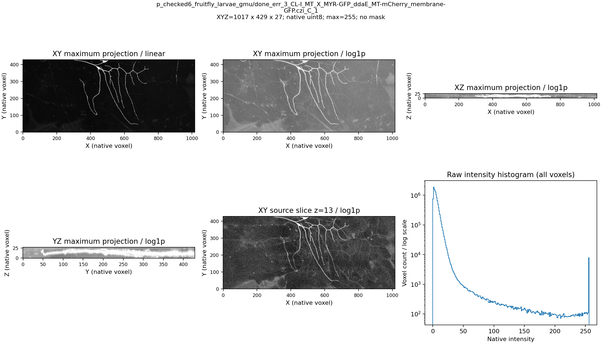
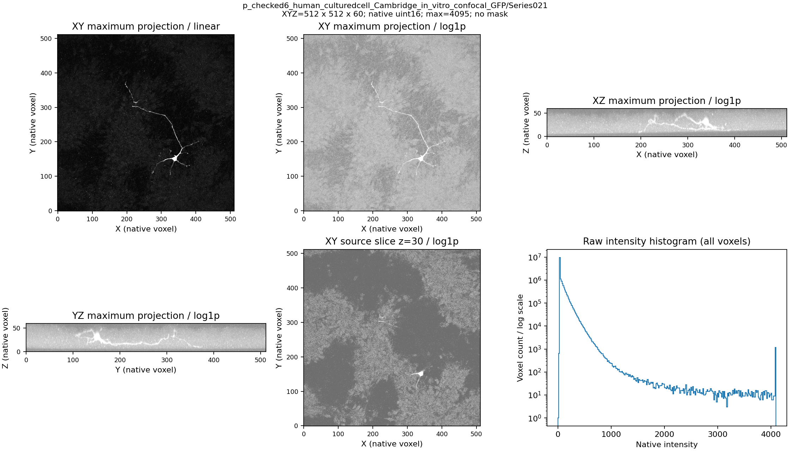

# PN2 Phase 1: start at the original image

22 October 2026. **Design proposal for discussion, not an implemented or
validated sampling policy.** The user subsequently agreed to the bounded
three-control CPU probe in [the fixed protocol](phase1_sampling_protocol.md).
That is permission to test the candidate, not product promotion.
PN1 contributes conceptual lessons only. Rebuilding
a PN1 reference and repairing DGCNN singleton handling are outside this plan.

## Product path and Phase 1 responsibility

```text
Original scalar 3D microscopy file + available acquisition metadata
    -> verified decoding and explicit native/metric coordinate transforms
    -> automatic image-derived structural guide
    -> finite-budget cloud of actual source voxel locations and intensities
    -> PointNeXt -> Transformer proposals -> consolidation -> GATv2 -> graph/SWC
```

Phase 1 must supply informative spatial evidence, including weak/thin processes,
with recorded information loss and resource cost. It does not supply the final
neuronal skeleton or certified foreground labels. Manual masks and correction
are not part of the main automatic path. Reference SWCs are absent from the
inference API; they can evaluate saved clouds afterward.

## What the original proposal assumes, and the departure to discuss

Pages 1-2 of the original [proposal](C:/Users/Seywe/Desktop/Research/R-Arij/Proposal.pdf)
start with a segmented image, extract a classical medial skeleton, permit manual
verification, and use skeleton distances plus a differentiable sampler with a
guide-based geometric loss. The missing premise is a reliable automatic mask
and guide. Neither the PDF nor the current raw inspection establishes it.

My proposed first candidate is **soft structural guidance before committing to
a binary segmentation or trusted skeleton**. A multiscale 3D tube response can
provide an image-derived sampling preference without requiring manual masks or
calling that response anatomy. The first named method to assess is Sato tubeness:
the [official documentation](https://scikit-image.org/docs/stable/api/skimage.filters.html#skimage.filters.sato)
defines a multiscale Hessian-based 2D/3D filter with bright/dark ridge polarity
and an image-valued output. That supports its role as a guide, not a claim of
neuronal segmentation accuracy.

This is a proposed change from explicit TEASAR/Kimimaro skeleton distances to a
soft voxel guide. It preserves structure-informed point preparation and leaves
the PointNeXt/Transformer/GATv2 architecture intact. It also proposes a fixed
first sampling control before optimizing a Gumbel sampler. No guide-Chamfer
loss is added: fitting a fallible guide to itself would not demonstrate better
anatomy. These departures are for review before implementation, not defaults
silently installed by this document.

## Proposed construction

1. **Keep the original data.** Retain native XYZ/intensities, source hashes,
   axis/spacing declarations and any feature-coordinate transforms. Do not
   equate uint16 storage with a 0-65535 acquisition range.
2. **Calculate an automatic soft guide.** Probe bright tubular image structure
   at declared scales. Keep the guide separate from raw intensity and from the
   reference. A low response is uncertain evidence, not a background label.
   Specify bright-structure polarity explicitly rather than inheriting the
   library's dark-ridge default.
3. **Keep source locations eligible before selection.** For the first bounded
   test, the domain is the native voxel grid of an image-defined tile. Do not
   impose the PN1 20%-of-maximum gate. A full-grid candidate ceiling is trivial;
   it is not itself a retention success. Finite-budget selected-cloud quality
   and cost are the relevant measurements.
4. **Select distinct source voxels under an explicit budget.** Compare guided
   weights with a uniform control on the same domain and actual point count.
   Preserve a declared context contribution rather than giving zero weight to
   every weak guide location. A nonzero probability does not guarantee that a
   thin branch survives. Do not invent a 50/50 quota or adopt 512/2048 points
   merely because an earlier experiment used them.
5. **Export a source-grounded packet.** XYZ, original intensity, source indices,
   actual unique count, tile origin, normalization parameters and guide/sampling
   provenance. Keep guide values as diagnostics initially; a new encoder input
   channel would be a separate architecture decision. Empty/short inputs receive
   explicit outcomes, not duplicate padding or reference-selected counts.

Scales and context allocation have physical/representational meanings and must
be frozen with the comparison before reading its outcomes. No numerical values
are selected here. Where calibration is verified, use a spacing-aware guide
calculation and preserve its transform back to native source voxels. Where it
is unknown, declare voxel units. The standard Sato API does not expose a spacing
argument; passing scalar voxel sigmas does not establish physical isotropy.
Padding needed by an image filter must be distinguished from fabricated cloud
points and must be specified at tile boundaries.

## Why this is a candidate, not a foregone conclusion

Tube scores can favor non-neuronal ridges and can undersupply somata, junctions,
dim fragments or structures outside their scale range. Context sampling does
not prove those failures are solved. The raw images below do not establish
which visible structures belong to the target neuron.

Saved PN2 work provides two relevant cautions:

- [Field-expanded sampling](../../pointneuron2/docs/pointneuron2/field_sampling_results.md)
  found that restrictive eligibility could exclude useful reference-supported
  locations before sampling. On its eight fitted training crops, expanded random
  selection was a stronger coverage control than the proposed guided mixture.
  This supports examining eligibility and measuring selection separately; it
  does not promote that old learned field or establish generalization.
- [Attention results](../../pointneuron2/docs/pointneuron2/field_attention_results.md)
  did not show consistent development branch retention gains. More image-model
  machinery is not automatically better. No old field weights or attention
  gates are carried into this raw-first candidate.

Thus Sato-guided sampling must earn its place against the matched unguided
control. Failure would reject that guide/selector hypothesis, not authorize a
new loss, manual mask or training extension automatically. A learned image guide
remains a later alternative with explicit supervision/exposure, not a hidden
prerequisite of this first CPU comparison.

## Raw evidence inspected now

Two original training files were decoded directly, without masks, reference
content, caches, models or point selection. They were chosen as the smallest
decoded uint8 and uint16 files in the explicit training header inventory, not
by reconstruction outcomes. This is convenient initial inspection, not a
representative population or new validation set. Both retain unknown physical
calibration and are displayed in native voxel coordinates.

| Historical alias | Context | Native XYZ | Storage | Observed range | Median / 99th percentile |
|---|---|---|---|---|---|
| 32 | Fruitfly larva microscopy | 1017 x 429 x 27 | uint8 | 0-255 | 4 / 25 |
| 46 | Cultured-cell confocal, Series021 | 512 x 512 x 60 | uint16 | 15-4095 | 37 / 388 |

The latter's maximum does not certify acquisition bit depth. Views show spatial
background variation and strong/weak process-like structures. These are visual
observations, not foreground annotations or 3D connectivity measurements.
Linear and log1p panels use the full image range; the log is display-only.





[Raw summary and source/decoded hashes](phase1/raw_inspection_summary.json),
[image-only case list](../configs/phase1_raw_review.json), and
[reproduction script](../scripts/inspect_raw_images.py) are visible in source.
The original files are unchanged. No reserved files or SWC contents were read.

## Smallest next comparison and decision

After reviewing the proposed departure, implement only the soft-guide/selection
probe, using fixed image-defined training tiles and a matched uniform control.
Use analytic 3D tubes/junctions to check signs, scales, axes and boundaries, then
measure selected-cloud reference-curve support, worst branch/gap behavior,
off-reference agreement, actual counts, runtime and memory on declared training
examples. Reference disagreement is not certified biological false-positive
rate. Record count-matched seed variability rather than choosing a favorable
draw. No gradient training or PN1 inference belongs in this comparison.

The decision is whether structural weighting offers a useful retention/cost
tradeoff over the same broad-domain control without concealing local losses.
Freeze the exact protocol, scale/allocation values and acceptance criteria in
discussion before the comparison; they are not invented from these raw plots.
Do not proceed to a large fit if the selected representation already excludes
important traced structure. Do not call a high all-grid candidate ceiling a
successful point representation. The final question remains PN2 reconstruction,
not an endless attempt to perfect a local sampling metric.

Runtime preparation was pending at the design review. The retained
environment previously exposed a scikit-image/NumPy ABI mismatch through pytest
plugin loading; the bundled document runtime has no scikit-image installed.
The approved probe now uses a compatible isolated image-processing runtime,
without changing the historical environment or silently rewriting a published
operator to avoid the dependency. Packages and synthetic operator checks now
live in the new ignored runtime. The original raw-image review itself used no
structural filter. See the fixed protocol for subsequent probe execution.
