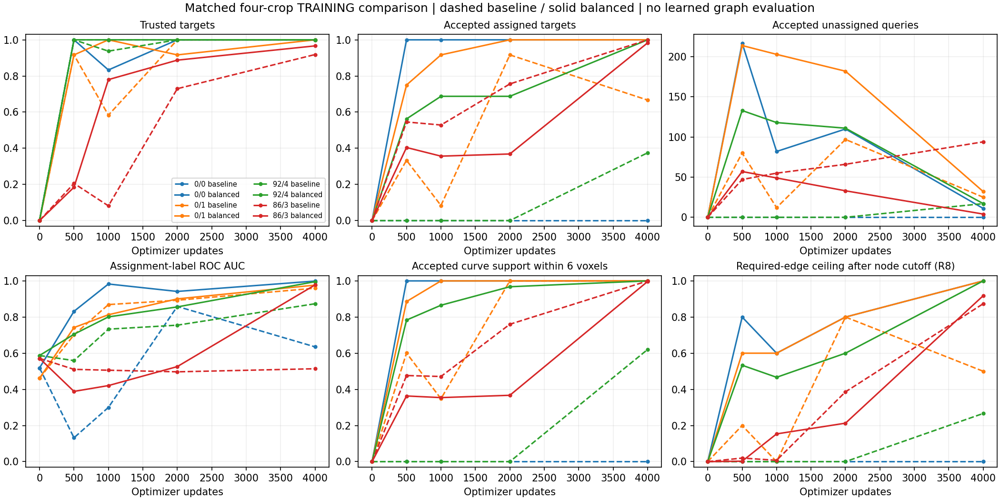

# Balanced confidence comparison: useful improvement, incomplete proposal interface

18 October 2026. The agreed fresh, paired four-training-crop fit completed all
4,000 updates in 19.68 minutes. **Confidence ranking improves substantially, but
every combined learnability gate still fails.** The three smaller crops pass the
geometry/interface gate and fail selection. The dense crop passes selection and
fails the geometry/interface gate because one junction remains outside tolerance.
Stop at the cap. No additional fit, cutoff change, GATv2 training or production
policy promotion follows automatically.

This result supports keeping balanced normalization as the leading confidence
objective for further research. It does not establish generalization, successful
graph reconstruction or improvement over PN 1.0. There is one paired seed and
four crops from three training neurons; development/test data are not evaluated.

## What changed and what was verified

Only the classification normalization changed: equal positive and negative class
means per crop, retaining coefficient 2. Assignment algorithm/cost, geometry and
radius losses, seed, four frozen input clouds, model, explicit per-crop
normalization, optimizer, crop order and 4,000-update budget match the baseline.
All parameters train jointly, so geometry and assignments can also change.
See the [predeclared protocol](balanced_query_ready.md).

The read-only [paired reviewer](../../scripts/pointneuron2/review_balanced_query_fit.py)
checks original and archived source hashes, exact cache identity, all 123 initial
state tensor hashes, identical step-zero prediction arrays and matching backend.
It loads all ten checkpoints on CPU and verifies optimizer steps, recipe,
provenance, RNG-state presence and terminal non-resumability. Both fits report
zero checkpoint reload difference; the new final checkpoint SHA256 is
`62892ad332259dab76896ff16bb71294d87166c7ad274e6813d12ab9dcc1e58a`.

For all 40 saved crop/snapshot predictions, the reviewer independently checks
assigned distances, accepted counts, junction counts, classification loss,
candidate pairs/labels at radii eight and twelve, edge availability after node
cutoff, curve support and original gates. It makes zero model forwards,
optimizer updates or GPU calls. This real-data audit supplements the 18 targeted
implementation tests passed before training; those tests were not rerun because
model/training sources are unchanged.

## Final matched results

All counts below use the original .5 cutoff and two-voxel trusted-match tolerance.
An accepted assignment is not necessarily geometrically trusted.

| Training crop | Trusted placements, baseline → balanced | Accepted assigned, baseline → balanced | Accepted unmatched, baseline → balanced | Trusted junctions, baseline → balanced |
|---|---:|---:|---:|---:|
| 0/0 | 6/6 → 6/6 | 0/6 → **6/6** | 0 → **11** | 0/0 → 0/0 |
| 0/1 | 12/12 → 12/12 | 8/12 → **12/12** | 25 → **32** | 0/0 → 0/0 |
| 92/4 | 16/16 → 16/16 | 6/16 → **16/16** | 17 → **17** | 2/2 → 2/2 |
| 86/3 | 384/418 → **404/418** | 418/418 → **411/418** | 94 → **4** | 74/77 → **76/77** |

The smaller crops retain all assigned targets but exceed their predeclared zero
extra allowance. The dense crop exceeds 95% trusted placement (96.65%), exceeds
95% assigned acceptance (98.33%), and has four extras against an allowance of
20. Its remaining untrusted junction is 2.091 voxels from its assigned proposal.
That miss is marginal against the fixed tolerance; it remains a miss and is not
evidence of gross junction loss. Fourteen dense assignments are outside tolerance
(2.011–2.596 voxels), all accepted. Seven trusted assigned queries are rejected,
leaving **397/418 = 94.98%** both accepted and trusted. The declared selection
gate measures assigned acceptance, so it passes; that is not complete node recall.

Accepted curve support within six voxels reaches 100% in every crop, versus
0% / 100% / 62.04% / 99.98% in the baseline. Curve support alone cannot establish
a clean node set or correct connections.

Mean center errors change .668 → .952, .868 → .688, .759 → .395 and 1.098 →
1.005 voxels. Radius MAE changes .074 → .063, .318 → .452, .572 → .604 and
1.735 → 1.958. Thus the result is not a uniform improvement across outputs;
radius accuracy worsens in three crops and the first crop's mean placement error
increases while staying within tolerance.

## Ranking improves; unique selection remains unresolved

| Crop | Assignment-label ROC AUC, baseline → balanced | Average precision, baseline → balanced | Balanced accepted set precision |
|---|---:|---:|---:|
| 0/0 | .635 → **.999** | .029 → **.931** | 6/17 = 35.3% |
| 0/1 | .960 → **.977** | .295 → **.370** | 12/44 = 27.3% |
| 92/4 | .874 → **.996** | .309 → **.866** | 16/33 = 48.5% |
| 86/3 | .514 → **.978** | .820 → **.992** | 411/415 = 99.0% |

Precision here uses the final Hungarian set assignment, not independently
verified biological foreground. High AUC in a sparse crop can coexist with many
extras at the operational cutoff. The dense ranking improvement shows that the
change does more than shift a constant confidence baseline on this paired task.
It does not isolate which shared-network learning changes caused that gain.

In every crop some unmatched query still outranks an assigned positive. In the
smaller crops, the lowest positive/highest negative probabilities are
.941/.970, .840/.995 and .841/.974. Therefore no single cutoff per crop can retain
all required positives and remove all extras there. This follows from score
ordering; no cutoff search was performed. Reference-count top-k remains an oracle,
not an automatic inference policy, and would not recover all assignment labels.

Among the smaller crops' accepted unmatched queries, 8/11, 16/32 and 12/17 are
within six voxels of the annotated crop-clipped curve. Only 2/11, 9/32 and 6/17
are within two voxels. Thus extras are not all harmless coincident duplicates;
24/60 are farther than six voxels from the annotated curve. Distance to an
annotation does not independently prove image background. We have not visually
classified each residual error against the raw image in this review.

Assignment changes from 2,000 to 4,000 fall from 6/6 → 5/6, 9/12 → 7/12,
13/16 → 9/16 and 239/418 → 83/418. This is reduced change between snapshots,
not per-update stability or proof that assignment churn caused the residual errors.

## Graph readiness improves without changing the candidate policy

| Crop | Required candidate edges at R8, baseline → balanced | Required edges after node cutoff, baseline → balanced |
|---|---:|---:|
| 0/0 | 4/5 → **5/5** | 0/5 → **5/5** |
| 0/1 | 9/10 → **10/10** | 5/10 → **10/10** |
| 92/4 | 13/15 → **15/15** | 4/15 → **15/15** |
| 86/3 | 353/404 → **384/404** | 353/404 → **371/404** |

All trusted-endpoint required edges are candidates at R8 in the new final model.
Each smaller crop now also has known negative edges (8/9/33), so the earlier
smallest-crop supervision gate is no longer its obstacle. The dense case reaches
95.05% candidate availability before selection but only **91.83%** afterward:
20 edges lack trusted endpoints and another 13 lose an endpoint to confidence.
These are ceilings under exact-target adjacency/trusted-assignment evaluation,
not measured learned connectivity or SWC topology scores.

R12 adds no required positive edges or post-cutoff recall in the new final
predictions, while increasing candidate counts 13,581 → 29,180, 5,083 → 7,591,
10,958 → 24,955 and 4,907 → 4,911. The earlier radius-margin argument remains
relevant to displaced proposals, but this run does not justify promoting a larger
candidate radius as its next fix. Primary gates remain R8.

The current edge-supervision code masks edges touching unmatched/untrusted
proposals. The current decoder preserves accepted isolated nodes. Consequently,
passing the current residual proposal set to GATv2 does not by itself provide a
supervised mechanism for rejecting its extras. Reassigning that responsibility
would require an explicit design change and a separate comparison.

## Research decision

Keep this completed result and balanced normalization as the stronger research
candidate. The paired evidence supports that objective change on these fixed
training examples; it weakens the claim that normalization alone solves proposal
selection. It does not justify replacing Phase 1, abandoning PointNeXt/Transformer,
or claiming a generally superior reconstruction pipeline.

Before another fit, discuss the **proposal-selection contract**: confidence is
currently asked to identify unique representatives of an assigned target set,
while rejecting both redundant curve points and spatially unrelated proposals.
My recommendation is to retain that explicit responsibility initially, and use
these saved failure cases to decide whether the assignment/negative supervision
matches it. Treating confidence as foreground instead, or asking the graph stage
to remove nodes, would change the interface and needs agreement first.

Do not extend this fit or choose a different cutoff to chase the gate. The sparse
extras decline late in training, but that alone is not a decision to buy more
updates. No new learning experiment is prepared by this report. The next step is
an evidence-backed design discussion, followed by one stated hypothesis and
success/failure rule before implementing another comparison.

Raw review: `tmp/pointneuron2/local_runs/balanced_query_review_20261018`.
Visible [full paired evidence](balanced_query_results_seed0/summary.json) includes
all snapshots, score statistics, candidate arms, checkpoint hashes and dense-crop
placement misses. Existing model/training sources and settings remain unchanged
by this review.
