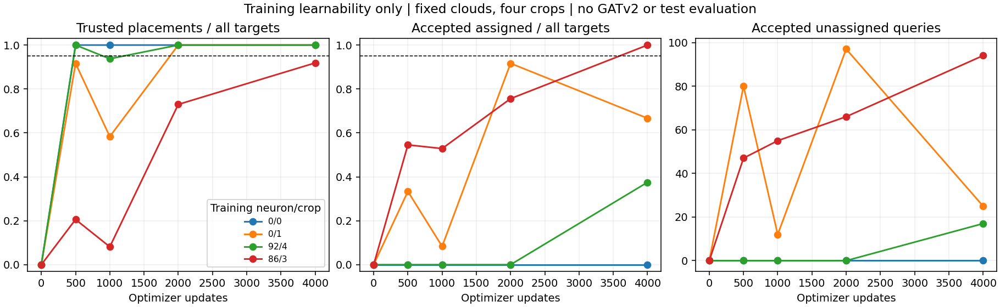
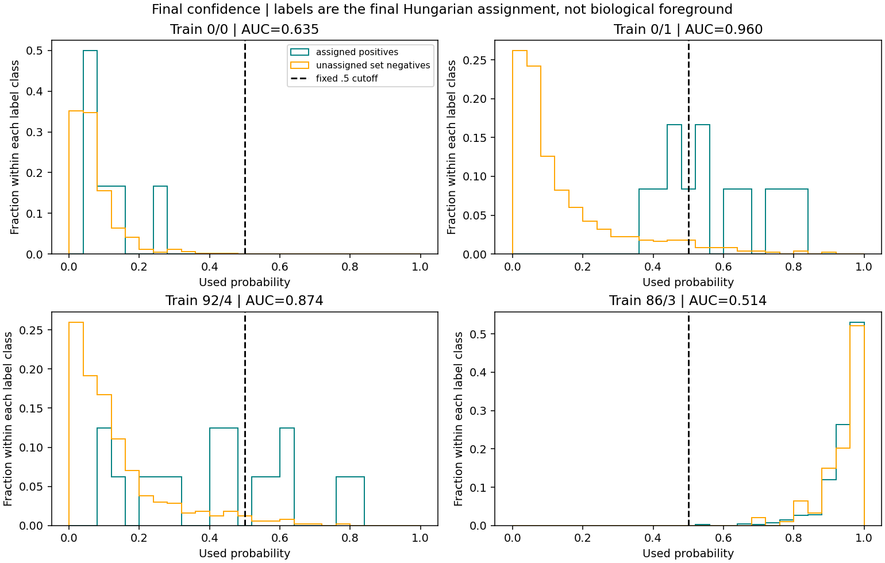

# Four-crop fit: placement learned, proposal selection and graph interface fail

17 October 2026. The user completed the agreed fresh 4,000-update fit on four
fixed training crops. Execution, source/cache preservation and checkpoint reload
pass. **The combined training-learnability gate fails on every crop.** Stop at
the agreed cap: do not extend fitting, lower cutoffs or start GATv2 training.

The result supports retaining the PointNeXt/Transformer geometry work, while
revisiting its confidence objective and the proposal-to-graph candidate contract.
It does not establish development-set or end-to-end reconstruction improvement.
No model, loss, sampler, threshold or training setting is changed by this review.

## Final results, with the original gates

| Training neuron / crop | Trusted assigned targets @2 voxels | Trusted junctions | Accepted assigned at .5 | Accepted unassigned | Accepted curve support @6 | Reference-edge ceiling before confidence |
| --- | ---: | ---: | ---: | ---: | ---: | ---: |
| 0 / 0 | 6 / 6 | 0 / 0 | **0 / 6** | 0 | **0%** | **4 / 5 = 80%** |
| 0 / 1 | 12 / 12 | 0 / 0 | **8 / 12** | 25 | 100% | **9 / 10 = 90%** |
| 92 / 4 | 16 / 16 | 2 / 2 | **6 / 16** | 17 | **62.04%** | **13 / 15 = 86.67%** |
| 86 / 3 | **384 / 418 = 91.87%** | **74 / 77** | 418 / 418 | **94** | 99.98% | **353 / 404 = 87.38%** |

"Assigned" does not mean correctly placed: the dense crop accepts all 512
queries, including 34 assigned proposals outside the two-voxel tolerance.
"Unassigned" is an extra under the current set target, not independently verified
biological background. Curve support is nearest-point coverage, not connectivity.
Accepting many points can cover the curve while producing an unusable graph.

The agreed geometry gate requires >=95% trusted targets, all visible junctions,
>=95% attainable candidate-edge recall, and known positive/negative supervision.
The selection gate requires >=95% assigned acceptance, at most floor(5% of target
count) accepted extras and >=95% accepted curve support at six voxels. Neither
gate is satisfied on any crop. The dense allowance was 20 extras; it produces 94.

## What the fit establishes

The three sparse crops place every reference target within two voxels. Their
mean assigned errors are 0.67, 0.87 and 0.76 voxels; the modest branched example
also finds both junctions. The dense crop's mean error is 1.10 voxels, but its
maximum is 5.87, 34 targets fail tolerance and three junctions remain untrusted.
All 418 targets were retained in the loss; no 512-query capacity overflow occurs.

This is evidence of **training-set geometric learnability** beyond the earlier
junction-free two-crop fit. It does not reproduce that older fit exactly: the
data, fresh trajectory and per-crop normalization experiment differ. The
successful normalization/reload behavior remains useful, not a production-policy
or generalization claim.

Radius predictions also remain limited. Floored-target radius MAE is
0.074 / 0.318 / 0.572 / 1.735 voxels by crop. Target ranges are 1–1, 1–1, 1–3.062
and 1–12. Thus the first two crops only test a constant radius target; the
broader radius responsibility is not solved by good center placement.



## Confidence fails as a selector, beyond a cutoff issue

The six-target crop rejects all matched positives. The dense crop accepts every
query. On every crop, at least one unassigned query outranks an assigned positive;
there is no per-crop cutoff that perfectly separates all final assignment labels.
This conclusion comes directly from the saved scores, without a threshold search.

| Crop | Confidence AUC against assignment labels | Average precision | Reference-count top-k recall, oracle only |
| --- | ---: | ---: | ---: |
| 0 / 0 | .635 | .029 | 0 / 6 |
| 0 / 1 | .960 | .295 | 4 / 12 |
| 92 / 4 | .874 | .309 | 5 / 16 |
| 86 / 3 | **.514** | .820 | 347 / 418 |

The dense ranking is almost chance. Its apparently high average precision must
be compared with an assigned-positive prevalence of .816. Knowing the reference
target count and selecting that many top scores still would not fix these labels.
That top-k calculation is a ranking diagnostic, never an automatic inference rule.

The trained confidence head's behavior does **not** show that the cached features
cannot support a better classifier; that capacity question was not tested here.
Nor does the previous two-crop linear-separability result transfer to these four
new feature sets or establish successful joint confidence optimization.



There is a concrete loss-design concern. For Q=512 queries, P assigned positives
and positive weight w=8, the existing normalized weighted cross-entropy's best
constant probability is:

```text
p_constant = w P / (w P + Q - P)
```

It is **.087 / .161 / .205 / .973** for the four crops. The loss therefore permits
very different confidence baselines when a model distinguishes crop density
without distinguishing individual assigned queries. Independent calculation gives:

| Crop | Actual classification loss | Best constant-score loss |
| --- | ---: | ---: |
| 0 / 0 | .291 | .295 |
| 0 / 1 | .244 | .441 |
| 92 / 4 | .340 | .507 |
| 86 / 3 | **.150** | **.125** |

The first crop barely beats its constant baseline. The dense crop is worse than
its constant baseline despite a low absolute classification loss. This supports
testing confidence class normalization; it does not isolate weighting as the
sole cause or prove that changing it will solve the task.

Assignments also change across saved snapshots. Between 2,000 and 4,000, the
assigned query changes for 6/6, 9/12, 13/16 and 239/418 target identities.
This establishes changing labels across snapshots, not their per-update rate
or that such changes are intrinsically harmful. Features and geometry also
change; assignment instability remains a plausible contributor, not a diagnosis.

Many unassigned queries are near the annotated curve: 169/506, 19/500, 58/496
and 15/94 lie within two voxels of its crop-clipped segments. Consequently,
"on the curve" and "the unique representative chosen by the set assignment"
are different responsibilities. Balanced class weights would not resolve that
semantic distinction by themselves.

## Candidate generation is a separate bottleneck

The sparse crops have all trusted endpoints, yet miss four required candidate
pairs in total. The missed predicted pair lengths are **8.046, 8.963, 8.648 and
8.237 voxels**. All exceed the current radius-eight admission rule. Their
endpoints' neighbor ranks are 131/63, 19/29, 62/80 and 58/18, so kNN-16 does not
rescue them. Nearby unused queries crowd the neighborhoods. The corresponding
reference chords are only 7.27–7.93 voxels long.

The dense case has a different failure: every reference edge whose endpoints
are trusted is already a candidate. Its 51 unavailable reference edges are lost
to untrusted endpoints, rather than absent pairs between trusted endpoints.
Of its 34 poorly placed target assignments, 31 targets have an input-cloud point
within six voxels. That proximity does not prove sufficient image evidence or
exonerate Phase 1, but this failure cannot simply be attributed to a hard point cap.

After the existing node cutoff, even perfect edge scores would retain only
0/5, 5/10, 4/15 and 353/404 required target edges. These are ceilings under the
declared exact-target-adjacency/trusted-assignment formulation. They are not
bounds on every conceivable topologically equivalent reconstruction through
alternative intermediate points.

The six-target crop has zero known negative candidate edges. The predeclared
per-crop negative-supervision requirement is a conservative gate, not a biological
quality criterion. It can reject an otherwise fully represented tiny crop (as
at update 500). This does not explain away the final failure: removing that one
condition still leaves its 80% candidate recall and total confidence rejection.
The original gate is reported unchanged.

## Research decision and one proposed comparison

**Keep the useful geometry model and stop this run. Do not promote the checkpoint
or use GATv2 fitting to conceal missing proposals/candidate edges.** Preserve
Phase 1, PointNeXt, Transformer and intended GATv2 stages while discussing the
following two interface questions before implementing changes:

1. **Confidence objective:** compare the saved weighted-CE baseline with one
   fresh, otherwise matched four-crop fit using equal positive/negative class
   means per supervised crop: `0.5 mean(-log p_positive) +
   0.5 mean(-log(1-p_negative))`. Retain current assignment labels and geometry
   losses for that comparison. This tests the specific class-prior concern while
   keeping the architecture fixed. It is not a field replacement or a claim that
   the current set-label semantics are correct.
2. **Candidate error margin:** radius-eight target spacing and a two-voxel
   trusted-placement tolerance do not imply radius-eight predicted edges.
   For a reference chord <=8 with endpoint errors <=2, triangle inequality gives
   a predicted pair distance <=12. A separately reviewed radius-twelve margin
   would respect that error budget; candidate counts and computational cost must
   be reported. It cannot repair the dense case's untrusted endpoints.

These are **proposals, not implemented changes**. The candidate-margin question
can first be assessed on fixed saved predictions without training. Compare any
agreed candidate rule on both the saved baseline and subsequent loss variant;
do not silently replace the original radius-eight gate when reporting progress.
Keep adjacency labels, unknown handling and the decoder explicit.

If the loss comparison is agreed, use the same four frozen clouds, fresh seed,
optimizer/backend, 4,000-update cap and snapshot schedule. Judge per-crop
acceptance/extras, confidence ranking, geometry, junctions and radius errors,
plus both original and explicitly agreed candidate contracts. No cutoff search
or longer-budget rescue. A confidence improvement alone is insufficient if
geometry/junction or edge availability still fails. If normalized loss fails,
revisit assignment-defined objectness/duplicate representation before more LR
or duration replays. No new fit is prepared or launched in this results review.

Only after actual proposals meet an agreed interface should we compare GATv2
with the matched pairwise scorer. Automatic whole-neuron coverage/crop matching,
development evaluation and a fresh neuron-disjoint PN1 comparison remain open.
The repeatedly examined development set and reserved test data were not evaluated
in this review. No genuine end-to-end reconstruction improvement is established.

## Integrity and reproducibility

Training finished in 1,083.02 seconds (18.05 minutes excluding startup). Its
saved prediction reload maximum delta is 0.0. Source/cache/snapshot hashes match
and fresh initial weights match the CPU and GPU timing checks. Independent CPU
calculations verify all 20 cached crop snapshots' distances, assignments,
confidence counts, weighted CE, candidate sets and masked adjacency labels.

All five checkpoints exist with correct steps, crop cursors and provenance.
The four noninitial states contain 123 populated AdamW parameter states with
matching update counters and a saved CUDA RNG state. The final checkpoint is
terminal at 4,000; no continuation is queued. Its SHA256 is
`90d685bd14ba4cf128c7cf5e229103b81abc708bb035385bacfbf1f2fdd4ecef`.

The review uses saved training caches/predictions and CPU checkpoint reads,
with **zero extra model forwards, optimizer updates or GPU workloads**. Plots
are visually checked. This numerical review does not need another training test.

- [Complete numerical review](branched_query_results_seed0/summary.json)
- [Integrity verification](branched_query_results_seed0/review.json)
- [Read-only analysis runner](../../scripts/pointneuron2/review_branched_query_fit.py)
- [Original fit protocol](branched_query_ready.md)

Raw fit: `tmp/pointneuron2/local_runs/branched_query_restart_20261017/model`.
Raw review: `tmp/pointneuron2/local_runs/branched_query_review_20261017`.
Raw fit-report SHA256:
`3e023316978632587f7b9d0b2798cbb6964aa0dacb1ce158e2c04647bb667def`.
