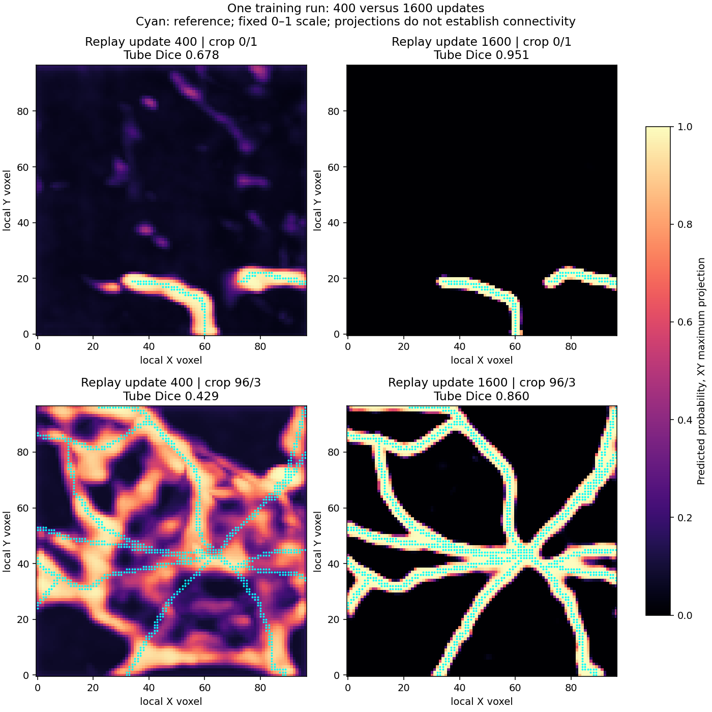

# Eight-crop field learnability passes at 1,600 updates

12 October 2026. The user completed the agreed duration-only replay in **2 minutes
49 seconds** at the terminal; the recorded loop took **163.40 seconds**. This
measured runtime supersedes the conservative 7-9 minute preflight estimate.
**The final frozen gate passes.** This is a selected-training-crop field result,
not development validation, a point-cloud comparison or a complete PN 2.0 model.

The intended architecture remains **Phase 1 point-cloud preparation -> PointNeXt
-> Transformer skeleton proposals -> GATv2 connectivity -> SWC**. The field is a
possible Phase 1 guide. No point-cloud interface, PointNeXt or GATv2 implementation
was added, and no decoder, threshold, target, training strategy or gate changed
while inspecting this run.

## Within-run duration result

Same eight 97-cubed image crops from four training neurons, seed 0, 88,673-parameter
U-Net, batch 1, no augmentation, hard-negative BCE and masked Dice, AdamW LR
0.001 / weight decay 0.0001, gradient clip 10. One optimizer kept its state for
all 1,600 updates. Probability threshold stayed 0.5; update 1,600 is primary.

| Measurement | Replay 400 | Replay 800 | Replay 1,600 |
| --- | ---: | ---: | ---: |
| Mean known-region tube Dice | 0.6779 | 0.7426 | **0.9173** |
| Mean reference-sample coverage within 6 voxels | 99.77% | 100% | **100%** |
| Mean predicted-voxel reference proximity within 6 voxels | 95.68% | 98.44% | **99.9985%** |
| Crops passing coverage / proximity | 8/8 / 7/8 | 8/8 / 8/8 | **8/8 / 8/8** |
| Frozen gate | Fail | Fail | **Pass** |

The gate requires each crop to have nonempty predictions, coverage >=95% and
proximity >=90% within six voxels, plus mean known-region hard Dice >=0.80.
At update 800 the geometry requirements pass but mean Dice still fails. The
1,600 result passes without selecting an earlier snapshot or tuning a threshold.
Dice improves from replay 400 to 1,600 on **all eight crops**.

## Per-crop final measurements and independent audit

Fresh frozen-checkpoint inference reproduces all saved primary geometry metrics
within 1e-5, and the checkpoint remains unchanged. Final checkpoint reload from
the training run itself is exact (maximum logit delta 0.0).

| Crop | Dice 400 -> 1,600 | Tube precision / recall at 1,600 | Prediction / target volume | Final image |
| --- | --- | --- | ---: | --- |
| 0/1 | 0.678 -> **0.951** | 92.0% / 98.4% | 1.07x | [Open](centerline_duration_results_seed0/sample_0000_patch_001.png) |
| 0/2 | 0.554 -> **0.882** | 82.4% / 94.8% | 1.15x | [Open](centerline_duration_results_seed0/sample_0000_patch_002.png) |
| 32/0 | 0.811 -> **0.967** | 94.3% / 99.2% | 1.05x | [Open](centerline_duration_results_seed0/sample_0032_patch_000.png) |
| 32/3 | 0.758 -> **0.912** | 86.9% / 96.1% | 1.11x | [Open](centerline_duration_results_seed0/sample_0032_patch_003.png) |
| 96/0 | 0.602 -> **0.891** | 82.8% / 96.4% | 1.16x | [Open](centerline_duration_results_seed0/sample_0096_patch_000.png) |
| 96/3 | 0.429 -> **0.860** | 77.6% / 96.3% | 1.24x | [Open](centerline_duration_results_seed0/sample_0096_patch_003.png) |
| 162/1 | 0.743 -> **0.894** | 84.7% / 94.7% | 1.12x | [Open](centerline_duration_results_seed0/sample_0162_patch_001.png) |
| 162/2 | 0.849 -> **0.981** | 97.0% / 99.3% | 1.02x | [Open](centerline_duration_results_seed0/sample_0162_patch_002.png) |

All eight crops have **100% saved reference-sample coverage within two voxels**
of accepted support. This checks sampled reference locations against the field,
not arc-length-weighted skeleton-path coverage or branch connectivity.
There are **zero known-negative accepted voxels farther than six voxels from
the reference** in every crop. One accepted uncertain bright voxel remains in
96/3. Tube precision is agreement with the constructed reference tube on known
voxels, not biological precision or a score for all unannotated neurites.

Crowded crop 96/3, the previous proximity failure, reaches **99.9883% proximity**
within six voxels. Its 77.6% strict tube precision and 1.24x target volume still
show extra near-reference width/support. The result is much better but does not
prove perfect center placement, connections, radii or trace identity.

All eight final overlays were inspected. They show narrower, more trace-aligned
fields; simple branches and the crowded case both improve. The paired figure
uses two established illustrative cases, rather than selecting only the best
result. Colors use the same probability scale and cyan denotes reference.
These XY projections can overlay structures at different depths; they are not
3D topology evidence.

## Reproducibility caveat

Initialization tensors, initial inference, cache/config/device/Torch/loss and
the recorded first 400 crop indices match the completed hard-negative run.
The saved baseline report and initial/final checkpoint hashes remain unchanged.
However, **the new 400-update predictions do not reproduce the previous
400-update results**: mean Dice is **0.6779 versus 0.6084**, with per-crop Dice
differences of about 0.040-0.117. These are noticeable, not negligible rounding
differences; the comparison explicitly records its common-budget match as false.

The cause has not been isolated. Numerical/backend variability and unrecorded
runtime conditions are possibilities, not established explanations. Exact
initialization and declared settings do not guarantee an identical trained
trajectory. Consequently the clearest duration evidence is **0.6779 -> 0.9173
within the same uninterrupted replay**. Do not claim an exactly reproduced
baseline or attribute all old-to-new differences solely to update count.
The final model's independently reproduced gate pass remains valid for these
eight selected training crops. Repeatability remains a separate unresolved issue.

## What this establishes and the next decision

The present field recipe can fit these varied training crops under the frozen
criterion; the previous 400-update failure was insufficient evidence of an
intrinsic inability to learn this target. This supports moving past tiny-fit
tuning. It does not prove that optimization is the sole bottleneck, that the
field generalizes, or that it improves PN 1.0 or the proposed PN 2.0 modules.

Next recommendation: **design the Phase 1 point-cloud interface and matched
comparison before implementation**. Use the field as guidance for selecting
image points while preserving intensity/context and spatial coverage. Specify
candidate generation, score-versus-coverage allocation, point attributes and
equal input budgets. Bare extracted path vertices should not silently replace
image evidence or the Transformer proposal task.

Then agree a separate train/development-validation field pilot and input-cloud
evaluation, with reserved test neurons untouched, to check usefulness beyond
these memorized crops. A point-cloud benefit, PointNeXt integration and eventual
Transformer/GATv2 evaluation must be measured separately. No new training run,
sampling interface or architectural replacement was implemented or launched
during this inspection.

## Evidence and inspection scope

- [Complete training report](centerline_duration_results_seed0/fit_report.json)
- [Duration comparison, per-crop deltas and pairing checks](centerline_duration_results_seed0/duration_comparison.json)
- [Independent frozen-checkpoint audit](centerline_duration_results_seed0/audit.json)
- [Completed protocol](centerline_duration_ready.md)
- [Intended architecture and open interface decisions](centerline_framework.md)

`audit_centerline_fit.py` performed eight frozen forward passes with zero
optimizer updates. Its optional scikit-image thinning remains unavailable due
to the previously identified NumPy ABI incompatibility; no library was changed.
The voxel/loss audit completed, and no new skeleton-path result is claimed.
`plot_centerline_duration.py` renders saved arrays without inference or training;
its cache checks passed and the resulting figure was inspected.
Model weights and caches remain ignored; readable JSON evidence and final
images are saved here. No training code changed and no extra training was run.
