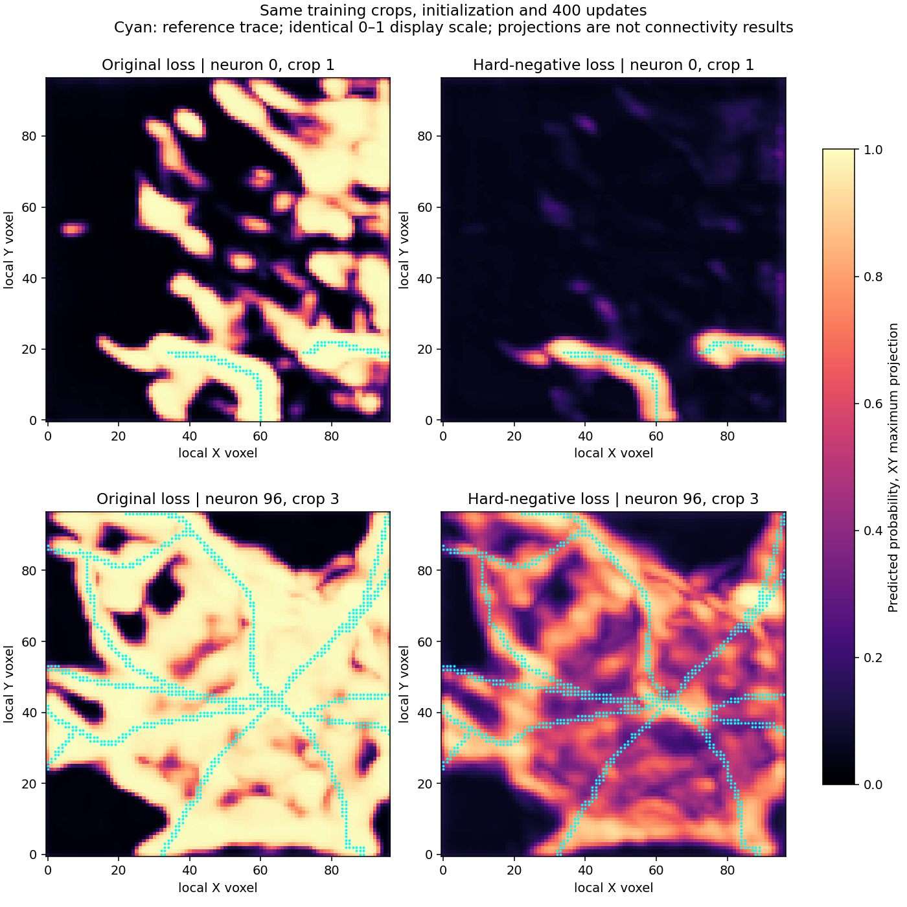

# Negative-loss control improves every crop; the learning gate still fails

12 October 2026. The user completed the frozen loss-only control in **1 minute
52 seconds** at the terminal (99.72 seconds inside the loop). Final checkpoint
reload is exact, paired execution checks pass, and the saved baseline files
remain unchanged. **No validation or SWC reconstruction is promoted.**

## Final paired result at update 400

Eight fixed training crops, same initial model tensors, inputs, model/optimizer
config, 400-update budget and probability threshold 0.5. Only negative BCE
aggregation changes. Means weight crops equally; each of four neurons supplies
two crops. The old run did not record actual crop order; the control matches
the unchanged declared seeded algorithm and records its sequence. This is a
one-seed training-crop result, not generalization or a PN 1.0 comparison.

| Measurement | Original loss | Hard-negative loss | Frozen requirement |
| --- | ---: | ---: | --- |
| Mean supervised tube Dice | 0.4007 | **0.6084** | Mean >=0.80 |
| Mean predicted-voxel proximity within 6 voxels | 80.86% | **93.59%** | Each crop >=90% |
| Mean reference-sample coverage within 6 voxels | 100% | **99.65%** | Each crop >=95% |
| Crops passing proximity requirement | 3/8 | **7/8** | 8/8 |
| Crops passing coverage requirement | 8/8 | **8/8** | 8/8 |

Dice improves on **all eight crops**. The controlled result supports negative
loss aggregation as a contributor to the original overprediction. It does not
prove that optimization, annotation quality, center placement or topology is
otherwise solved. The larger raw loss values from the new objective are not
directly comparable to the original loss and are not quality evidence.

The gate fails for two reasons: mean Dice remains below 0.80, and crop **96/3**
has only **69.98%** of its predicted voxels within six voxels of the reference.
All coverage checks pass; crop 0/2 is the lowest at 97.23%.

## Per-crop change

Proximity is agreement with this SWC, not biological precision. Coverage at
six voxels can hide small placement gaps or broad masks. It does not establish
correct center paths or connections.

| Neuron / crop | Dice, original -> control | Proximity, original -> control | Control coverage | Prediction |
| --- | --- | --- | ---: | --- |
| 0 / 1 | 0.114 -> **0.631** | 22.6% -> **97.3%** | 100% | [Open](centerline_loss_control_results_seed0/sample_0000_patch_001.png) |
| 0 / 2 | 0.452 -> **0.514** | 89.0% -> **90.6%** | 97.2% | [Open](centerline_loss_control_results_seed0/sample_0000_patch_002.png) |
| 32 / 0 | 0.583 -> **0.693** | 99.8% -> **100%** | 100% | [Open](centerline_loss_control_results_seed0/sample_0032_patch_000.png) |
| 32 / 3 | 0.648 -> **0.689** | 100% -> **100%** | 100% | [Open](centerline_loss_control_results_seed0/sample_0032_patch_003.png) |
| 96 / 0 | 0.424 -> **0.544** | 87.5% -> **95.0%** | 100% | [Open](centerline_loss_control_results_seed0/sample_0096_patch_000.png) |
| 96 / 3 | 0.304 -> **0.383** | 61.1% -> **70.0%** | 100% | [Open](centerline_loss_control_results_seed0/sample_0096_patch_003.png) |
| 162 / 1 | 0.365 -> **0.671** | 88.1% -> **95.8%** | 100% | [Open](centerline_loss_control_results_seed0/sample_0162_patch_001.png) |
| 162 / 2 | 0.317 -> **0.743** | 98.6% -> **100%** | 100% | [Open](centerline_loss_control_results_seed0/sample_0162_patch_002.png) |

All eight final overlays were inspected. The control noticeably reduces extra
image-structure selection in 0/1 and narrows isolated branches in 162/2. Crowded
images remain less precise. Two illustrative cases are shown below; these were
chosen to display the corrected problem and remaining difficult case, not to
estimate quality across unseen data.

Cyan is the reference trace; colors show XY maximum-projected probabilities
on the same 0–1 scale. Display arrays are the saved float16 snapshots. Numerical
metrics were independently reproduced from full-precision checkpoint inference.
Projection overlap must not be interpreted as 3D connectivity.

## What remains: width and local placement

Read-only checkpoint inference reproduces the saved primary measurements within
1e-5; the control checkpoint hash is unchanged. The audit uses the correct
top-k loss definition, all known-voxel Dice and the original unknown mask.

The new field has **1.5–2.2 times** the target-tube volume, compared with **2.0–16.6
times** for the original model. For 0/1, accepted known-negative voxels farther
than six voxels from the trace fall from **10,335 to 43**. For the difficult
96/3 crop, they fall from **13,315 to 3,812**, but remain substantial. These
counts exclude unknown bright regions; their biological identity is not known.

There is a coverage/precision tradeoff that the coarse six-voxel metric hides:
only 64.8% of exact target-tube voxels are accepted in crop 0/2 and 59.1% in
96/3, despite high reference-sample coverage. That can reflect tube width,
local placement or missing portions rather than an entire missing branch.

To distinguish those effects, the audit profiles distance from each dense
reference sample to its nearest accepted voxel, without selecting a new
threshold or changing any gate:

| Neuron / crop | Reference samples within 1 voxel | Within 2 voxels | 95th-percentile distance |
| --- | ---: | ---: | ---: |
| 0 / 1 | 100% | 100% | 0.63 voxels |
| 0 / 2 | 82.1% | 88.2% | **4.11 voxels** |
| 32 / 0 | 100% | 100% | 0.70 voxels |
| 32 / 3 | 100% | 100% | 0.70 voxels |
| 96 / 0 | 91.9% | 97.6% | 1.24 voxels |
| 96 / 3 | 79.6% | 90.3% | **2.65 voxels** |
| 162 / 1 | 100% | 100% | 0.66 voxels |
| 162 / 2 | 100% | 100% | 0.63 voxels |

Five crops therefore contain accepted support within one voxel of every sampled
reference point. This is promising evidence of support, **not** extracted
centerline accuracy: a broad foreground region can contain the reference while
its extracted medial path is displaced or connected incorrectly. The crowded
chick and zebrafish crops also show measurable local support gaps. Keep the
width and placement problems separate instead of interpreting the gate Boolean
as either total failure or solved geometry.

The trajectory is mixed: mean Dice rises 0.467 -> 0.558 -> 0.608 at updates
100/200/400, but six-voxel coverage drops to 92.6% at update 200 before recovering
to 99.65%. Final-only assessment remains primary. Do not select the more
flattering intermediate snapshot or infer convergence from shuffled single-crop
loss logs.

The optional scikit-image thinning diagnostic remains unavailable due to its
NumPy ABI mismatch; no dependency changes were made and no thinning result is
claimed. The distance/voxel/loss audit does not depend on that optional step.

## Recommended next decision — not executed

Retain this hard-negative version as the current field candidate. Keep training
and validation paused. Before another training change, inspect **center paths
extracted from the frozen field** using the existing PN2 image-medial extractor
(`image_medial_skeleton`) and the recorded medial settings. Use the original
0.5 threshold, retain the same cached image coordinates and avoid GT-driven
seeds or path selection. Start with the simple branch **162/2** and crowded
case **96/3**; they are selected training diagnostics, not a validation set.

This would answer whether the remaining Dice failure mainly represents extra
tube width or poor center paths/extra branches after the actual conversion
needed by the pipeline. The existing Kimimaro-based extractor is separate
from the unavailable scikit-image diagnostic. Its fixed output must itself be
inspected; successful operation is not a quality result. Record distance and
coverage on extracted paths alongside the existing field metrics.

This proposal does not relax the failed gate, promote validation, start graph
reconstruction or alter training. Discuss it together before preparation. A
later decision about the field, labels, extraction or optimization should
follow the observed path failure rather than another blind parameter change.

## Saved evidence

- [Paired comparison](centerline_loss_control_results_seed0/loss_comparison.json)
- [Completed fit and snapshots' metrics](centerline_loss_control_results_seed0/fit_report.json)
- [Verified loss/position audit](centerline_loss_control_results_seed0/audit.json)
- [Completed protocol and command](centerline_loss_control_ready.md)

Checkpoint, arrays and logs remain at the original ignored directory:
`tmp/pointneuron2/local_runs/centerline_loss_control_20261012_203344_14488/model`.
Source/config and the learning gate are unchanged by this review. Only the
read-only audit now includes position profiles; the plot helper renders the
saved paired field examples. No additional optimizer steps were run.
