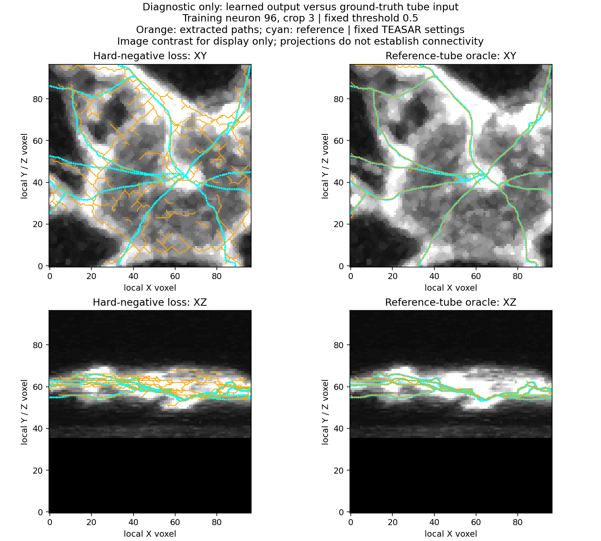
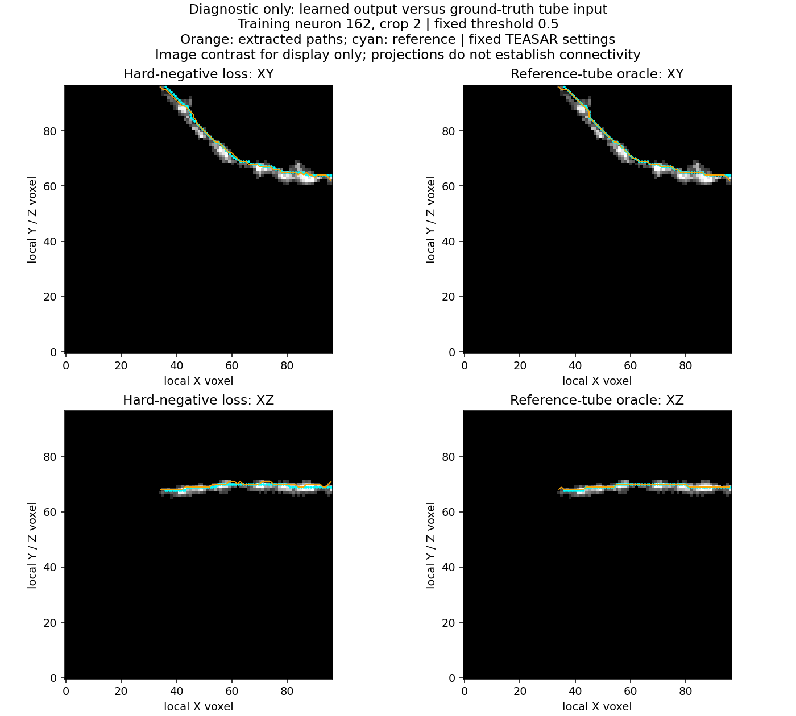

# Reference-tube oracle localizes the crowded-case bottleneck upstream

12 October 2026. The user approved the ideal-input diagnostic on the same two
training crops. **The oracle input contains ground truth. These are not model
predictions, validation results or a software performance claim.** No training,
checkpoint inference, library changes or gate changes were made.

## Question and fixed comparison

Can the existing extractor recover useful center geometry from the chosen
two-voxel reference-tube representation, including the crowded crop? This
separates errors present with ideal input from errors introduced by the learned
image-to-field stage. It does not independently test image/reference alignment,
annotation completeness, model capacity or correct neuronal connectivity.

Oracle input is the cached exact continuous-SWC distance field `<=2 voxels`,
intersected with valid native image voxels. It is checked against the original
cached positive tube labels. It is not drawn, manually cleaned or adjusted to
the extractor. It has 957 voxels in crop 162/2 and 6,878 in crop 96/3. The cached
image inputs, labels and uncertainty masks remain unchanged.

Use exactly the previous Kimimaro 5.8.5 image-medial extractor and recorded
settings: native unit spacing, TEASAR scale 1.5/constant 2, dust 8, branching
fix enabled, no border fix or hole filling, PDRF exponent 4/scale 100000, one
CPU worker. The improved learned paths are reused from the earlier frozen
diagnostic; they are not extracted again. Both arms use the same scoring code:
one-voxel maximum-step arc probes, length weighting and exact distances to
continuous segments. Prediction proximity uses the full reference forest;
reference coverage uses patch-clipped reference segments.

The shared scorer reproduces every previously saved learned-path metric
exactly on both cases. Cache, previous checkpoint/report and learned-path
hashes remain unchanged. The oracle loop took **6.43 seconds**, excluding
imports, loading and provenance checks. It performed zero optimizer updates
and zero model inference passes.

## Crowded zebrafish crop 96/3

| Measurement | Improved learned field -> paths | Reference-tube oracle -> paths |
| --- | ---: | ---: |
| Mean reference distance to extracted paths | 1.49 voxels | **0.37 voxel** |
| Reference length within 2 voxels of extracted paths | 75.0% | **98.7%** |
| Mean extracted-path distance to reference | 4.98 voxels | **0.41 voxel** |
| Extracted path length within 2 voxels of reference | 34.4% | **100%** |
| Total extracted path length | 1424 voxels | **650 voxels** |
| Clipped reference length | 597 voxels | 597 voxels |
| Components / endpoints / branch vertices | 9 / 118 / 99 | **1 / 18 / 16** |

With oracle input, extracted length is about **1.09 times** reference length,
versus **2.38 times** from the learned field. The near-complete two-voxel
reference coverage is the important preservation check: the extractor does
not achieve a clean-looking result merely by discarding much of the reference.

High oracle proximity is partly expected because its input is constrained to
the reference tube. The additional evidence is good reference coverage and
path length close to the reference, with far fewer spurs in the projected
overlay. This is not a topology-F1 or parentage result. A binary tube can merge
nearby branches and erase their identities; neither a single component nor
near-reference paths prove correct connections.

Orange is extracted geometry; cyan is reference. The right-hand output uses
ground truth as input and cannot be treated as a model reconstruction. Distances
above are measured in 3D; XY/XZ overlap is only illustrative.

## Simple branch 162/2

The learned candidate was already close to the reference. The oracle confirms
that this representation also supports a clean simple path with the same
extractor:

| Measurement | Improved learned field -> path | Oracle -> path |
| --- | ---: | ---: |
| Mean extracted-path distance to reference | 0.58 voxel | **0.11 voxel** |
| Mean reference distance to path | 0.50 voxel | **0.04 voxel** |
| Reference length within 2 voxels of path | 100% | **100%** |
| Extracted path length / reference length | 84.3 / 76.3 voxels | **79.1 / 76.3 voxels** |
| Components / endpoints / branch vertices | 1 / 2 / 0 | **1 / 2 / 0** |

## Interpretation and proposed next decision

For these selected crops, the two-voxel tube representation and fixed extractor
can preserve much better reference geometry than the crowded learned field
currently provides. The large crowded-case excess is therefore not an
unavoidable failure of this extractor on ideal input. **The current bottleneck
is upstream in producing the right image-to-field output.** The extractor may
still amplify noisy inputs, and neither its full-volume topology nor its
behavior on other neurons is established.

This narrows the investigation; it does not prove which upstream cause is
responsible. Optimization, capacity/context, input/reference alignment and
ambiguous or incomplete annotation remain possible. The oracle deliberately
bypasses image interpretation, so it cannot validate the image-to-label mapping.

The hard-negative fit's mean Dice was still increasing at the saved checks
(0.467 -> 0.558 -> 0.608 over updates 100/200/400). With the target/extractor
geometry now checked, I recommend **one duration-only learning check** next:
freshly replay the same hard-negative recipe on the same eight training crops
for **1,600 updates**, saving checks at 400/800/1,600. Keep initialization,
model, labels, unknown mask, optimizer/LR and threshold/gate fixed. The 400-update
checkpoint is the common-budget comparison; the final 1,600-update result tests
whether the present recipe can fit the varied crops given more optimization.
That is a learnability question, not validation or a claim that longer training
will succeed.

Allow roughly **3–5 minutes** on the local RTX 3070 Ti Laptop GPU, based on the
completed 400-update timing; estimate/preflight again during preparation. The
user would launch it visibly, with a fresh ignored output directory. The current
checkpoints do not save optimizer state, so this should be a fresh replay rather
than claim an exact continuation while resetting AdamW moments. No LR schedule,
loss, architecture or target change is bundled with the update-budget change.

The user subsequently approved preparation; see the
[duration-only protocol and visible command](centerline_duration_ready.md).
The full fit remains for the user to launch.

If the final result fails, stop the duration hypothesis and inspect the learning
curve and image/reference ambiguity; do not automatically extend it or promote
validation. The existing 400-update
candidate's primary gate remains failed; the oracle cannot pass it on behalf
of the model.

## Verification and saved evidence

**Five focused tests passed in 1.75 seconds**: segment-interior distances,
arc weighting and missing-path reporting, shared scorer bidirectional geometry,
and the exact oracle mask with padding exclusion, copy isolation and mismatch
rejection. Real checks reproduce prior learned metrics and verify oracle
coordinate bounds, valid edge indices and reference-tube support at vertices.

- [Complete oracle report and protected hashes](centerpath_oracle_results_seed0/oracle.json)
- [Earlier frozen learned-field center paths](field_centerpaths_results.md)
- Entry script: `scripts/pointneuron2/audit_centerpath_oracle.py`
- Ignored raw oracle vertices/edges: `tmp/pointneuron2/local_runs/centerpath_oracle_20261012`

Only visible diagnostic reports/images and source are committed. Model weights,
cache data and label files were not modified.
