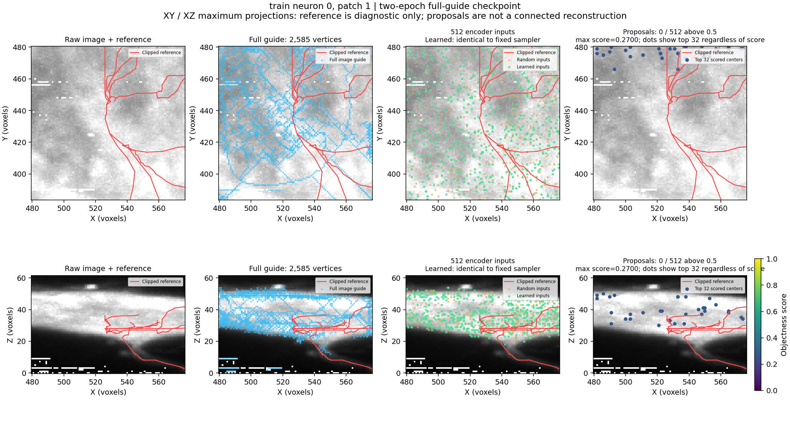
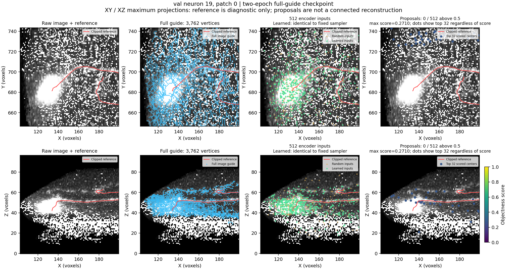

# Visual inspection of the user-run full-guide checkpoint

The user's local run `sampling-smoke_20261010_182727_1596` completed two epochs
on the RTX 3070 Ti Laptop GPU. Its checkpoint reloads and produces finite
outputs. Inspection used all eight cached patches, in evaluation mode without
gradients or optimizer updates. The existing checkpoint and cache were unchanged.

## Training execution

| Measurement | Epoch 1 | Epoch 2 |
|---|---:|---:|
| Annotated-patch training proposal loss | 51.7100 | 50.5225 |
| Annotated-patch validation proposal loss | 8.8948 | 8.8931 |
| Learned alpha | 0.249631 | 0.249360 |

Alpha started at 0.25 and received nonzero gradients in all four training
batches. Training took 5.0 seconds within the approximately 38-second launcher
run. Only one of four train patches and two of four validation patches have
cached reference nodes. Unannotated patches contribute guide loss, with no
fabricated negative proposal labels. The small loss decreases are execution
evidence, not a demonstrated reconstruction improvement.

## What is visible

Left to right, the figures show raw image/reference, full guide/reference,
learned and random inputs/reference, and scored proposal centers/reference.
Top is XY, bottom XZ. Red is the clipped reference; cyan is the full guide;
green the learned inputs; orange the random inputs. Proposal dots show the
top 32 centers regardless of score; **they do not imply acceptance**.
Scores at least 0.5 would receive a green outline.





For these two patches, reference-curve proximity within **three voxel units** is:

| Patch | Full guide | 1,024 candidates | 512 random inputs | 512 fixed inputs | 512 learned inputs |
|---|---:|---:|---:|---:|---:|
| Train chick 0 / patch 1 | 19.1% | 36.7% | 18.5% | 23.8% | 23.8% |
| Validation fly 19 / patch 0 | 96.1% | 72.3% | 57.4% | 50.3% | 50.3% |

Reference curves include full-SWC edges clipped to each box, including boundary
crossings. Metrics are measured in the run's saved isotropic voxel ruler. They
are not segmentation precision, connectivity or reconstruction F1. The fly
patch with one local reference node is included in the machine report but is
not used as a meaningful branch-coverage example. Five patches have no clipped
reference points and retain null reference metrics.

The learned and fixed samplers selected the **same unordered candidate sets on
all eight patches**, using the same seed per patch. Tiny probability changes
altered ordering in seven patches, so equality of ordered indices is recorded
separately. Matching sets after four updates does not mean the sampler failed
to receive gradients or cannot learn. This is one seed and a tiny run; random
versus guided results differ by patch and do not establish a method ranking.

Every patch produced **zero of 512 proposals with score at least 0.5**. Maximum
scores across patches ranged from 0.2680 to 0.2720. Conservative initialization
starts with positive-class score approximately 0.269; median center offsets were
0.0014–0.0080 voxels across patches. The checkpoint remains close to its initial
behavior. No proposal connectivity or full-volume SWC reconstruction was run.

## Interpretation to discuss together

Retaining full guides removes an avoidable information loss, but does not repair
the chick's extracted guide. Its cyan structures extend through broad image
regions and have weak support for the traced branches. Mask specificity and
branch continuity need further work; incomplete reference traces cannot prove
that every extra structure is noise.

The informative fly patch has strong full-guide support, then loses support in
candidate preparation and selection. That points to a separate representation
limitation. A broader controlled candidate/selection comparison is needed; these
two patches do not justify universally increasing every point budget or choosing
a new selection rule.

The next proposed work is automatic mask assessment on additional training
examples and candidate/branch-support assessment, followed by an agreed cache
recipe and matched longer training. No preprocessing method was promoted by
this inspection, and PointNeXt remains a later stage.

## Files and reproduction

Entry script: `scripts/pointneuron2/inspect_sampling_checkpoint.py`.
Full metrics and provenance:
[report.json](checkpoint_inspection_full_guides_seed0/report.json).
Its `generated_artifact_root` points to ignored raw crops, selected inputs,
centers, scores and reference arrays for all eight patches. The report separates
ordered selection equality from unordered candidate-set equality, and records
the original inference and figure-postprocessing hashes.

Source/configuration integrity, cache file hashes, source volume/SWC hashes and
checkpoint-manifest provenance were checked. Candidate XYZ and raw intensities
were checked against the original images. The two main figures were visually
inspected. Source references appear only in metrics and overlays; they never
enter the sampler or encoder.

From the real local `pointneuron2` folder, choose a fresh output path:

```powershell
$inspectionRun = "tmp/pointneuron2/local_runs/sampling-smoke_20261010_182727_1596"
& .\tmp\pointneuron2\sampling_env\Scripts\python.exe -u scripts/pointneuron2/inspect_sampling_checkpoint.py `
  --root "C:/Users/Seywe/Documents/GitHub/PointNeuron/data/gold166" `
  --manifest "$inspectionRun/cache/manifest.json" `
  --checkpoint "$inspectionRun/model/proposal.pt" `
  --output-dir "tmp/pointneuron2/checkpoint_inspection_new" `
  --device cuda
```

This command performs cached-patch inference and plotting only.
