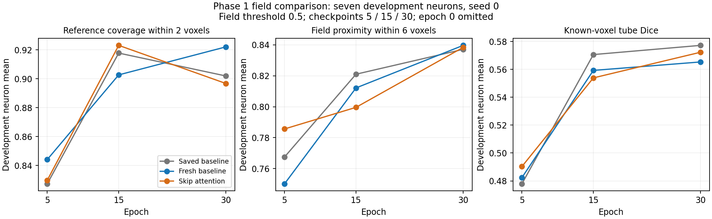
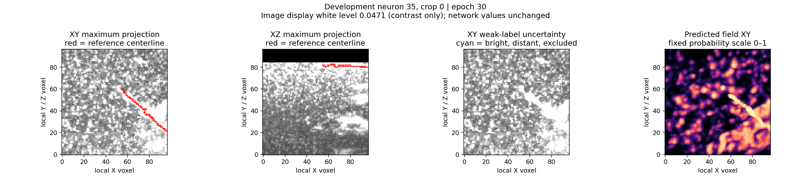
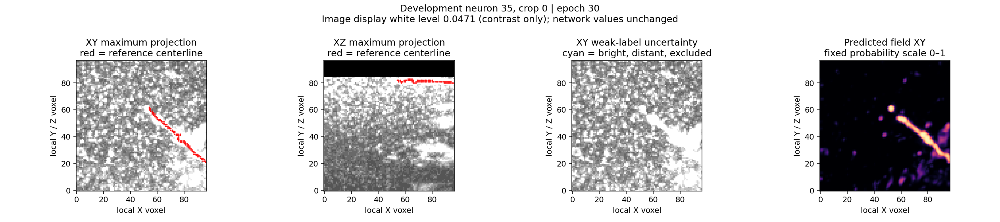
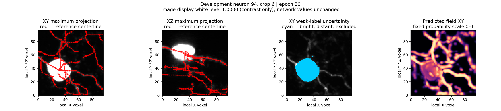
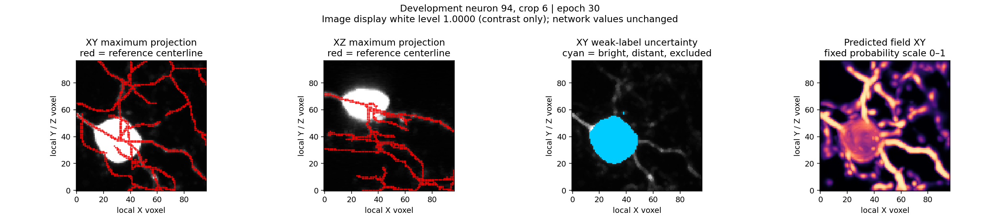

# Phase 1 skip attention: cleaner targeted predictions, uneven branch retention

13 October 2026. Both agreed 30-epoch fits completed. **The two skip gates help
the targeted neuron-35 dilution case, but do not improve development fields
consistently.** At the fixed final checkpoint, average reference coverage falls,
average field proximity barely changes, and known-voxel Dice rises slightly.
Attention is not promoted. The already-approved fixed-budget sampling comparison
is the next action; it has not run yet.

## What we tested

Fresh baseline U-Net versus the same backbone with two additive skip gates:
88,673 versus 89,167 parameters. Both loaded the exact shared backbone tensors
from the original pilot's epoch-0 checkpoint and used identical recorded crop
order. Same native image cache, weak labels, loss, AdamW LR .001, batch 1,
float32, no augmentation, seed 0 and 30 epochs. Each fit used 211 supervised
crops from 33 training neurons and made 6,330 optimizer updates. Development
contains 56 crops from seven neurons, including 47 supervised crops.
Reserved test records: zero.

This tests decoder-conditioned skip-feature filtering within the Phase 1 field
guide. It does not test pairwise self-attention, enforce connected paths, or run
PointNeXt, the Transformer proposal stage or GATv2. Those later stages remain
part of the intended PN 2.0 architecture. This is a patch study, not a whole-neuron
SWC evaluation or a matched comparison against PN 1.0.

## Final development results

Field threshold .5; metrics are means over development neurons. Coverage measures
reference length near accepted field voxels. Proximity measures accepted field
voxels near the reference; it is not biological precision because reference
annotations can be incomplete. Known-voxel Dice excludes the unknown/padding
mask. None of these is topology F1 or a finite-budget point-cloud measurement.

| Metric | Fresh baseline | Skip attention | Attention minus baseline |
| --- | ---: | ---: | ---: |
| Reference coverage within 2 voxels | 92.21% | 89.67% | **−2.54 percentage points** |
| Reference coverage within 6 voxels | 97.51% | 96.89% | −0.63 points |
| Field proximity within 6 voxels | 83.96% | 83.84% | −0.13 points |
| Known-voxel tube Dice | 0.5653 | 0.5723 | +0.0070 |

Training means also fall: coverage within two voxels goes from 93.44% to 91.19%,
proximity from 88.87% to 87.94%, and Dice from .6266 to .6014. These measurements
do not establish a generalization advantage for the gates.



Attention coverage peaks at epoch 15 (92.31%) and falls at epoch 30 (89.67%),
while its development Dice increases. This illustrates why Dice alone does not
answer whether reference branches survive. The comparison remains fixed at
epoch 30 as agreed; there is no retrospective checkpoint substitution.
Epoch 0 is omitted from the plot: dense untrained predictions can give high
coverage while having very poor proximity and Dice.

## Where attention helps and hurts

| Development neuron | Baseline coverage, 2 voxels | Attention coverage | Baseline proximity, 6 voxels | Attention proximity |
| --- | ---: | ---: | ---: | ---: |
| 19 | 95.94% | 86.25% | 77.15% | 67.47% |
| 21 | 98.08% | 96.65% | 82.27% | 82.54% |
| 35 | 91.66% | 91.63% | 68.66% | 79.06% |
| 44 | 84.12% | 85.54% | 87.21% | 87.38% |
| 79 | 96.21% | 92.52% | 89.15% | 91.36% |
| 94 | 79.89% | 75.47% | 86.10% | 80.01% |
| 135 | 99.57% | 99.66% | 97.22% | 99.02% |

Coverage declines in five of seven neurons. Proximity improves in five, with
substantial losses in 19 and 94. Mean changes hide opposing effects.

### Neuron 35, crop 0: the targeted dilution case improves

Coverage stays close: **96.10% → 94.80%**, while proximity rises
**10.58% → 93.88%**. Accepted field voxels decrease from 7,228 to 686.
The saved projections show the baseline's large off-reference blobs largely
removed, leaving support concentrated around the annotated structure.
This supports the intended gate mechanism on this crop. It does not prove that
every removed voxel was a biological false positive.

Fresh baseline:



Skip attention:



Crop 35/2 improves less: coverage remains 100%, proximity rises 22.77% → 35.80%,
and accepted voxels decrease 14,047 → 8,143. Much off-reference support remains.
[Baseline overlay](field_attention_results_seed0/baseline_sample_0035_patch_002.png),
[attention overlay](field_attention_results_seed0/attention_sample_0035_patch_002.png).

### Neuron 94, crop 6: both coverage and proximity worsen

Coverage falls **81.05% → 61.90%**, proximity **84.25% → 75.02%**.
The attention field retains less support along low-contrast reference branches.
This is a material regression, not a harmless trade of coverage for cleaner support.

Fresh baseline:



Skip attention:



Other inspected crops show the same need to inspect retention, not just density:

| Crop | Coverage baseline → attention | Proximity baseline → attention | Saved overlays |
| --- | ---: | ---: | --- |
| 19/5 | 100% → 79.78% | 92.68% → 93.97% | [Baseline](field_attention_results_seed0/baseline_sample_0019_patch_005.png), [attention](field_attention_results_seed0/attention_sample_0019_patch_005.png) |
| 44/7 | 63.78% → 67.84% | 97.11% → 100% | [Baseline](field_attention_results_seed0/baseline_sample_0044_patch_007.png), [attention](field_attention_results_seed0/attention_sample_0044_patch_007.png) |
| 79/4 | 77.76% → 59.84% | 70.62% → 88.66% | [Baseline](field_attention_results_seed0/baseline_sample_0079_patch_004.png), [attention](field_attention_results_seed0/attention_sample_0079_patch_004.png) |
| 94/2 | 74.05% → 64.04% | 81.14% → 62.16% | [Baseline](field_attention_results_seed0/baseline_sample_0094_patch_002.png), [attention](field_attention_results_seed0/attention_sample_0094_patch_002.png) |

The plots are maximum-intensity projections of saved 3D outputs; quantitative
metrics are calculated in 3D. Projections alone cannot establish connectivity.

## Replay variation and execution verification

The fresh baseline differs from the saved original pilot despite exact shared
starting tensors and matched crop order. Original → fresh development coverage
is **90.19% → 92.21%**, proximity **83.71% → 83.96%**, and Dice
**.5772 → .5653**. The observed Dice replay difference (.0119) exceeds the
attention-versus-fresh Dice gain (.0070). One replay is not a statistical noise
bound; the source of training variation has not been isolated. Recorded
deterministic-algorithm and deterministic-CuDNN settings are false.
The fresh baseline remains the primary comparator.

Paired execution checks passed. A separate CPU review verified the original
shared initialization, both 30-epoch crop orders, report agreement, unchanged
training sources and all final field hashes. It recomputed all **112 final
development field measurements** and their neuron means from the saved float32
arrays and native coordinates. The review performed **zero model inference
passes and zero optimizer updates**. Both checkpoint reloads reproduce logits
exactly (maximum delta 0) across the seven checked development neurons.
The original pilot and native cache were preserved.

Measured fit times: baseline **17m12s**, attention **17m33s**. Paired runner
elapsed time: **34m48s**; the user's complete command took **35m19s**.
Peak allocated CUDA memory: 613.2 versus 704.1 MiB. These are observed run
measurements, not a controlled hardware benchmark.

Readable evidence committed with this report:

- [Independent audit and exact final metrics](field_attention_results_seed0/audit_summary.json)
- [Fresh baseline recipe, backend, training curves and per-neuron checks](field_attention_results_seed0/baseline_summary.json)
- [Attention recipe, backend, training curves and per-neuron checks](field_attention_results_seed0/attention_summary.json)

Full reports, fields and checkpoints remain locally under
`tmp/pointneuron2/local_runs/field_attention_20261013/`; they are ignored artifacts.
The copied inspection overlays above are unchanged originals.

## Conceptual conclusion and agreed next step

The gates can filter irrelevant-looking local field support, but filtering can
also suppress reference branches. **Skip attention does not by itself solve
reliable branch preservation or connectivity.** These results narrow the
hypothesis: the neuron-35 failure is responsive to feature filtering; neuron-94
support remains difficult and is worsened by this particular intervention.
They do not establish that attention in general is unsuitable.

The next comparison asks whether these field changes produce better finite-budget
point clouds. The sampler uses the union of raw-image candidates and field
candidates, so lost field support need not always mean a lost input point; fewer
off-reference candidates may also reduce dilution. Field metrics cannot settle
that question.

Run the already-approved separate comparison visibly on your local GPU:

```powershell
Set-Location "C:\Users\Seywe\Documents\GitHub\PointNeuron\pointneuron2"
& .\scripts\pointneuron2\run_field_attention.ps1 -Action compare
```

This uses both fixed epoch-30 checkpoints, the same 56 development crops,
unchanged four controls A/B/C/D, budgets 512/2,048 and seeds 0–4. It makes
**zero optimizer updates**. The prior single-model comparison took 4m24s;
allow roughly 8–12 minutes for two arms, subject to I/O and system load.
Outputs are `baseline/comparison/`, `attention/comparison/` and
`sampling_comparison.json` inside the same experiment folder.

Review matched-count coverage/proximity, the neuron-35 dilution cases,
neuron-94 retention and neuron-79 chain gaps. Expanded-mode availability
differences are flagged separately. No threshold sweep, selector change,
new training, SWC reconstruction or automatic model promotion is included.
