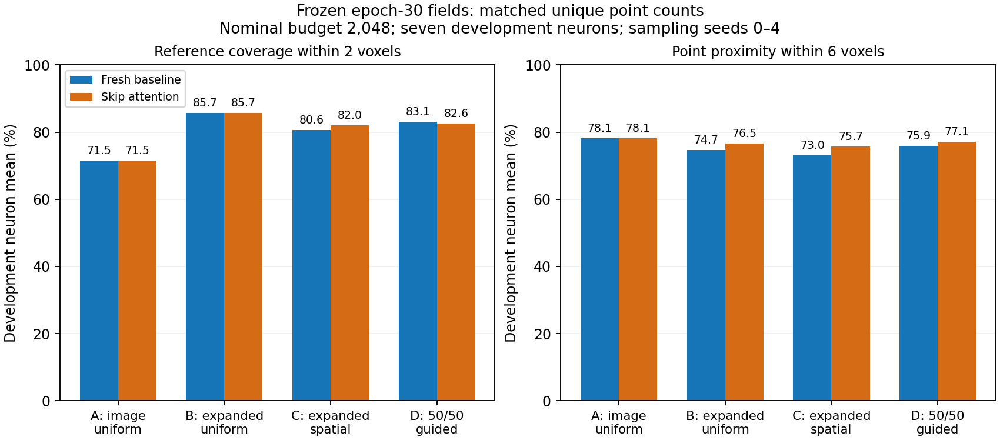

# Attention sampling: targeted cleanup survives, branch retention remains uneven

13 October 2026. The approved frozen-checkpoint comparison completed in **8m20s**
with zero optimizer updates. **Attention improves average point proximity at
matched counts and fixes the extreme dilution in crop 35/0, but loses support
on several other neurons.** Neither the attention field nor the 50/50 guided
selector is promoted. No further training or strategy change has been launched.

## Fixed experiment

Both fresh epoch-30 models from the [paired training study](field_attention_results.md),
same 56 image-defined crops from seven development neurons, sampling seeds 0–4,
nominal budgets 512 and 2,048, unchanged field threshold .5 and 8-voxel spatial
cells. No test records, whole-arbor evaluation, SWC reconstruction or later
PointNeXt/Transformer/GATv2 execution. Both fits share initial backbone tensors
and training order; observed baseline replay variation remains a limitation.

The unchanged controls are:

- **A:** uniform sampling from original image foreground F.
- **B:** uniform sampling from expanded candidates C = F union predicted field P.
- **C:** score-independent spatial coverage sampling from expanded candidates.
- **D:** half guide spatial/score selection, half spatial context from the
  remaining expanded pool. D does not reserve half its points for original F;
  its context can also come from field-only additions.

Matched mode uses N = min(budget, |F|) for every control and both models.
Expanded mode lets B/C/D use min(budget, |C|); A remains limited to F.
These are unique image-voxel points, without padding or duplication.

Coverage is reference length within two voxels of a selected point. Proximity is
the fraction of points within six voxels of reference segments. Proximity is
reference agreement, not verified biological precision: annotations may be
incomplete. All means below average within each neuron before averaging the
seven neurons. No connections between selected points are inferred by these metrics.

## Equal-count results at nominal budget 2,048

| Control | Baseline coverage | Attention coverage | Baseline proximity | Attention proximity |
| --- | ---: | ---: | ---: | ---: |
| A: image uniform | 71.47% | 71.47% | 78.13% | 78.13% |
| B: expanded uniform | **85.69%** | **85.68%** | 74.74% | 76.52% |
| C: expanded spatial | 80.61% | 81.97% | 73.04% | 75.65% |
| D: 50/50 guided | 83.08% | 82.61% | 75.94% | 77.09% |

For B, attention preserves aggregate coverage (−0.002 percentage points) and
raises proximity by **1.78 points**. For C both means improve (+1.36 coverage,
+2.61 proximity). D gains 1.15 proximity points but loses .47 coverage points.
This is better than interpreting the field-only coverage decline as a universal
point-cloud decline, but it is not a uniform per-neuron improvement.

Expanded uniform B has higher mean coverage than D with either model. D can
improve proximity at the cost of coverage; it is not a universally better sampler.
Both models' B inputs cover about 14.21 points more reference length than A
at the same actual count. A points and coordinates are exactly identical across
models, as required for the image-only control; their field-score features differ.

At matched nominal budget 512, baseline → attention coverage/proximity are:

| Control | Coverage | Proximity |
| --- | ---: | ---: |
| A | 62.51% → 62.51% | 77.99% → 77.99% |
| B | 74.32% → 74.77% | 74.75% → 76.59% |
| C | 66.24% → 68.56% | 69.57% → 72.21% |
| D | 73.47% → 73.31% | 74.91% → 75.91% |

The attention-versus-baseline pattern therefore depends on the selector and
budget, rather than establishing one overall architecture winner.

## Gains and losses are localized

For B, matched nominal budget 2,048, means over each neuron's available annotated
crops and five seeds:

| Neuron | Baseline coverage | Attention coverage | Baseline proximity | Attention proximity |
| --- | ---: | ---: | ---: | ---: |
| 19 | 91.09% | 87.71% | 43.36% | 41.66% |
| 21 | 86.32% | 86.65% | 80.35% | 79.86% |
| 35 | 76.25% | 81.13% | 66.77% | 80.69% |
| 44 | 87.61% | 88.73% | 85.29% | 85.67% |
| 79 | 88.71% | 87.80% | 85.94% | 85.04% |
| 94 | 74.72% | 71.58% | 64.09% | 63.73% |
| 135 | 95.11% | 96.17% | 97.36% | 98.99% |

Coverage improves in four of seven neurons and falls in 19, 79 and 94.
Proximity improves in three and falls in four; the large neuron-35 gain drives
much of the aggregate benefit. These are development observations, not
statistical confidence intervals from independent training seeds.

Focused equal-count crop means across seeds:

| Crop / control | Actual N | Coverage baseline → attention | Proximity baseline → attention |
| --- | ---: | ---: | ---: |
| 35/0, B | 358 | **68.42% → 95.03%** | **12.57% → 94.97%** |
| 35/0, D | 358 | 49.00% → 95.06% | 6.70% → 88.27% |
| 35/2, B | 325 | 47.93% → 74.19% | 21.48% → 36.06% |
| 35/2, D | 325 | 28.99% → 31.25% | 10.89% → 11.20% |
| 94/2, B | 2,048 | 80.75% → 68.97% | 45.29% → 41.60% |
| 94/6, B | 2,048 | **65.90% → 53.36%** | 54.08% → 49.80% |
| 79/4, B | 2,048 | 48.66% → 46.56% | 50.69% → 50.15% |

The 35/0 field cleanup translates into useful sampled inputs at the same N.
But 35/2 remains diluted, especially under D. Its image-only A coverage is
83.00% at N=325, compared with attention B's 74.19% and D's 31.25%.
Image evidence already contains strong support here; union expansion and
allocation can discard it even when the full candidate pool covers 100%.

Neuron 94/6 has a different failure: full image foreground coverage is only
30.64%, so dim support needs field additions. Baseline full-union coverage is
88.42%, versus attention's 71.44%; attention loses support before finite-budget
selection. An image reservation cannot recover field-only candidates that are
absent, and may reduce their allotted points. That tradeoff must be measured.

## Path gaps remain a separate concern

For the same 73.57-voxel clipped reference chain 48 → 1 in crop 79/4, the mean
longest run without a point within two voxels, across five seeds at N=2,048:

| Control | Baseline gap | Attention gap |
| --- | ---: | ---: |
| A: image uniform | 9.56 voxels | 9.56 voxels |
| B: expanded uniform | **8.87 voxels** | **9.13 voxels** |
| C: expanded spatial | 11.88 voxels | 16.07 voxels |
| D: 50/50 guided | **20.77 voxels** | **23.11 voxels** |

D can cover more total reference length in this crop than B while leaving a
longer gap on this particular chain. Mean coverage and proximity alone do not
guarantee evenly supported paths. These are geometric support gaps, not measured
graph disconnections or final topology errors.

## Expanded-mode availability and inspection

At nominal 2,048 in expanded mode, B coverage baseline → attention is
91.18% → 89.57%, proximity 74.77% → 76.45%. D coverage is
91.03% → 89.48%, proximity 76.69% → 77.96%. Actual B/C/D counts differ
between models in **19 crops**, or 285 rows across the three controls and five
seeds. These means mix candidate availability with selection; matched mode is
the direct equal-count comparison. Counts do not differ between models at
nominal 512 in expanded mode.

For example, 35/0's union shrinks from 7,296 candidates to 757. Expanded-mode
baseline uses 2,048 points; attention uses all 757. The original overlays below
show expanded mode, nominal 2,048 and seed 0. Their displayed metrics are for
that seed/mode, not the matched five-seed averages above. Orange is context,
green is guide, cyan is reference; XY/XZ projections do not depict graph edges.

| Crop | Fresh baseline inspection | Attention inspection |
| --- | --- | --- |
| 35/0 | [Baseline](field_attention_sampling_results_seed0/baseline_sample_0035_patch_000.png) | [Attention](field_attention_sampling_results_seed0/attention_sample_0035_patch_000.png) |
| 35/2 | [Baseline](field_attention_sampling_results_seed0/baseline_sample_0035_patch_002.png) | [Attention](field_attention_sampling_results_seed0/attention_sample_0035_patch_002.png) |
| 79/4 | [Baseline](field_attention_sampling_results_seed0/baseline_sample_0079_patch_004.png) | [Attention](field_attention_sampling_results_seed0/attention_sample_0079_patch_004.png) |
| 94/6 | [Baseline](field_attention_sampling_results_seed0/baseline_sample_0094_patch_006.png) | [Attention](field_attention_sampling_results_seed0/attention_sample_0094_patch_006.png) |

## Verification and saved evidence

Both runs pass paired execution checks, make zero optimizer updates and reproduce
their saved final probability fields exactly (maximum score delta 0). Each has
56 inference passes. Combined runner elapsed time is 494.14 seconds; the user's
terminal command took 8m20s. Original cache and pilot artifacts are preserved.

A separate CPU audit verified **5,470 unique cloud files**, their unique counts,
native coordinates, original raw intensities, float32 field scores and valid
voxel provenance. All 8,960 report rows agree with their saved measurement
files; all macro summaries were recomputed. Both models' image-only point
arrays match exactly. Protected artifact hashes were checked, and reference
coverage, proximity and gap measurements were recomputed from geometry for
**40 focused seed-0 matched clouds** (five crops × four controls × two models).
This review made zero model inference passes and zero optimizer updates.

- [Audit counts, exact summaries, per-neuron/crop means and five-seed path data](field_attention_sampling_results_seed0/audit_summary.json)
- [Compact paired report, recipe, hashes and execution checks](field_attention_sampling_results_seed0/paired_summary.json)

Complete clouds/measurements remain in the ignored local experiment folder:
`tmp/pointneuron2/local_runs/field_attention_20261013/{baseline,attention}/comparison/`.
The paired full report is `sampling_comparison.json` in the experiment root.

## Conclusion and proposed next comparison

Update: the user approved and completed this control. The
[quota results](field_image_reservation_results.md) show targeted dilution gains
and dim-support costs; it is not promoted. The
[protocol](field_image_reservation_ready.md) records the separate implementation.

Field-guided expansion has a measured benefit over the original threshold-only
input at equal counts. The remaining limitation has **two parts**: uneven field
predictions (especially dim-support loss), and budget allocation that can dilute
good image evidence or leave long support gaps. This experiment confirms a
specific attention benefit; it does not establish a reliable replacement field.

Recommendation for discussion: freeze the fresh baseline weights and test one
image-reservation control before further training. Reserve half the actual point
budget for uniform original-foreground points, then uniformly fill the remaining
slots from the expanded pool excluding those already chosen. Compare against
saved B at the same N, seeds and seven development neurons. This isolates a
quota change without adding score ranking or spatial gate changes. Measure the
neuron-35 dilution benefit, neuron-94 dim-support cost and neuron-79 path gaps.

This is a proposed bounded diagnostic, not a promised universal solution. No
new selector is adopted by this report. The approved control is implemented
separately and its completed development comparison is linked above. Point-cloud → PointNeXt
→ Transformer → GATv2 remains the intended architecture; this report evaluates
only the candidate Phase 1 input guide and selectors.
