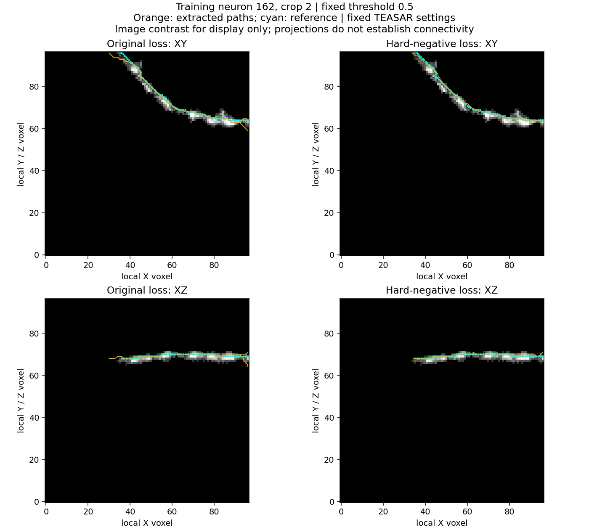
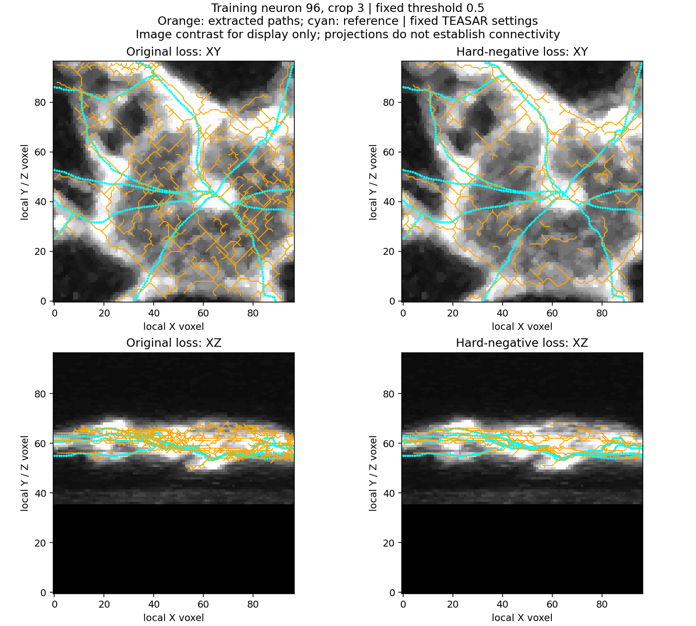

# Frozen fields produce a good simple path; crowded paths remain problematic

12 October 2026. The user approved the proposed center-path diagnostic and
asked whether there is reason for optimism. There is now evidence of improvement
in the extracted geometry of a simple training case, as well as the earlier
pixel-field improvement. This is encouraging component evidence, not a result
on unseen neurons or a complete PointNeuron reconstruction.

No training was run. Four frozen forward passes reproduced the selected field
measurements; CPU extraction then used the existing `image_medial_skeleton`
function. Both checkpoints and original reports are unchanged. The actual
diagnostic loop took **7.34 seconds**, excluding imports, cache checks and
checkpoint loading. Validation and the failed original learning gate remain
unchanged.

## Fixed diagnostic setup

Pre-agreed training cases: **162/2**, a simple branch, and **96/3**, a crowded
zebrafish crop. Compare original all-negative and improved hard-negative
400-update checkpoints. Preserve all accepted native voxels at **probability
0.5**, excluding padding. No point budget, GT-dependent seed, path repair or
reference-based selection is applied.

Use recorded settings with Kimimaro **5.8.5**: native unit spacing,
TEASAR scale 1.5/constant 2, dust threshold 8, branching fix enabled,
borders fix/holes fill disabled, PDRF exponent 4/scale 100000, one CPU worker.
These are the existing extraction settings, not tuned to the results. Alpha
and sampling-mixture settings are retained in metadata but are not used by
this extraction function.

The reference SWC is read **after both arms have been extracted**. Paths and
reference edges are probed at at most one-voxel intervals, weighted by arc
length. Each probe's distance is computed to continuous segment interiors,
not just sparse vertices. Predicted-path proximity uses the full reference
forest, as the original field distance target does. Reference coverage uses
the continuous reference segments clipped to the original image-defined
patch. Values approximate arc-length integrals through fixed sampling.

Isolated zero-length reference points are tracked separately; both selected
cases have none. Coordinates remain native acquisition voxels, not micrometers.
Component/end-point counts describe extracted graphs; they do not establish
correct neuronal connectivity.

## Simple branch 162/2

| Measurement | Original field -> path | Improved field -> path |
| --- | ---: | ---: |
| Mean extracted-path distance to reference | 1.16 voxels | **0.58 voxel** |
| 95th-percentile extracted-path distance | 4.43 voxels | **1.25 voxels** |
| Extracted path length within 2 voxels of reference | 81.4% | **99.0%** |
| Reference length within 2 voxels of extracted path | 96.8% | **100%** |
| Extracted path length / reference length | 97.9 / 76.3 voxels | **84.3 / 76.3 voxels** |
| Components / endpoints / branch vertices | 1 / 3 / 1 | **1 / 2 / 0** |

The extra extracted spur relative to the reference disappears. The remaining
single path tracks the reference closely in both XY and XZ views, though it
still has some extra length near the ends. A low hard voxel Dice for a field
can coexist with a useful center path in a simple case: field width and
center-path geometry are different measurements. The failed gate is not
silently replaced by these favorable selected-case results.

Orange: extracted paths; cyan: reference. Image contrast is for display only.
These projected overlays are illustrative; the distances above are measured
in native 3D coordinates.

## Crowded crop 96/3

| Measurement | Original field -> paths | Improved field -> paths |
| --- | ---: | ---: |
| Extracted path length within 6 voxels of reference | 55.3% | **67.5%** |
| Mean extracted-path distance to reference | 6.06 voxels | **4.98 voxels** |
| 95th-percentile extracted-path distance | 15.10 voxels | **14.22 voxels** |
| Reference length within 2 voxels of extracted paths | 76.6% | **75.0%** |
| Mean reference distance to extracted paths | 1.40 voxels | **1.49 voxels** |
| Extracted path length / reference length | 2432 / 597 voxels | **1424 / 597 voxels** |
| Components | 2 | **9** |

The improved version has substantially less excess path and fewer branch
vertices (288 -> 99), but still about **2.4 times** the reference path length.
Roughly one third of extracted length is farther than six voxels from the
reference. Crowding is therefore **not merely a thick-mask scoring problem**:
substantial off-reference structure survives actual center-path extraction.
Some of it could be real untraced structure; biological identity is unresolved.

The tradeoff matters: finer two-voxel reference coverage worsens slightly,
despite perfect six-voxel coverage in both arms. The change from two to nine
components could reflect removed false bridges or new breaks; component count
alone cannot decide. No edge matching or topology-F1 evaluation is claimed.

## What this means for confidence and the next decision

There is reason for **cautious optimism**. The loss change has a controlled
effect on all eight training-crop fields, and the simple-case improvement
carries through a fixed extraction method. This is a stronger result than
successful execution alone. The crowded case limits that confidence: both
path precision and local placement still need work, and unseen-neuron
performance has not been tested.

Retain the current candidate and frozen primary gate. Avoid another blind
loss/architecture change. A useful next diagnostic would feed an **ideal
reference-derived tube** into the same fixed extractor on these training
crops as a separately labeled oracle control. This would test how much
crowded-path error the extractor creates even with ideal input, versus error
originating in the learned field. Oracle output would be diagnostic ground
truth input, not model inference, training data changes or an automatic
reconstruction result. **That additional control has not been run.** Discuss
it together before implementation. No long training or validation command
is needed at this point.

## Execution checks and visible artifacts

**Five focused tests passed in 3.40 seconds**: exact segment-interior distances
and subdivision/degenerate geometry, arc-length weighting and missing-path
reporting, plus existing extractor tests for native frame/anisotropy/thin
branches, caps, components and dust removal. Real extraction checks verified
finite in-bounds coordinates, valid edge indices and accepted image support
at extracted vertices. These are execution checks; quality conclusions use
the actual measurements above.

- [Complete diagnostic and provenance](field_centerpaths_results_seed0/centerpaths.json)
- [Earlier eight-crop field comparison](centerline_loss_control_results.md)
- Entry script: `scripts/pointneuron2/audit_field_centerpaths.py`
- Raw path vertex/edge arrays: ignored `tmp/pointneuron2/local_runs/centerline_centerpaths_20261012`

The two figures and JSON are copied into visible docs. Raw arrays are not
committed. No environment changes were needed: the existing Kimimaro method
works independently of the incompatible optional scikit-image thinning step.
