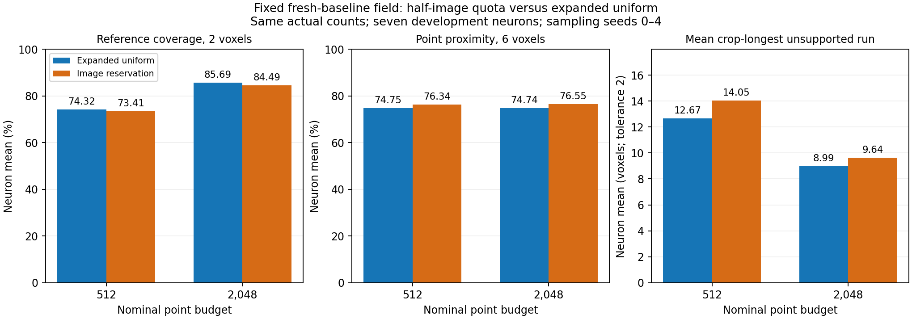
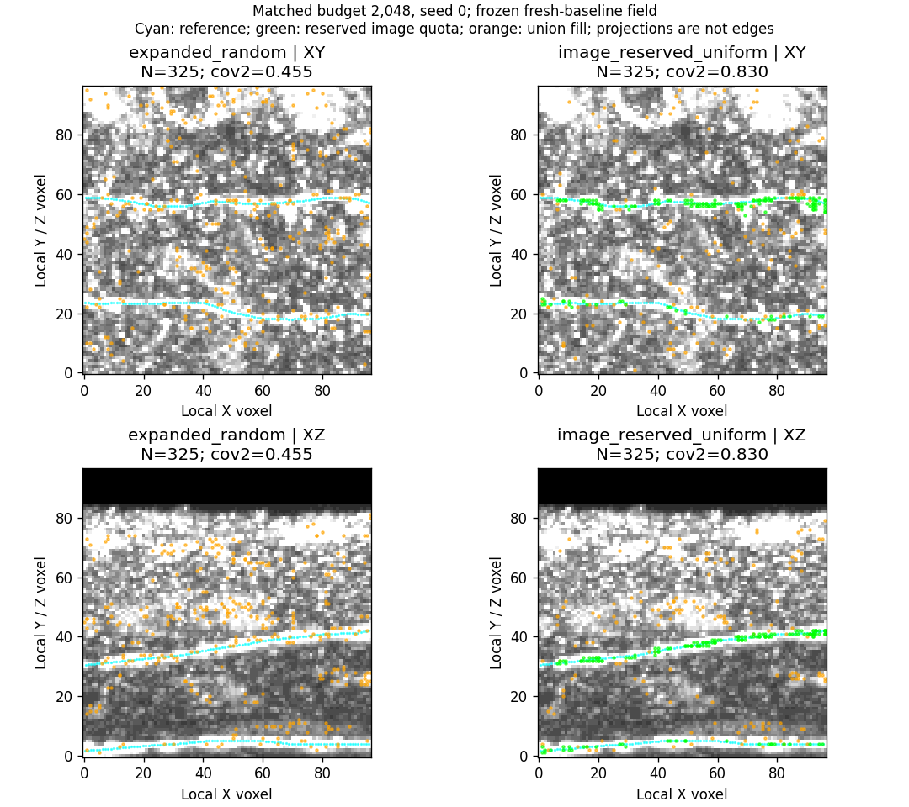
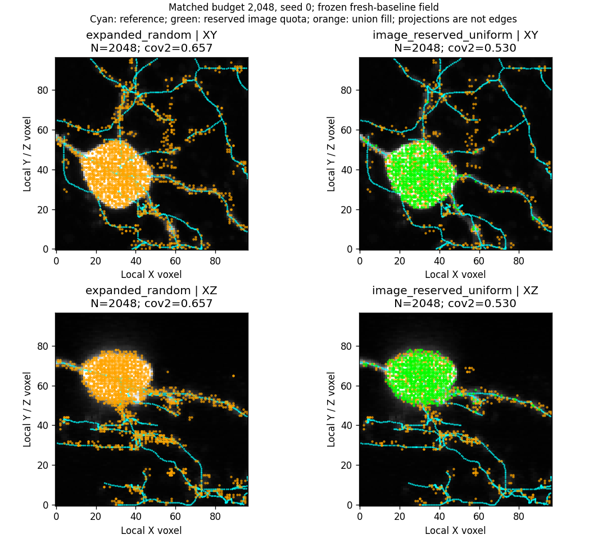

# Half-image reservation: fixes dilution locally, costs dim support globally

13 October 2026. The approved frozen-field quota comparison completed in
**1m28s**, with **zero inference passes and zero optimizer updates**.
The half-image quota strongly improves the neuron-35 dilution cases, but mean
reference coverage falls and mean longest support gaps increase. **This fixed
quota is not promoted.** It remains an informative diagnostic control.

## Fixed comparison

Only allocation changed. Both arms use the same fresh ungated baseline field
at epoch 30, original image foreground F and field-expanded pool F union P.
Control B is the saved uniform-expanded selection. Reservation draws
`floor(N/2)` uniform F points, then uniformly fills the remaining slots from the
union excluding those already selected. Fill can select more foreground points.
No new score ranking, spatial selector, threshold, field inference or training.

All 56 image-defined development crops from seven neurons, sampling seeds 0–4,
nominal budgets 512 and 2,048. Both arms have identical actual counts
`N = min(budget, |F|)`. Low-foreground crops have fewer than the nominal budget;
there is no padding or repeated point. There are 560 matched pairs / 1,120
rows. Reserved test records and final SWC reconstruction remain excluded.

Coverage is reference length within two voxels of input points; proximity is
input points within six voxels of reference segments. Proximity is reference
agreement, not verified biological precision with incomplete annotations.
Means average crops/seeds within each neuron, then the seven neurons.
A support gap is a reference run without a nearby point, not a graph cut.

## Aggregate measurements

| Nominal budget | Metric | Expanded uniform | Half-image reservation | Change |
| --- | --- | ---: | ---: | ---: |
| 512 | Reference coverage, 2 voxels | 74.32% | 73.41% | −0.91 percentage points |
| 512 | Point proximity, 6 voxels | 74.75% | 76.34% | +1.59 points |
| 512 | Mean crop-longest gap, tolerance 2 | 12.67 voxels | 14.05 voxels | +1.38 voxels, worse |
| 2,048 | Reference coverage, 2 voxels | **85.69%** | **84.49%** | **−1.19 points** |
| 2,048 | Point proximity, 6 voxels | 74.74% | 76.55% | +1.81 points |
| 2,048 | Mean crop-longest gap, tolerance 2 | **8.99 voxels** | **9.64 voxels** | +0.64 voxels, worse |

At nominal 2,048, mean worst-chain coverage also falls 62.24% → 60.39%,
and critical-reference-point coverage 73.51% → 71.94%. At 512, critical
coverage improves 59.79% → 62.92% despite lower mean length coverage.
Different metrics capture different retention effects; proximity gains alone
do not justify adopting the quota.

## Per-neuron changes at nominal 2,048

Reservation minus expanded uniform. Positive coverage/proximity deltas improve
those measures; negative longest-gap deltas improve the gap measure.

| Neuron | Coverage change | Proximity change | Mean crop-longest gap change |
| --- | ---: | ---: | ---: |
| 19 | −0.38 points | −0.74 points | −1.22 voxels |
| 21 | −3.35 points | +5.59 points | +1.86 voxels |
| 35 | **+5.11 points** | **+11.29 points** | +0.51 voxels |
| 44 | +2.14 points | −0.15 points | −1.39 voxels |
| 79 | −3.46 points | +1.77 points | +2.42 voxels |
| 94 | **−9.31 points** | **−6.12 points** | +2.14 voxels |
| 135 | +0.92 points | +1.06 points | +0.18 voxels |

Coverage improves in three neurons and declines in four. The same three gain
coverage at nominal 512, while neuron 94 loses 9.06 points. This does not prove
every image quota would fail, but the tested fixed half-budget rule does not
deliver consistent retention on these development cases.

## Why useful image protection can still hurt

Selected crop means over five seeds, at matched nominal budget 2,048:

| Crop | Actual N | Coverage uniform → reserved | Proximity uniform → reserved |
| --- | ---: | ---: | ---: |
| 35/0 | 358 | **68.42% → 92.04%** | 12.57% → 53.97% |
| 35/2 | 325 | **47.93% → 81.60%** | 21.48% → 59.51% |
| 94/2 | 2,048 | 80.75% → 70.09% | 45.29% → 41.26% |
| 94/6 | 2,048 | **65.90% → 53.29%** | 54.08% → 46.07% |
| 79/4 | 2,048 | 48.66% → 46.54% | 50.69% → 50.31% |

In 35/2, mean selected foreground count rises **6.2 → 163.8**. The raw
foreground contains narrow annotated structures, while the much larger field
pool contains considerable off-reference support. Reserving 162 points for F
protects useful evidence from dilution. The targeted hypothesis is supported
here: allocation itself was losing branch support.

In 94/6, mean selected foreground count rises **1,384.2 → 1,704.0** out of
2,048. Field-only points therefore fall **663.8 → 344.0**. The saved projection
shows quota points concentrated on the bright central body, while dim reference
branches have fewer points. Original foreground alone has limited reference
coverage here; protecting it does not protect every useful branch.

These observations explain the opposing effects without identifying all
off-reference structures as biological false positives. A fixed raw-foreground
quota cannot distinguish informative thin structures from an oversized bright
region. It changes allocation, not field candidate eligibility.

## Same-chain check versus worst-gap summaries

The particular clipped 73.57-voxel reference chain **48 → 1** in 79/4 has
mean longest unsupported run **8.87 → 8.13 voxels** across five seeds. This
small improvement has substantial seed variation: reservation gaps range
3.99–15.83 voxels. At seed 4 the gap worsens 7.96 → 15.83 voxels.

Across all chains in 79/4, the crop-longest gap instead worsens
**25.15 → 31.18 voxels**. Across neuron 79 its mean increases 2.42 voxels.
The quota does not consistently repair path support, even though the previously
examined chain's average improves. A crop maximum can refer to another chain;
these measurements should not be conflated.

Additional original paired inspections:

- [35/0](field_image_reservation_results_seed0/sample_0035_patch_000.png)
- [94/2](field_image_reservation_results_seed0/sample_0094_patch_002.png)
- [79/4](field_image_reservation_results_seed0/sample_0079_patch_004.png)

Inspections show nominal 2,048 and seed 0; displayed coverage differs from the
five-seed means. Cyan is reference, green the reserved quota, orange union fill.
XY/XZ projections do not show inferred connections.

## Execution and independent saved-output audit

All paired execution checks pass. Runner time is 84.19 seconds; terminal time
1m28s. Zero field inference passes, optimizer updates and test records.
Existing source fields and control clouds are reused and preserved.

The CPU review checked **820 distinct cloud files** (410 per arm, reused across
budget rows when actual N is the same), native coordinates/raw intensities,
float32 scores, unique counts and valid candidate membership. It reproduced
every quota mask and seeded selection from saved image inputs, checked
**3,605 protected hashes**, matched all 1,120 rows to detail files and recomputed
macro summaries and all paired deltas. Reference geometry measurements were
recomputed for **10 focused seed-0 clouds**. The review made zero model inference
passes and zero optimizer updates.

- [Audit, exact macros, per-neuron/crop measurements and five-seed chain data](field_image_reservation_results_seed0/audit_summary.json)
- [Compact completed comparison report](field_image_reservation_results_seed0/comparison_summary.json)
- [Approved recipe, source links and reproducible command](field_image_reservation_ready.md)

Full clouds, chain measurements and logs remain in the ignored local
`tmp/pointneuron2/local_runs/field_image_reservation_20261013` experiment and its
adjacent console log. Published inspection images are unchanged copies.
No production selector or downstream architecture was changed.

## Conceptual conclusion and proposed next step

This bounded comparison is complete. **The fixed half-image quota is not
selected as a general default.** Neuron-35 gains support the dilution diagnosis;
neuron-94 losses demonstrate the cost of reserving bright foreground
indiscriminately. Together with the attention study, this identifies
heterogeneous input failures, not a universal winning heuristic.

Field-expanded uniform remains a useful research reference: at matched nominal
2,048 it covers 85.69% of development reference length versus 71.47% for
image-only uniform inputs. That is measured input support, not proof of a
commercial-ready Phase 1, improved SWC topology or superiority over PN 1.0.
No matched end-to-end PN 1.0 comparison has been made here.

Recommendation for discussion: stop extending global allocation/attention
experiments for now, retain the existing expanded-uniform controls, and prepare
the intended **PointNeXt → Transformer** data interface and a small learnability
plan. The next question is whether the learned point-cloud model can recover
skeleton geometry from these imperfect but improved inputs. It must be tested,
not assumed. Phase 1 limitations remain explicit in later comparisons.

Before implementation or fitting, agree on input attributes, native/local
coordinates, actual counts/masking, continuous-reference targets, the frozen
input protocol and acceptance/reload criteria; estimate local GPU time before
launch. PointNeXt is still not implemented; the prior query decoder pilot used
DGCNN. GATv2 remains the intended later connectivity stage and was not executed
by this study. This recommendation begins the next design discussion; no new
training run or silent proposal change is authorized by these results.
