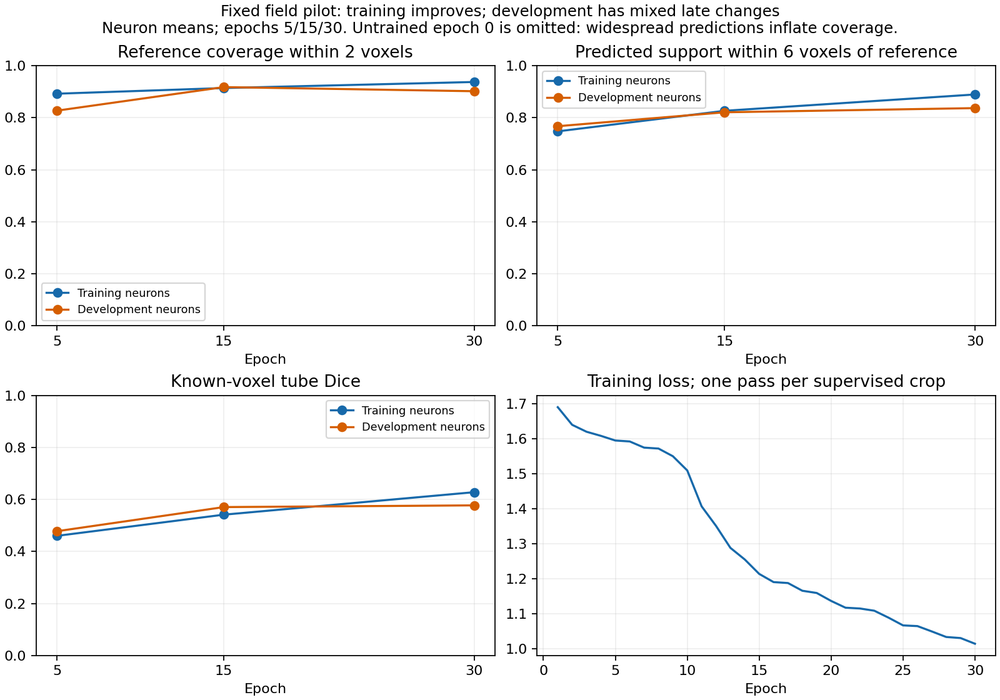

# Field pilot learns useful support; fixed-budget development comparison is next

13 October 2026. The user completed the agreed 30-epoch field pilot in **17 minutes
14 seconds** at the terminal; the recorded loop took 1,029.51 seconds. This is
faster than the representative preflight estimate of 25.9-38.8 minutes. The
run completed **6,330 updates**, using 211 supervised crops from 33 training
neurons. All 56 development crops from seven other neurons were reported, with
47 supervised and nine unannotated crops. Reserved test data stayed excluded.

The model learns reference-related support beyond the eight-crop fitting
experiment, but misses branches and adds off-reference locations in difficult
cases. This is a **candidate Phase 1 guide**, not an accepted complete model.
The intended PointNeXt -> Transformer -> GATv2 stages have not run here.
The four-control development sampling comparison is prepared but not run.

## Training and development results

Values average annotated crops within a neuron, then weight neurons equally.
The known-voxel Dice metric excludes uncertain regions and is not biological
segmentation accuracy. Coverage probes represent continuous in-box reference
segments with arc-length weights. Distances are native voxels, not micrometers.

| Epoch | Train coverage within 2 voxels | Development coverage within 2 voxels | Train proximity within 6 voxels | Development proximity within 6 voxels | Train tube Dice | Development tube Dice |
| --- | ---: | ---: | ---: | ---: | ---: | ---: |
| 5 | 89.24% | 82.73% | 74.77% | 76.75% | 0.4601 | 0.4779 |
| 15 | 91.42% | 91.78% | 82.67% | 82.10% | 0.5414 | 0.5706 |
| 30 | 93.75% | 90.19% | 88.94% | 83.71% | 0.6278 | 0.5772 |

Final development coverage within six voxels is **97.04%**. Six-voxel support
does not ensure accurate centers, continuous connections or preserved branch
parentage. The untrained epoch-zero field had 98.51% two-voxel coverage, but
only 4.52% proximity and Dice 0.0076: widespread background predictions can
inflate coverage. It is not a better model.

Training loss falls from 1.6908 at epoch 1 to 1.0144 at epoch 30 and is still
declining. From epoch 15 to 30, development Dice gains only **0.0066**, while
two-voxel coverage falls **1.59 percentage points**. Proximity improves by 1.61
points. This is a mixed late tradeoff, not proof that more training will repair
every case. Mean training Dice 0.6278 also shows incomplete fitting; this is
not simply a perfectly fitted training model failing everywhere else.



The final epoch remains **30**, as agreed. No retrospective checkpoint switch,
training extension, threshold change, augmentation or new architecture was made
while reviewing these results.

## Saved-field eligibility audit: useful expansion with a proximity cost

A read-only CPU audit reproduced **all 56 saved final field measurements**,
then evaluated candidate membership using those same saved float32 fields.
It performed zero optimizer updates and zero new model inference passes.

F is every valid native image voxel above the original intensity cutoff. P is
field support at probability >=0.5. C is F union P. These are **full-pool
eligibility ceilings**, before either 512/2,048 sampling budget. C retaining F
guarantees that full-pool coverage cannot decrease; it does not guarantee that
a sampler will retain that coverage or have equal reference proximity.

| Full eligible support | Coverage within 2 voxels | Coverage within 6 voxels | Proximity within 6 voxels |
| --- | ---: | ---: | ---: |
| Original threshold F | 75.27% | 87.32% | 78.17% |
| Learned field P | 90.19% | 97.04% | 83.71% |
| Expanded C = F union P | **95.33%** | **99.74%** | 74.65% |

Expansion adds **20.06 percentage points** of mean eligible two-voxel coverage,
but union proximity falls **3.52 points**. Neither quantity establishes the
performance of a finite sampled cloud. Proximity is agreement with the available
reference, not confirmed biological precision.

| Development neuron | Scored crops / all crops | F coverage within 2 voxels | P coverage within 2 voxels | C coverage within 2 voxels | Field tube Dice |
| --- | ---: | ---: | ---: | ---: | ---: |
| 19 | 2 / 8 | 95.23% | 87.26% | 95.89% | 0.5073 |
| 21 | 8 / 8 | 64.00% | 94.95% | 96.53% | 0.5654 |
| 35 | 8 / 8 | 77.21% | 91.80% | 94.94% | 0.5003 |
| 44 | 8 / 8 | 91.09% | 79.52% | 91.27% | 0.5604 |
| 79 | 6 / 8 | 74.51% | 94.24% | 98.56% | 0.6424 |
| 94 | 7 / 8 | 30.98% | 84.29% | 90.63% | 0.5333 |
| 135 | 8 / 8 | 93.84% | 99.30% | 99.50% | 0.7312 |

Neuron 94's improvement is substantial; the old cutoff is a major eligibility
loss there. Neuron 44 gets almost no additional eligible two-voxel coverage.
These are seven development neurons used in earlier research decisions, not
an independent final test or evidence of superiority to PN 1.0.

## Image inspection: different failure modes need different explanations

Seven final overlays were inspected, selected by saved metric extremes and the
previously difficult cases. All 56 original overlays remain in the local run.
Projection overlap is illustrative, not a measurement of connectivity.

- **135/3:** field Dice 0.7902; an encouraging simple elongated structure.
  Both F and C already provide full coverage here. [Image](field_pilot_results_seed0/sample_0135_patch_003.png).
- **44/7:** field coverage 47.50%; one substantial reference branch is largely
  absent from the probability projection. F and C both provide 72.38% coverage:
  retaining image context protects some evidence, but neither pool fully solves
  this crop. [Image](field_pilot_results_seed0/sample_0044_patch_007.png).
- **44/4:** field coverage 49.63%; another reference branch is largely omitted.
  F and C both reach 84.14%. [Image](field_pilot_results_seed0/sample_0044_patch_004.png).
- **35/0:** field proximity is only 13.33%, despite 94.80% coverage of its short
  reference. F has 358 points with 100% proximity; C has 4,826 points with only
  14.46% proximity and 96.10% coverage. The field follows many bright structures
  away from the trace. This is a strong reason to check whether expansion
  dilutes a finite sampling budget. Unannotated structures are not automatically
  verified false positives. [Image](field_pilot_results_seed0/sample_0035_patch_000.png).
- **79/4:** the field emphasizes peripheral bright structures around a broad
  bright central region and does not reproduce all reference paths through it.
  Field coverage is 70.83%, versus C's 96.75%. Large image foreground and
  reference-tube supervision are different geometric tasks in this crop.
  [Image](field_pilot_results_seed0/sample_0079_patch_004.png).
- **94/2:** field support includes some dim reference regions, with gaps;
  F covers 31.59%, P 72.63%, C 92.32%. [Image](field_pilot_results_seed0/sample_0094_patch_002.png).
- **19/4:** no in-box trace or usable supervision; predictions follow visible
  structures. Coverage/Dice/precision are not invented for this crop.
  [Image](field_pilot_results_seed0/sample_0019_patch_004.png).

The field's local appearance-to-tube mapping remains imperfect across image
types, noise levels and thick structures. Incomplete fitting, weak supervision,
domain differences and local context are plausible contributors, not isolated
causal diagnoses. PointNeXt/Transformer/GATv2 have not been tested by this run.
Do not interpret the field as a standalone final skeleton or an exact neurite mask.

Summed across the 56 crop outputs, 27,876 of 213,871 accepted locations have zero
raw intensity (13.03%). This counts crop outputs, not unique locations in a
whole neuron. Such support was explicitly allowed; it is predicted context,
not proof of recovered visible fluorescence. The nine unannotated crops produce
nonempty fields, but their biological correctness cannot be scored from an
absent local reference.

## Next: finish the agreed finite-budget comparison

Run the already prepared four-control comparison with the fixed final checkpoint:

```powershell
Set-Location "C:\Users\Seywe\Documents\GitHub\PointNeuron\pointneuron2"
& .\scripts\pointneuron2\run_field_pilot.ps1 -Action compare
```

This performs frozen field inference on 56 development crops, CPU point selection
and reference scoring, with **zero optimizer updates**. Four controls A/B/C/D,
512/2,048 nominal budgets and seeds 0-4 are unchanged. Match actual unique counts
for B minus A; inspect D minus B and D minus C, per-neuron results and branch gaps.
Focus on both neuron 94's coverage gain and 35/0's potential dilution. Do not
choose a sampler from the overall mean alone.

The comparison produces `comparison/comparison.json`, `metrics.csv`, clouds,
per-chain measurements and overlays beneath `field_pilot_20261012`. Its actual
duration is not yet measured; the completed training's 17-minute duration does
not predict this mostly CPU comparison. It prints freezing/scoring progress.
No new training, production integration or proposal-stage bypass starts.

## Execution checks and visible evidence

The completed run reports exact checkpoint reload across all seven development
neurons (maximum logit delta 0), preserved caches/source files, zero reserved
test records and exclusion of unannotated crops from optimization. An independent
read-only audit verifies the checkpoint/config/cache hashes and source contracts,
all 30 training-order permutations, all final field hashes/origins/float32
precision and all 56 final saved metrics and macro means. It does not independently
rerun model inference or establish repeated-training numerical identity.

CUDA peak allocated memory was **613.23 MiB**. The bounded CPU cache retained
at most **97.53 MiB** of arrays; neither figure is total system/process memory.

- [Saved training/evaluation summaries and provenance](field_pilot_results_seed0/training_summary.json)
- [Independent saved-field audit and per-crop eligibility measurements](field_pilot_results_seed0/saved_field_review.json)
- [Approved protocol, settings and source links](field_pilot_ready.md)
- Raw report: `tmp/pointneuron2/local_runs/field_pilot_20261012/model/pilot_report.json`.

This review changes readable reports only. No training source, model, checkpoint,
cache, selector, threshold or experimental strategy was changed.
