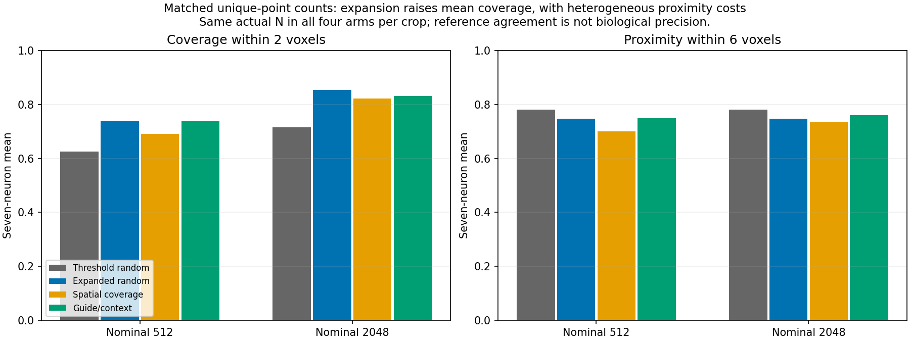

# Development sampling: expansion helps but can dilute useful image support

13 October 2026. The user completed the fixed epoch-30 four-control comparison
in **4 minutes 24 seconds** at the terminal; its recorded loop took **252.45
seconds**. It performed 56 frozen development-crop forward passes and **zero
optimizer updates**, exactly reproducing the saved final field probabilities.

Candidate expansion retains a substantial mean coverage benefit at matched
unique counts. It also causes severe losses in some already useful image pools.
The 50/50 rule is a tradeoff, not a universal winner. **No selector is promoted
as a final default.** PointNeXt, Transformer decoding and GATv2 did not run here.

## Equal actual unique-point counts

F is the original image-threshold pool; P is field support at >=0.5; C is their
union. Each matched crop/budget uses N = min(budget, len(F)) in all four arms.
Nominal 2,048 does not imply 2,048 available F points. Means average five seeds
and annotated crops within a neuron, then weight seven neurons equally. Nine
crops without in-box reference length remain visible without invented scores;
47 crops, or 235 crop/seed pairs, are scorable at each budget. Sampling seeds
are not independent biological replicates.

| Arm | Coverage within 2 voxels, nominal 512 | Proximity within 6 voxels, nominal 512 | Coverage within 2 voxels, nominal 2,048 | Proximity within 6 voxels, nominal 2,048 |
| --- | ---: | ---: | ---: | ---: |
| A: original threshold random | 62.51% | 77.99% | 71.47% | 78.13% |
| B: expanded random | **73.95%** | 74.66% | **85.47%** | 74.70% |
| C: expanded spatial coverage | 69.05% | 70.00% | 82.12% | 73.41% |
| D: 50/50 guide/context | 73.78% | 74.93% | 83.22% | 76.01% |

B minus A at the larger matched budget is **+13.99 percentage points coverage**
and **-3.43 points proximity**. Six neuron means gain coverage; neuron 44 loses
3.35 points. Among 235 pairs, coverage improves in 159, worsens in 48 and ties
in 28. Worst-chain coverage improves in 117, worsens in 56 and ties in 62.
A positive overall result does not erase crop or branch regressions.

## Per-neuron matched results at nominal 2,048

Coverage measures reference length within two voxels of selected points.
Proximity measures selected-point agreement within six voxels of full reference
segments; it is not confirmed biological precision. Distances are native voxels.

| Neuron | A coverage | B coverage | D coverage | A proximity | B proximity | D proximity |
| --- | ---: | ---: | ---: | ---: | ---: | ---: |
| 19 | 86.81% | 88.16% | 88.29% | 40.11% | 42.19% | 47.35% |
| 21 | 61.53% | 86.43% | 81.25% | 91.71% | 82.13% | 79.67% |
| 35 | 73.93% | 76.23% | 68.94% | 90.84% | 67.66% | 61.91% |
| 44 | 90.30% | 86.95% | 89.78% | 84.25% | 86.10% | 85.47% |
| 79 | 66.93% | 88.15% | 86.60% | 90.05% | 86.89% | 88.88% |
| 94 | 26.97% | **76.89%** | 77.10% | 50.16% | 59.99% | 72.05% |
| 135 | 93.84% | 95.46% | 90.55% | 99.81% | 97.96% | 96.76% |

Neuron 94 gains **49.92 coverage points** under B, with a proximity gain too.
Neuron 35's modest mean coverage gain conceals a **23.18-point proximity loss**
and strong failures in individual crops. A commercial quality claim cannot
rest on the overall mean. These development neurons have informed earlier
research decisions and are not an independent final test.

## Expanded-pool counts: a different comparison

B/C/D now use min(budget, len(C)); A keeps its available F count. At nominal
2,048, A has a different count in **215 of 280 crop/seed pairs**, so those A
comparisons include availability differences. The matched table isolates selection.

| Expanded-count arm | Coverage within 2 voxels, 512 | Proximity within 6 voxels, 512 | Coverage within 2 voxels, 2,048 | Proximity within 6 voxels, 2,048 |
| --- | ---: | ---: | ---: | ---: |
| B: expanded random | 76.00% | 74.65% | 90.19% | 74.66% |
| C: expanded spatial coverage | 71.65% | 70.07% | 89.03% | 74.45% |
| D: 50/50 guide/context | 76.28% | 74.98% | 90.29% | 77.02% |

At equal expanded counts, D minus B adds only **0.096 coverage point**, with
**+2.36 points proximity**. Coverage worsens in 65 pairs, improves in 58 and
ties in 112. Its proximity gain is heterogeneous: neuron 94 gains 13.26 points,
while neuron 35 loses 3.79 points.

The prespecified D-minus-C contrast gives +1.26 mean coverage points and +2.58
proximity points. Its coverage advantage is largely driven by neuron 19; five
neuron means lose coverage, while neuron 79's gain is only 0.008 point.
Worst-chain coverage worsens in 51 pairs, improves in 41 and ties in 143.
Guidance improves proximity over C but does not guarantee branch preservation.

## Concrete failures and gains

Values average five seeds unless explicitly identified as one seed. Saved figures
use seed 0, so their printed values differ from averages. Projection overlap
does not measure connectivity.

- **35/0, matched N=358:** A coverage/proximity is **94.80% / 100%**, B
  **70.25% / 14.25%**, D **58.50% / 8.10%**. Added support consumes slots
  previously concentrated on a useful reference-related structure.
  [Matched image](field_pilot_sampling_results_seed0/sample_0035_patch_000_matched.png).
- **35/2, matched N=325:** A is **83.00% / 100%**, B **49.51% / 21.85%**,
  D **29.37% / 10.58%**: a second strong dilution case.
  [Matched image](field_pilot_sampling_results_seed0/sample_0035_patch_002_matched.png).
- **35/0, expanded N=2,048:** B recovers 95.58% coverage but only 14.21%
  proximity. A has 358 points with 94.80% coverage and 100% proximity. More
  points can hide coverage dilution while retaining much off-reference support.
  [Expanded image](field_pilot_sampling_results_seed0/sample_0035_patch_000.png).
- **94/2, N=2,048 throughout:** A coverage is 30.00%, B 72.96%, C 80.90%,
  D 79.47%. D proximity is 64.04%, versus B 41.70%. Expansion reaches dim
  reference regions, with selector-specific tradeoffs.
  [Image](field_pilot_sampling_results_seed0/sample_0094_patch_002.png).
- **79/4, N=2,048:** whole-crop C/D coverage is nearly equal, 62.89%/62.84%,
  but branches differ. In **seed 0**, clipped chain **48->1** has in-box length
  **73.57 voxels**. D gives 30.99% chain coverage and a **45.04-voxel**
  unsupported run; C gives 41.45% chain coverage and a **9.95-voxel** run.
  This is a long clipped chain, not a completely lost tiny terminal fragment.
  It measures input support, not a demonstrated final SWC break.
  [Image](field_pilot_sampling_results_seed0/sample_0079_patch_004.png).
- **44/7:** expanded B/C/D receive the whole 704-point pool, with identical
  72.38% coverage and 7.30-voxel maximum gap. The pool itself lacks support;
  selector changes cannot exceed this ceiling.
  [Image](field_pilot_sampling_results_seed0/sample_0044_patch_007.png).

## Interpretation and proposed next step, for discussion

The comparison separates two mechanisms. **Eligibility** is a real loss stage:
the old cutoff excludes useful dim locations, and learned expansion repairs much
of that loss, especially in neuron 94, at equal counts. **Allocation and imperfect
scores** cause another loss: off-reference additions can displace an already
useful image backbone. More points or higher overall proximity do not guarantee
that the same branches survive.

This is neither evidence that the full PN 2.0 proposal is wrong nor acceptance
of a universal Phase 1 recipe. The field improves eligibility but is not a
reliable standalone foreground selector. Weak labels, incomplete references,
image types and model fitting remain relevant; off-reference structures are not
automatically verified biological false positives.

I recommend **one bounded image-backbone preservation comparison** before
promoting a selector, with the same saved fields, budgets and seeds. Its purpose
would be to retain original image-supported coverage while allocating remaining
capacity to learned additions, comparing against A/B/D. The tradeoff is less
capacity for field-only dim structures; the allocation rule must be discussed
and fixed before implementation. No threshold sweep or additional field training
is recommended solely from these means. Missing support in 44/7 is a separate
field/input limitation, not an allocation bug.

This proposed selector is **not implemented or run**. PointNeXt/Transformer/GATv2
integration remains a separate agreed step. There are no final SWCs or matched
PN 1.0 reconstruction results here, and no reserved test neurons were opened.

## Verification and visible evidence

Independent checks verified **4,480 unique result rows**, **56 input crops**,
**2,735 distinct cloud files** and **3,187 protected hashes**. Every cloud
retains exact voxel-to-native-XYZ mapping, raw intensity and field scores, valid
guide roles, no duplicates and no selected padding. Matched counts agree,
measurement details match their rows, and macro means were recomputed.
This review performs zero model inference and zero updates. Per-chain metrics
were inspected from saved measurements, not independently rerun for all clouds.

- [Verified summary, per-neuron results and pair signs](field_pilot_sampling_results_seed0/summary.json)
- [All 4,480 compact metric rows](field_pilot_sampling_results_seed0/metrics.csv)
- [Field training/development review](field_pilot_results.md)
- [Completed protocol and source links](field_pilot_ready.md)
- Raw clouds, all 56 original overlays and per-chain measurements remain in
  `tmp/pointneuron2/local_runs/field_pilot_20261012/comparison`.

Only readable reports and figures changed during review. Weights, sampling
source, thresholds, caches and experimental settings remain unchanged.
