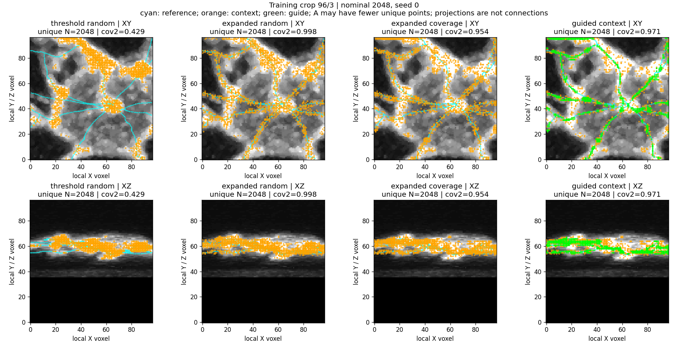

# Completed protocol: isolated Phase 1 field-guided input comparison

12 October 2026. The user approved the [four-control design](phase1_field_guided_sampling_design.md).
The selector, scorer and local launcher are implemented as an isolated
comparison. **The user completed it in 1 minute 7 seconds.** Candidate expansion
helps these fitted examples, while the 50/50 selector is not the strongest
coverage control. Read [the measured results and branch losses](field_sampling_results.md)
before proceeding. The command below documents the completed experiment; it
is not a request to repeat it.

The intended architecture stays **Phase 1 point cloud -> PointNeXt -> Transformer
proposals -> GATv2 connectivity -> SWC**. This command evaluates possible input
clouds. It neither integrates the selector into the production pipeline nor
trains or executes those later modules.

## Local visible command

```powershell
Set-Location "C:\Users\Seywe\Documents\GitHub\PointNeuron\pointneuron2"

& .\scripts\pointneuron2\run_field_sampling.ps1 -Action compare
```

Use the existing RTX 3070 Ti Laptop GPU environment. The command performs
**eight frozen float32 field forward passes**, CPU point selection and CPU
reference scoring. It performs **zero optimizer updates**. It verifies original
decoded image values rather than estimating raw intensities from a displayed
image. Live output identifies each crop and its foreground/guide/union counts.

Allow roughly **3-6 minutes**, depending on the four image decode times and
startup/plotting. A one-crop representative preflight estimated **93.5 seconds**
for the extrapolated compute phases, excluding import/startup, output writing,
plotting and variation between source images. CPU image verification dominates;
this is not a GPU training job. No precise full-run duration has been measured.

## What is compared

Use the same eight fitted training crops: 0/1, 0/2, 32/0, 32/3, 96/0, 96/3,
162/1 and 162/2. Reuse the passing update-1,600 checkpoint. The field has
already trained on these examples, so this is an **in-sample interface check**,
not evidence of generalization or a complete PN 2.0 improvement.

| Arm | Available points | Selection |
| --- | --- | --- |
| A: threshold random | F: original strict raw-intensity cutoff | Uniform distinct points |
| B: expanded random | C: F union predicted field >=0.5 | Uniform distinct points |
| C: expanded coverage | Same C | Score-independent spatial coverage |
| D: guided context | Same C | 50% field-guide coverage, remaining quota contextual coverage |

Cell size is eight native voxels; budgets are **512 and 2,048**, with sampling
seeds **0-4**. No 1,024-point pre-cap discards candidates. No threshold, fraction
or cell-size tuning is performed. Field scores remain metadata, not a new
encoder input channel. Observed raw intensities and native XYZ are retained;
no signal is painted into dim or zero-intensity predicted locations.

Two groups explicitly separate availability from allocation:

- `matched`: every arm uses `min(K, len(F))` distinct points.
- `expanded`: B/C/D use `min(K, len(C))`; A uses its actual available F count.
  Different-count A comparisons are flagged as availability comparisons.

Short pools are not padded with duplicate coordinates. Clouds have variable N
and are not fed to a neural encoder by this command. Unused guide quota goes
to context; an empty guide falls back exactly to coverage-only selection.

The primary allocation endpoint is **arc-length-weighted reference coverage
within two voxels**, D versus C, in the expanded group at nominal budget 2,048.
Each D/C pair has exactly the same unique count. Report all controls, budgets,
seeds, worst-chain coverage and off-reference support; a better mean with lost
branches is not an automatic win. No sampler advancement gate has been invented
from the earlier field learnability gate.

## Outputs and measurement safeguards

The launcher prints a fresh ignored directory:

```text
tmp/pointneuron2/local_runs/field_sampling_compare_<timestamp>_<PID>/
  console.log
  comparison/
    comparison.json         # availability, 640 grouped rows, summaries, 40 primary pairs
    metrics.csv             # concise row table with paths to detailed measurements
    inputs/                 # verified raw images, valid masks, full-precision fields
    clouds/                 # XYZ/raw-intensity points, voxel IDs, field scores, guide/context roles
    measurements/           # per-cloud branch coverage, unsupported runs and reference proximity
    inspection/             # eight XY/XZ comparison images, nominal 2048, seed 0
```

Identical selections reused by two groups/budgets share one cloud file; this
does not reduce the paired row count. Input and cloud files are frozen and
hashed **before** loading reference arrays or SWC geometry. Selector inputs
never include reference nodes, reference distances, known-label masks or the
reference-derived bright-uncertainty mask.

Reference scoring uses exact distances to continuous segments and fixed
<=1-voxel midpoint probes with arc-length weights. Unsupported-run lengths are
probe approximations and split at crop exits. Boundary-clipped/short chains and
isolated critical points are identified separately. No edges are invented
between sampled points. Proximity is annotation agreement, not biological
precision; image context and incomplete annotation require inspection.

The script checks original image/cache/config/checkpoint hashes, exact
coordinate/valid-mask alignment, raw-intensity restoration, historical raw
foreground counts, reproduction of saved field metrics and accepted counts,
unique counts and label-free selection. It protects its frozen clouds and
implementation-source hashes against mutation during the full run. Runtime,
CUDA peak allocated memory and retained input-array size are recorded; the
latter is not total process peak RAM.

Defaults use:

- `tmp/pointneuron2/local_runs/centerline_duration_20261012_220038_14488/model`
- `tmp/pointneuron2/local_runs/centerline_prepare_20261012/cache/manifest.json`
- Original images under the parent checkout's `data/gold166`.

Alternative local paths may be supplied with `-Models`, `-Manifest`,
`-ArtifactRoot` and `-Python`; the same frozen contracts still apply.
`-Action preflight` runs one selected training crop, 96/3, one nominal budget
and one seed for execution/timing only, not the full comparison.

## Completed preparation evidence

**23 focused tests passed in 16.61 seconds.** They cover candidate eligibility,
raw coordinate/intensity identity, uniqueness, small/empty pools, exact fallback,
seed reproducibility, image-only pool validation, cell-round allocation,
continuous segment distances, branch gaps and isolated reference points.
The tiny synthetic complete runner additionally checks all 640 grouped rows,
40 primary pairs, reference loading only after all eight input clouds are
saved, source-file preservation, exact uint16 restoration, timing-only behavior
and rejection of reserved identities. The launcher parses successfully.
After adding implementation-source hashes and memory-report metadata, the four
synthetic runner checks were rerun and passed in **26.52 seconds**; selector
settings and numerical behavior were unchanged.

The real-crop CUDA preflight passed all checks on **96/3**: F=5,507, P=8,534,
C=11,899, four distinct cloud files at N=2,048. It performed **one frozen GPU
forward pass and zero optimizer updates**. The cached image and restored integer
intensities reproduce the original decoded crop exactly, and saved final field
measurements/accepted count reproduce. All protected hashes remained unchanged.

Measured phases: image verification **17.54 seconds**, inference **0.81 seconds**,
four-arm selection **0.13 seconds**, scoring **0.06 seconds**, reference setup
**0.19 seconds**. Recorded loop: **20.74 seconds**, excluding imports.
[Saved preflight timing and checks](field_sampling_preflight.json).

The one-crop preview below was rendered from those already frozen clouds with
**zero additional inference**; its layout was inspected and protected hashes
rechecked. This is a single fitted crop at one seed, not the full experiment.
Its expanded random arm already has high reference coverage: candidate expansion
may be valuable even if guided allocation does not win. We will retain every
control rather than assume D is the best selector.



## After the user-run comparison

Review per-crop/per-chain differences and images together. The next broader
field train/development-validation pilot requires a separate protocol and timing
check; the fixed 33/7/8 neuron split remains intact. No development/test files
were opened in this preparation and no new field training was launched.
PointNeXt, Transformer integration and GATv2 remain later agreed architecture
steps; this comparison cannot pass them on behalf of the model.

Entry points: `scripts/pointneuron2/run_field_sampling.ps1` and
`scripts/pointneuron2/compare_field_sampling.py`. The isolated selector is
`src/pointneuron/data/field_guided_sampling.py`; reference-only scoring is
`scripts/pointneuron2/field_sampling_metrics.py`. Existing production samplers,
model architectures, reader code and saved training recipes were not modified.
