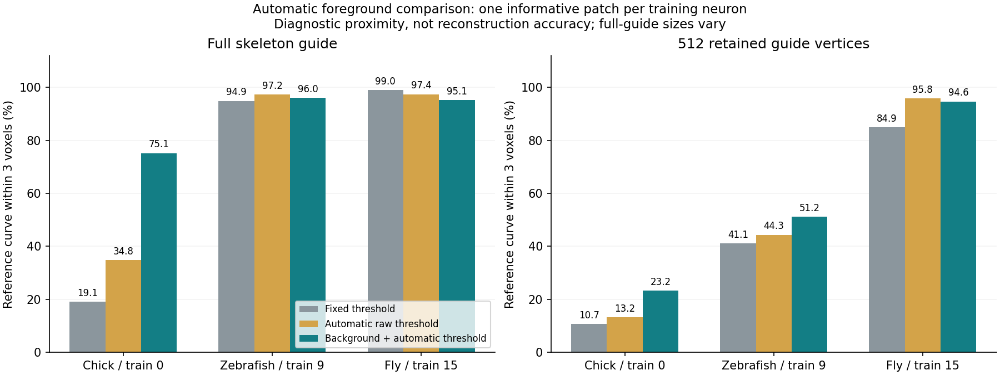

# Automatic foreground comparison: first results

The agreed CPU comparison is complete: **12 image-defined patches from three
training neurons**, three mask rules, no source or method failures. All **110
repository tests pass**, including seven new foreground/context/patch-selection
checks. No model was trained and no preprocessing method was promoted.

## The controlled comparison

The runner is `scripts/pointneuron2/compare_foreground.py`; image-only rules are
in `src/pointneuron/data/foreground.py`. The fixed experiment recipe is
`configs/pointneuron2/foreground_comparison.json`. It compares:

1. **Fixed:** existing threshold of 20% of the datatype range (51 for these 8-bit images).
2. **Raw Otsu:** an automatically chosen threshold separating image intensity classes.
3. **Background + Otsu:** subtract a Gaussian background estimate, clip negative residuals to zero, then automatically threshold the residual.

These are intensity rules, not verified neuron segmentations. Otsu separates
histogram classes; it does not recognize neurite anatomy. See the
[Otsu implementation paper](https://www.ipol.im/pub/art/2016/158/) and
[SciPy Gaussian filter documentation](https://docs.scipy.org/doc/scipy/reference/generated/scipy.ndimage.gaussian_filter.html).

Background sigma was fixed at 8 voxel units before running, with no per-patch
manual settings. Filtering reads a 4-sigma halo; thresholds use only the patch
core. Image-defined patch selection is identical to the existing cache rule,
and identical boxes are used for all methods. Selection depends on the original
fixed mask, so this experiment does not measure whole-image coverage from the
alternative masks.

TEASAR settings, original isotropic spacing [1,1,1], uniform pool selection,
seed and point budgets (1,024 candidates / 512 guide vertices) stay fixed.
Source spacing metadata is recorded but not applied, to isolate the mask change.
This is not the final calibrated recipe. Candidate intensities remain raw.

## Measurements

Only **three of 12 patches have local reference curves**: one per neuron.
The nine other patches remain in the report with null reference metrics; absent
annotation does not establish background. References evaluate results but never
choose patches, masks, guides or candidates. No validation or reserved-test
neuron is evaluated. Dataset inventory scans SWCs for valid source selection.

Percentages below mean reference-curve proximity within **3 voxel units**, not
segmentation precision, connectivity or reconstruction F1.

| Training patch | Mask rule | Foreground voxels | Full guide vertices | Full guide support | Candidate support | 512-guide support |
|---|---|---:|---:|---:|---:|---:|
| Chick 0 / patch 1 | Fixed | 197,488 | 2,585 | 19.1% | 36.7% | 10.7% |
| Chick 0 / patch 1 | Raw Otsu | 176,205 | 2,348 | 34.8% | 43.0% | 13.2% |
| Chick 0 / patch 1 | Background + Otsu | 117,925 | 5,567 | 75.1% | 55.2% | 23.2% |
| Zebrafish 9 / patch 2 | Fixed | 58,608 | 4,441 | 94.9% | 66.6% | 41.1% |
| Zebrafish 9 / patch 2 | Raw Otsu | 68,648 | 5,168 | 97.2% | 69.0% | 44.3% |
| Zebrafish 9 / patch 2 | Background + Otsu | 42,018 | 3,845 | 96.0% | 74.3% | 51.2% |
| Fly 15 / patch 1 | Fixed | 30,658 | 1,682 | 99.0% | 94.8% | 84.9% |
| Fly 15 / patch 1 | Raw Otsu | 16,473 | 801 | 97.4% | 95.6% | 95.8% |
| Fly 15 / patch 1 | Background + Otsu | 11,871 | 608 | 95.1% | 95.4% | 94.6% |



## Interpretation for our next discussion

The original mask is **not uniformly failing**: full-guide support is already
high on the informative zebrafish and fly patches. The chick result supports
the hypothesis that mask construction contributes to its weak guide.

However, the chick background-corrected guide has **more than twice as many
vertices**, despite fewer foreground voxels. Its mask also has more components
(51 to 118 with 26-neighbour connectivity). Better proximity can partly reflect
a denser, more fragmented guide. Overlays still show broad foreground and extra
guide structures; a clean neurite segmentation or correct topology is not established.

The matched 512-guide result is more modest: chick support rises from 10.7% to
23.2%. This guide supports only **1 of 8 local reference junctions** within three
voxels; the full guide supports 5 of 8. A substantial representation problem
therefore remains. Roles use the full reference tree: terminals have no children,
junctions have more than one child; patch-boundary cuts are not biological terminals.

Fly full-guide support drops under the alternative masks while bounded-guide
support improves: a mask/reduction tradeoff. On an unannotated zebrafish patch,
foreground grows from 322 fixed-mask voxels to 13,811 background-corrected voxels.
That could admit weak signal or noise; incomplete annotation cannot resolve which.

After inspecting these results, we agreed to retain full guides rather than
impose the pilot's 512-vertex cap. That change is implemented and profiled in
[full_guides.md](full_guides.md). This historical comparison keeps its original
budgets and artifacts. No alternative mask has been promoted; image specificity,
branch continuity and candidate coverage still need broader assessment.
Longer training and PointNeXt remain later steps.

## Files and reproduction

[report.json](foreground_comparison_seed0/report.json) contains all 12 patches,
source/config hashes, reference support at 1/3/6 voxels, terminal/junction support,
component counts, thresholds and times. Its `generated_artifact_root` identifies
the ignored NPZ folder containing raw crops, masks, score images, guide edges,
pools and reference diagnostics. These are experimental artifacts, not training caches.

Inspect the permanent overlays:

- [Chick example](foreground_comparison_seed0/sample_0000_patch_001.png)
- [Zebrafish example](foreground_comparison_seed0/sample_0009_patch_002.png)
- [Fly example](foreground_comparison_seed0/sample_0015_patch_001.png)

Cyan is the full guide, red the clipped reference. Raw display scales match
across methods. Maximum projections, including mask panels, can hide depth mismatch.

To reproduce from the PN 2.0 folder with a **fresh** output directory:

```powershell
& .\tmp\pointneuron2\sampling_env\Scripts\python.exe -u scripts/pointneuron2/compare_foreground.py --output-dir tmp/pointneuron2/foreground_comparison_new
```

Generated outputs: `tmp/pointneuron2/foreground_comparison_seed0`; saved console:
`tmp/pointneuron2/foreground_comparison_seed0_console.log`. Scripts, configuration,
figures and this report are outside ignored `tmp`. Method computation took about
22 seconds across 36 patch/method evaluations, excluding inventory, volume
decoding, plotting and disk I/O.
