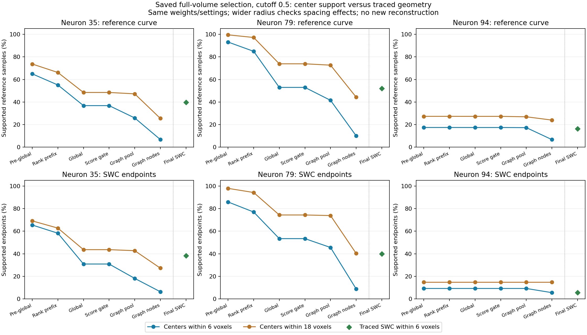

# Full-volume selection audit: two different loss patterns

The user approved measuring where branch support is lost in the saved seven-neuron
comparison. This CPU audit loads no image volumes or model weights, runs no
network inference or geodesic tracing, and changes no production settings.
All seven cases passed provenance and saved-output checks. Replayed adaptive
input pools match saved graph indices/counts; KD-tree measurements reproduce
the saved full-SWC precision/recall exactly within 1e-7.

**Global selection removes substantial available geometry on neurons 35 and 79.
Neuron 94 is already poorly represented before that selection. One intervention
will not solve both patterns.**

## What was measured

Reference SWCs are resampled at one-voxel spacing, using the spatial evaluator's
same 250,000-point maximum. Each stage is measured against the same targets.
Curve support is the fraction within 6/12/18 voxels of a retained center; endpoints
are non-root leaves in the reference SWC. References never select proposals.

Stages: saved post-local proposals -> global score-ranked candidate prefix ->
global sphere suppression/output cap -> graph score gate -> adaptive input pool
-> actual selected graph centers -> final traced SWC points.

The pre-global pool has **already undergone local confidence filtering and sphere
suppression**. Missing support there cannot be uniquely attributed to the image
mask or encoder. Global selection examines only the top 16,384 scored candidates,
then accepts at most 4,096 spheres. The audit replays the score-only prefix exactly;
subsequent loss still combines sphere suppression and the final cap.

## Results at graph cutoff 0.5

| Neuron | Pre-global center support @6 | Rank-prefix support @6 | Final proposal support @6 | Final SWC recall @6 |
|---|---:|---:|---:|---:|
| 19 | 100.00% | 100.00% | 99.16% | 79.22% |
| 21 | 85.92% | 85.92% | 85.35% | 76.36% |
| 35 | 64.93% | 55.09% | 36.81% | 39.69% |
| 44 | 99.87% | 99.87% | 99.69% | 98.71% |
| 79 | 93.11% | 84.89% | 52.94% | 52.09% |
| 94 | 17.45% | 17.45% | 17.43% | 16.33% |
| 135 | 98.91% | 98.91% | 98.79% | 86.54% |

These are support measurements, **not reconstruction F1 or foreground precision**.
Point density can inflate coverage; a dense background cloud can be near a trace.
Global proposal support is not an upper bound on final recall: tracing can recover
intermediate geometry between centers, as neuron 35 demonstrates.



The orange curves use 18 voxels to distinguish gaps caused by node spacing from
broader spatial exclusion. Green diamonds measure actual traced geometry at six
voxels. Do not read the center-to-SWC jump as a comparable point-count change.

## Neurons 35 and 79: confidence priority loses spatial support

On 35, global selection loses **28.12 percentage points** of six-voxel support:
9.84 points at the score prefix, then 18.28 through suppression/output capping.
On 79, the corresponding loss is **40.17 points**: 8.22 then 31.95.
The loss persists at 18 voxels: 73.65% -> 48.46% on 35 and 99.48% -> 73.84% on 79.
It therefore cannot be explained solely by small gaps between sparsely sampled
centers. Center coordinates are an exact subset of the earlier pool.

Endpoint support also drops during global selection:

| Neuron | Pre-global supported endpoints @6 | After score prefix | After global selection | Final SWC |
|---|---:|---:|---:|---:|
| 35 | 72/110 | 64/110 | 34/110 | 42/110 |
| 79 | 164/191 | 147/191 | 102/191 | 76/191 |
| 94 | 5/54 | 5/54 | 5/54 | 3/54 |

References 21, 35 and 79 contain 91, 110 and 191 disconnected root components,
with no shared branch vertices. Their leaf counts therefore include annotation
fragment ends, not necessarily anatomical terminals. Reference 94 has one root,
54 leaves and 50 junctions. Forest representation also limits biological
interpretation of the existing induced-graph topology metric.

## Neuron 94: the primary deficit is earlier

Only 17.45% of its reference curve and 5/54 leaves have nearby post-local proposals.
Global selection changes curve support by only 0.02 percentage points. The later
24-anchor selection is sparse, but final tracing recovers 16.33% recall, close to
the support present before global selection. Increasing the graph-node budget or
lowering the global score gate cannot reliably recover branches absent from this
saved pool. This revises the emphasis of the earlier 24-node observation.

Earlier corrected-crop evidence found faint-signal mask/candidate losses on this
source. The full-volume audit confirms an upstream-of-global deficit but does not
separate masking, patch coverage, point sampling, proposal learning and local
suppression. Those require different saved inputs or a separate agreed diagnostic.

## Sparse centers are not the final arbor

Neuron 19 drops from 99.16% final proposal support to 19.22% selected-center support
at six voxels, but 128 selected centers retain 97.06% support at 18 voxels and
traced SWC recall is 79.22%. Much of the apparent center loss is sampling spacing.
Its final spatial precision is only 39.82%, so high available coverage does not
mean clean reconstruction. Both false trajectories and missing geometry matter.

## Completed next control

The user chose comparing spatial coverage during global selection first. The
control uses the exact saved post-local proposals on capped neurons 35/79, with
19 as an already-covered control. It keeps the 16,384 candidate count, 4,096 output
budget and sphere IoU 0.1 rule. Candidate priority becomes existing farthest-point
coverage, seeded by the highest-confidence proposal, instead of descending score.
Actual objectness values remain unchanged. References only measure the outcome.

This is a CPU representation diagnostic, not a promoted selector or new model.
Measure curve/endpoint retention, selected-center proximity and the downstream
score-gate/pool effect. A full SWC comparison would need separate agreement and
the user's visible terminal. No additional training is needed for this hypothesis.
The [completed comparison](global_coverage_comparison.md) recovers much of the
available geometry on 35/79, but exposes a strong specificity loss on neuron 19.

## Files and verification

- [Audit script](../../scripts/pointneuron2/audit_full_volume_selection.py)
- [Verified measurements, transitions and hashes](full_volume_selection_audit_seed0/summary.json)
- [Prior seven-neuron reconstruction results](validation_graph_cutoff_results.md)

Per-reference distances are ignored under
`tmp/pointneuron2/local_runs/full_volume_selection_audit_final_20261011/distances`.
Final measurement took about ten seconds after interpreter/import startup.
Synthetic checks verify sparse-center versus interpolated-SWC coverage, empty
sets, fixed denominators and exact lost/gained/retained accounting. These are
measurement checks; they do not establish improved reconstruction.

To repeat into fresh directories:

```powershell
Set-Location "C:\Users\Seywe\Documents\GitHub\PointNeuron\pointneuron2"
& .\tmp\pointneuron2\sampling_env\Scripts\python.exe -u `
  .\scripts\pointneuron2\audit_full_volume_selection.py `
  --comparison .\tmp\pointneuron2\local_runs\validation_graph_cutoffs_20261011\validation_comparison.json `
  --output-dir .\tmp\pointneuron2\local_runs\full_volume_audit_repeat\report `
  --artifact-dir .\tmp\pointneuron2\local_runs\full_volume_audit_repeat\distances
```
