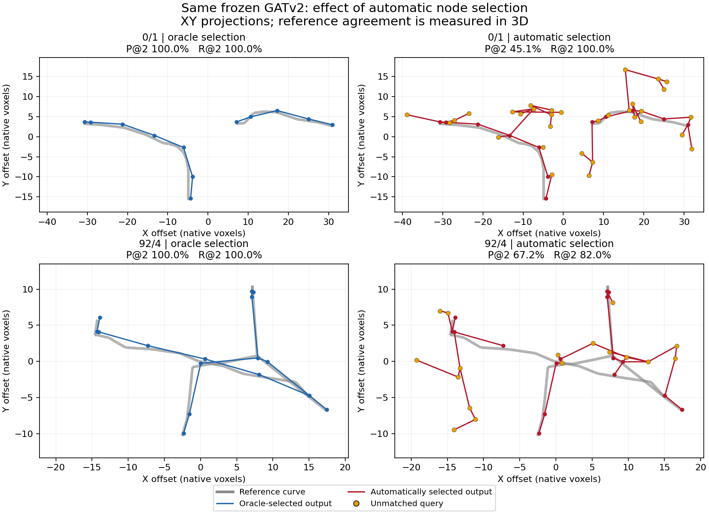

# Automatic node selection exposes a substantial proposal-to-graph gap

19 October 2026. The agreed **CPU inference-only** comparison is complete on
the same four training crops. The successful terminal GATv2 checkpoint is
unchanged. Its oracle-selection baseline still passes; using the balanced
proposal model's existing .5 automatic selection produces substantially worse
reference agreement, especially on the smaller crops. No training, pruning,
threshold adjustment, new node head or architecture change occurs.

## Paired geometry and node sets

P/R below are arclength-weighted precision/recall within two **native voxels**
against continuous crop-clipped reference segments. They are not an official
PN 1.0 comparison or calibrated physical-distance metric.

| Training crop | Oracle P / R @2 | Automatic P / R @2 | Automatic assigned + unmatched nodes | Components: oracle → automatic |
|---|---:|---:|---:|---:|
| 0/0 | 100% / 100% | **57.11% / 92.38%** | 6 + 11 | 1 → 1 |
| 0/1 | 100% / 100% | **45.12% / 100%** | 12 + 32 | 2 → 3 |
| 92/4 | 100% / 100% | **67.21% / 81.98%** | 16 + 17 | 1 → 2 |
| 86/3 | 98.77% / 97.98% | **97.75% / 95.79%** | 411 + 4 | 14 → 18 |

The smaller crops retain all assigned nodes but add many unmatched queries.
The dense crop rejects seven assigned nodes, including one reference junction,
and retains four unmatched queries. In total, automatic selection keeps **64
unmatched nodes**, all attached to output edges; none is an isolated extra.
Twenty-six of these nodes lie farther than six voxels from the crop reference.
Distance from annotation does not independently certify biological background.

Automatic exported arclength on crop 0/1 is 211.59 voxels against 65.29 reference
voxels. Its high recall therefore coexists with substantial excess output.
Geometry precision alone also cannot certify topology: close wrong connections
may score well. Isolated vertices contribute no arclength weight to precision;
they remain explicitly counted in this evaluation. One assigned dense node is
isolated, and no unmatched nodes are discarded.



The figure shows XY projections for two selected examples, with the same axes
within each row. Gray is the reference, blue the oracle-selected output, red the
automatic output, and orange unmatched queries. The numerical metrics use 3D
geometry; projected crossings do not prove connections. This is not a raw-image
overlay or a classification of every extra query as background.

## Where direct reference edges disappear

This table follows the original saved target/query correspondence without the
two-voxel placement mask, consistently with the successful GAT control.

| Crop | Required edges | Removed with node endpoints | Missing from rebuilt candidates | Rejected by edge score | Displaced during forest decoding | Direct reference edges retained |
|---|---:|---:|---:|---:|---:|---:|
| 0/0 | 5 | 0 | 0 | 0 | 3 | 2/5 |
| 0/1 | 10 | 0 | 0 | 0 | 4 | 6/10 |
| 92/4 | 15 | 0 | 0 | 2 | 3 | 10/15 |
| 86/3 | 404 | 13 | 0 | 0 | 0 | 391/404 |

Every required pair whose endpoints survive is present in the rebuilt candidate
graph. There is **no candidate-availability loss in this comparison**. In the
dense crop, GATv2 and the decoder preserve all 391 available required pairs;
the 13 missing direct pairs originate entirely in confidence-rejected nodes.

On the smaller crops, additional high-scoring links touching unmatched nodes
can make the forest decoder choose alternate routes. Crucially, a missing
**direct** reference edge is not automatically a missing anatomical connection.
A path review of the exported forests finds:

- All three missing direct pairs in 0/0 remain connected through unmatched nodes.
- All four missing direct pairs in 0/1 do too.
- In 92/4, three of five remain connected through unmatched nodes, one through
  another assigned target, and one pair is disconnected.

Ten of the twelve direct-pair mismatches with retained endpoints thus have
paths containing only unmatched intermediate nodes. Such paths can represent
valid subdivision, but can also make geometric detours. Direct-edge identity
counts alone must not be interpreted as anatomical topology errors. The poor
spatial precision and the extra attached branches provide separate evidence
of reference-disagreeing reconstruction.

The decoder selects 14/35/21/6 links outside the exact assigned-target adjacency
in the four automatic arms. All touch unmatched queries, whose correct
connections were not supervised in the oracle-node fit. No selected link joins
two assigned targets with known nonadjacency, and no output component merges
assigned nodes from different reference crop components. This does not exclude
local rewiring, unnecessary branches, or fragmentation within a component.
Among unmatched nodes, 27 have degree one, 26 degree two and 11 degree at least
three; those are raw graph counts, not independently verified biological errors.

## Exact comparison and verification

The [fixed evaluation recipe](../../configs/pointneuron2/gat_automatic_selection.json)
pins the completed balanced proposal report and the successful GAT report/
checkpoint. The [isolated evaluator](../../scripts/pointneuron2/evaluate_gat_automatic_selection.py)
uses cached image-derived proposals; it does not rerun Phase 1, PointNeXt or
Transformer. The automatic arm selects query IDs solely from saved confidence
logit difference >=0, equivalent to the inclusive .5 cutoff. No reference count,
assignment, geometry or SWC is passed to that selector.

Both arms rebuild symmetrized 16-neighbour union eight-voxel-radius candidates
on their retained nodes. Saved confidence is a scorer input in both arms. The
oracle decoder deliberately retains all reference-selected nodes; the automatic
decoder uses original confidence and retains every selected node, including
isolates. No cleanup or connectedness completion is added. Reference information
enters automatic-arm assessment only after inference, for correspondence,
geometry and topology accounting. CPU eval mode and inference mode are used;
all GAT parameters have gradients disabled and no optimizer is constructed.

The run completes eight GAT forwards in 7.11 seconds of evaluation time, plus
startup/loading. **Zero optimizer updates and zero GPU work** occur. Model,
frozen inputs, original cache and protected source hashes match before/after.
The oracle arm reproduces terminal GPU scores within the established CPU/GPU
tolerance and its exact reference graphs still pass.

Eighteen targeted tests pass: reference-free inclusive selection, stagewise edge
loss accounting, unmatched-edge unknown labels, retained isolates, wrong-cycle
displacement, empty-output accounting/strict JSON, and existing proposal graph/
supervision/decoder checks. An empty-output test caught an infinity-serialization
case, handled locally as explicit empty failure with zero recall and undefined
precision; shared metrics/model code are unchanged.

A separate CPU verification replays all eight saved score arrays with **zero
score difference**, checks rebuilt candidate pairs and assessment labels, and
validates all eight existing SWCs against decoded edges and positions. It also
performs the path analysis above. No review optimizer/GPU work occurs. Full
[evidence](gat_automatic_selection_results_seed0/summary.json) and
[validation metadata](gat_automatic_selection_results_seed0/validation.json)
pin the source, report and output artifacts. Generated scores/SWCs/source
snapshots remain in ignored `tmp/pointneuron2/local_runs/gat_automatic_selection_20261019`.

The completed CPU command was:

```powershell
Set-Location "C:\Users\Seywe\Documents\GitHub\PointNeuron\pointneuron2"
& .\tmp\pointneuron2\sampling_env\Scripts\python.exe -u `
  .\scripts\pointneuron2\evaluate_gat_automatic_selection.py `
  --output .\tmp\pointneuron2\local_runs\gat_automatic_selection_20261019
```

Existing output directories are protected. A reproduction must use a fresh
ignored output directory; rerunning over the completed evidence is refused.

## Research decision

Keep the successful conditional GAT checkpoint and the stronger balanced
proposal checkpoint. Their integration is **not yet a clean automatic
reconstruction**, even on these already-used training examples. The successful
graph control remains valid; this result measures what changes when oracle node
selection is removed.

The immediate issue is the node-set/interface responsibility: confidence removes
useful nodes in the dense case, while unwanted or redundant nodes enter the
smaller graphs and receive attachments from an edge scorer trained without them.
Candidate radius enlargement is not supported by this result. Another longer
oracle-node GAT fit would not address the measured input-distribution difference.

Before another fit, decide how to make node selection and graph training work
on the same imperfect proposal distribution, with an explicit responsibility
for unwanted nodes. The current decoder cannot delete an accepted node merely
by rejecting its edges. Retaining proposal confidence as the sole selector,
adding graph-based node-confidence refinement, and defining a pruning policy
have different implications; this evaluation does not choose or implement one.
Giving GATv2 a node-scoring role would extend Phase 4 beyond its current edge-only
responsibility and requires explicit agreement. No such change, threshold sweep,
new training, broader-data claim or PN 1.0 improvement is introduced here.
