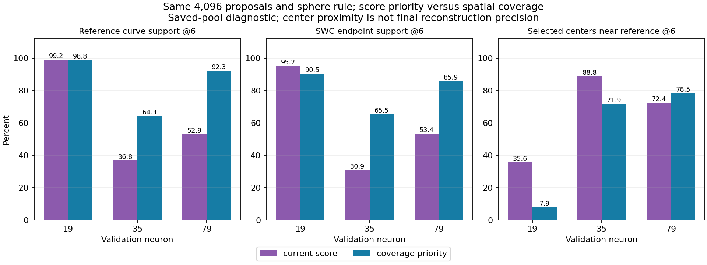

# Global selection control: coverage improves, with mixed specificity

Following the [full-volume audit](full_volume_selection_audit.md), the user chose
testing spatial coverage during global selection. This CPU comparison completed
on 11 October 2026 in 82.2 seconds after interpreter/import startup. It used
neurons 35 and 79, with already-covered neuron 19 as a control. No model inference,
training, image decoding, geodesic tracing or new SWC reconstruction was run.

**We can recover much of the available proposal support at the same budget.
Pure spatial coverage is not a safe universal selector: it strongly increases
the fraction of selected centers away from the reference on neuron 19.**

## Controlled change

Both arms share the same saved post-local proposals, actual scores/radii,
16,384 candidate limit, 4,096 output count and production sphere-IoU rule (0.1).
Current selection prioritizes descending model confidence. The control uses
the existing farthest-point coverage implementation, seeded by the highest-score
proposal, to order 16,384 spatial candidates; the same sphere selector then accepts
4,096. References never enter either selection rule. Ranking priorities are
internal ordering arguments; actual model scores are preserved unchanged.

This isolates the global candidate priority policy, including which proposals
reach suppression. It does not isolate score-prefix loss from later suppression.
All three arms reached exactly matched candidate and output budgets.

## Measurements

Reference curves use the spatial evaluator's one-voxel resampling and six-voxel
diagnostic distance. Center proximity is an approximation to annotated geometry,
**not final SWC precision or semantic foreground accuracy**. Incomplete references
can classify real unannotated branches as far from the reference.

| Neuron | Curve support: current -> coverage | SWC endpoint support: current -> coverage | Selected centers near reference: current -> coverage |
|---|---:|---:|---:|
| 19 | 99.16% -> 98.84% | 20/21 -> 19/21 | 35.62% -> 7.91% |
| 35 | 36.81% -> 64.35% | 34/110 -> 72/110 | 88.84% -> 71.85% |
| 79 | 52.94% -> 92.29% | 102/191 -> 164/191 | 72.44% -> 78.47% |



On 35, curve support gains **27.54 percentage points**, retaining almost all
64.93% available pre-global support; endpoint retention more than doubles.
The proximity proxy falls 16.99 points, so the recovered coverage comes with
more centers away from the annotated trace.

On 79, curve support gains **39.36 points**, close to the available 93.11%.
Endpoint support and the proximity proxy both improve. This is the strongest
candidate case for a later controlled reconstruction comparison, but it still
does not establish final SWC quality.

On 19, near-reference centers collapse to 7.91% while curve support remains
almost unchanged. A large background or unannotated region can consume spatial
coverage slots. This counterexample prevents promoting pure farthest-point
selection as a general fix. Endpoints on 35/79 include disconnected annotation
fragment ends, not necessarily biological terminals.

## The later graph gate can remove the recovered support

Actual model scores of coverage-selected proposals are generally lower. Only
26.03%, 38.33% and 42.24% remain above 0.85 on 19, 35 and 79 respectively;
all current global proposals were above 0.85. The diagnostic measures both
already-existing cutoff arms without changing production defaults.

| Neuron | Coverage arm support after gate 0.5 | After gate 0.85 | Current arm, either gate |
|---|---:|---:|---:|
| 19 | 98.84% | 55.54% | 99.16% |
| 35 | 64.35% | 38.12% | 36.81% |
| 79 | 92.29% | 43.96% | 52.94% |

Thus a better global selector alone is not enough if useful lower-confidence
proposals are rejected afterwards. Confidence, branch retention and rejection
of irrelevant geometry must be evaluated together.

The replayed adaptive graph input pool at cutoff 0.5 has six-voxel support
47.55% -> 22.38% on 19, 25.90% -> 25.09% on 35 and 41.50% -> 46.94% on 79.
These pool centers are sparse. At 18 voxels, support on 35 improves
47.24% -> 70.13%, and on 79 improves 72.64% -> 99.11%. This wider-radius control
shows spatial reach, but cannot predict the actual selected graph or traced tree.
No new topology F1 or reconstruction F1 was produced.

## Research implication and next discussion

The audit's global-selection diagnosis is supported by a label-independent,
matched-budget counterfactual: many weak branches were available and could be
retained without increasing the global point count. The limiting factor is
partly priority and spatial allocation, not simply the number 4,096.

But spatial coverage alone lacks semantic rejection. A proposed next control
would protect strong proposals while adding spatial representation in neglected
regions, then assess the same retention/proximity tradeoff and downstream score
behavior. It must be agreed before implementation; no hybrid selector or
architecture change has been made. Neuron 94 still requires an upstream audit:
this experiment does not recover proposals absent from its post-local pool.

Before any promotion, a frozen reconstruction comparison must assess full SWC
precision/recall, branches and artifacts. That would be a separate user-launched
run. Earlier auxiliary guide-loss failures also caution against treating extracted
guides or coverage as semantic ground truth.

## Visible files and verification

- [CPU comparison script](../../scripts/pointneuron2/compare_global_coverage.py)
- [Complete measurements, settings and source/artifact hashes](global_coverage_comparison_seed0/summary.json)
- [Loss-stage audit](full_volume_selection_audit.md)

Raw selections are ignored under
`tmp/pointneuron2/local_runs/global_coverage_comparison_20261011`.
These files contain source indices and unchanged centers/radii/scores, but not
pre-global encoder features (which were not saved). They are diagnostic artifacts,
not production proposal files ready for reconstruction.

Checks verify frozen inputs/code and proposal hashes, exact candidate/output
counts, unchanged objectness and source-row identity. A synthetic oversized-pool
check verifies deterministic spatial priority and the highest-confidence seed.
Figures were visually inspected. These checks establish correct execution of
this control, not a measured improvement in reconstruction.

To repeat into fresh directories:

```powershell
Set-Location "C:\Users\Seywe\Documents\GitHub\PointNeuron\pointneuron2"
& .\tmp\pointneuron2\sampling_env\Scripts\python.exe -u `
  .\scripts\pointneuron2\compare_global_coverage.py `
  --comparison .\tmp\pointneuron2\local_runs\validation_graph_cutoffs_20261011\validation_comparison.json `
  --output-dir .\tmp\pointneuron2\local_runs\global_coverage_repeat\report `
  --artifact-dir .\tmp\pointneuron2\local_runs\global_coverage_repeat\selections
```
