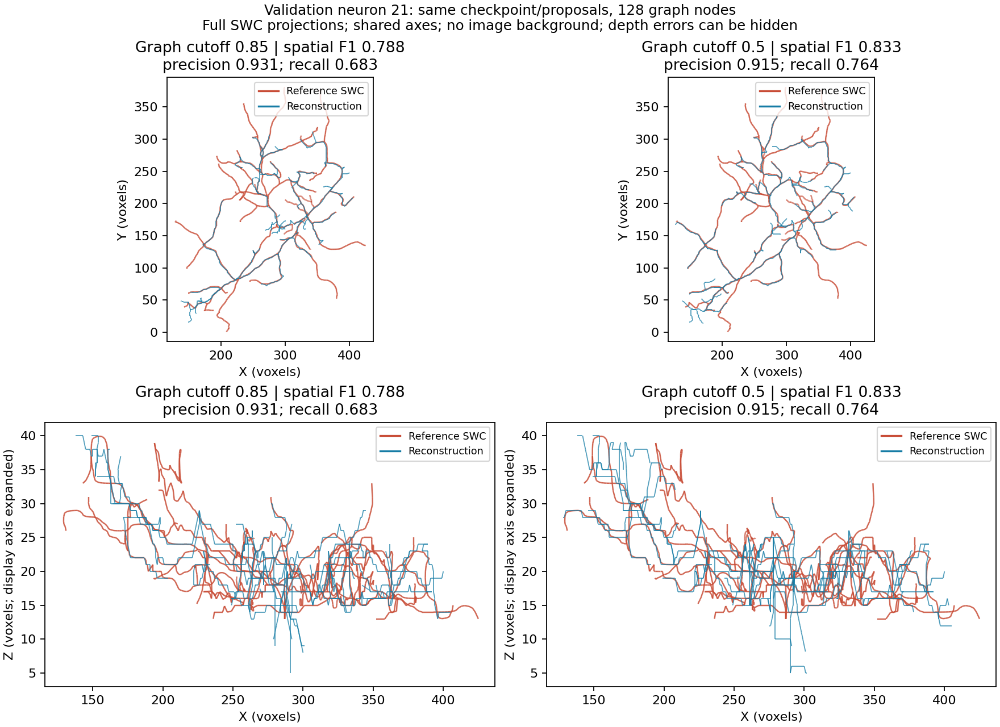

# Neuron 21: measured reconstruction gain from the lower graph cutoff

The user-launched paired run completed on 11 October 2026 in 133.7 seconds.
Both valid, single-root SWCs were reconstructed from the same 1,884 aggregated
proposals, generated once from 29 full-volume image-defined patches. Frozen
source/image/reference/checkpoint hashes and paired proposal checks passed.
Both arms selected 128 graph nodes; only the graph cutoff differed.

**Cutoff 0.5 improves spatial F1 and recall on this development case with a
small precision loss. Connectivity and generalization remain unresolved.**

## Results on the full reference

Spatial metrics use one-voxel SWC resampling and six-voxel matching. Topology is
evaluated separately on a GT-induced graph for each output's selected nodes.

| Metric | Graph cutoff 0.85 | Graph cutoff 0.5 | Change (0.5 minus 0.85) |
|---|---:|---:|---:|
| Spatial precision | 0.9311 | 0.9154 | -0.0158 |
| Spatial recall | 0.6830 | 0.7636 | +0.0806 |
| Spatial F1 | 0.7880 | 0.8326 | +0.0446 |
| Topology F1 | 0.5588 | 0.5279 | -0.0309 |
| Fallback bridge edges | 2 | 1 | -1 |
| Mean reference-to-reconstruction distance | 8.068 voxels | 5.616 voxels | -2.452 voxels |
| Mean reconstruction-to-reference distance | 1.972 voxels | 2.171 voxels | +0.199 voxels |

Recall improves by 8.06 percentage points and precision falls by 1.58 points.
Spatial F1 gains 4.46 points (5.66% relative). The missed-reference distance
improves, while the prediction-to-reference distance gets slightly worse, which
is consistent with this tradeoff. Reference-to-reconstruction 95th-percentile
distance falls from 40.35 to 27.75 voxels; substantial omissions remain.

The earlier crop-audit coverage cannot be compared directly with these scores:
it measured node proximity in eight crops, while this run used 29 full-volume
patches and evaluates connected SWC geometry against the entire reference.

The lower cutoff expands the adaptive candidate pool from 532 to 552 nodes and
anchor seeds from 65 to 83, while the final graph budget remains 128. Exported
SWCs have 1,825 versus 2,128 nodes after edge resampling. More exported nodes
alone is not evidence of improvement; the full-reference spatial metrics are.
Both arms retain foreground threshold 5 without adaptation and satisfy the
350,000-voxel foreground cap. Reachable-edge fraction is 0.9921 in both arms.

## Inspect the geometry



Red is the reference SWC; blue is the reconstruction. The XY projection shows
additional reference-aligned geometry at 0.5. Both outputs still omit reference
branches. XZ shows depth departures and extra geometry in both, with some
additional departures at 0.5. The Z display axis is expanded. These are SWC
projections without an image background, so overlaps cannot establish correct
branch connectivity or depth alignment.

The saved HTML views in each run folder allow rotating the reconstruction with
the image/reference context. Original graph/SWC files remain in the ignored run
directory, under `cutoff_0_85/sample_0021` and `cutoff_0_5/sample_0021`.

## Why topology remains a concern

Topology F1 decreases. Its GT-induced target graph has 77 edges at cutoff 0.85
and 70 at cutoff 0.5 because the selected node positions change, despite equal
node counts. It therefore does not compare predictions against one identical
edge target. The drop does not by itself establish anatomically worse branching,
but we cannot claim a connectivity improvement from this experiment.

The lower arm's one fallback bridge matches its induced target edge, versus
zero matches among two bridges in the higher arm. This is a limited graph
diagnostic, not proof that a fallback route follows the neurite correctly.

## Agreed next step

The user chose to extend the same paired comparison to all seven validation
neurons, reusing these completed neuron-21 outputs. The
[seven-neuron extension is prepared](validation_graph_cutoffs.md). The other six will each
generate one shared full-volume proposal file and two reconstructions with
fixed weights/settings. Failures and foreground-cap problems must remain
visible. No production cutoff has been changed or promoted.

Neuron 21 was selected using validation failure evidence. This result is useful
development evidence, not an untouched confirmation or a state-of-the-art claim.
The broader internal validation comparison will test whether the benefit is
consistent across imaging sources. Neuron 94's low proposal support remains a
separate unresolved input/model question.

## Files and checks

- [Verified results, hashes and exact metric deltas](graph_cutoff_results_neuron21/summary.json).
- [CPU summarizer](../../scripts/pointneuron2/summarize_graph_cutoffs.py): verifies
  frozen inputs/code, shared proposals, both graph/SWC hashes, actual metric JSON
  files, valid single-root SWCs and equal 128-node graphs before plotting.
- [Original run preparation](graph_cutoff_comparison.md).

The summarizer reads existing results; it performs no inference, tracing,
retraining or metric rerun. To repeat with a fresh report directory:

```powershell
Set-Location "C:\Users\Seywe\Documents\GitHub\PointNeuron\pointneuron2"
& .\tmp\pointneuron2\sampling_env\Scripts\python.exe -u `
  .\scripts\pointneuron2\summarize_graph_cutoffs.py `
  --comparison .\tmp\pointneuron2\local_runs\graph_cutoffs_neuron21_20261011\comparison.json `
  --output-dir .\docs\pointneuron2\graph_cutoff_results_repeat
```
