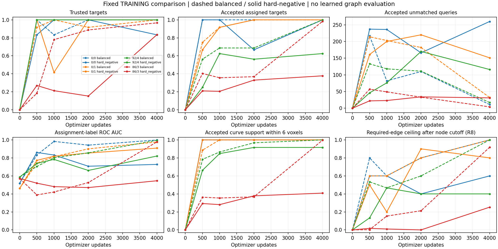

# Hard-negative comparison fails: retain the balanced reference and stop loss tuning

18 October 2026. The user completed the agreed fresh 4,000-update 50/25/25 fit
on the same four training crops. **The proposed objective fails its predeclared
tradeoff.** Every selection and combined gate fails; sparse extras increase,
and dense placement, junctions, ranking and accepted coverage regress.

Reject this variant for the current protocol. Preserve the completed run and
retain the balanced fit as the stronger research reference, itself still
incomplete. No further loss variant, update extension, threshold search,
K/coefficient sweep, sampler change or GATv2 training is prepared. This is the
stopping rule specified before the run, not a reason to discard the whole
PointNeXt/Transformer framework or change Phase 1 without discussion.

## Execution and comparison integrity

The fit completes all 4,000 updates in 18.94 minutes, with reported checkpoint
reload difference 0.0. This is successful execution, not successful learnability.
The earlier 85–128 minute estimate overpredicted actual duration substantially;
neither these timings nor the slightly different completed durations establish
an objective-dependent speed change under matched system conditions.

The [read-only paired reviewer](../../scripts/pointneuron2/review_hard_negative_query_fit.py)
checks the exact recipe difference, matching backend, cache manifest and all
initial tensor hashes, plus identical step-zero prediction arrays. Original and
archived training-source hashes match. All ten saved checkpoints are loaded on
CPU; recipe/provenance, experiment identity, crop cursor and optimizer steps are
verified. The terminal checkpoint is non-resumable and has SHA256
`399b3fd2f1cb54120db722ac334d689a22e4a9d51dfcfd755c40e60970419eb4`.

For all 40 crop/snapshot predictions across the two fits, the audit independently
checks assigned distances, acceptance, trusted junctions, candidate pairs/labels,
R8/R12 edge availability, curve support and original gates. It checks reference
weighted/balanced CE and independently reconstructs the hard-negative objective,
K, selected query membership and accepted hard negatives. It reuses the preserved
reviewer's weighted-CE field through an explicitly documented in-memory alias;
no raw report, prediction or checkpoint is rewritten. No model forwards, neural
gradients, optimizer updates, GPU calls or development/test evaluation occur.

The implementation's 28 tests passed before training, including analytical
confidence gradients and dense-crop equality. Those tests establish the intended
mechanism and execution, not that the mechanism learns better. Existing training
sources remain unchanged by this review.

## Final results: balanced → hard-negative

All results use the original .5 cutoff and two-voxel trust tolerance.

| Training crop | Trusted targets | Accepted assigned targets | Accepted unmatched queries | Trusted junctions |
|---|---:|---:|---:|---:|
| 0/0 | 6/6 → **5/6** | 6/6 → 6/6 | 11 → **260** | 0/0 → 0/0 |
| 0/1 | 12/12 → 12/12 | 12/12 → 12/12 | 32 → **151** | 0/0 → 0/0 |
| 92/4 | 16/16 → 16/16 | 16/16 → **10/16** | 17 → **116** | 2/2 → 2/2 |
| 86/3 | 404/418 → **349/418** | 411/418 → **158/418** | 4 → **31** | 76/77 → **60/77** |

Extras worsen on every crop. Placement regresses in the smallest and dense
crops, and the dense crop loses 16 trusted junctions relative to the comparator.
The dense model retains only **139/418 targets both accepted and trusted**,
versus 397/418 in the balanced fit. Assigned acceptance alone does not count
geometric correctness.

Accepted curve support within six voxels changes 100% → 100%, 100% → 100%,
100% → 91.60% and 100% → **40.85%**. The first crop's 100% coverage accompanies
266 accepted queries for six assigned targets; it is not evidence of a clean
skeleton or correct topology.

Mean assigned center error changes .952 → .791, .688 → .857, .395 → .595 and
1.005 → 1.558 voxels. The first crop's mean improves despite losing one trusted
target; means cannot replace tail/count checks. Dense maximum error increases
2.596 → 8.830 voxels. Radius MAE changes .063 → .051, .452 → .426,
.604 → .615 and 1.958 → 2.220. Small radius improvements do not rescue the
failed selection/geometry tradeoff.

## Ranking and confidence distributions regress

| Crop | Assignment-label ROC AUC | Average precision | Hard-negative fit positive probability range |
|---|---:|---:|---:|
| 0/0 | .999 → **.727** | .931 → **.043** | .501–.531 |
| 0/1 | .977 → **.909** | .370 → **.155** | .514–.544 |
| 92/4 | .996 → **.821** | .866 → **.240** | .468–.523 |
| 86/3 | .978 → **.546** | .992 → **.851** | .292–.662 |

Sparse positive scores compress near .5 while overlapping unmatched scores.
Dense positive/negative medians are .463/.450, with extensive overlap. Dense
average precision must be read against positive prevalence 418/512=.816.
This is a ranking regression, not merely a cutoff offset. No cutoff search was
performed, and no threshold adjustment is proposed.

The actual candidate classification losses are .690/.663/.683/.697, near the
constant-.5 value log(2)=.693. This descriptive comparison alone would not prove
failed discrimination; the independent ranking and distributions supply that
evidence, especially in the dense crop. Unmatched labels still mean non-selected
set representatives, not independently verified image background.

## Where the graph interface loses information

| Crop | Required R8 edges before confidence | Required R8 edges after confidence |
|---|---:|---:|
| 0/0 | 5/5 → **3/5** | 5/5 → **3/5** |
| 0/1 | 10/10 → **8/10** | 10/10 → **8/10** |
| 92/4 | 15/15 → **12/15** | 15/15 → **6/15** |
| 86/3 | 384/404 → **286/404** | 371/404 → **102/404** |

The console's final dense `edge_ceiling=0.7079` is **before node confidence
filtering**. After filtering it is **102/404=25.25%**. Of 404 reference edges,
118 lack trusted endpoints and another 184 lose an endpoint to confidence.
Even perfect edge scores under this exact-target/trusted-assignment contract
cannot recover those edges from the retained nodes. This is an interface ceiling,
not a measured GATv2 reconstruction result.

R12 raises new-run pre-filter availability to 4/5, 10/10, 15/15 and 286/404;
post-filter availability becomes 4/5, 10/10, 8/15 and 102/404. It does not fix
dense placement/selection or sparse extras, and remains diagnostic. No radius
policy change is justified by this failed objective experiment.

## Established observations versus explanations

Established: the formula and its implementation concentrate negative gradients
as intended at fixed scores, but the resulting joint fit is worse. The dense
crop's direct classification formula is identical to balanced CE because K=N.
Its learned result can nevertheless change through the shared model and the
different sparse-crop training trajectory. Identical direct formula does not
isolate the dense crop from the rest of joint training.

Assignment changes between 2,000 and 4,000 increase from 5/6 → 6/6,
7/12 → 10/12, 9/16 → 14/16 and 83/418 → 267/418. This is snapshot-to-snapshot
change, not the per-update rate or proof that matching caused the failure.

Dense trusted placement rises from 64/418 at update 2,000 to 349/418 at 4,000,
so learning is still occurring late. This does not override the fixed stopping
rule or establish that a longer fit would meet the coupled selection/geometry
criteria. The result concerns the matched budget, not absolute learnability.

All 4,000 pre-clip gradient norms exceed clip ten; mean reported norm is 451.8
and maximum 2453.0. Equivalent aggregate clipping statistics were not saved for
the balanced comparator. Therefore clipping, shared-feature competition and
changing hard sets/assignments are plausible contributors, not isolated causes.
The run remains finite and completes; it is inaccurate to call it a numerical
crash or to infer that changing the clip alone would solve it.

One seed on four training crops does not establish a universal result about hard
negative mining, encoder capacity or the proposed full architecture. It does
reject **this** prescribed redistribution as an improvement under **this** matched
protocol. There is no matched end-to-end PN 1.0 comparison or test-set result here.

## Research decision and next discussion

Close this comparison as failed. Keep the balanced result as the stronger
experimental reference, without promoting it to production: it still has
11/32/17 sparse extras and a remaining dense junction miss. Keep Phase 1 and the
intended architecture fixed while discussing the next decision.

Return to the **assignment/selection contract**, as predeclared. Confidence and
geometry both influence which queries become positive; every other query is
negative for unique-set selection. The next question is whether that changing
assignment and joint optimization teach the intended unique-representative
responsibility reliably. Review that mechanism and the concrete saved failures
before choosing a new experiment. The present result does not prove that the
negative labels are semantically wrong or that stable assignments would solve it.

No next learning experiment is prepared by this report. In particular, do not
continue the terminal fit, tune K/coefficient/cutoff, switch backbone/sampler or
pass the failure to GATv2 as an assumed cleanup stage. Any proposed change should
have a discriminating hypothesis and explicit interpretation before implementation.

Raw review: `tmp/pointneuron2/local_runs/hard_negative_query_review_20261018`.
Visible [paired evidence](hard_negative_query_results_seed0/summary.json) contains
all saved-snapshot metrics, score distributions, candidate arms, source/report/
checkpoint hashes and placement misses.
