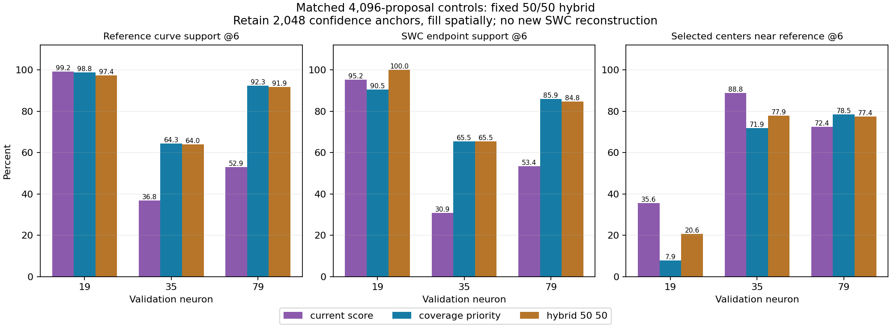

# Fixed hybrid global-selection control

Follow-up: the user completed the focused neuron-79 reconstruction control.
[Verified results and projections](hybrid_swc_results.md) show spatial F1
0.6560 -> 0.6862, with higher precision and recall, but substantial remaining
geometry and evaluation limits. No selector is promoted. The recommendation
below records the decision at the time of this CPU diagnostic.

**Completed 11 October 2026:** all three cases passed matched-budget,
protected-anchor, frozen-input and saved-control checks. CPU comparison took
75.0 seconds after interpreter/import startup. The hybrid retains most support
gains on 35/79 but does not preserve neuron 19's proximity proxy. No selector
is promoted.

The user approved one hybrid diagnostic after the
[score versus spatial control](global_coverage_comparison.md). This comparison
uses the same saved post-local proposals on neurons 19, 35 and 79. It runs on CPU
with no image decoding, model inference, geodesic tracing or training. Production
code/settings and model weights remain unchanged. No reconstruction F1 is produced.

## Fixed hypothesis and implementation

The preset is **50% confidence anchors, 50% spatial fill**. The first 2,048
proposals already accepted by the current score/sphere selector are protected.
They are its strongest accepted scores, not the first 2,048 raw network rows.
Farthest-point filling orders remaining candidates by their distance from the
protected anchors and subsequently chosen spatial candidates. The unchanged
production sphere selector accepts the remaining 2,048 output slots.

All three controls share the 16,384 candidate limit, 4,096 output budget,
sphere IoU 0.1 rule, frozen input arrays and unchanged actual objectness scores.
References never enter selection. Internal rank tensors specify order only;
they are not replacement objectness predictions. The balance is declared before
measurement and is not changed after observing the three cases.

The score-only and pure-coverage controls are reused from saved files. Their
artifact/source hashes are checked, source-row identities are verified, and
their support/gate/pool measurements are recomputed to match the earlier report.
Hybrid output must have exactly 4,096 distinct rows, exactly 16,384 candidate rows,
and retain every protected anchor in the accepted prefix.

## Measurement limits

Reference curves use one-voxel resampling and the spatial evaluator's 250,000-point
maximum. Support is measured at 6/12/18 voxels. Selected-center proximity to the
reference is a diagnostic for annotated geometry, not semantic precision or final
SWC precision. Real unannotated branches may be far from an incomplete reference.

Endpoints on neurons 35/79 include disconnected annotation fragment ends. Graph
input-pool measurements precede geodesic node selection and tracing; sparse centers
cannot be read as the final arbor. Coverage improvements do not establish a
reconstruction improvement. Neuron 94 is not included in this selector control:
its earlier missing-proposal deficit remains a separate problem.

## Results

| Neuron | Current curve support @6 | Pure coverage | Fixed hybrid |
|---|---:|---:|---:|
| 19 | 99.16% | 98.84% | 97.42% |
| 35 | 36.81% | 64.35% | 64.04% |
| 79 | 52.94% | 92.29% | 91.86% |

| Neuron | Current centers near reference @6 | Pure coverage | Fixed hybrid |
|---|---:|---:|---:|
| 19 | 35.62% | 7.91% | 20.63% |
| 35 | 88.84% | 71.85% | 77.93% |
| 79 | 72.44% | 78.47% | 77.39% |



On 35, hybrid curve support gains **27.23 percentage points** versus the current
selector, retaining almost all the pure-coverage gain. Its proximity proxy is
6.08 points better than pure coverage, but 10.91 points worse than the current
selector. Supported SWC endpoints increase from 34/110 to 72/110.

On 79, hybrid curve support gains **38.92 points**, while the proximity proxy
also improves by 4.96 points. Endpoint support increases from 102/191 to 162/191.
It retains slightly less support and proximity than pure coverage. This is a
promising case for an actual reconstruction control, not proof that either
new selection policy improves the final SWC.

On 19, protection improves the proximity proxy relative to pure coverage, but
it remains **14.99 points below the current selector**. Curve support is also
1.74 points lower, although endpoint support improves from 20/21 to 21/21 and
18-voxel curve support stays 100%. Half confidence anchors do not provide a
general safeguard against spreading into regions away from the reference.
These measurements do not prove those regions are biological background.

## Downstream gate and pool

| Neuron | Hybrid curve support before/after 0.5 gate | After 0.85 gate | Current after either gate |
|---|---:|---:|---:|
| 19 | 97.42% | 87.14% | 99.16% |
| 35 | 64.04% | 39.28% | 36.81% |
| 79 | 91.86% | 48.25% | 52.94% |

Only 60.06%, 65.04% and 62.23% of hybrid rows retain scores at least 0.85 on
19/35/79, respectively. The high gate again removes much of the recovered support.
Protecting half the accepted high-score rows does not make scores of the spatial
fill higher. Lowering a gate must be assessed together with rejection and tracing.

At cutoff 0.5, current -> hybrid adaptive input-pool support at six voxels is
47.55% -> 33.85% on 19, 25.90% -> 24.46% on 35 and 41.50% -> 47.16% on 79.
At 18 voxels it is 100% -> 100%, 47.24% -> 69.48% and 72.64% -> 99.09%.
Wider reach can coexist with sparse six-voxel center coverage. Actual geodesic
selection and SWC tracing have not run for the hybrid.

## Decision and next discussion

The fixed hybrid does **not** meet the intended goal of recovering weak cases
while preserving the cleaner control. It is not a universal replacement or a
finished PN2 result. Confidence and spatial coverage remain complementary, but
a fixed mixture alone does not provide semantic rejection.

Recommendation: stop ratio tuning on these three validation cases. Neuron 79 has
the strongest simultaneous retention/proximity improvement and merits one frozen
full-SWC comparison at cutoff 0.5 before broader selector work. Agree that scope
and implementation together, then prepare a visible user-run command. Do not
launch a long run from this diagnostic. Neuron 19's regression risk and neuron
94's upstream missing-proposal deficit remain separate problems.

No new ratio, input recipe, learned rejection module or architecture has been
implemented. The conditional three-neuron reconstruction is not prepared or
launched because the guard case failed the representation tradeoff. A single
neuron-79 test would narrow the next experiment to the supported hypothesis.

## Visible files and repeat command

- [CPU script](../../scripts/pointneuron2/compare_hybrid_global.py)
- [Measurements, source/input hashes and control checks](hybrid_global_comparison_seed0/summary.json)
- [Prior global selection control](global_coverage_comparison.md)
- [Stage-by-stage audit](full_volume_selection_audit.md)

Raw hybrid selections are ignored under
`tmp/pointneuron2/local_runs/hybrid_global_comparison_20261011`.
Pre-global encoder features were not saved, so these are diagnostic selection
artifacts, not production proposal files ready for reconstruction.

Synthetic checks compare seeded spatial filling to a dense reference calculation,
verify deterministic order, retained anchors, source-row mapping, fixed count
and rejection of duplicate anchors. Raw artifact checks also verify unchanged
source coordinates, radii and scores. These are execution/measurement checks.

To repeat into fresh output directories:

```powershell
Set-Location "C:\Users\Seywe\Documents\GitHub\PointNeuron\pointneuron2"
& .\tmp\pointneuron2\sampling_env\Scripts\python.exe -u `
  .\scripts\pointneuron2\compare_hybrid_global.py `
  --comparison .\tmp\pointneuron2\local_runs\validation_graph_cutoffs_20261011\validation_comparison.json `
  --coverage-report .\docs\pointneuron2\global_coverage_comparison_seed0\summary.json `
  --output-dir .\tmp\pointneuron2\local_runs\hybrid_global_repeat\report `
  --artifact-dir .\tmp\pointneuron2\local_runs\hybrid_global_repeat\selections
```
