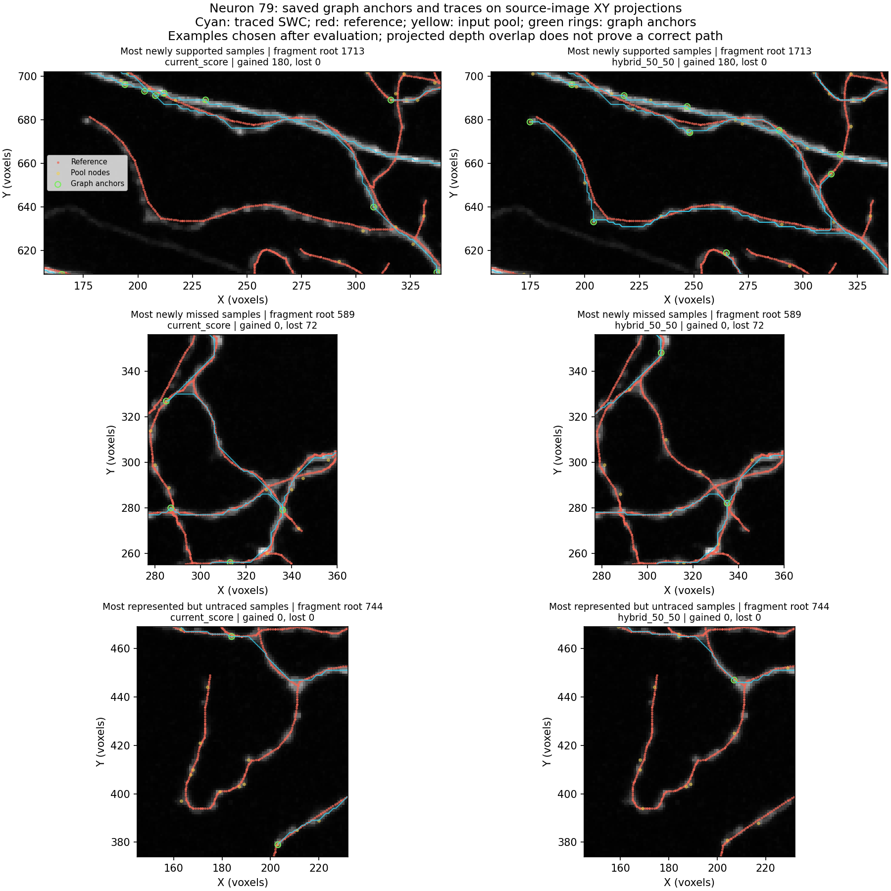

# Neuron 79: where recovered proposals fail to become traced branches

**Completed 11 October 2026:** user-approved CPU inspection of the saved graph
selection, traced paths and unchanged source image. No model inference,
geodesic recomputation, new reconstruction, training or parameter changes.
The paired reconstruction first improved spatial F1 from 0.6560 to 0.6862;
see [those verified results](hybrid_swc_results.md).

## Evidence from the actual saved neuron

The hybrid SWC misses 7,456 of the same 16,793 reference samples at six voxels.
Of those, **6,181 already have a hybrid global proposal within six voxels**.
All 6,181 also have a graph-input-pool candidate within 18 voxels. The evidence
is available at the 625-candidate graph pool, but the final tree misses it.

| Represented but untraced reference samples | Current | Hybrid |
|---|---:|---:|
| Total with a global proposal within 6 voxels | 3,218 | 6,181 |
| Input-pool candidate within 18, no selected anchor within 18 | 2,034 | 4,509 |
| Selected anchor within 18, still untraced within 6 | 1,184 | 1,672 |
| No pool candidate within 18 | 0 | 0 |

These distance strata locate regions for inspection, not causally classified
errors. Sparse graph anchors can trace geometry farther than 18 voxels away.
Nevertheless, **4,509/6,181 = 73.0%** of the hybrid's represented-but-untraced
samples have nearby pool candidates but no nearby selected anchor. This points
to anchor placement as a major remaining constraint on this neuron. The other
1,672 samples merit route/connectivity inspection even with a nearby anchor.

The two final 128-anchor graphs share only **13 exact source proposals**.
Hybrid anchors include 67 scores below 0.85, versus zero for the control.
Only 48 hybrid anchors come from the 2,048 protected global confidence anchors;
the control selects 76 from that same protected set. Global protection does
not guarantee downstream graph preservation. Nearest-reference-fragment
assignments span 66 fragments in the control and 69 in the hybrid, despite
the large global coverage gain. These assignments are diagnostics, not counts
of biologically represented branches.

## Source-image evidence and concrete examples

Among the 6,181 hybrid represented-but-untraced samples:

- 83.0% have rounded reference-voxel intensity above the actual graph threshold 15.
- **99.64%** have at least one voxel above 15 within a radius-two cube around
  the rounded location (a 5x5x5 neighborhood, not a two-voxel Euclidean ball).
- 85.20% have a voxel above the proposal threshold 51 in that neighborhood.

Among the 1,196 samples the hybrid loses, **91.89%** are above graph threshold
at the rounded location and **99.83%** have nearby signal above it. Missing
local intensity is therefore insufficient to explain most of these losses.
These local checks do not prove that a continuously connected neurite survives
the mask: a thin connecting gap can matter despite bright local neighborhoods.

Examples are chosen after evaluation by the largest relevant sample count;
they are diagnostic, not a new validation selection criterion.

- **Fragment root 1713:** reference support rises from 6.25% to 100%; 180 samples
  are newly covered. Nearest-assigned anchors rise from zero to two, and the
  hybrid visibly traces the curved feature represented in the source image.
- **Fragment root 589:** support falls from 88.98% to 27.97%; 72 samples are lost.
  Neither graph has an anchor assigned nearest to this fragment. Changing the
  surrounding anchors changes which route is traced through the region.
- **Fragment root 744:** support stays 3.48% in both; 185 samples remain missed
  despite nearby global proposals. Pool candidates sit along the visible curved
  feature, but neither graph places a nearest-assigned anchor on the fragment
  and neither final trace follows most of it.

The panels use XY maximum-intensity projections within the fragment's depth
range plus margin. Depth overlap can hide crossings; these panels and local
signal statistics do not certify neurite identity or a correct connection.

Saved path voxels above threshold 15 are **99.83% in both arms**; median path
intensity is 97. This largely follows from tracing on the foreground graph.
Path-voxel distance from the reference exceeds six voxels for 12.43% of control
path entries and 11.26% of hybrid entries (repeated entries across edges count
again). These are not the resampled-SWC precision denominator. Bright image
paths alone do not guarantee complete arbor coverage or correct connections.

## A separate, reproducible component-allocation problem

The current connected-coverage selector first divides candidates into image-path
connectivity components, orders them by size, allocates node slots and performs
Euclidean farthest-point selection inside each component. Allocation uses
`max_nodes * component_size / remaining_source`: its numerator stays fixed
while the denominator shrinks, before clipping to remaining slots.

Calling the **unchanged** production function on synthetic eligible components
demonstrates that later components can receive zero anchors:

| Eligible component sizes | Actual allocation of 128 anchors | Fixed-total proportional shares |
|---|---|---|
| 300 / 250 / 75 | 61 / 67 / 0 | 61.44 / 51.20 / 15.36 |
| 250 / 250 / 125 | 51 / 77 / 0 | 51.20 / 51.20 / 25.60 |

All components meet the existing size eligibility rule. The first two consume
the full budget before the third is visited. Proportional shares are shown as
floats; they are not a new rounded allocation policy or implemented fix.
The [probe](../../scripts/pointneuron2/probe_component_allocation.py) and its
[recorded outputs](hybrid_graph_path_audit_seed0/component_allocation_probe.json)
preserve the counterexamples and original source hash.

**This does not establish that component starvation caused neuron 79's losses.**
Its saved graph lacks the full candidate geodesic matrix and component allocation
trace. Final connectedness includes added bridges, so it cannot establish that
the original input pool was one connectivity component. No production fix is
implemented by this audit.

## What to test next, together

The evidence favors graph anchor allocation and route coverage as the next
target on neuron 79, before additional proposal-model training or blanket
mask relaxation. It does not prove that simply raising the 128-node budget
is sufficient. Neuron 94's earlier missing-proposal problem remains separate.

Recommended comparison: keep the **same hybrid proposals, 625-node graph pool,
image mask and 128-anchor budget**. Save the full geodesic/component allocation
trace once. If actual component starvation is present, compare the current
allocation with a corrected allocation that accounts for the remaining node
budget. If it is absent, compare Euclidean anchor coverage with image-path
distance coverage. Declare the applicable comparison from that trace before
examining its new SWC scores; do not silently combine both changes.

That would require a new versioned experimental driver and a separately agreed
user-visible graph run. The old frozen sources/results must remain verifiable.
No such run or repair is prepared or launched here. The current conclusion is
a measured reconstruction gain plus a more specific graph-stage diagnosis,
not a completed first phase or a promoted universal selector.

## Reproduce the inspection

The [CPU audit script](../../scripts/pointneuron2/audit_hybrid_graph_paths.py)
verifies the paired experiment, then decodes the fixed image once. Run it with
`--comparison tmp/pointneuron2/local_runs/hybrid_swc_neuron79_20261011/comparison.json`
and a fresh `--output-dir`. The [full inspection data](hybrid_graph_path_audit_seed0/summary.json)
include per-fragment support, selected source identities, edge-path records,
image statistics, input/source hashes and measurement limits.
