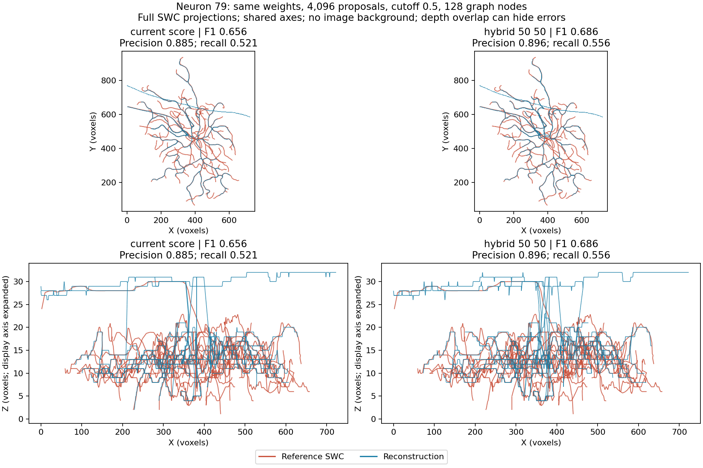
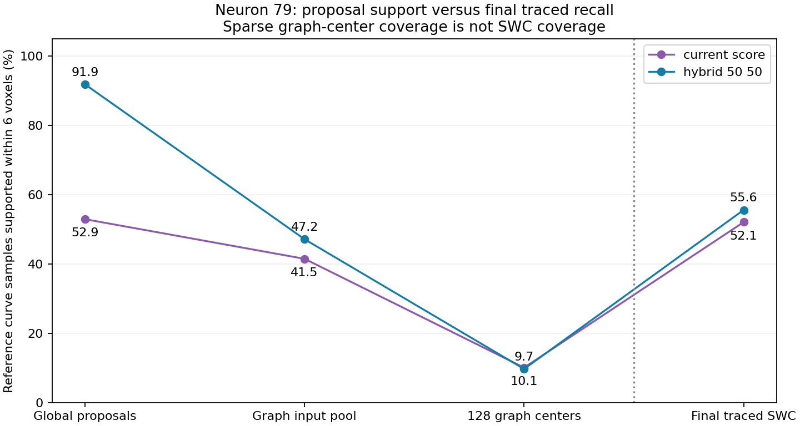

# Neuron 79: measured hybrid reconstruction results

Follow-up: the user-approved [graph/path and image inspection](hybrid_graph_path_audit.md)
is complete. It narrows the graph-stage diagnosis and records a synthetic
allocation problem, without changing settings or rerunning reconstruction.

**Completed 11 October 2026.** The user ran the fixed paired reconstruction on
their local RTX 3070 Ti Laptop GPU, with live terminal output. It completed in
421.4 seconds (7m01s within the driver; terminal total 7m08s). Saved inputs,
all 125 frozen source hashes, actual feature identities, proposal/graph/SWC
hashes, saved metric reports and independent CPU geometry checks passed.
The control reproduced its previous spatial precision, recall and F1 exactly.

## Result and its scope

| Measure | Current confidence selection | Fixed 50/50 hybrid | Change |
|---|---:|---:|---:|
| Spatial precision | 0.8855 | 0.8961 | +1.07 percentage points |
| Spatial recall | 0.5209 | 0.5560 | +3.51 points |
| Spatial F1 | 0.6560 | 0.6862 | +3.03 points |
| Reported topology F1 | 0.4064 | 0.4946 | +0.0882; arm-dependent targets |
| Bridge edges | 4 | 4 | unchanged |
| Bridge matches to induced target | 1/4 | 2/4 | one additional match |
| Reference-to-prediction mean distance | 10.32 voxels | 9.51 voxels | lower |
| Prediction-to-reference mean distance | 4.97 voxels | 4.49 voxels | lower |

This is an actual final-SWC improvement on one selected validation neuron,
with unchanged checkpoint and input evidence. It supports the hypothesis that
global confidence ranking discarded useful geometry. Better allocation alone
can improve reconstruction without additional training. It does not establish
generalization, a universal selector, a finished first phase or superiority to PN1.

Both arms use 4,096 proposals, cutoff 0.5, at most 128 graph nodes, distance NMS
18, the same image/mask and geodesic settings. The raw local pool is regenerated
once and must match the saved pool exactly. The hybrid uses the already frozen
2,048 confidence anchors and spatial fill; no ratio tuning or new weights.
Both arms adapt the foreground threshold from 5 to 15 to satisfy the same
350,000-voxel cap, retaining 339,243 foreground voxels. No new test data are used.

The XY projections show additional agreement with parts of the reference,
but substantial red-only geometry remains. XZ exposes depth disagreement and
step-like traced paths in both outputs. These are voxel-graph paths; the figure
alone cannot distinguish wrong biological paths from voxel discretization or
annotation differences. There is no image background, and projection overlap
can hide errors. Image-based path inspection is still needed for biological claims.

## How much recovered evidence reaches the SWC?

All support measurements use the same 16,793 reference curve samples and six-
voxel distance. Graph centers are sparse; their coverage is not SWC recall.

| Stage | Current | Hybrid |
|---|---:|---:|
| Global 4,096 proposals: curve support @6 | 52.94% | 91.86% |
| Adaptive input pool: curve support @6 | 41.50% (604 nodes) | 47.16% (625 nodes) |
| Selected 128 graph centers: support @6 | 10.08% | 9.70% |
| Final traced SWC: recall @6 | 52.09% | 55.60% |

At 18 voxels the hybrid input pool retains 99.09% curve support, versus 72.64%
for the control; selected graph centers cover 42.21% versus 44.34%. Wider input
reach does not automatically place graph anchors on every useful branch.
Tracing interpolates between anchors, so low center coverage does not prove
equally low traced coverage, nor identify one stage as the sole cause.

The global support gain of **38.92 points** becomes a final recall gain of
**3.51 points**. This is evidence that global allocation matters and that much
of its recovered support still fails to become the final arbor. Graph-anchor
selection and tracing are the next specific mechanisms to inspect; the numbers
do not establish that increasing the graph budget alone would fix them.

Using identical reference targets, the hybrid SWC newly supports **1,785** curve
samples, loses **1,196** previously supported samples, retains **7,552**, and
leaves **6,260** absent in both. Net gain is 589/16,793 = 3.51 percentage points.
It is not a monotonic superset of the old reconstruction.

Supported reference endpoints increase only from **76/191 to 79/191**: 14 gained,
11 lost, 65 retained, 101 absent in both. These are annotation fragment ends,
not 191 verified biological neurite terminals. Global proposals supported
102 versus 162 of them before graph selection and tracing.

## Topology metric: a structural limitation

The reference SWC contains **191 roots** and no shared branching vertices.
It is stored as disconnected annotation fragments. The reconstructed graphs
are single connected trees with 128 nodes and 127 edges.

The topology evaluator maps each arm's selected centers to reference nodes,
then builds a minimum spanning forest using finite distances within those
reference components. This creates **60 target edges for the control and 59
for the hybrid**. These are different targets, not a fixed common edge test.

With exactly 127 predicted edges and 59 hybrid target edges, true positives
cannot exceed 59. Consequently the edge-count ceiling is
`2 * 59 / (127 + 59) = 0.6344` for F1 (control ceiling: 0.6417). This is a bound
for these fixed edge counts, not a proposed normalized score or a new metric.
Even matching every induced hybrid target edge could not yield F1=1 while
keeping 127 predicted edges. The observed 46/59 target matches are encouraging,
but the remaining connections need image evidence: unmatched edges may be wrong
or may connect gaps absent from the fragmented reference.

This explains part of the apparent topology ceiling; it does not explain away
missing spatial geometry or certify the extra connections. Changing the metric
or output connectivity policy requires a separate agreed comparison.

## Next research decision

Recommendation: inspect the saved **625-node graph pool -> 128 selected anchors
-> traced paths** on newly gained and lost reference regions before retraining
or changing budgets. Use image evidence to separate missing anchor placement,
paths that bypass neurites, and gaps introduced by foreground filtering.
First agree that scope together; no new reconstruction or training is launched.

The hybrid remains experimental. Neuron 19's representation regression still
needs a safeguard, and neuron 94's missing evidence arises earlier. A broader
validation comparison would be needed before promotion. The learned PN2
architecture stages have not been implemented by this diagnostic.

## Visible artifacts

- [Verified measurements and support changes](hybrid_swc_results_seed0/summary.json)
- [Read-only CPU summarizer](../../scripts/pointneuron2/summarize_hybrid_swc.py)
- [Fixed protocol and user-run command](hybrid_swc_comparison.md)
- [Prior representation diagnostic](hybrid_global_comparison.md)

Raw outputs and the completed comparison remain in the ignored directory
`tmp/pointneuron2/local_runs/hybrid_swc_neuron79_20261011`. The two arm folders
contain SWCs and interactive `sample_0079_geodesic_compare.html` files.

To reproduce this report, invoke `summarize_hybrid_swc.py --comparison` with
that directory's `comparison.json` and a fresh `--output-dir`. It verifies
saved files and measures their geometry on CPU; it does not rerun the model,
trace paths or change settings.
