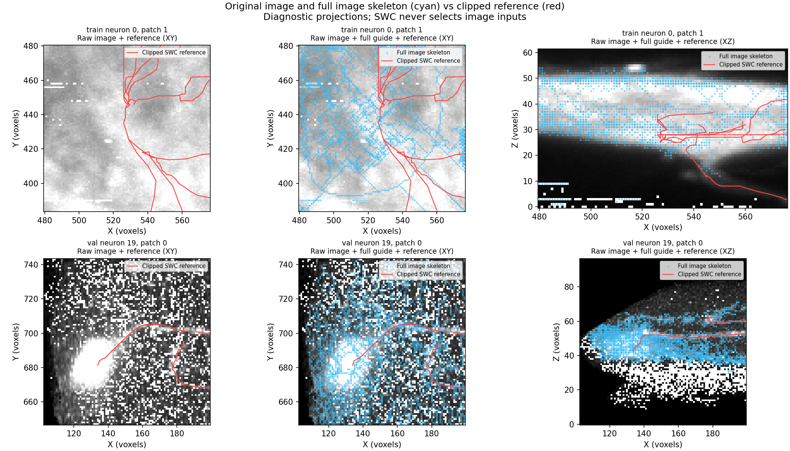

# Input audit: why we are not starting longer training yet

The original inspection was a warning worth investigating. The audit now uses
the actual image, the full extracted skeleton, and reference edges clipped at
patch boundaries. It checks all eight cached train/validation patches from the
execution smoke. No test neuron was evaluated and no training run was launched.
The existing dataset inventory scans SWC files for valid file selection; only
the two cached train/validation sources enter the audit metrics.

## Measured losses of reference coverage

Coverage here is the fraction of a resampled local reference curve within three
voxel units of each representation. It is a diagnostic of input support, not
reconstruction F1 or a foreground precision metric.

| Representation | Train neuron 0, patch 1 | Validation neuron 19, patch 0 |
|---|---:|---:|
| All thresholded foreground | 92.0% | 100.0% |
| Full extracted image skeleton | 19.1% | 96.1% |
| 1,024 foreground candidates | 36.7% | 72.3% |
| 512 retained guide vertices | 10.7% | 59.4% |

The train patch contains 197,488 foreground voxels and 2,585 full guide vertices.
The validation patch contains 32,673 foreground voxels and 3,762 full guide
vertices. Reducing these to fixed pools loses spatial support before training.
The full guide itself is already weak on the train patch, so guide compression
alone cannot fix that case.

The train patch's broad bright image regions produce a mask whose medial axis
can differ substantially from the annotated neuronal trace. That is a plausible
explanation for its poor full-guide coverage, supported by the projections;
the audit does not isolate one definitive cause. The validation guide covers the
local reference much better but also includes many other structures. Incomplete
annotations prevent interpreting every extra guide point as noise.

Lowering the foreground threshold from 0.2 to 0.1 restores train-patch foreground
support from 92% to 100%, while increasing foreground voxels from 197,488 to
253,735. This does not establish that the extracted guide will improve: adding
background can also change skeletonization adversely. No new threshold was
promoted from this diagnostic.



The source hash, every cached candidate's XYZ coordinate and intensity, and the
full-guide vertex counts agree with the source/cache records. This rules out a
cache point-conversion mismatch in these records, but does not prove complete
anatomical alignment or calibrated source spacing. The current distances use
spacing [1,1,1], hence voxel units. MIP projections can hide depth mismatch.

Boundary clipping adds ten crossing reference edges to the train patch and two
to the informative validation patch. The original eight-patch smoke still has
only one train patch with a substantial local reference, one informative val
patch, one val patch with a single node, and five patches without local curve
support. No-reference patches remain in the audit with null coverage metrics.

## What happens next

The first diagnostic comparisons and an optional [inspection viewer](manual_review.md)
are available. Pool selection has mixed effects, and recorded source spacing
does not resolve the train guide. No new settings have been promoted. The main
pipeline now prioritizes [automatic preprocessing](automatic_preprocessing.md);
human review of these pilot cases is not a prerequisite for continuing.

1. Check source-specific XYZ spacing and foreground/trace correspondence in 3D.
   Compare image-only foreground/guide extraction choices on training data,
   measuring thin-branch and terminal support as well as extra structures.
2. Replace or improve uniform pool reduction with an image-only coverage-aware
   approach. Verify candidate and guide support at the same fixed point budgets
   before coupling it to learning. Preserve disconnected structures and retain
   ordinary foreground exploration; do not select inputs from the SWC.
3. Expand image-defined patch coverage so a tiny cap does not leave training
   with almost no annotated signal. Keep unannotated patches distinct from
   verified negatives and check reference segments crossing patch boundaries.
4. Run longer matched learned/random training after those input checks, then
   score full validation reconstructions. PointNeXt follows this assessment.

The implementation added in this audit is `scripts/pointneuron2/audit_sampling.py`.
Three new geometry checks pass, including edges crossing a patch with neither
endpoint inside. Production extraction, cached pools and trained weights have
not been modified by this diagnostic. Measurements and provenance are saved in
`input_audit_seed0/audit.json`; the earlier smoke results remain separate.

To reproduce locally, use a fresh output directory:

```powershell
& .\tmp\pointneuron2\sampling_env\Scripts\python.exe scripts/pointneuron2/audit_sampling.py --root 'C:/Users/Seywe/Documents/GitHub/PointNeuron/data/gold166' --manifest tmp/pointneuron2/sampling_training_cache_smoke/manifest.json --output-dir docs/pointneuron2/input_audit_new
```

These are two informative patch examples, not a dataset-wide diagnosis or
evidence of PN 2.0 improvement. The full stage-1 reconstruction comparison is
still outstanding.
