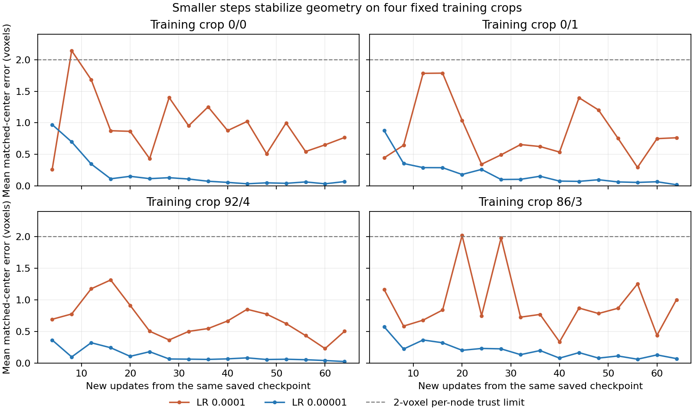

# Smaller steps stabilize geometry; automatic selection and topology remain incomplete

20 October 2026. Both user-launched 64-update controls finish. **LR 0.00001
passes the declared stability criterion; neither arm passes the combined
diagnostic qualification.** Preserve that distinction. The lower LR gives
useful local geometry evidence and one full automatic crop pass, not a complete
PN 2.0 reconstruction result. No additional training is launched or prepared.

## Comparison integrity and execution

Both arms import identical update-1,000 model weights, Adam moments/counters and
RNG, verified directly from saved initial checkpoints against their common
parent. LR is the only arm difference; both use partial supervision. Both
complete 64 proposal and 64 GAT updates, ending at Adam clocks 5,064/1,064.
Runtime is 398.7 seconds after setup, about 6.65 minutes; the user's full console
duration is 7m10s. This measures the paired job including probes/exports, not
128 pure optimizer updates or a forecast of broader training.

Arm A reproduces recorded steps 1,001–1,013 and the historical incoming stop at
1,014 before proceeding. Its recorded labels contain 63 both-class updates and
one positive-only update. Arm B has both classes on all 64 updates. Neither arm
encounters an all-unknown edge batch: real-GPU GAT skipping is therefore not
demonstrated by this run; its behavior remains covered by the CPU tests.

## Geometry: a clear local result

All 452 target centers across the four crops remain within two voxels at every
one of B's 16 all-crop probes and every incoming training occurrence. A's geometry
fluctuates substantially, including only 157/418 trusted dense targets in one
incoming batch. Both arms have the same input clouds, so this paired difference
supports a local step-size effect, not a Phase 1 or architecture replacement.

| Crop | Minimum trusted count across A cycle probes | B cycle probes | Final mean distance A | Final mean distance B |
|---|---:|---:|---:|---:|
| 0/0 | 3/6 | 6/6 | 0.768 | 0.070 |
| 0/1 | 9/12 | 12/12 | 0.764 | 0.020 |
| 92/4 | 16/16 | 16/16 | 0.503 | 0.024 |
| 86/3 | 239/418 | 418/418 | 1.003 | 0.070 |

The plotted two-voxel line is the per-node trust limit; a mean below it does not
guarantee that every node is trusted. The count checks above are separate. One
checkpoint and seed, 64 updates per arm and four training crops do not establish
long-run stability or generalization. Radius accuracy and whole-neuron stitching
are not certified by the center-distance result.

## Actual automatic output at reduced-LR endpoint

| Crop | Accepted assigned + extras | Required edges retained | Nonreference edges | P@2 | R@2 | Full gate |
|---|---:|---:|---:|---:|---:|---|
| 0/0 | 6/6 + 0 | 5/5 | 0 | 100% | 100% | **Pass** |
| 0/1 | 12/12 + 18 | 6/10 | 20 | 50.54% | 96.47% | Fail |
| 92/4 | 16/16 + 4 | 13/15 | 6 | 87.16% | 100% | Fail |
| 86/3 | 418/418 + 0 | 402/404 | 2 | 99.92% | 99.74% | Fail |

Crop 0/0 passes the original node, graph, geometry and SWC criteria using
automatic selection, with no reference-selected model inputs. That is a useful
automatic **training-crop** success. The four-crop gate remains failed.

The dense crop has all 418 assigned nodes accepted and trusted, correct component
count 14, all 404 required pairs present and above the edge cutoff, but two wrong
same-tree adjacencies displace two required edges during forest selection. One
junction still has incorrect incidence. The selected false pairs are known
negative training edges, with logits 9.721 and 2.136. Their persistence cannot
be explained solely by unknown-edge masking. Small continuous geometry error
and valid SWC serialization do not establish exact topology.

For crop 0/1, all 20 nonreference decoded edges touch unmatched proposals; all
four missing required pairs survive candidates and cutoff but lose during
forest selection. Its matched centers are very accurate, while accepted extras
and their connections keep curve precision near 50%. Center placement alone is
not the reconstruction bottleneck in this saved endpoint.

## Why the formal verdict is still "neither"

A fails stability and output preservation: crop 0/1 component-count error grows,
and dense P/R decline beyond the allowed amount. B passes stability but narrowly
fails one preservation criterion: crop-0/1 precision changes
0.5106842223 → 0.5053539117, a decline of **0.0053303107** (0.533031 percentage
points), exceeding the declared 0.005 allowance by **0.0003303107** (0.033031
percentage points). This is the sole B diagnostic-preservation violation.

Do not silently relax that allowance after seeing the result. Equally, do not
interpret its small excess as evidence that the reduced LR failed to stabilize
geometry. The numerical rule and component-specific scientific conclusion answer
different questions. Three failed full crop gates are substantive limitations
regardless of this narrow preservation miss.

## The remaining confidence and edge-ranking errors

At B's endpoint, crop 0/1's weakest matched proposal scores **95.24%**, while
its strongest unmatched proposal scores **99.75%**. Crop 92/4 has corresponding
values **94.99%** and **97.87%**. Thus no single monotone confidence cutoff can
retain every matched target and reject every extra in either saved crop. This
is a ranking error under the declared unique-target representation, not merely
a poorly chosen 0.5 cutoff. No cutoff search is performed.

The dense crop's two selected false edges are also ranking/decision errors.
The averaged edge loss is only 0.006844 over 404 known positives and 3,126 known
negatives, despite the false edge with logit 9.721. A small mean loss can coexist
with a few high-scoring mistakes that determine the forest. This is a measured
loss/output mismatch; it does not prove which alternative objective will fix it.

Simply adding model capacity or rerunning the earlier hard-negative loss is not
justified. The [previous 50/25/25 confidence experiment](hard_negative_query_results.md)
already regressed badly and remains rejected. A new objective would need to
explain what changes relative to that failed variant and preserve the successful
geometry behavior. These 64-update controls also cannot establish that more
training under the existing objective would never resolve the residual errors.

## Research decision

Close the declared comparison without extension or an LR grid. Preserve reduced
LR as the demonstrated stable local reference, while retaining the official
failed qualification. No long-run default is silently changed.

The next substantive discussion should concern learning **unique node membership
and graph edge ordering**, with geometry stability as a constraint. Keep Phase 1
and the architecture provisionally; this result does not justify rebuilding
them. The evidence narrows the unresolved design issue, but does not yet select
a new loss, graph node head or decoder. Explain any such change and its matched
comparison before implementation. No new training command is provided here.

## Verification and artifacts

The [read-only reviewer](../../scripts/pointneuron2/review_joint_partial_stability.py)
verifies all 16 saved prediction/SWC pairs, selection and score mapping, graph/
geometry metrics, transferred training labels, original full gates, formal
qualification and the decision rule. It checks checkpoint hashes/cursors/moments,
common initialization and recorded pre-stop replay. It performs no model forward,
optimizer update or CUDA initialization. The full incoming packet at 1,014 was
checked by the runtime replay; the reviewer independently checks its retained
summary, not a second archived copy of that full packet.

Visible [summary and provenance](joint_partial_stability_results_seed0/summary.json).
Raw review: ignored `tmp/pointneuron2/local_runs/joint_partial_stability_review_20261020/`.
