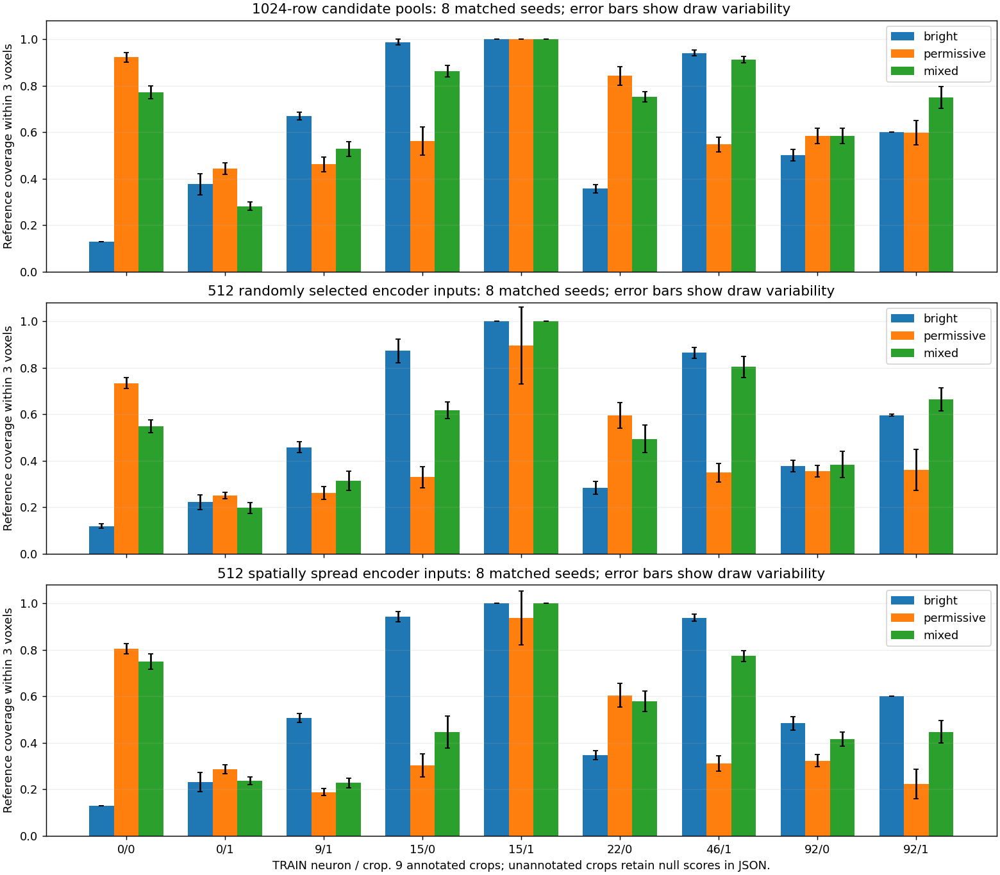

# Bright-core plus weak-signal candidate control — 11 October 2026

The 50/50 mixed pool improves average reference coverage, but loses some coverage
of branches already represented by the bright mask. It is an experimental control,
not an adopted training policy. The spatial-selection control is also complete;
it helps the bright pool but does not resolve dilution in the mixed pool. The
next recommended step is the staged corrected raw/local-coordinate model pilot.

## Experiment

Reused all 12 corrected training crops from the six-neuron foreground comparison.
Nine contain reference curves; three keep null scores. The fly 15/1 crop contains
only six reference samples. No mask re-extraction, full-volume processing, model
training, validation selection or reserved-test evaluation occurred.

Image-only pools, each 1024 rows, with eight matched seeds:

- **Bright:** uniform samples of the fixed mask.
- **Permissive:** uniform samples of the noise-hysteresis mask.
- **Mixed:** 512 bright samples plus 512 samples from permissive-minus-bright.
  Shortages transfer to the other group. Every eligible voxel is retained before
  padding if the union is smaller than the budget. Bright voxels outside the
  permissive mask remain eligible. Raw intensities and XYZ are preserved.

Each pool is scored directly and after selecting 512 rows using random sampling
or the existing fixed medial prior. **All methods use the same full fixed-mask
guide** for this prior, isolating pool changes. No guides are capped; references
never enter point selection. Baseline pools at seed zero exactly reproduce the
saved foreground-comparison pools.

CPU execution took **17.4 seconds**; 12 crops completed without errors.

## Results

Mean reference proximity within three voxels, first averaged over seeds inside
each crop and then over the nine annotated crops:

| Representation | Bright | Permissive | Mixed |
|---|---:|---:|---:|
| 1024-row pool | 61.8% | 66.2% | **71.6%** |
| 512 random inputs | 53.2% | 45.9% | **55.8%** |
| 512 fixed-medial inputs, same guide | 55.1% | 55.8% | **57.9%** |
| Along-edge supported length, 512 random | 54.1% | 46.8% | **56.1%** |

The mixed pool gains 9.8 percentage points before selection, but only 2.6 points
after random selection. These are **representation diagnostics, not reconstruction
F1 or semantic precision**. Along-edge support measures spatial proximity gaps,
not connectedness of a predicted graph.


To expose losses hidden by the mean, reference samples are separated only for
scoring: those within three voxels of the bright foreground, and those farther
from bright foreground but within three voxels of the permissive foreground.
The latter are called fixed-missed/noise-available, not verified weak neurites.

| 512 random input coverage within 3 voxels | Bright | Permissive | Mixed |
|---|---:|---:|---:|
| Bright-available samples, mean across nine crops | 71.6% | 45.7% | 64.1% |
| Fixed-missed/noise-available samples, mean across seven crops | 0.0% | 36.1% | 35.6% |

Conditional means have different denominators; some recovery groups contain only
one or eight samples. They must not be interpreted as dataset-wide recall.
Per-crop counts and all seed measurements remain in the JSON report.

Examples after random selection:

- Chick 0/0: bright 11.9%, permissive 73.4%, mixed 54.8%; the mixed pool restores
  useful missing coverage while preserving its small bright core well.
- Fly 15/0: bright 87.3%, permissive 33.0%, mixed 61.7%; even the mixed rule
  dilutes a crop where bright foreground already represents the trace well.
- Cultured cells 46/1: bright 86.4%, permissive 34.9%, mixed 80.4%.
- Adult fish 92/1: bright 59.5%, permissive 36.1%, mixed 66.3%.

This is evidence for separating bright and additional candidates, but not for
using a universal 50/50 ratio. Dense regions, incomplete traces, finite candidate
budgets and input selection still matter. Increasing input capacity is plausible;
its training benefit and GPU cost have not been measured in this experiment.

## Spatial-selection control: completed

An additional CPU run used the existing farthest-point selector on exactly the
same pools, masks, seeds and 512-input budget. It took **24.9 seconds**. Every
earlier pool, random and fixed-medial metric reproduced exactly, demonstrating
that only the new selector differed. Twelve crops completed without failures.

| 512-input coverage within 3 voxels | Bright | Permissive | Mixed |
|---|---:|---:|---:|
| Random | 53.2% | 45.9% | 55.8% |
| Fixed medial prior, same full guide | 55.1% | 55.8% | 57.9% |
| Farthest-point spatial spreading | **57.5%** | 44.2% | 54.2% |

Mixed plus spatial spreading helps chick 0/0 (54.8% to 75.0%) but hurts fly
15/0 (61.7% to 44.6%) and adult fish 92/1 (66.3% to 44.7%). The mean cannot
justify adopting that combination. Its within-six-voxel coverage is higher,
95.6% versus 90.3% for mixed/random, showing sensitivity to the proximity ruler.
Spatial coverage is not anatomical discrimination and can spread noisy points.



Machine-readable evidence: `mixed_candidate_spatial_seed0/comparison.json`.
Settings: `configs/pointneuron2/mixed_candidate_spatial_comparison.json`.
Arrays and console log: ignored `tmp/pointneuron2/mixed_candidate_spatial_seed0`.
The first mixed-only run is reproducible from local commit `d7a2b53`; this extended
runner still accepts its original configuration.

## Next model experiment and user-visible commands

I recommend the prepared **corrected raw-coordinate versus local-coordinate
control**, using the fixed-mask range-corrected baseline. That measures a
confirmed coordinate defect with one varying factor, while these foreground
limitations remain explicit. Neither mixed pooling nor spatial selection has
been adopted for production cache preparation or inference.

Both model arms use the same corrected cache, initialization, augmentation and
random point-selection streams. The only varying factor is proposal coordinate
features; offset/radius units remain voxels. No auxiliary guide loss. Full guides
remain cached. This uses the existing PN 1.0 encoder/head for an internal
five-epoch repair comparison; it does not implement PointNeXt or claim final
PN 2.0 performance. The 512-input budget is held fixed to isolate coordinates.

Dataset: **33 train / 7 validation neurons**, at most eight image-defined crops
per neuron; eight reserved test neurons are untouched. Batch size 2, five epochs
per arm, candidate/input counts 1024/512, local RTX 3070 Ti Laptop GPU.
Earlier cache preparation took about six minutes; earlier five-epoch arms took
roughly 0.5–8 minutes each. Corrected full-cache/training durations are unmeasured.

**Neither preparation nor training has been launched.** Preparation is CPU only;
the training command is a separate deliberate step and prints every batch.
Whole-neuron reconstruction/evaluation is another stage and should be agreed
separately given its previously long runtime.

CPU cache preparation, in PowerShell:

```powershell
Set-Location "C:\Users\Seywe\Documents\GitHub\PointNeuron\pointneuron2"
$repairExperiment = Join-Path (Get-Location) ("tmp\pointneuron2\local_runs\repair_" + (Get-Date -Format 'yyyyMMdd_HHmmss'))
& .\tmp\pointneuron2\sampling_env\Scripts\python.exe -u `
  .\scripts\pointneuron2\sampling_ablation.py --stage prepare `
  --config .\configs\pointneuron2\repair_comparison.json `
  --artifact-root "C:\Users\Seywe\Documents\GitHub\PointNeuron" `
  --output-dir $repairExperiment
```

After preparation succeeds, user-launched GPU training in the same PowerShell
session (or set `$repairExperiment` to the saved directory printed above):

```powershell
& .\tmp\pointneuron2\sampling_env\Scripts\python.exe -u `
  .\scripts\pointneuron2\sampling_ablation.py --stage train `
  --experiment $repairExperiment --device cuda
```

Scripts and configuration hashes are frozen at preparation. Code/settings
changes require a fresh experiment. Cache, logs and checkpoints stay in the
printed ignored experiment directory; progress remains visible in the terminal.

## Files and reproduction

- `src/pointneuron/data/mixed_candidates.py`: reference-free disjoint allocation,
  shortage transfer and padding rules.
- `scripts/pointneuron2/compare_mixed_candidates.py`: verifies corrected-reader,
  training partition and saved artifact hashes, prepares pools, measures separate
  reference groups and applies fixed CPU selectors.
- `configs/pointneuron2/mixed_candidate_comparison.json`: preset 50/50 experiment.
- `mixed_candidate_seed0/comparison.json`: all metrics, counts, source hashes and
  runtime. Arrays and log live in ignored `tmp/pointneuron2/mixed_candidate_seed0`.

```powershell
Set-Location "C:\Users\Seywe\Documents\GitHub\PointNeuron\pointneuron2"
& .\tmp\pointneuron2\sampling_env\Scripts\python.exe -u `
  .\scripts\pointneuron2\compare_mixed_candidates.py `
  --comparison .\docs\pointneuron2\foreground_repaired_seed0\comparison.json `
  --output-dir .\docs\pointneuron2\mixed_candidate_repeat `
  --artifact-dir .\tmp\pointneuron2\mixed_candidate_repeat\artifacts
```

Use fresh directories. This command performs CPU diagnostics, not training.

Verification: 195 pre-existing tests passed before checkpoint `5d18ed8`; the
19-test targeted candidate suite then passed, including eight new mixed-allocation
cases. Checks cover a bright minority in a large permissive population, overlapping
strata, disjoint bright eligibility, shortage transfer and retaining every unique
voxel before padding. Execution checks do not establish model improvement.

Git: the previous PN 2.0 groundwork is now committed locally as `5d18ed8`, and
the initial mixed-pool experiment as `d7a2b53`, on `pointneuron2`.
These checkpoints and the spatial-selection diagnostic have now been pushed to
[GitHub](https://github.com/GraphiCortex/PointNeuron_Rec/tree/pointneuron2).
The [corrected-input pilot cache is ready](repair_pilot_ready.md). The original
checkout remains on `main`; generated arrays, environments, logs and checkpoints
remain ignored.
