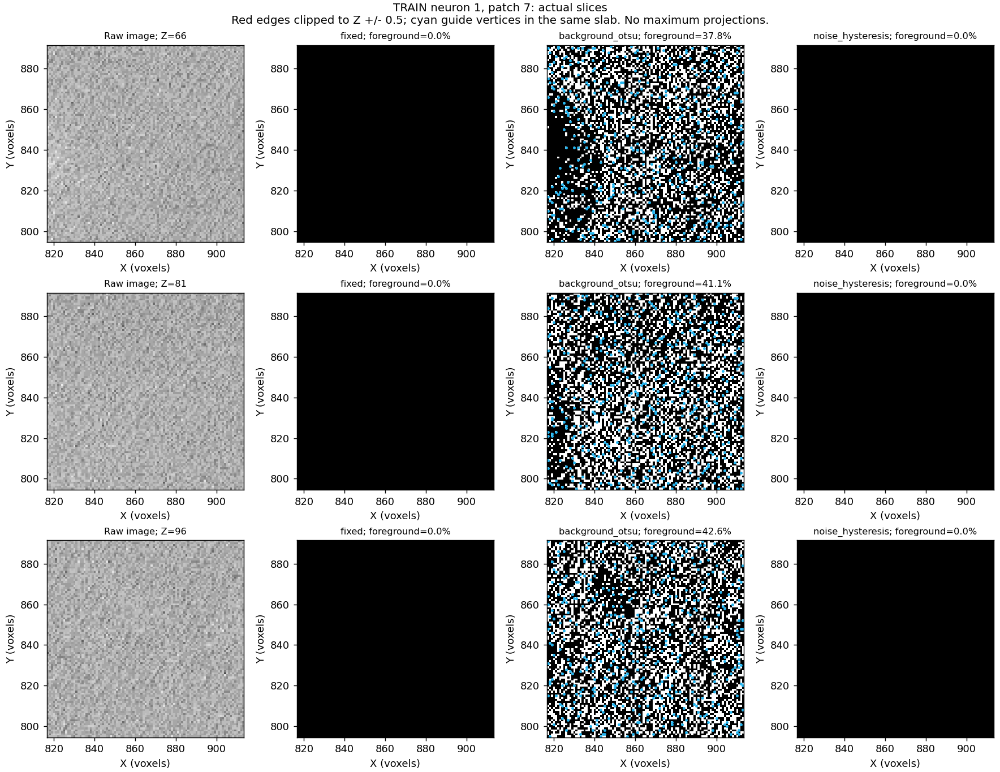
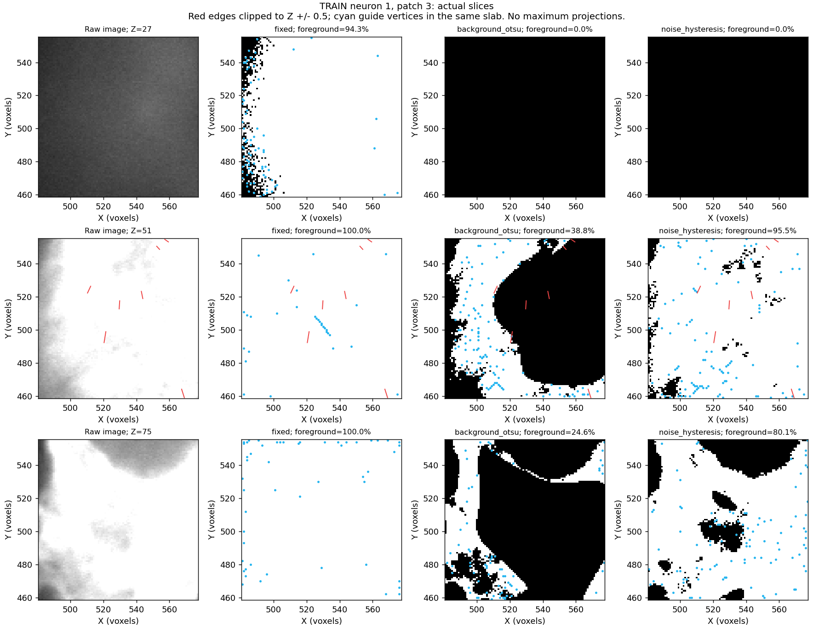

# Noise-aware preprocessing: slice inspection and prepared comparison

The agreed slice inspection and experimental noise-aware mask are implemented.
The four-case local CPU preparation pilot and the user's six-neuron, 48-patch
comparison completed. See the [full-run results](noise_comparison_results.md):
the numerical noise floor leads to permissive masks on repeated-intensity fish
images, and average selected-input support falls from 72.0% to 60.1% relative
to background Otsu. The experiment is not promoted. The command below is retained
for reproduction, not as a required next run.
The main cache/training recipe remains unchanged. No model was trained here.

## What actual slices show

`scripts/pointneuron2/inspect_foreground_slices.py` reads saved NPZ artifacts and
plots actual Z slices at image-depth quartiles. Reference edges are clipped to
the slice slab (Z +/- 0.5), and only guide vertices in that slab are shown.
It does not project every reference edge or guide vertex into the plane.
Repeated `--z` arguments allow other local Z indices to be inspected.

The original chick-0 patch has broad fluorescent regions: at Z=30, the fixed
mask occupies 92.2% of the slice. The difficult chick-1 patch reaches 100% fixed
foreground at Z=51. This helps explain why skeletonizing the binary mask yields
paths through broad regions instead of reliably following individual neurites.

A diagnostic samples raw intensity on the reference curve and compares it with
the median of six neighbors three voxels away. Boundary points are excluded.
Most sampled points in chick-0 and the fly example are brighter than their local
surroundings, so these checks do not support globally inverting image polarity.
The clipped chick-1 patch instead has zero median local reference contrast:
**465 of 677 interior reference samples (68.7%) are at least 254.5** on its
8-bit intensity scale. Also, 31.2% of its raw voxels equal 255. These are image
ceiling observations; they do not establish whether clipping arose during
acquisition or subsequent conversion. Extra threshold tuning cannot restore
intensity differences absent from these saved voxels.

The unannotated chick-1 patch shows mostly low-level texture in the inspected
slices. Otsu masks retain much of that texture, yielding the earlier lattice.
An absent trace still does not prove that every retained voxel is background.

## Experimental automatic rule

The method is `noise_hysteresis` in `src/pointneuron/data/foreground.py`:

1. Subtract the existing Gaussian background estimate (sigma 8; same 4-sigma
   context halo and isotropic extraction ruler as the previous comparison).
2. Estimate a scalar noise proxy for the core patch from adjacent-voxel
   differences along each axis: normal-scaled MAD / sqrt(2), then the median
   across axes. Quantized images have a 1/sqrt(12) intensity-unit floor when
   MAD vanishes; floating images have a relative numerical floor.
3. Seed positive residuals above four times that noise estimate.
4. Retain residuals above twice the estimate only when connected to a seed
   through such voxels, using 26-neighbor propagation within the core patch.

No SWC coordinates, animal identity, checkpoint predictions or hand-painted
regions determine the mask. Weak foreground outside a seeded component is
discarded; no gaps are filled. Raw intensities are preserved in image candidates.
Every extracted guide vertex remains available; 512 encoder inputs are separate.

The robust estimate is a **patch-level noise proxy**, not a calibrated spatial
noise map. Its scaling assumes weakly correlated Gaussian noise; structured
texture, clipping and dense signal can bias it. Sparse fly images reach the
quantization floor, so this rule can admit weaker foreground than Otsu there.
It is neither a neurite classifier nor a guarantee of clean skeletons.

Implementation references: [SciPy MAD](https://docs.scipy.org/doc/scipy/reference/generated/scipy.stats.median_abs_deviation.html)
and [masked binary propagation](https://docs.scipy.org/doc/scipy/reference/generated/scipy.ndimage.binary_propagation.html).

## Four-case preparation results

These cases were deliberately chosen from the previous run to inspect distinct
failure modes. This is **not** an independent benchmark or a method-ranking sample.
The pilot reuses the exact saved halo-filtered background scores; it does not
approximate them by filtering cropped images without their context.

| Training case | Fixed full-guide support | Background Otsu | Noise hysteresis |
|---|---:|---:|---:|
| Chick 0, patch 3 | 19.1% | 75.1% | 65.7% |
| Chick 1, patch 3 | 9.2% | 49.8% | 44.3% |
| Fly 18, patch 4 | 94.9% | 87.3% | 93.7% |

Support means reference-curve proximity within three saved voxel units; it is
not reconstruction F1, mask precision or connectivity. Noise hysteresis improves
the fly case relative to background Otsu but loses support on both chick cases.
The broad fluorescent foreground remains a problem.

On unannotated chick 1, patch 7, foreground decreases from **239,127 to 1,364**
voxels relative to background Otsu; guide vertices decrease from **29,030 to 352**.
This is suppression of the observed lattice, not a measured false-positive reduction.
The noise-aware mask is not empty over the whole patch, even where displayed
slices round their foreground fraction to 0.0%.



The clipped case shows the limitation plainly: the new mask occupies 95.5% of
the Z=51 slice, versus 38.8% for background Otsu. A noise cutoff alone does not
distinguish a broad fluorescent region from a neurite.



See the [compact pilot report](noise_aware_pilot/summary.json) for all case
metrics, source-report hashes, noise estimates, contrast checks, and original
artifact paths. Original slices for the three previous methods remain in
`docs/pointneuron2/noise_aware_pilot_slices`.

## Completed local run and reproduction command

Compare **the exact previous 48 boxes** on six frozen training neurons:
fixed mask, background Otsu, and noise hysteresis. The runner verifies source
image/reference hashes and partition identity before reusing box coordinates.
All methods use the same TEASAR settings, full guides and 1,024 uniform candidates.
Selected-input diagnostics hold 512 rows fixed and compare random versus fixed
guide-prior selection over three seeds: 432 pools and 864 selections if all
patches complete. Empty masks/pools are retained as unavailable inputs with
reference support measured accordingly, not silently replaced with another mask.

```powershell
Set-Location "C:\Users\Seywe\Documents\GitHub\PointNeuron\pointneuron2"

& .\scripts\pointneuron2\run_local.ps1 `
  -Action noise-compare `
  -ArtifactRoot "C:\Users\Seywe\Documents\GitHub\PointNeuron" `
  -Comparison "C:\Users\Seywe\Documents\GitHub\PointNeuron\pointneuron2\tmp\pointneuron2\local_runs\preprocessing-compare_20261010_190312_1596\masks\comparison.json"
```

This is **CPU preprocessing**, with live progress and a fresh run directory.
The earlier broader comparison took 8m24s; the completed noise-aware run took
7m59s. Runtime includes source loading and guide
extraction. It does not start GPU training. Outputs have the familiar layout:
`console.log`, `masks/comparison.json`, mask figures/NPZs, `candidates.log`,
`candidates/comparison.json`, candidate figures/NPZs and `launch.json`.

The completed run's gains, regressions, junction/terminal support and noisy
cases are documented in the [full-run results](noise_comparison_results.md).
No rerun is currently needed. The next proposed work is a targeted revision of
the degenerate noise-estimate/growth behavior using saved patches, before another
full experiment. The completed run did not select or deploy a new default.

## Preparation checks and code

All **142 repository tests passed**. New checks cover noise-scale recovery,
noise-only patches, preservation of connected weak signal, rejection of isolated
weak signal without filling gaps, degenerate quantized images, float intensity
rescaling, unchanged input values, parameter errors, slice clipping and frozen
patch bounds/partition checks. The PowerShell launcher parses successfully.

The four-case guide pilot and its candidate runner completed without failures
(36 pools, 72 selections). A separate one-patch CLI preparation check reloads
the original source volume and uses the frozen-box path, then verifies matching
saved scores, masks and pools against the pilot. These are preparation checks,
not the full six-neuron comparison. The original 48-patch result remains intact.

- `scripts/pointneuron2/inspect_foreground_slices.py`: reproducible saved-slice inspection.
- `scripts/pointneuron2/prepare_noise_pilot.py`: small saved-score pilot.
- `scripts/pointneuron2/compare_foreground.py`: full-volume halo filtering and optional frozen boxes.
- `scripts/pointneuron2/compare_candidates.py`: matched input/segment/role diagnostics.
- `scripts/pointneuron2/run_local.ps1`: visible `noise-compare` launcher.
- `configs/pointneuron2/foreground_noise_comparison.json`: mask experiment settings.
- `configs/pointneuron2/candidate_noise_comparison.json`: fixed-budget input settings.

Pilot reproduction (choose fresh output directories):

```powershell
& .\tmp\pointneuron2\sampling_env\Scripts\python.exe -u .\scripts\pointneuron2\prepare_noise_pilot.py `
  --comparison "<absolute prior masks/comparison.json>" `
  --case 0:3 --case 1:3 --case 1:7 --case 18:4 `
  --output-dir "<fresh pilot directory>"
```
