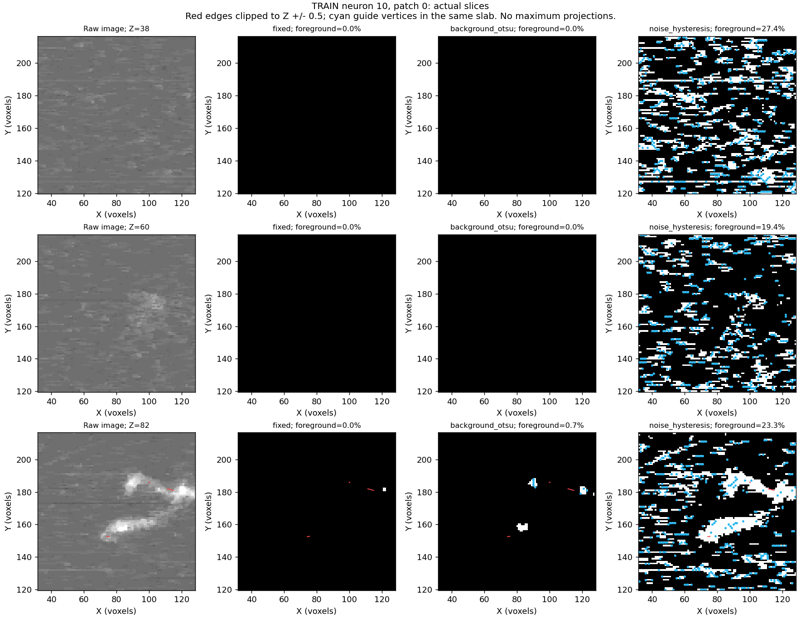
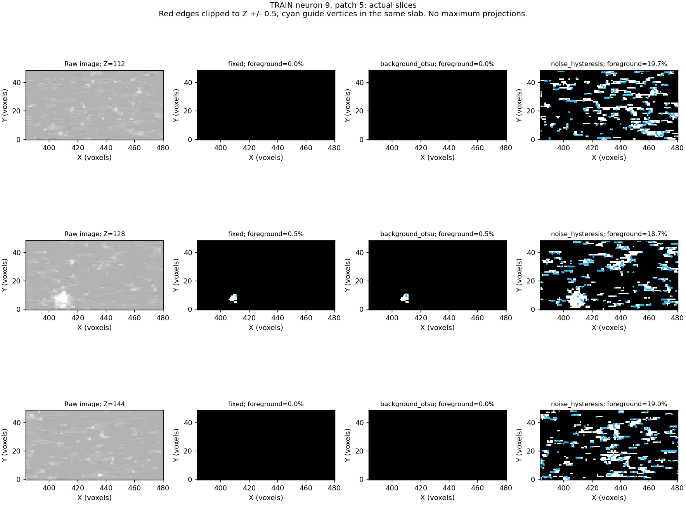

# Noise-aware comparison: completed user-run results

The user's local run completed on 2026-10-10 in **7m59s** terminal wall time:
six training neurons, the same 48 patch boxes, 144 mask results, 432 candidate
pools and 864 selections. Both stages completed without failures.

**Do not promote noise hysteresis as the new preprocessing default.** It
suppresses the previously inspected noisy chick lattice, but makes several
fish masks much more permissive and reduces selected-input reference coverage.
This is a failure of the first noise-aware rule, despite successful execution.
The main cache/training recipe remains unchanged. Stage 1 remains incomplete.

## Coverage before and after input selection

All values below are reference proximity within three saved isotropic voxel
units. They are not reconstruction F1, mask precision or graph connectivity.
Guides retain all vertices; input diagnostics select 512 rows from 1,024 uniform
candidates using the same fixed guide prior. Three seeds are averaged inside
each patch before patches are averaged.

| Source (annotated patches) | Background Otsu: full guide | Noise: full guide | Background Otsu: 512 inputs | Noise: 512 inputs |
|---|---:|---:|---:|---:|
| Chick (8) | 63.9% | 62.6% | 68.4% | 69.6% |
| Zebrafish (10) | 80.3% | 85.0% | 78.5% | 51.2% |
| Fly (3) | 89.9% | 94.4% | 60.2% | 64.6% |
| All annotated patches (21) | 75.4% | 77.8% | 72.0% | 60.1% |

The pooled guide score rises by 2.4 percentage points, while the selected-input
score falls by 11.9 points. Selected arc-length support also falls from 72.6%
to 60.2%. Junction proximity falls from 79.0% to 42.4% across the twelve patches
with annotated junctions; terminal proximity falls from 54.4% to 51.2% across
sixteen patches with annotated terminals. Role scores also average seeds within
patches, then patches; these are not whole-neuron detection rates.

Against background Otsu, full-guide proximity improves on 13 annotated patches,
worsens on five and is unchanged on three. Selected-input proximity improves
on six, worsens on twelve and is unchanged on three. Random selection on the
noise mask averages 60.3%, close to the fixed guide prior's 60.1%. This does not
evaluate a learned sampler or prove that it cannot improve.

The original fixed mask is still a useful control: selected-input coverage is
63.4% overall and 68.5% on the three fly patches. Neither automatic alternative
establishes one best recipe across all sources.

## Identified failure: repeated intensities collapse the noise estimate

The method estimates noise from adjacent-voxel differences along each axis,
then takes the median of those three estimates. If most neighboring differences
are zero on two axes, that median becomes zero. The implementation substitutes
its quantization floor, 1/sqrt(12), giving strong/weak residual thresholds of
approximately **1.155 / 0.577 intensity units**.

The floor prevents a zero scale, but is not evidence that a textured image has
such a small usable noise level. The sparse foreground and repeated intensities
in these images violate the simple neighbor-difference noise assumption. We have
not established why source images have these repeated values; quantization and
spatial correlation are possibilities, not proven acquisition/conversion history.

In fish neuron 10, patch 0, identical neighbors occupy 48.8% of Z comparisons,
55.8% of Y comparisons and 77.7% of X comparisons. **Its raw image has no zero
voxels.** The zero-MAD problem here is not explained by a mostly zero-valued
image. The old background-Otsu threshold is 14.599; the new strong threshold is
only 1.155, and weak propagation is more permissive still.

| Fish case | Background-Otsu foreground | Noise foreground | Background-Otsu 512-input support | Noise 512-input support |
|---|---:|---:|---:|---:|
| Neuron 10, patch 0 | 1,976 | 186,658 | 64.0% | 15.4% |
| Neuron 10, patch 6 | 7,415 | 180,907 | 92.3% | 25.3% |

Actual slices show low-contrast texture admitted throughout the patch, alongside
the brighter traced structures. This is consistent with dilution of the bounded
candidate/input budget over expanded foreground. The run does not isolate the
effect of the noise estimator from connected growth; both need checking.

The unannotated fish-9 patch 5 similarly expands from 430 to 60,399 foreground
voxels and from 19 to 16,612 guide vertices. No local reference is available to
score it, so these additions cannot all be counted as false positives.

The floor is used on five of sixteen fish patches and fifteen of sixteen fly
patches, versus zero of sixteen chick patches. In the fly cases, weaker
thresholds have some proximity benefits, but incomplete references do not
establish that the extra foreground is correct.

Summed over the overlapping processed patches, foreground grows from 1,043,645
to 2,283,524 voxels, and guide vertices from 101,965 to 332,284, relative to
background Otsu. These totals describe processing load, not unique anatomy.
Denser guides make point proximity easier without proving better neurite paths.

## What still worked

The noisy chick-1 patch 7 retains the pilot's suppression: background Otsu has
239,127 foreground voxels and 29,030 guide vertices; noise hysteresis has 1,364
foreground voxels and 352 guide vertices. It has no local reference, so this is
an observed lattice reduction, not a measured false-positive reduction.
The clipping and broad-foreground limitation in chick-1 patch 3 also remains.

## Recommended next change to discuss

Treat noise estimation as unreliable when the neighbor-difference distribution
collapses, instead of using a numerical floor as the sole foreground criterion.
Add a regression case with repeated adjacent intensities and textured background;
the prior Gaussian-noise and constant-image checks did not cover this failure.

A conservative next experiment would apply noise rejection **within the saved
background-Otsu foreground**, using its threshold as a lower bound for both
seed and propagation thresholds. This constrains foreground growth relative to
that baseline while allowing a higher noise threshold to reject the chick lattice.
It cannot recover branches already excluded by Otsu; that limitation should be
explicit. Alternatives such as a different noise estimator can be assessed
separately, without claiming that threshold changes alone identify neurites.

First compare the masked growth and estimator behavior on these saved patches,
including the clipped chick cases and strong fly cases. Saved raw images and
halo-filtered residual scores permit that check without another source-volume
load. Agree on the change before implementing it. A new full run or longer
training is premature until that targeted check is interpretable.

## Evidence, consistency checks and limits

Original run:
`tmp/pointneuron2/local_runs/noise-compare_20261010_200727_1596`.
The [permanent summary JSON](noise_comparison_results_seed0/summary.json) records
the absolute run directory, report hashes, all candidate summaries, source and
paired-patch summaries, role metrics, processing load and diagnostic artifact paths.
Figures in this document were copied from the run or generated from its saved
arrays by `scripts/pointneuron2/inspect_foreground_slices.py`; no mask, guide or
candidate experiment was rerun during this inspection.

Checks verified all **288 artifact hashes**, reuse of all **48 exact prior
boxes**, identical **96 control mask artifacts**, and identical **576 control
selector metric sets** against the earlier expanded comparison. The fixed and
background-Otsu controls are therefore directly comparable across runs. The
candidate report links to the exact mask report and all patches are training-only.

Twenty-one patches contain references and twenty-seven do not. The pooled
averages weight patches equally (chick 8, fish 10, fly 3), not neurons or sources
equally. References are incomplete, boxes were originally chosen using the fixed
mask, and physical anisotropy is held at the prior isotropic ruler. These results
identify an input-quality failure without establishing dataset-wide reconstruction
quality. The previous 142 preparation tests remain the latest test run; this
results inspection changes documentation only.
