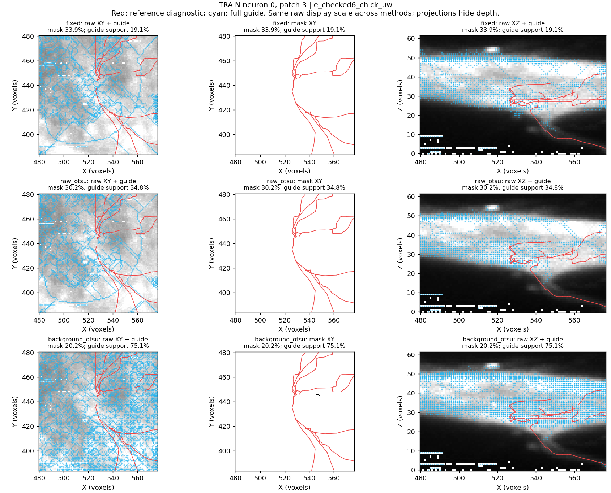
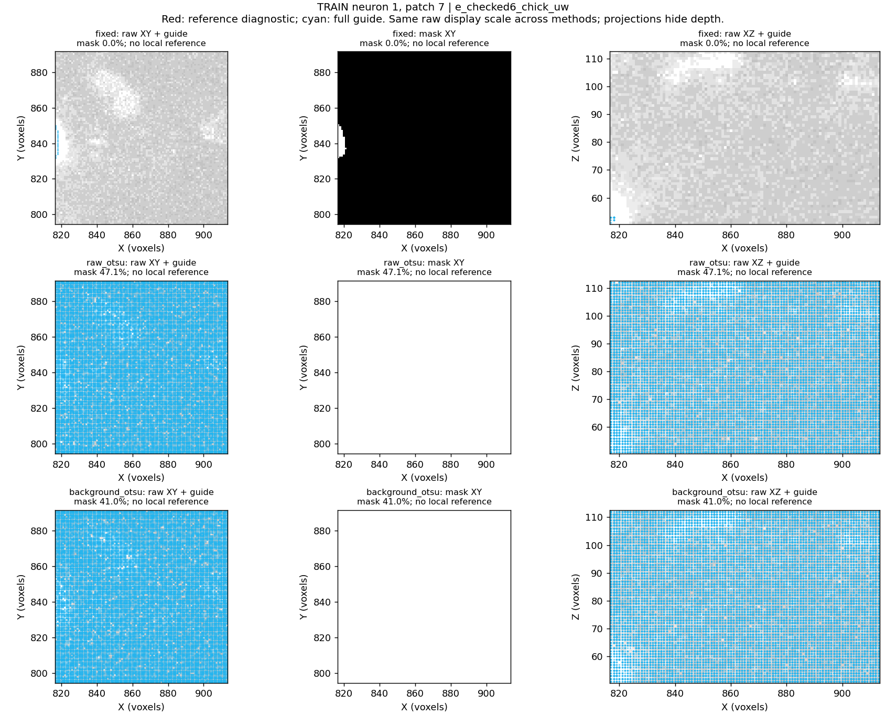
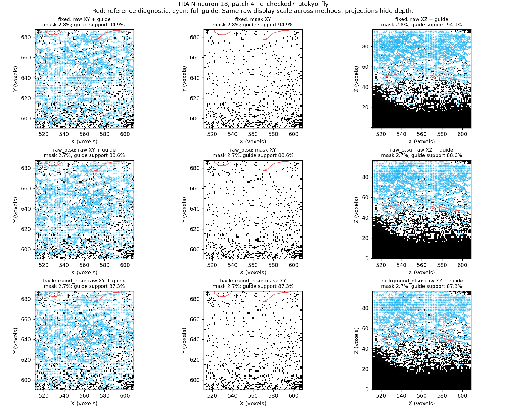
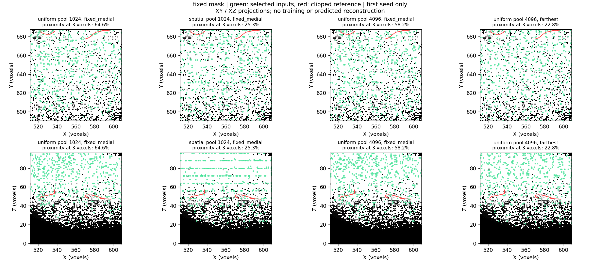

# Expanded preprocessing comparison: user-run results

The user's local CPU run completed on 2026-10-10 in **8 minutes 24 seconds**
(terminal wall time). Both stages completed without failures: six training
neurons, 48 patches, 144 mask extractions, 1,728 candidate-pool variants and
5,184 selections. This was a preprocessing diagnostic; it trained no model.

The experiment identifies two remaining problems: guide extraction depends
strongly on image appearance, and selecting 512 inputs still loses reference
coverage. No alternative mask, candidate preparation or selector is promoted.
Stage 1 remains incomplete; PointNeXt has not started.

## Full-guide results

The values below are the percentage of sampled reference-curve points within
three saved voxel-distance units of any full-guide vertex. They measure
proximity support, **not reconstruction F1, precision or graph connectivity**.
All guide vertices were retained; these results are not caused by a 512-guide cap.

| Source | Annotated patches | Original fixed mask | Raw Otsu | Background correction + Otsu |
|---|---:|---:|---:|---:|
| Chick | 8 | 44.4% | 47.2% | 63.9% |
| Zebrafish | 10 | 62.9% | 79.5% | 80.3% |
| Fly | 3 | 95.3% | 91.6% | 89.9% |
| All annotated patches | 21 | 60.5% | 68.9% | 75.4% |

Background correction improves the chick mean and the difficult fish neuron 10.
It reduces guide support on all three annotated fly patches. The effect also
varies within sources: chick neuron 0 improves from 31.4% to 79.9%, whereas
neuron 1 improves from 48.8% to 58.6%. Fish neuron 9 was already at 94.9%.

The overall mean weights patches equally, so fish contributes ten patches,
chick eight and fly three. It is not a balanced average over species or neurons.
Twenty-seven patches have no local reference and cannot contribute a measured
reference-support score. Missing reference is not evidence of background.

## Candidate pool and selection results

These comparisons hold the output at **512 selected rows**, use uniform image
candidates and the same fixed full-guide prior. Three seeds are averaged within
each patch before averaging patches. They do not evaluate a trained sampler.

| Mask | 1,024 candidates | 4,096 candidates | Change |
|---|---:|---:|---:|
| Original fixed | 63.39% | 63.96% | +0.57 percentage points |
| Raw Otsu | 71.01% | 71.95% | +0.94 percentage points |
| Background correction + Otsu | 72.04% | 73.50% | +1.46 percentage points |

For the original mask, the larger pool improves six annotated patches, worsens
ten and leaves five unchanged. For the background-corrected mask it improves
twelve, worsens five and leaves four unchanged. More candidates are not the same
as more encoder inputs, and this run does not test increasing the 512-input budget.

The brightest-voxel spatial pool is also mixed. With the original mask and fixed
guide prior, fly support falls from 68.55% with uniform candidates to 43.53%
with spatial candidates. It does not establish a better default. Farthest-point
selection can improve the pooled score while worsening fly coverage; covering
the foreground volume does not guarantee covering its traced neurites.

Reference proximity of the full guide and selected inputs can differ in either
direction. The original fixed mask retains foreground near 89.2% of reference
points, while its extracted guide reaches 60.5%. This points to an extraction
problem beyond simply excluding all nearby image voxels. Nearby foreground
still does not establish a correctly connected mask or identifiable neurite.

## Contrasting overlays

These figures are copied from the completed run, without re-extraction or edits.
XY/XZ projections hide depth; apparent two-dimensional overlap is insufficient
to establish three-dimensional agreement. The mask panels are projections too.

**Chick neuron 0, patch 3:** background correction improves full-guide support
from 19.1% to 75.1%, but dense webs remain visible. A guide nearer the reference
is not necessarily a clean neurite skeleton.

**Chick neuron 1, patch 7:** the original mask has 267 foreground voxels;
raw Otsu admits 274,896 and background-corrected Otsu admits 239,127. The latter
occupies about 41% of the patch and produces 29,030 guide vertices. The overlay
shows a dense lattice across the region. There is no local reference, so this
cannot establish a false-positive rate. It is a concrete instability to inspect
when designing automatic foreground extraction.

**Fly neuron 18, patch 4:** original guide support is 94.9%, versus 87.3% after
background correction. Its candidate overlay additionally shows spatial pool
representatives concentrating at regular positions and losing local traced
coverage. That candidate figure shows one seed; the tables use all three.

## Recommended next step to discuss

Keep full guides and uniform candidate preparation as the working reference.
Prioritize an automatic foreground method that distinguishes local neurite
signal from broad fluorescence and noise. A proposed next experiment is to
estimate local background/noise and test whether a noise-aware foreground
criterion avoids the large expansions above while retaining weak branches.
This is a hypothesis to assess, not an implemented or validated replacement.
Inspect actual 3D slices of these contrasting cases as well as their projections.

Agree on that change before implementation. Then compare the same saved patch
boxes, including the unannotated expansion cases and the already strong fly
guides. Reference scores and raw-image overlays both matter. Do not choose a
source-specific rule merely from the three source means. Longer matched sampler
training follows a defensible input recipe and remains a separate agreed run.

## Saved evidence and checks

Original run directory:
`tmp/pointneuron2/local_runs/preprocessing-compare_20261010_190312_1596`.
It contains `launch.json`, both console logs, the complete `masks/comparison.json`
and `candidates/comparison.json`, all 48 mask figures, candidate figures and NPZ
inputs/selection indices. Nothing was rerun to produce this results note.

The permanent [summary JSON](preprocessing_comparison_expanded_seed0/summary.json)
records the absolute run directory, source-report SHA-256 hashes, every candidate
summary setting, full-guide means by source and neuron, and paired pool-budget
deltas for each annotated patch. Aggregation reads the saved reports; it does
not alter reference geometry or experiment settings.

Post-run checks verified all **288 artifact hashes**, the candidate report's
link to the exact mask report, matching full-guide counts, saved terminal/junction
coordinates, training-only partition labels and 512 rows in all 5,184 reported
selections. Sparse pools can contain padding, so 512 rows need not mean 512
unique voxels. These checks verify saved-result consistency, not biological quality.

The [experiment specification](preprocessing_comparison_expanded.md) describes
reproduction and the prior 131 passing preparation tests. No training code or
preprocessing algorithm was changed during this result inspection.

Additional limits: patches were chosen using the original fixed mask, references
are incomplete, only six training neurons were sampled, and recorded physical
anisotropy was not applied in this controlled comparison. Segment-gap metrics
refer to individual clipped SWC edges; they do not prove reconstructed connectivity.
