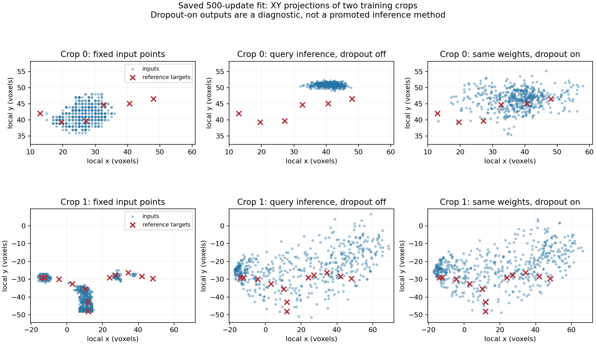

# Saved 500-update GPU fit: dropout dependence and confidence

Follow-up: [the dropout-zero control has completed](query_dropout_zero_results.md).
Its raw geometry improves substantially; confidence and an inference normalization
gap remain. This report retains the earlier 0.1 run and its original protocol.

The user completed the paired fixed-crop fit in 48 seconds on the local RTX
3070 Ti Laptop GPU. Both arms executed 500 updates, their pairing checks passed,
and their saved checkpoints reproduce the final predictions exactly.
This checks two training crops from neuron 0, not validation or reconstruction.
The full 30-epoch comparison remains pending.

## Measured fit

| Arm | Initial mean target distance | Final mean target distance | Final coverage within 6 voxels | Median GPU update | Peak allocated GPU memory |
| --- | ---: | ---: | ---: | ---: | ---: |
| Pointwise | 2.89 | 2.84 | 79.2% | 26.8 ms | 121.1 MiB |
| Query | 52.20 | 7.02 | 66.7% | 50.5 ms | 158.3 MiB |

Distance and coverage use every raw output slot, regardless of confidence, and
average the two crops equally. The crops have 6 and 12 reference targets.
The pointwise head starts near its input coordinates; the query head starts
near the crop center. These measurements do not rank whole-neuron quality.

The query head accepts **zero slots in either crop at score 0.5**. Its highest
scores are 0.0863 and 0.2902. Matched versus unmatched mean scores are
0.0813 versus 0.0771 in crop 0, and 0.1735 versus 0.1793 in crop 1.
It has not learned useful used/unused separation on these fitted examples.
Lowering a cutoff cannot repair that absent separation or missing geometry.

## Forward-only diagnosis with the same weights

The initially inspected training center loss was much lower than the final
evaluation geometry suggested. We isolated normalization and decoder dropout
with fresh in-memory copies of the saved model for each mode. There were no
gradient/optimizer updates and no checkpoint writes. Dropout probes use three
declared random seeds, rather than selecting the best outcome.

The first replay ran neural forwards on CPU, reproducing the original CUDA
random input indices. CPU and CUDA predictions differ slightly, so the decisive
controls below ran on the original CUDA device. The GPU replay reproduces both
saved final geometry metrics exactly; evaluating one crop at a time leaves
query coverage at 66.7%.

| Query mode | Mean target distance | Coverage within 6 voxels |
| --- | ---: | ---: |
| Normal inference, dropout off | 7.02 | 66.7% |
| Only pooled encoder BatchNorm uses batch statistics | 7.73 | 66.7% |
| All encoder BatchNorm uses batch statistics | 7.73 | 66.7% |
| Head in training mode, all dropout probabilities set to zero | 7.02 | 66.7% |
| Decoder dropout on, encoder remains in inference mode, seed 1000 | 1.81 | 95.8% |
| Decoder dropout on, encoder remains in inference mode, seed 1001 | 1.62 | 100% |
| Decoder dropout on, encoder remains in inference mode, seed 1002 | 1.77 | 100% |
| Encoder and head in training mode, seeds 1000–1002 | 1.11–1.37 | 100% |

The training-mode/zero-dropout control exactly matches inference, accounting for
the change in attention execution mode. Enabling dropout while keeping the
encoder in inference mode supplies most of the geometry recovery. All query
modes still accept zero slots at score 0.5.

**Measured behavior:** this checkpoint's geometric support depends strongly on
decoder dropout. **Interpretation:** stochastic variation among slots provides
much of the apparent training coverage; the model is not yet producing a stable,
confident target set at inference. This is particularly visible in crop 0.
It is not proof that every crop collapses or that set prediction cannot work.
BatchNorm's use of batch statistics does not rescue this particular failure.



These XY projections show every slot; red crosses mark the sparse reference
targets. Metrics use full 3D distances. In crop 0, inference slots concentrate
away from much of the reference; dropout spreads outputs enough for some to
land close to the targets. Crop 1 already has much broader slot dispersion.
The broad random cloud is not a good reconstruction and is not a proposed
inference method.

The confidence pattern is also close to a crop-wide weighted class prior.
For 512 slots, T matched targets, foreground weight 8 and background weight 1,
the optimal shared score is `8T / (512 - T + 8T)`: 0.0866 for T=6 and 0.1611
for T=12. This supports a failure of slot-specific classification; it does not
establish the precise cause. Volatile matching and insufficient query identity
are hypotheses to investigate, not confirmed implementation defects.

The current head injects its learned slot embedding at the decoder input.
An alternative would preserve slot identity explicitly in every attention
layer, as in [the DETR authors' decoder](https://github.com/facebookresearch/detr/blob/main/models/transformer.py#L218-L233).
That is a possible later design comparison, not a change included now.

## Approved next control: change only training dropout

The user chose a fresh 500-update comparison with query decoder dropout set
to zero. The same targets, image candidates, selected inputs, initial weights,
learning rate, loss, encoder and update count remain fixed. Changing dropout
alone asks whether the deterministic head can learn the two examples without
using training noise for proposal diversity. It is a diagnostic, not a new
default or evidence of generalization.

The runner accepts a dropout override only for `smoke`. It deep-copies the run
settings, preserving the base config and cache manifest, and records the
effective settings in the reports/checkpoints. The old 0.1 run remains intact.
Final evaluation geometry and score-filtered coverage now print in the terminal.

All 28 targeted tests pass. The added checks verify that the dropout override
preserves both arms' exact initial weights, does not mutate the cache settings,
rejects invalid values and cannot change full-pilot settings. A two-update CPU
run through the actual PowerShell entry point passes pairing and checkpoint
checks with effective dropout zero. This is runner verification, not the
500-update control's learning result.

```powershell
Set-Location "C:\Users\Seywe\Documents\GitHub\PointNeuron\pointneuron2"

& .\scripts\pointneuron2\run_query.ps1 `
  -Action smoke `
  -Steps 500 `
  -DecoderDropout 0 `
  -Manifest ".\tmp\pointneuron2\local_runs\query_implementation_20261011\cache\manifest.json" `
  -Device cuda
```

Allow roughly a minute based on the observed 48-second run; duration may vary.
The runner prints the device and creates a fresh ignored
`tmp/pointneuron2/local_runs/query_smoke_<timestamp>_<PID>` folder, containing
live `console.log`, `launch.json`, `models/comparison.json` and both checkpoints.
The 500-update GPU control has been prepared, not launched by the assistant.
No full training or reconstruction automatically follows it.

We will inspect deterministic geometry, matched errors, confidence separation
and score-filtered support together. Improving all-slot training coverage alone
does not meet the learnability goal. If this control still fails, preserve it
and discuss an explicit query-identity/assignment comparison before full training.

## Saved evidence and repeat audit

[The verified report](query_gpu_fit_seed0/summary.json) records the original run,
checkpoint hashes, GPU diagnostic modes and exact replay checks. Original outputs:

```text
tmp/pointneuron2/local_runs/query_smoke_20261011_234202_4464/models/
tmp/pointneuron2/local_runs/query_fit_audit_gpu_control_20261011/
```

[audit_query_fit.py](../../scripts/pointneuron2/audit_query_fit.py) reproduces the
diagnosis without optimization. For CUDA-trained runs, exact input-index replay
requires CUDA even when neural forwards are requested on CPU. BatchNorm buffer
updates in diagnostic copies are discarded; original checkpoint hashes are
checked before and after. Every new audit requires a fresh output directory.
