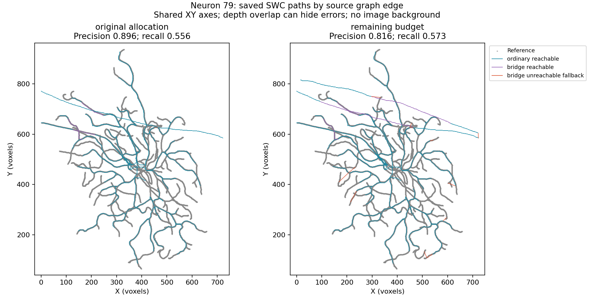
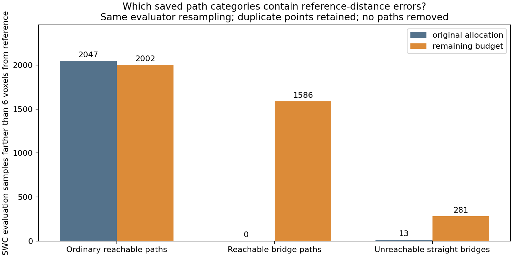
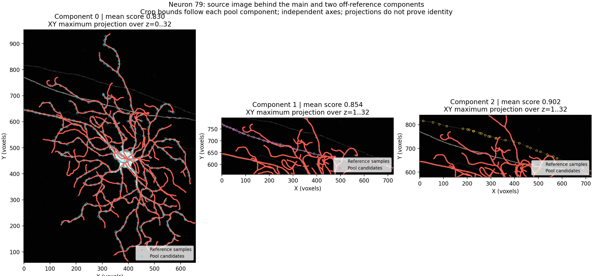

# Neuron 79: allocation repair and source-supervision audit

**The allocation defect is repaired, but the fixed reconstruction comparison
regresses overall.** The user completed the CPU run in 298.5 seconds (terminal
5m02s); the geodesic calculation took 222.4s. Actual pool/matrix equality,
cached repaired allocation, fixed settings and paired checks passed.

| Spatial metric | Original hybrid allocation | Repaired allocation | Change |
| --- | ---: | ---: | ---: |
| Precision | 0.8961 | 0.8162 | −7.99 percentage points |
| Recall | 0.5560 | 0.5731 | +1.71 percentage points |
| F1 | 0.6862 | 0.6734 | −1.29 percentage points |
| Approximate ESA | 6.9998 | 8.5344 | Worse; lower is better |
| Graph bridges | 4 | 21 | +17 |
| Reachable graph edge fraction | 0.9921 | 0.9055 | Lower |

Both use the same saved 4,096 proposals, filtered 625 candidates, real encoder
features, checkpoint, 128 anchors, size eligibility, threshold adapting to 15,
339,243 foreground voxels and graph/export settings. All 13 eligible components
receive anchors after repair. There is no new neural inference or training.
The original saved SWC is the verified paired control. This result does not
support promoting the repaired configuration as a reconstruction-quality gain.

## What was gained, and what was added

An independent saved-output inspection verifies hashes, reports, graph identities
and spatial metrics. It also replays the unchanged graph-to-SWC exporter and
checks every node, parent, coordinate and radius against the saved six-decimal
SWC before assigning evaluation samples to their originating graph edges.

On the same 16,793 reference samples at 6 voxels, the repair:

- Newly supports 297 samples and loses support on only 10.
- Retains support on 9,327; misses 7,159 in both arms.
- Raises supported reference samples from 9,337 to 9,624, a net gain of 287.

However, predicted samples farther than 6 voxels from the reference rise from
2,060 to 3,869. These counts use the exact evaluator resampling, including its
duplicate points; they are not unique anatomical errors or physical path length.

| Prediction samples farther than 6 voxels | Original | Repaired |
| --- | ---: | ---: |
| Paths within pool component 0 | 387 | 317 |
| Paths within pool component 1 | 1,660 | 1,646 |
| Paths within pool component 2 | 0 | 1,625 |
| Paths between pool components | 13 | 281 |
| Total | 2,060 | 3,869 |

The newly admitted component 2 accounts for 1,625 of the net 1,809 additional
off-reference predicted samples (89.8% by these counts). All 1,625 evaluation
samples on its six internal edges are beyond 6 voxels of the reference. This
component has 31 pool candidates, mean model score 0.902, and none of its
candidates is within 6 voxels of the reference. The repair gives it seven anchors.

The existing component 1 already contributed a large off-reference path before
repair despite mean score 0.854. Pool component numbers describe candidate
connectivity groups; they do not certify biological neuron identity.

The source of the regression is more specific than an increased bridge count.
Ordinary reachable-path errors change from 2,047 to 2,002; reachable-bridge
errors change from 0 to 1,586; unreachable straight-bridge errors change from
13 to 281. Most new reachable-bridge errors are inside off-reference components
1/2. Edge category membership also changes with the selected node set.
Reachability does not establish ownership by the annotated neuron, and merely
turning off straight-line fallback would leave substantial off-reference paths.
This inspection removes no paths and reports no pruning counterfactual score.

Topology edge F1 changes from 0.4946 to 0.3911, but its target set also changes
from 59 to 52 edges. The reference remains a 191-root forest. This is not a
fixed-target biological-connectivity benchmark; the spatial decline above is
measured against the same reference point set.

## The user-approved image and supervision inspection

The follow-up decodes the same frozen source image once, checks the complete
train/validation cache hashes and identities, replays the 156 inference patch
centers and examines the existing supervision objective. It performs no network
inference, parameter update, new labeling or reconstruction.

The image shows two elongated bright structures followed by components 1/2,
outside the reference curves. They are present in the actual image rather than
empty-space proposals. The image alone cannot establish whether they belong to
another structure, are imaging artifacts, or are unannotated target geometry.

| Pool group | Candidates | Mean score | Candidates near reference at 6 voxels | Median reference distance | Median intensity at rounded center |
| --- | ---: | ---: | ---: | ---: | ---: |
| Component 0 | 429 | 0.830 | 404 | 1.48 voxels | 66 |
| Component 1 | 44 | 0.854 | 0 | 25.30 voxels | 71 |
| Component 2 | 31 | 0.902 | 0 | 45.62 voxels | 58 |

All candidates in components 1/2 have a rounded voxel above the graph threshold
15 and nearby image signal above the proposal threshold 51. Their brightness
overlaps the correct component. Image thresholding alone does not establish
which signal belongs to the target annotation.

| Cached supervision | Train | Validation |
| --- | ---: | ---: |
| Total image-defined crops | 262 | 56 |
| Crops with local reference nodes | 210 | 47 |
| Crops without local reference nodes | 52 | 9 |

The existing trainer explicitly assigns zero supervised proposal loss to a crop
without local SWC nodes. Its comment states that such a crop is not a verified
background annotation. A synthetic mixed-batch CPU autograd check confirms
objectness-gradient L1 of 1.0 for the annotated example and exactly 0.0 for the
unlabeled example. No optimizer step occurs. This demonstrates existing behavior,
not that changing it will improve the real model.

For neuron 79, two of the eight validation-cache crops have no local reference
nodes. Seven of the 156 inference crops do. Of the 44 component-1 candidates,
10 originate from reference-empty inference crops; of the 31 component-2
candidates, six do. Therefore **34/44 and 25/31 arise from crops that contain
reference nodes**. The empty-crop rule alone cannot explain these high scores;
discrimination within mixed foreground crops remains a model issue to assess.
Neuron 79 is validation data and has not been used for training.

Inference and cache patch indices are local to different selected lists. The
audit matches their actual centers, never just equal index numbers. Labels
inside a crop do not establish complete annotation of every structure in it.
The original label policy and all training sources remain unchanged.

## Interpretation and recommended next decision

The repair succeeds at distributing anchors and recovers additional reference
geometry. The current network/graph also admits bright off-reference structures
with high scores and connects them. This is a target-discrimination and connection
problem alongside the earlier coverage losses. It is not resolved by spending
the point budget more fairly or requiring an image-reachable path.

The next useful model diagnostic is to measure score separation on annotated
training/validation crops using the existing checkpoint: near-reference versus
farther foreground examples, separated from wholly unlabeled crops. That would
show whether current supervision learns rejection, whether confidence is poorly
calibrated or undertrained, and which examples a training change should target.
Any hard-negative training change must account for annotation completeness;
absence from a partial reference must not silently become a background label.
The existing loss uses positive class weight 8, so raw scores should not be
assumed calibrated probabilities of belonging to the target neuron.

Keep the separately versioned budget repair for research, but retain the better
original hybrid SWC as this case's reconstruction control. No new default,
threshold, component filter, bridge policy or training strategy is promoted.
The remaining budget repair does not fix neuron 94's earlier proposal deficit
or resolve neuron 19's specificity guard. Stage 1 remains unfinished; this is
one selected validation neuron, not evidence of general superiority or a PN1
matched benchmark. No reserved test neurons were used.

## Visible artifacts and reproducibility

- [Allocation/path summary](remaining_budget_results_seed0/summary.json), including every graph edge.
- [Image/supervision summary](component_supervision_audit_seed0/summary.json), including source crop geometry.
- [Saved-result inspector](../../scripts/pointneuron2/summarize_allocation_results.py).
- [Image and supervision inspector](../../scripts/pointneuron2/audit_component_supervision.py).
- [Completed reconstruction protocol](remaining_budget_comparison.md).

Both inspectors accept `--comparison` pointing at
`tmp/pointneuron2/local_runs/remaining_budget_neuron79_20261011/comparison.json`
and `--output-dir` pointing at a fresh directory. They refuse to overwrite an
earlier report. The first starts no image/geodesic/inference work; the second
decodes one image and performs the small synthetic CPU gradient check. The
source/input checks, exact exporter replay, independent spatial metrics, cache
identities, crop-center matches and gradient assertions all passed. Figures
were visually checked; image/XY projections still hide depth relationships.
