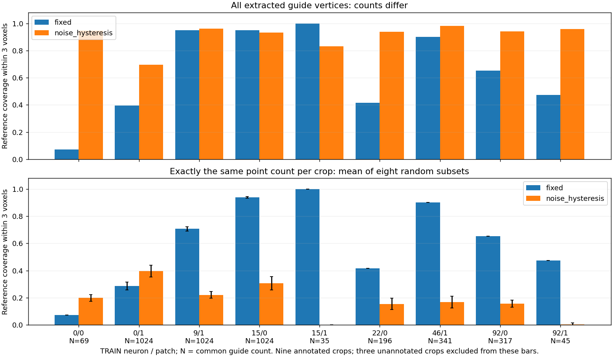

# Corrected-input foreground comparison — 11 October 2026

The permissive mask recovers useful faint signal, but its much denser skeleton
can dilute a bounded point representation. Relaxing the mask alone does not
produce reliable anatomical guidance. Neither mask is promoted.

## What ran

CPU-only diagnostic on this machine, not training or reconstruction:

- Six frozen **training** neurons: chick 0, larval zebrafish 9, fly 15, frog 22,
  cultured human cells 46, adult zebrafish 92; two image-defined crops each.
- Corrected `vaa3d-pbd-v2` reader; fixed threshold = 20% of decoded image maximum.
  Both uint16 sources have maximum 4095 and cutoff 819, rather than 13107.
- Fixed mask versus existing background-subtracted noise hysteresis: Gaussian
  sigma 8, four-sigma context halo, high/low noise multipliers 4/2.
- Identical boxes across methods, selected by the fixed-mask coverage rule with
  no SWC filtering. References only score outputs, never choose their inputs.
- Full guides retained; candidate pools have 1024 rows. Padding is excluded from
  density-control counts. No 512-point encoder or learned sampler was run.
- **12 crops, 24 mask/extraction cases, zero failures**; nine crops contain local
  reference curves. Three unannotated crops remain with null reference scores.
  Fly 15/1 has just six reference samples and must not be overinterpreted.

All distances below are voxel proximity to available SWC curves clipped to each
crop, including boundary-crossing edges. These are **not segmentation precision,
topology scores or reconstruction F1**. Source spacing metadata is recorded but
extraction and metrics retain [1,1,1] spacing to isolate the mask comparison.

## Results

Unweighted means over nine annotated crops, unless otherwise indicated:

| Diagnostic | Fixed | Noise hysteresis |
|---|---:|---:|
| Foreground fraction, all 12 crops | 4.53% | 13.48% |
| Full-guide vertices, all 12 crops | 821 | 10,032 |
| All-foreground coverage within 3 voxels | 76.7% | 100.0% |
| Full-guide coverage within 3 voxels | 64.6% | 91.1% |
| Count-matched spatial-null coverage within 3 voxels | 13.7% | 73.0% |
| Full-guide coverage above that null | 50.9 percentage points | 18.1 percentage points |
| Full-guide coverage within 6 voxels | 74.9% | 99.7% |
| Count-matched spatial-null coverage within 6 voxels | 44.3% | 99.3% |
| Uniform 1024-row candidate-pool coverage within 3 voxels | 62.9% | 64.8% |
| Guide coverage with exactly matched counts, within 3 voxels | **60.5%** | **17.8%** |

The spatial null is eight independent sets of distinct voxel centers distributed
uniformly in the same crop, with the observed unique point count. It diagnoses
coverage caused by density, not anatomical topology or background truth.

The matched-guide control uses N = min(1024, unique fixed guide vertices, unique
noise guide vertices) per crop, averaging eight random subsets without padding.
**Production guides remain full.** This does not measure the actual guide-weighted
or learned sampler; it tests representation quality under the same point count.

| Training neuron / crop | Reference samples | Common N | Fixed coverage | Noise coverage |
|---|---:|---:|---:|---:|
| Chick 0/0 | 770 | 69 | 7.1% | 19.8% |
| Chick 0/1 | 595 | 1024 | 28.6% | 39.5% |
| Larval fish 9/1 | 1150 | 1024 | 70.7% | 22.0% |
| Fly 15/0 | 350 | 1024 | 93.9% | 30.6% |
| Fly 15/1 | 6 | 35 | 100.0% | 0.0% |
| Frog 22/0 | 395 | 196 | 41.5% | 15.4% |
| Cultured cells 46/1 | 489 | 341 | 90.2% | 16.8% |
| Adult fish 92/0 | 721 | 317 | 65.2% | 15.5% |
| Adult fish 92/1 | 190 | 45 | 47.4% | 0.4% |



Chick 0/0 shows real retention loss under the fixed rule: full-guide coverage
rises from 7.1% to 94.7%, and remains better after matching counts. Its guide
grows from 69 to 1685 vertices. Larval fish 9/1 gains only 95.0% to 96.2% full-guide
coverage while growing from 4396 to 22250 vertices; candidate-pool coverage drops
from 66.2% to 46.6%.

Actual slices, selected at image-depth quartiles without reference-based choice:

- [Chick slices](foreground_repaired_seed0/chick_slices/slices.png)
- [Larval fish slices](foreground_repaired_seed0/larval_fish_slices/slices.png)

## Interpretation and proposed next step

A hard cutoff discards faint branches; a permissive mask supplies substantial
additional structure. Skeletonizing that structure cannot establish which
branches belong to the neuron. This argues against treating the extracted
TEASAR skeleton as trusted anatomical supervision. Incomplete annotations also
prevent labeling every additional branch false.

I recommend a **training-only candidate-pool control**: preserve a bright-core
allocation, reserve an allocation for weak-signal points, and compare against
both existing pools at the same total budget. Keep raw intensity available.
Assess recovered weak curves alongside losses on already well-covered curves.
Use saved masks first, without new network training. One prespecified 50/50 pool
could be an initial control, not a tuned or adopted final policy.

The guide should be an uncertain image cue; a confidence rule or learned
foreground model needs its own evaluation. The staged repaired-coordinate
control already disables the guide auxiliary loss. An architecture change cannot
recover image evidence absent from its candidate pool.

**The proposed pool control is not implemented or run.** The staged raw-versus-
local-coordinate GPU experiment follows the input decision. No full cache
preparation, training, validation selection or reserved-test evaluation ran here.

Limitations: six sources and two crops each are a small diagnostic; fixed-mask
crop selection can omit weak-only regions. Pointwise proximity does not assess
connectedness, branch correctness or crossing-neurite identity. These results
do not establish a final preprocessing policy or architecture ceiling.

## Visible files and reproduction

- `scripts/pointneuron2/compare_foreground.py`: corrected range, reader/source
  provenance, mask extraction and spatial-density controls.
- `scripts/pointneuron2/summarize_repaired_foreground.py`: verifies artifact
  hashes and compares exactly matched counts over repeated random subsets.
- `configs/pointneuron2/foreground_repaired_comparison.json`: diagnostic settings.
- `foreground_repaired_seed0/comparison.json`: all crops, source hashes and metrics.
  Its density-summary scalars use radius 6; per-crop fields name every radius.
- `foreground_repaired_seed0/matched_guides/matched_guides.json`: matched-count
  metrics and hashes. Raw arrays and log are in ignored
  `tmp/pointneuron2/foreground_repaired_seed0`, linked from the report.

Reproduce with fresh output directories:

```powershell
Set-Location "C:\Users\Seywe\Documents\GitHub\PointNeuron\pointneuron2"
& .\tmp\pointneuron2\sampling_env\Scripts\python.exe -u `
  .\scripts\pointneuron2\compare_foreground.py `
  --root ..\data\gold166 `
  --config .\configs\pointneuron2\foreground_repaired_comparison.json `
  --output-dir .\docs\pointneuron2\foreground_repaired_repeat `
  --artifact-dir .\tmp\pointneuron2\foreground_repaired_repeat\artifacts
& .\tmp\pointneuron2\sampling_env\Scripts\python.exe -u `
  .\scripts\pointneuron2\summarize_repaired_foreground.py `
  --comparison .\docs\pointneuron2\foreground_repaired_repeat\comparison.json `
  --output-dir .\docs\pointneuron2\foreground_repaired_repeat\matched_guides
```

Verification: 33 foreground, noise, intensity-range and density-control tests
passed. A box-filling synthetic guide scores perfect coverage but zero excess
over its density-matched null; a thin correct guide beats that null. These checks
verify the diagnostic, not model improvement.

## Git status

At the end of this diagnostic, before the subsequent checkpoint step, work was
saved in the real local `pointneuron2` checkout on branch `pointneuron2`, but was
uncommitted and unpushed at HEAD `1719a56`. A commit creates a
local versioned snapshot; a push uploads it to GitHub. Generated arrays,
environments and checkpoints remain ignored. No commit or push was performed
in response to a status question.
