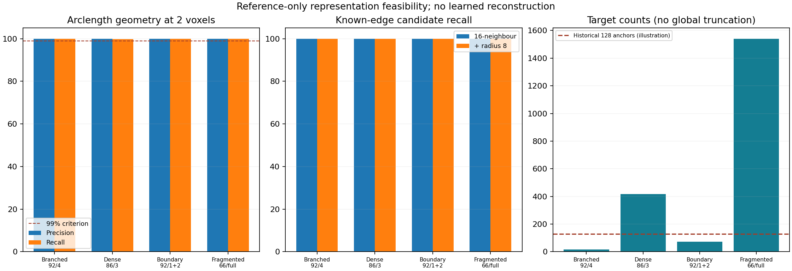
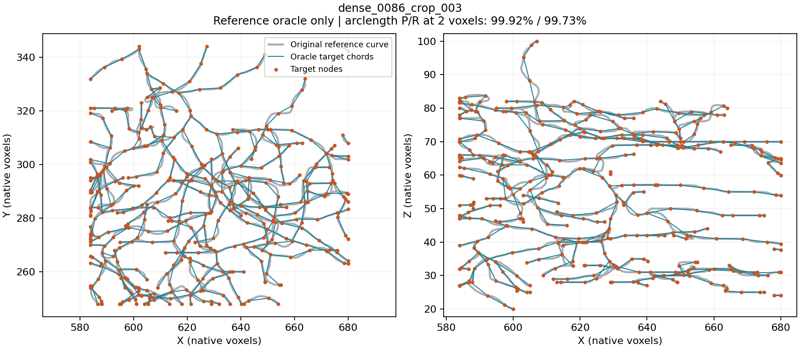
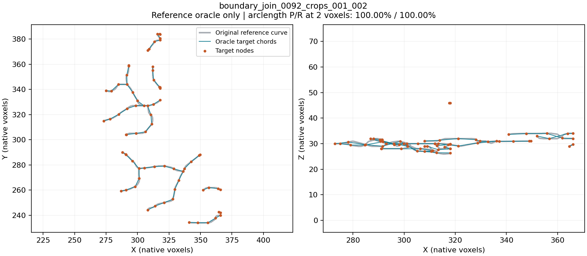

# Reference-only representation check passes; learned connectivity remains open

16 October 2026. After reviewing the original PointNeuron paper and PN 2.0
proposal, the user agreed to begin the proposed pipeline work. The first bounded
implementation/check is complete on CPU: **four training-reference cases pass
the declared representation gate**. Final runtime was 30.91 seconds. No image
inference, model fitting, GPU run or development/test reconstruction occurred.

This is a representation feasibility result with perfect reference nodes,
identity correspondence and known edge labels. It is not successful automatic
reconstruction, learned GATv2 performance, or improvement over PN 1.0.

## What was implemented

- A diagnostic-only graph builder reuses the existing spacing-eight target
  constructor and restores edges along the visible parts of reference chains.
  Curves exiting and re-entering a crop remain separate. Coincident reference
  identities are not spatially merged.
- A reference-free geometric candidate rule constructs symmetrized 16-neighbour
  edges, union edges within eight native voxels. kNN-only results are separate.
- The oracle keeps known reference edges, exports straight target-to-target
  chords to SWC, reloads, and checks geometry, topology and serialization.
- Ten new synthetic tests plus nine existing target tests pass (19 total),
  including same-component rewiring with unchanged degrees and segment-interior
  distance checks. Tests disable unrelated installed pytest plugin auto-loading.

The implementation is isolated from existing samplers, encoder, Transformer,
confidence runners/checkpoints and production graph code. GATv2 and the automatic
initializer/refinement/decoding policy remain unimplemented. The oracle exporter
is not a learned graph decoder: it is deliberately given correct connections.

## Fixed final results

P/R are midpoint-quadrature arclength precision/recall against continuous
reference segments, at two native voxels. The maximum quadrature interval is
0.5 voxel. Each case required at least 99% precision and recall, perfect known
edge availability, preserved structural incidence/components and valid SWC
round-trip. No threshold or spacing was adjusted to meet those criteria.

| Training case | Target nodes / edges | Reference components -> exported | Precision @2 | Recall @2 | Gate |
| --- | ---: | ---: | ---: | ---: | --- |
| Neuron 92, crop 4 | 16 / 15 | 1 -> 1 | 100.00% | 100.00% | Pass |
| Neuron 86, crop 3 | 418 / 404 | 14 -> 14 | 99.92% | 99.73% | Pass |
| Neuron 92, crops 1+2 | 73 / 64 | 9 -> 9 | 100.00% | 100.00% | Pass |
| Neuron 66, full reference | 1,541 / 1,341 | 200 -> 200 | 99.99% | 99.91% | Pass |

All cases have 100% precision and recall at six voxels. All known structural
identities and branch incidence survive; there are zero missing structural
identities, structural degree errors, detected cross-component edges or
unresolved component identities. Maximum coordinate round-trip error is less
than 5e-7 voxel.

The dense crop has 78 original junction-role targets, but 77 visible degree-three
or higher vertices after clipping. A reference junction can have a branch cut by
the crop. Its identity is still preserved; role count and visible degree are
different quantities.

## What the successful candidate recall does and does not mean

Even the 16-neighbour graph alone includes every known edge in these examples.
The eight-voxel radius adds no edges here. This does not establish a generally
sufficient k value, especially with noisy/missing/extra learned proposals.

| Case | Candidate edges | Known required edges | Other candidates |
| --- | ---: | ---: | ---: |
| 92/4 | 120 | 15 | 105 |
| 86/3 | 3,981 | 404 | 3,577 |
| 92/1+2 | 694 | 64 | 630 |
| 66 full | 14,454 | 1,341 | 13,113 |

The oracle supplies edge selection, so it does not test whether geometric or
learned features can discriminate those alternatives. Nonrequired candidates
are not automatically certified biological negatives. Reference fragmentation
and unannotated links must be handled explicitly when training edge prediction.

## Geometry remains approximate

Straight chords shorten total reference arclength by 4.17%, 4.76%, 3.87% and
2.16%, respectively. The maximum sampled reference-to-export distances are
1.72, 2.22, 1.48 and 2.67 voxels. High proximity scores do not imply exact curve
length, radius accuracy, or perfect geometry at tighter tolerances. Exported
nodes use generic type 3; soma/node-type prediction is not evaluated.

The first implementation can retain spacing eight as an explicit baseline;
there is no evidence here requiring an immediate representation rewrite.
Curvature-adaptive spacing or image-supported paths would be separate changes,
to discuss before implementation if the task requires greater length accuracy.

## Crop-joining coverage correction

The initial 30.19-second run selected neuron-92 crops 3+4. Their boxes touch,
but their reference pieces do not cross the shared face. All numerical gates
passed, yet the intended real joining condition was not exercised. That run
is preserved under `tmp/pointneuron2/local_runs/representation_oracle_20261016`,
including original source/config snapshots.

A training-only scan of existing crop identities selected crops 1+2, the first
neuron-92 pair with a shared reference identity. The final check additionally
requires an actual shared identity and reduced component count. These crops
have 41 and 33 targets, one shared boundary identity, and 10 components before
consolidation; the ideal union has 73 nodes and nine components. It passes.

All metrics, topology, candidate counts and serialization results for the other
three cases reproduce exactly. Their numerical criteria are unchanged. This
correction improves test coverage; it is not a model or threshold adjustment.
The joining still uses perfect reference identities/order, so automatic
correspondence across predicted crops remains untested.

## Research decision

The current nodes and known connections can represent useful branched/fragmented
reference geometry in these examples without imposing a historical 128-anchor
global limit. This removes one immediate reason to redesign Phase 1 or the node
representation before connectivity work. It does not establish exact-node
target identifiability, the correctness of current no-object labels, or a
generally adequate sampling budget.

The next design discussion should specify the learned connectivity contract:
node features, candidate construction for imperfect proposals, edge-label
masking for incomplete references, and the decoding of scores into an SWC.
An image/tracer initializer and reference-free crop matching need their own
explicit interfaces. No GATv2 training or new joint fit is queued automatically.
The 4,000-update frozen-confidence replay remains deferred.

The PointNeXt normalization and Transformer confidence failures remain. This
check bypasses them intentionally; they are not repaired by a passing oracle.
Matched PN 1.0 comparison also still needs a freshly trained neuron-disjoint
control because the historical baseline saw all eight PN2-reserved neurons.

## Reproducible files and preservation

- [Protocol, criteria and visible CPU command](representation_oracle_protocol.md)
- [Fixed configuration](../../configs/pointneuron2/representation_oracle.json)
- [Entry script](../../scripts/pointneuron2/representation_oracle.py)
- [Diagnostic graph/metric code](../../src/pointneuron/graph/representation_oracle.py)
- [Synthetic tests](../../tests/test_representation_oracle.py)
- [Visible complete summary](representation_oracle_results_seed0/summary.json)
- [Independent preservation/prefix review](representation_oracle_results_seed0/review.json)
- [Detailed raw outputs and source snapshots](../../tmp/pointneuron2/local_runs/representation_oracle_verified_20261016/summary.json)

Source SWC, target-audit, partition and protected model/source hashes match before
and after. Current code matches the final report and saved source snapshots.
All source reads are restricted to the three selected training-neuron SWCs.
Generated SWCs/arrays/logical provenance remain ignored under `tmp/pointneuron2`;
reports, config, code, tests and selected figures are visible in this checkout.
