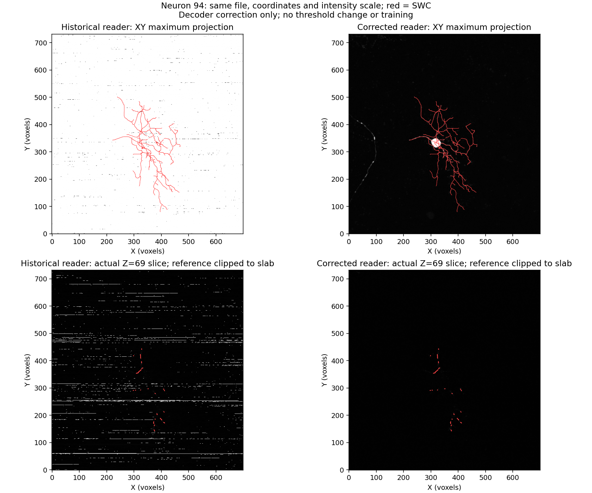
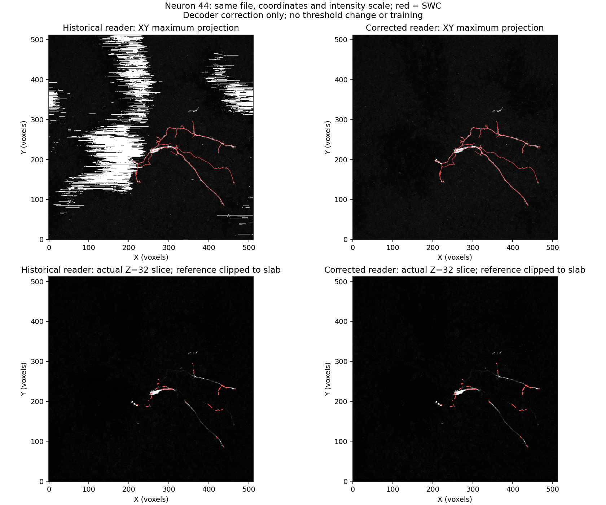
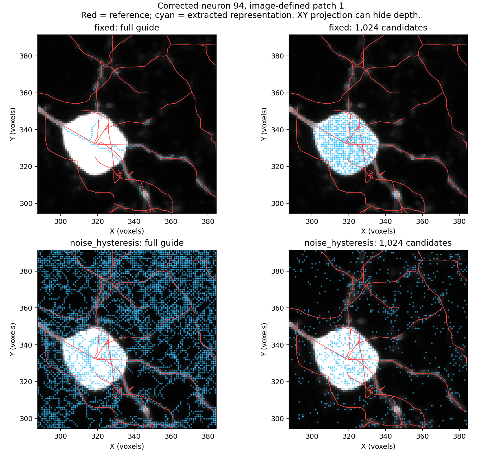

# PN 2.0 root-cause investigation — 11 October 2026

We found confirmed input-decoding defects, an invalid intensity-range assumption,
and absolute-position dependence in the proposal head. These precede the planned
PN 2.0 architecture. The earlier reconstruction scores measure a pipeline with
incorrectly decoded inputs; they cannot establish its performance on correct images.

The agreed next direction is **repair inputs and coordinate handling first**.
No new long training or whole-neuron reconstruction was launched during this audit.

## 1. The compressed image reader was wrong

The independent reference is Vaa3D's
[ImageLoaderBasic.cpp](https://github.com/Vaa3D/v3d_external/blob/master/v3d_main/neuron_annotator/utility/ImageLoaderBasic.cpp).

- PBD8 consumes two-bit difference codes from the low bits first. Our reader
  reversed their order. Partial groups can then corrupt the carried intensity
  and create bright streaks or large artificial regions through unsigned wraparound.
- PBD16 three-bit codes map to `0,+1,+2,+3,+4,-1,-2,-3`. Our reader treated them
  as two's complement. The four/five-bit extension ranges were also incorrectly
  conflated; they now fail explicitly pending a verified implementation.
- The original synthetic fixtures encoded the same mistaken assumptions. New
  fixtures derive from the Vaa3D format, cover all packed PBD8 bytes and partial
  groups, and exercise PBD16 boundaries, signs, carry and byte order.

Both defects are fixed in `src/pointneuron/data/vaa3d_raw.py` in this PN 2.0
checkout. The original parent checkout was not edited.

| Neuron | Changed voxel intensities | Old voxels above the old cutoff | Correct voxels above that cutoff | Interpretation |
|---|---:|---:|---:|---|
| 21, control | 0.0477% | 19,508 | 19,508 | Very little decoder damage; relatively successful control |
| 44 | 26.0441% | 56,439 | 0 | Decoder wraparound created foreground; cutoff also exceeds real signal range |
| 94 | 34.7615% | 2,828,391 | 20,468 | About 138 times too much thresholded foreground before correction |

The production reader was then compared **byte-for-byte** against an independently
implemented run-wise reference decoder on these three original source files.
All three match. Source images, SWCs and historical candidate intensities were
hash-checked. Candidate intensities match the historical incorrect decoder,
confirming that the defect reached the training cache.





Both columns use the same source file, coordinates and display scale. The lower
row shows a real Z slice, with reference segments clipped to that slice slab.
These are input corrections, not predicted reconstructions or measured F1 gains.

## 2. Storage precision was mistaken for signal range

Neuron 44 is stored as uint16, but its correctly decoded maximum is **4,095**.
The old threshold `0.2 * 65,535 = 13,107` cannot retain any real signal.

The repaired baseline adds an explicit image-only `image_max_fraction` policy,
shared between cache preparation and inference. On this image it gives
`0.2 * 4,095 = 819`. It does not rescale or replace source intensities. The
threshold mode is saved in the checkpoint and restored for inference. Impossible
cutoffs now cause a clear cache-preparation failure.

This is the minimum correction for the intensity-range error. It remains a
threshold baseline: maxima can be affected by outliers, and faint neurites can
still fall below the cutoff. It is not a validated segmentation method.

## 3. The proposal head used absolute image position

The encoder normalizes point coordinates, but the raw proposal head concatenates
absolute XYZ. To isolate this input, the audit held encoder features and selected
point rows fixed, then translated XYZ by `(512,512,0)`.

On all 56 cached validation patches of the no-auxiliary checkpoint:

- **10,574 / 28,672 decisions (36.9%)** changed at confidence cutoff 0.85.
- Mean absolute confidence change was **0.1351**.
- An encoder recomputation on the control patch gave exactly unchanged features.

This is a counterfactual test of translation dependence, not a reconstruction
benchmark. The chosen shift need not remain inside the original image bounds.

The new `coordinate_mode="local"` uses normalized local XYZ as features, while
keeping offsets and radii in voxel units. It differs from the pre-existing
`normalized` mode, which also multiplies offsets by the cloud scale. Nonzero-weight
tests verify unchanged logits, radii and offsets under translation, and translated
proposal centers. Historical weights are not reinterpreted as a repaired model;
the corrected head needs fresh training.

## 4. What remains after those repairs

Six fresh image-defined patches were prepared on CPU: two each from neurons
21, 44 and 94. No labels selected the input patches or candidates. All source
coordinates/intensities match, and every extracted guide vertex is retained.

| Corrected patch | Reference curve samples | Foreground support within 6 voxels | Full-guide support | 1,024-candidate support |
|---|---:|---:|---:|---:|
| 21 / 0 | 228 | 81.6% | 64.0% | 81.6% |
| 21 / 1 | 1,208 | 97.6% | 82.7% | 74.0% |
| 44 / 0 | 595 | 100.0% | 87.6% | 94.5% |
| 44 / 1 | 107 | 100.0% | 100.0% | 100.0% |
| 94 / 0 | 0 | Not scored | Not scored | Not scored |
| 94 / 1 | 1,104 | 40.0% | 33.8% | 29.0% |

These are representation diagnostics on a tiny validation subset. Proximity to
an incomplete reference cannot measure foreground precision. They do not score
selected 512-point inputs, a trained repaired head, or connected reconstructions.

**Neuron 94 still has a faint-signal bottleneck before the neural model.** Its
corrected foreground misses about 60% of this patch's reference curve at the
six-voxel tolerance, and candidate bounding loses more. Fixing the reader is
necessary but cannot by itself solve faint-neurite recovery.

A bounded follow-up on this same corrected image-defined crop compared the fixed
mask with the existing noise-hysteresis rule, keeping raw intensities, candidate
budget, random seed and full-guide extraction unchanged:

| Representation | Fixed mask: curve support within 6 voxels | Noise mask: curve support within 6 voxels |
|---|---:|---:|
| All foreground | 40.0% | 100.0% |
| Full image-derived guide | 33.8% | 98.1% |
| 1,024 candidates | 29.0% | 97.0% |
| 512 random inputs | 18.6% | 90.6% |
| 512 inputs from a fixed guide prior | 28.9% | 92.4% |

The noise mask expands from **19,342 to 64,799 voxels**, and the guide expands
from **149 to 6,144 vertices**. Visual inspection shows substantial additional
guide structure away from the traced neurites. A dense background representation
can inflate proximity coverage. These scores therefore establish a retention
tradeoff, not segmentation precision or improved reconstruction. The noise MAD
hits its quantization floor on this crop, adding another reason to validate the
rule across training domains before adoption. No new mask was promoted.



This is the useful direction for the next automatic-input comparison: retain
weak signal, use guide proximity as an uncertain prior, and train semantic
rejection from verified trace supervision. An extracted image skeleton cannot
be assumed to be ground truth. We still need to measure false proposals and
connected-reconstruction quality, rather than reward coverage alone.

The training supervision audit found **1,494 / 92,316 candidate rows (1.62%)**
within six voxels of clipped reference curves that receive negative targets in
annotated patches. One additional unlabelled patch contains 102 near-curve rows;
that patch currently receives no proposal supervision. This audit uses historical
candidate pools, not the selected rows from each training batch. Cropped-node
targets versus continuous SWC segments merit a separate correction/ablation, but
this discrepancy is much smaller than the demonstrated decoder damage.

## Repair state and next comparison

Implemented and checked:

- Corrected PBD8/PBD16 decoding and reference-based tests.
- Decoder version recorded in new sampling caches and checkpoints. Old sampling
  caches are rejected for new training; old sampling checkpoints are rejected
  for reconstruction on corrected images. Explicit read-only historical analysis
  remains available. Generic inherited PN 1.0 cache/checkpoint paths are not
  retroactively certified by these sampling-specific guards.
- Shared image-range threshold policy and impossible-cutoff validation.
- Translation-equivariant local proposal features with voxel-unit predictions.
- A six-patch CPU input integration check and byte-for-byte source verification.
- Full test suite: 191 tests passed before the final paired-coordinate test;
  the six-test ablation module, including that new test, subsequently passed.

Visible files:

- `scripts/pointneuron2/audit_root_causes.py`: reproducible reader, coordinate,
  foreground and supervision diagnostics.
- `scripts/pointneuron2/probe_repaired_foreground.py`: one corrected image crop
  through masking, full skeleton extraction, uniform candidates and fixed/random
  point selection; scores references separately and performs no training.
- `configs/pointneuron2/proposal_repaired.json`: local-coordinate proposal recipe.
- `configs/pointneuron2/sampling_repaired.json`: repaired reader/range pilot settings.
- `configs/pointneuron2/repair_comparison.json`: raw versus local head on identical
  repaired data, seeded random point selection and initialization; five epochs,
  batch size 2, 33 train / 7 validation neurons, eight reserved test neurons.

The random selection control deliberately holds sampling independent of the
head so the next coordinate comparison has one varying factor. Full guides
remain cached. Learned guide sampling can be reassessed on corrected inputs
after this comparison. The 512-input budget is a comparison setting, not a claim
that it is sufficient for the final PN 2.0 model.

**Immediate next step:** compare automatic faint-signal retention on the corrected
image-defined boxes, then assess guide/candidate coverage on training examples
before committing to the full cache and GPU pilot. The repaired range baseline
should remain an explicit control. Avoid picking a foreground rule solely from
these validation curves. Evaluate the held-out test set only after choices are frozen.

The new matched training comparison is prepared, not launched. Training will run
visibly on the local RTX 3070 Ti Laptop GPU when we agree the input policy is
ready. Previous five-epoch training was roughly 0.5–8 minutes per arm, but the
new runtime is unmeasured. Whole-neuron reconstruction previously took 81 minutes
for three arms and should be agreed separately.

CPU preparation, when the input-quality comparison is accepted:

```powershell
Set-Location "C:\Users\Seywe\Documents\GitHub\PointNeuron\pointneuron2"
$repairExperiment = Join-Path (Get-Location) ("tmp\pointneuron2\local_runs\repair_" + (Get-Date -Format 'yyyyMMdd_HHmmss'))
& .\tmp\pointneuron2\sampling_env\Scripts\python.exe -u `
  .\scripts\pointneuron2\sampling_ablation.py --stage prepare `
  --config .\configs\pointneuron2\repair_comparison.json `
  --artifact-root "C:\Users\Seywe\Documents\GitHub\PointNeuron" `
  --output-dir $repairExperiment
```

Preparation does not start training. Generated arrays and future checkpoints
remain in ignored `tmp/pointneuron2`; scripts, configurations, metrics and figures
remain visible in this real checkout.

The prototype still uses the PN 1.0 encoder/proposal/graph machinery. PointNeXt,
the query decoder and GATv2 have not yet been implemented. Ambitious architecture
work should proceed once the corrected inputs and measurement contract are
usable; it cannot compensate for erased or corrupted evidence at the input.

Machine-readable evidence: `root_cause_audit_seed0/summary.json`,
`root_cause_audit_seed0/verification.json`, `root_cause_audit_seed0/corrected_cache_masks.json`,
and `repaired_input_smoke_seed0/audit.json`. The latter's sensitivity sweep uses
the historical dtype-scaled cutoffs; its main foreground/guide/candidate results
use the corrected cached thresholds. Future sensitivity audits restore the
cached threshold mode. The bounded mask/pool comparison is saved in
`repaired_foreground_probe_seed0/summary.json`.
