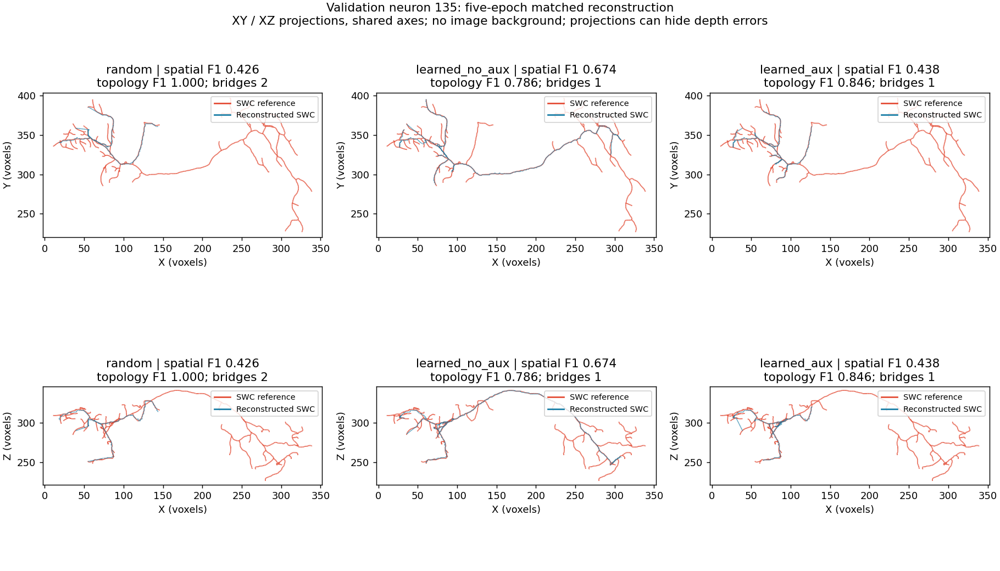
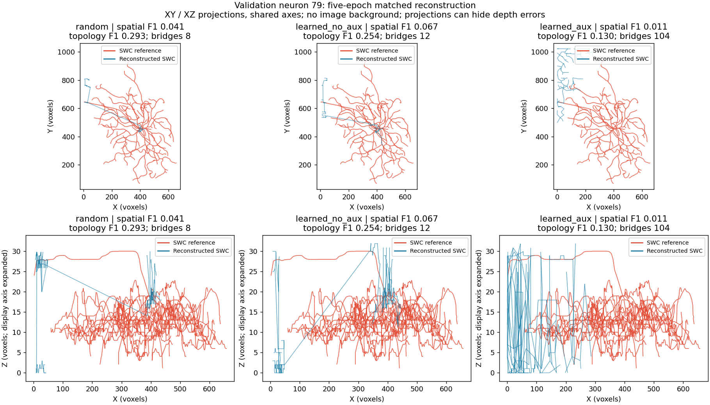
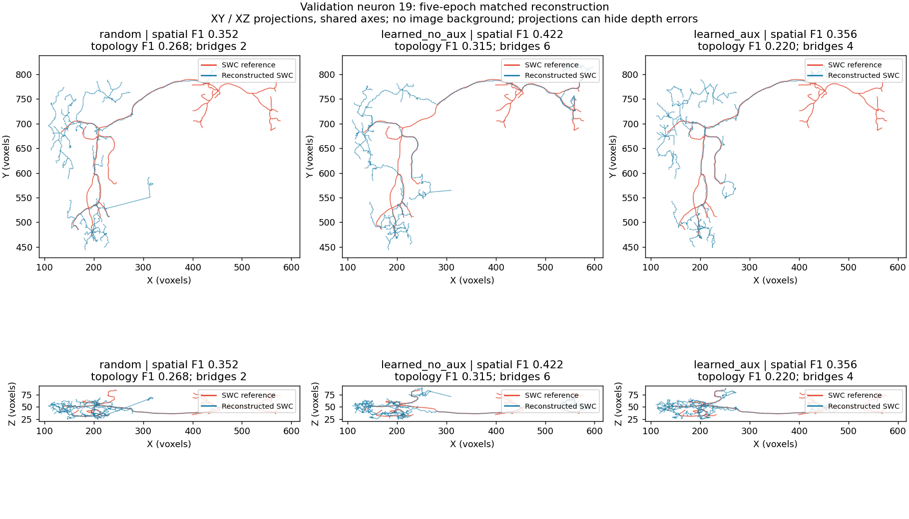

# Matched reconstruction results: five-epoch sampler pilot

**Historical pipeline:** confirmed image-decoder defects were found after this
evaluation. These results require reassessment on corrected inputs; see
[the root-cause findings](root_cause_findings.md). The saved metrics remain unchanged.

The user-launched evaluation completed on 11 October 2026 (Beirut time), taking
**81 minutes**. All **21 reconstructions** completed: three arms, seven validation
neurons each, no execution failures. Every exported SWC is valid and has one root;
this does not establish anatomical correctness. The eight test neurons remain reserved.

**The guide sampler without auxiliary loss improves mean spatial F1 in this
pilot. It is a candidate for further investigation, not a promoted PN 2.0 model.
The auxiliary guide loss has no convincing overall benefit here.**

## Main results

All means weight the seven neurons equally. Higher F1 is better. Bridges are
fallback graph connections, not necessarily anatomically correct branches.

| Arm | Spatial F1 | Spatial precision | Spatial recall | Topology F1 | Mean bridges |
|---|---:|---:|---:|---:|---:|
| Random | 0.2306 | 0.3643 | 0.2027 | 0.3451 | 30.0 |
| Learned without guide loss | **0.2823** | 0.3653 | **0.2687** | 0.3286 | 31.3 |
| Learned with guide loss | 0.2340 | 0.3297 | 0.2072 | 0.3083 | 53.6 |

Without auxiliary loss, spatial F1 increases by **0.0517 absolute** (about 22.4%
relative to this five-epoch random control). Mean spatial precision changes very
little; recall increases. Spatial F1 improves on four neurons, worsens on one,
and stays zero on two. Median spatial F1 remains low: 0.0411 random, 0.0671 without
auxiliary loss, and 0.0323 with it. Neuron 135 accounts for about **69%** of the
net spatial-F1 gain, so this is not a broadly solved reconstruction problem.

Topology F1 improves on five neurons in the no-auxiliary arm but its mean falls.
The metric compares predicted connectivity to a GT-induced graph on each arm's
own predicted nodes. It therefore changes with the node set and does not measure
all missing annotated branches. On neuron 135, random has **seven graph nodes**,
topology F1 **1.0**, spatial recall **0.2705** and spatial F1 **0.4258**. The
no-auxiliary arm has **15 graph nodes**, topology F1 **0.7857**, spatial recall
**0.5088** and spatial F1 **0.6744**. The lower topology score alone does not show
that the expanded reconstruction is worse. Keep the spatial and topology metrics
separate and inspect geometry.

The auxiliary arm's extra confident proposals from the cached-patch check did
not translate into better overall reconstruction. Mean bridges rise to 53.6 and
mean reachable-edge fraction falls to 0.595, versus 0.777 without auxiliary loss.
Neuron 79 is particularly poor: spatial F1 0.0111 and 104 fallback bridges, versus
0.0671 and 12 bridges without auxiliary loss. This experiment uses the original
fixed-threshold inputs; the failed experimental noise-hysteresis masks were never
used. These results do not identify a unique causal mechanism for the auxiliary
arm's degradation.

## Per-neuron spatial F1

| Neuron | Random | Learned without auxiliary | Learned with auxiliary |
|---|---:|---:|---:|
| 19 | 0.3519 | 0.4216 | 0.3558 |
| 21 | 0.7659 | 0.7982 | 0.8004 |
| 35 | 0.0295 | 0.0146 | 0.0323 |
| 44 | 0.0000 | 0.0000 | 0.0000 |
| 79 | 0.0411 | 0.0671 | 0.0111 |
| 94 | 0.0000 | 0.0000 | 0.0000 |
| 135 | 0.4258 | 0.6744 | 0.4381 |

All arms still miss substantial reference geometry. Neurons 44 and 94 have
zero precision and recall within the spatial evaluator's six-voxel distance
threshold, despite producing valid trees. Neurons 79 and 94 fail the existing
350,000-voxel graph foreground cap in every arm; the adapted graph threshold
reaches 254. These are existing downstream limitations, not successful outcomes
merely because the commands completed.

## CPU audit of saved proposals and graph selection

This additional diagnostic reused saved proposal/graph files and SWC references;
it did not train, load image volumes or regenerate inference. Reference segment
support is measured within eight voxels, sampling edges every four voxels. The
proposal pool is **already locally filtered/aggregated**, then filtered at the
graph's 0.85 score cutoff. It is not the raw network output or the input mask.

| Neuron | Random proposal -> selected support | No auxiliary proposal -> selected support | Auxiliary proposal -> selected support |
|---|---:|---:|---:|
| 19 | 0.315 -> 0.182 | 0.268 -> 0.192 | 0.223 -> 0.113 |
| 21 | 0.922 -> 0.564 | 0.906 -> 0.543 | 0.890 -> 0.583 |
| 35 | 0.066 -> 0.015 | 0.060 -> 0.005 | 0.071 -> 0.010 |
| 44 | 0.025 -> 0.000 | 0.027 -> 0.000 | 0.027 -> 0.007 |
| 79 | 0.031 -> 0.028 | 0.091 -> 0.056 | 0.013 -> 0.004 |
| 94 | 0.000 -> 0.000 | 0.000 -> 0.000 | 0.000 -> 0.000 |
| 135 | 0.111 -> 0.050 | 0.312 -> 0.141 | 0.300 -> 0.146 |

There are losses at more than one stage. Neuron 21 has substantial available
proposal support that decreases during node selection. In 35, 44 and 94, the
available score-filtered proposal support is already very poor before graph
selection. Changing only graph edges cannot recover branches whose nearby nodes
are absent. This audit cannot distinguish input-mask exclusion, candidate sampling,
network confidence and earlier NMS as the cause of missing proposals.

The audit's automatic `bottleneck` label is a heuristic. In particular, it can
mark a high topology-F1 case as `ok` even with poor spatial recall; use the actual
support values and geometry rather than treating that label as a diagnosis.

## Inspect the actual geometry

Red is the SWC reference; blue is the reconstruction. The projections use shared
limits across arms, without an image background. They can hide depth errors;
the generated interactive comparison HTMLs retain 3D views and source-image points.
Thin XZ views expand the Z display axis, explicitly labeled on the plots.

### Neuron 135: more annotated length recovered without auxiliary loss



### Neuron 79: poor coverage, especially with auxiliary loss



### Neuron 19: partial improvement, still substantial missing geometry



## Interpretation and proposed next step

1. Keep **guide sampling without auxiliary loss** as the candidate for the next
   comparison. Do not promote the auxiliary setting based on guide proximity or
   confidence counts. These are proposals for discussion, not automatic strategy changes.
2. First inspect image/reference support and input/proposal coverage in **44 and
   94**, using a few already cached annotated patches and saved proposals. Trace
   where supported reference branches disappear: fixed mask, image candidate
   pool, model confidence or NMS. This targets the common failures before investing
   in another long training/reconstruction run.
3. If guide sampling remains useful, compare a **frozen-alpha guide prior** with
   learned alpha. The previous confidence diagnostic found at most two out of
   512 candidate rows changed by learned alpha in any cached validation patch.
   The present result cannot establish that adaptation, rather than the guide
   prior itself, is responsible for the gains.
4. Before another full three-arm evaluation, discuss caching the common image
   candidate/guide pools across arms. These are currently extracted repeatedly;
   shared cached inputs could reduce redundant CPU work while preserving the
   agreed comparison. No performance changes have been implemented in this turn.

Stage 1 is still incomplete. PointNeXt, the query decoder and GATv2 have not
started. This pilot provides evidence of a spatial benefit in some cases and
identifies persistent failures; it does not yet establish an improved complete
PointNeuron 2.0 system.

The clean 30-epoch PN 1.0 reference has mean spatial F1 0.3743 and topology F1
0.4120 on the same seven neurons. It remains a useful target, but this five-epoch
pilot differs in training duration and input recipe, so it is not a controlled
comparison of PN 1.0 versus PN 2.0. Validation has already informed development,
the set is small and mixed across domains, and references can be incomplete.
No external test, repeated-seed significance or dataset-wide improvement is claimed.

## Evidence and reproduction

- [Full metrics, per-neuron selection audit and 80 input-file hashes](sampling_ablation_reconstruction_seed0/summary.json).
- [Training trajectories and cached confidence check](sampling_ablation_pilot_results.md).
- [Experiment settings and original stage commands](sampling_ablation.md).
- CPU report runner: `scripts/pointneuron2/summarize_ablation.py`.

The report validates cache hashes, neuron identities, unchanged SWC references,
checkpoint hashes, matched training initialization/order/augmentation, and exact
seven-neuron denominators in all reconstruction and metric reports. Figures were
visually inspected. The earlier 149-test run remains the training implementation's
verification; this results-only diagnostic was checked on the real saved artifacts.

Reproduce the summary/audit/figures in a fresh output directory:

```powershell
& .\tmp\pointneuron2\sampling_env\Scripts\python.exe -u `
  .\scripts\pointneuron2\summarize_ablation.py `
  --experiment .\tmp\pointneuron2\local_runs\ablation-prepare_20261010_205859_1596\experiment `
  --output-dir .\tmp\pointneuron2\ablation_report_recheck
```
