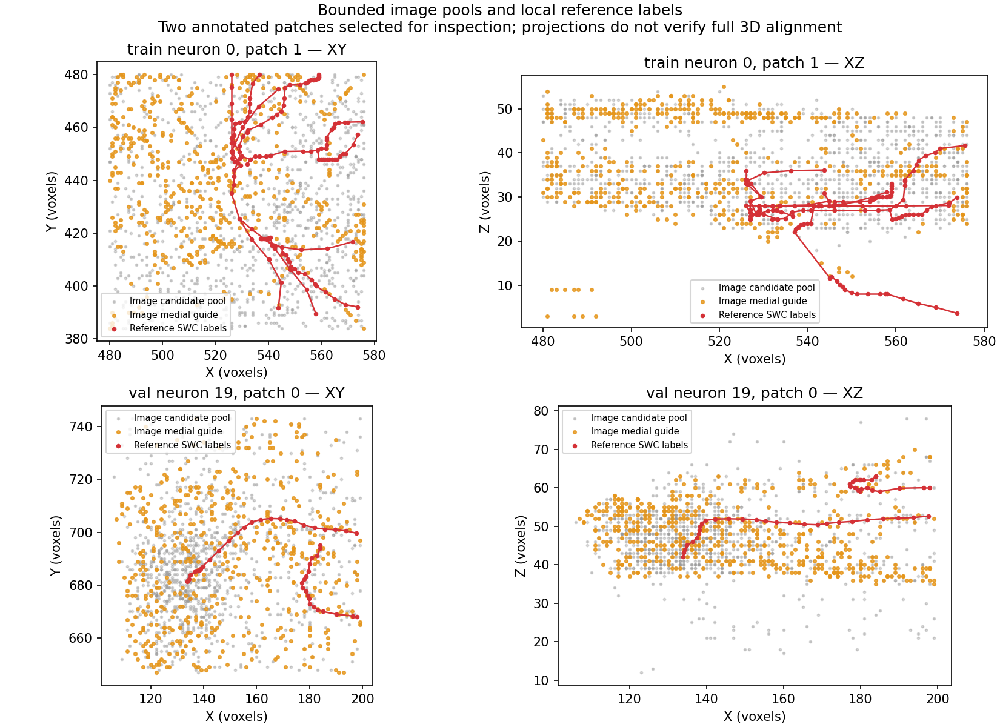

# Trainable sampling: local integration results

The later user-run full-guide smoke and its raw-image/proposal overlays are in
[checkpoint_inspection_full_guides.md](checkpoint_inspection_full_guides.md).
The bounded-guide smoke described below remains historical execution evidence.

The sampler now trains jointly with PN 1.0's DGCNN encoder and proposal head.
Its weights and sampling settings are saved in the proposal checkpoint and
automatically restored at inference. This completes the training integration
step, not stage 1's reconstruction evaluation. PointNeXt has not started.

## Code and local execution

Entry scripts are in `scripts/pointneuron2`:

| Script | Purpose |
|---|---|
| `build_sampling_cache.py` | Image-derived candidates and guides, separate SWC labels, partition/content checks |
| `train_sampling.py` | Joint learning or a matched random-input control, fresh model weights |
| `evaluate_sampling.py` | Local validation-reference representation diagnostics |
| `visualize_sampling.py` | XY/XZ image-guide/reference projections for inspection |
| `run_local.ps1` | Local Python launcher with saved logs/status and fresh output directories |

Reusable implementations are `data/sampling_cache.py`,
`models/adaptive_sampling.py` and `models/sampling_pipeline.py` under
`src/pointneuron`. Selection and geometric loss use image data only. Reference
SWCs supply the separate proposal supervision and diagnostic overlays.

All reported runs used this computer's RTX 3070 Ti Laptop GPU. Source, configs
and this report are outside ignored `tmp`; caches/checkpoints/logs are inside it.
The visible `pointneuron2` directory is the real development checkout; the former
junction was replaced after all files and working changes were verified.
Historical run records retain the paths used when those runs were executed.
Development files are not yet committed to Git.

## Corrected smoke results

The frozen partition remains 33 train / 7 validation / 8 reserved test neurons.
The smoke used train neuron 0 and validation neuron 19, four image patches each;
no test neuron was read. Each patch retains 1,024 candidates, at most 512 guide
points, and selects 512 inputs. Training used two epochs and two batches per
epoch, with batch size two and float32 computation.

| Check | Result |
|---|---|
| Repository tests | 93 passed with unrelated pytest plugins disabled |
| Learned sampler | Alpha 0.25 → 0.2493589222; finite nonzero gradients in all four training batches |
| Checkpoint | Saved sampler/configuration restored; repeated evaluation selections agree |
| Random control | Two epochs completed with the same candidate cache and proposal recipe |
| Reloaded CUDA inference | Completed on two training-image patches; zero proposals accepted at score 0.5 |

Only **1/4 train patches and 2/4 validation patches** contain local SWC nodes.
No local annotation does not prove background: those patches contribute the
image-guide loss only and receive no negative proposal labels. Earlier smoke
directories without the `_v2` suffix predate this correction and are superseded.

Final learned validation proposal loss is 8.9650; the random control is 8.6744.
These tiny runs verify execution, not a method ranking. Proposal losses average
over annotated records; total/guide losses average over all retained records.
The unfiltered radius-48 cache, float32 training and cubic label crops differ
from the older baseline protocol. A longer freshly trained matched comparison
on this same cache protocol is required before claiming a sampling benefit.

The checkpoint is `tmp/pointneuron2/sampling_training_smoke_v2/proposal.pt`.
Its SHA-256 is
`cbf15ebb236bcfc8b409b69557d5de80c0a10d661307799eabd90c187e92646d`.
Compact metrics and provenance are in `sampling_training_smoke.json`;
full run records remain in the corresponding ignored run directories.

## What the inspection tells us



The orange image guide extends well beyond the red local reference in these
projections, and some thin reference branches appear weakly represented.
This is partial visual QA on two patches, not a full 3D alignment assessment.
Some extra guide structures may be unannotated neurites rather than noise.

On validation patch 0, within six voxel units, local reference coverage is
88.7% for random, fixed-medial and learned inputs; sampled-point proximity to
the local reference is 11.3%, 13.1% and 13.1%, respectively. The learned and fixed
methods have unchanged representation metrics after this short run. Another
annotated patch has only one reference node, and two have none; their coverage
cannot support an anatomical improvement claim. Reference curves include only
edges whose endpoints lie inside the patch, omitting boundary-crossing edges.

## Continue stage 1

The follow-up [source-image audit](input_audit.md) now identifies guide-extraction
loss in the train example and substantial pool-compression loss in the validation
example. Its clearer figure overlays the actual image and includes reference
edges crossing patch boundaries. Those input issues are the next implementation
priority before longer training or PointNeXt.

Before spending time on a full training comparison, inspect more train/validation
image guides in 3D and measure candidate/guide coverage of reference branches,
including patch boundaries. Then run longer learned and random models on the
same completed cache and evaluate full validation reconstructions, retaining
failures, runtime and memory. Reserve test for the final comparison. PointNeXt
follows this sampling assessment.

The local launcher supports these commands from the original checkout. Each
creates a fresh output directory; the first prepares all train/validation pools,
and the second trains on the completed cache you supply:

```powershell
& .\pointneuron2\scripts\pointneuron2\run_local.ps1 -Action sampling-cache -ArtifactRoot $PWD.Path
& .\pointneuron2\scripts\pointneuron2\run_local.ps1 -Action sampling-train -ArtifactRoot $PWD.Path -Manifest '<absolute cache manifest path>'
```

For the matched control, invoke `train_sampling.py` with `--strategy random`,
the same `--manifest`, and a fresh `--output-dir`. The launcher also has
`-Action sampling-smoke` to reproduce a small integration run; it does not run
the representation diagnostic or inference evaluation automatically.
