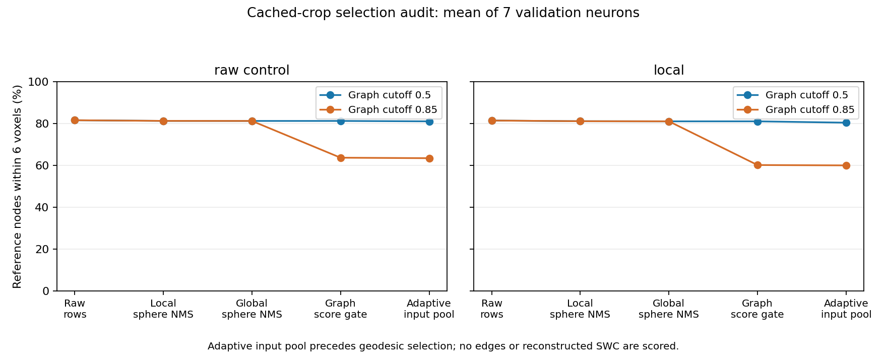

# Frozen-proposal score and suppression audit

**Update:** the user agreed to the proposed neuron-21 full-volume comparison.
[The full-volume pair has completed](graph_cutoff_results.md), showing a spatial
benefit and a topology tradeoff. The agreed
[seven-neuron extension is prepared](validation_graph_cutoffs.md).

Completed on 11 October 2026 after the user chose a bounded selection audit.
The two saved corrected-input checkpoints are unchanged. Inference and selection
on all 56 cached validation crops took 34.4 seconds, excluding environment/cache
setup. No training, full-volume inference, geodesic graph or SWC reconstruction
was run. Eight reserved test neurons were not used.

**The score cutoff demonstrably removes substantial reference-node support in
these saved crops. Sphere suppression removes little support at six voxels.
This identifies a filtering effect, not a measured final reconstruction gain.**

## What the pipeline actually does

`run_end_to_end.py` explicitly invokes local and global **sphere** suppression
at IoU 0.1. Its advertised 8/12-voxel distance-radius settings are not the
suppression rule while sphere mode is active. Duplicate removal depends on
the model's predicted radii.

Graph preprocessing uses `filter_proposals` with the frozen settings:
`adaptive_connected_coverage_nms`, distance 18 voxels, and maximum final nodes
128. This stage constructs a coverage pool plus distance-suppressed anchor seeds;
it does not simply keep the distance-suppressed nodes. The candidate pool can
exceed 128. Actual final node selection depends on a geodesic graph and was not
run here. Treating distance-only suppression as the full adaptive selector would
misrepresent the pipeline.

The new [diagnostic script](../../scripts/pointneuron2/audit_proposal_selection.py)
calls the existing production selection implementations. For both graph cutoff
variants, it keeps aggregation fixed at score 0.5, local sphere IoU 0.1/top 512,
and global sphere IoU 0.1/top 4096. Only the graph cutoff varies: 0.5 versus 0.85.
Model weights, cached inputs, deterministic selected points and all other
selection settings are fixed.

## Stage-by-stage results

Coverage is the fraction of unique cached reference nodes within six voxels of
at least one retained proposal. Each neuron's eight cached crops are combined,
including predictions from unannotated crops, and overlapping reference nodes
are deduplicated by ID. Means below weight the seven neuron unions equally;
empty proposal sets would score zero. These are partial-volume unions, not a
full-neuron coverage benchmark. They differ from the earlier mean over 47
individual annotated crops at three voxels.

| Stage | Raw, graph 0.5 | Raw, graph 0.85 | Local, graph 0.5 | Local, graph 0.85 |
|---|---:|---:|---:|---:|
| All raw proposal rows | 81.56% | 81.56% | 81.42% | 81.42% |
| Local sphere suppression | 81.25% | 81.25% | 81.10% | 81.10% |
| Global sphere suppression | 81.22% | 81.22% | 81.04% | 81.04% |
| Graph score gate | 81.22% | 63.69% | 81.04% | 60.19% |
| Adaptive graph candidate pool | 81.03% | 63.46% | 80.40% | 60.02% |



For the local model, sphere suppression reduces six-voxel coverage by only
0.38 percentage points from raw rows to global aggregation. At three voxels,
the loss is larger but still modest: 69.40% to 67.55%. The subsequent 0.85
graph gate loses 20.85 percentage points at six voxels. Lowering it to 0.5
preserves this support before connectivity is considered.

The local adaptive pool at cutoff 0.5 averages 531 proposals per neuron, versus
454 at cutoff 0.85. Its six-voxel coverage is 80.40% versus 60.02%. Endpoint
coverage at six voxels is 73.55% versus 49.42%; junction coverage is 77.38%
versus 63.60%. Endpoint/junction identities come from each full reference SWC,
but only nodes within the cached union enter the coverage denominator.
References are used exclusively for measurement, never selection.

## A concrete case and an unresolved input failure

Local-model coverage after the graph score gate:

| Neuron | Cached reference nodes / full reference nodes | Cutoff 0.5 | Cutoff 0.85 |
|---|---:|---:|---:|
| 19 | 83 / 674 | 97.59% | 63.86% |
| 21 | 2,433 / 2,733 | 82.49% | 21.33% |
| 35 | 266 / 3,199 | 82.33% | 74.06% |
| 44 | 596 / 661 | 97.82% | 70.13% |
| 79 | 455 / 3,186 | 79.56% | 79.56% |
| 94 | 597 / 1,301 | 28.48% | 23.79% |
| 135 | 1,385 / 1,503 | 98.99% | 88.59% |

Neuron 21 is especially informative: the global sphere output has 1,151 proposals;
the 0.85 gate retains just 191 and reduces cached reference coverage from 82.49%
to 21.33%. This is a concrete development case for a paired full-volume check.
It was selected for inspection using validation diagnostic evidence, so it is
not an untouched confirmatory case.

Neuron 94 remains poorly supported even before score gating (about 28.5% at six
voxels). Fixing the cutoff cannot recover geometry absent from those proposals.
This audit does not identify whether that remaining failure is primarily
foreground extraction, sampling, learned prediction or incomplete crop coverage.

## Fixed-budget controls and their limits

Two additional controls branch from each graph score gate. They are **not**
the adaptive selector's final outputs:

| Local-model control | Cutoff 0.5: coverage / mean rows | Cutoff 0.85: coverage / mean rows |
|---|---:|---:|
| Distance-18 anchor seeds, at most 128 | 28.60% / 61.0 | 22.28% / 38.6 |
| Existing geometric coverage truncation, at most 128 | 55.51% / 128 | 50.34% / 128 |

Both variants use the same maximum node budget; actual selected counts differ
when distance suppression exhausts the eligible points. A geometric 128-node
control preserves more node proximity than distance anchors alone. However,
sparse nodes can cover reference segments through connecting edges, which are
absent from this diagnostic. These values cannot establish SWC accuracy, the
adequacy of a 128-node cap, or the performance of the geodesic adaptive selector.

Lowering the score gate also does not simply eliminate background. Local
post-gate proposal rows within six voxels of cached reference nodes average
62.07% at cutoff 0.5 versus 63.01% at 0.85. Missing local annotations and sparse
reference vertices limit interpretation of rows outside that distance; they
cannot automatically be labeled false positives. More retained proposals may
still cause incorrect connectivity. Final spatial precision/recall and topology
must be measured separately.

## Recommended next step, to agree together

Run a bounded full-volume comparison on validation neuron 21 using the same
local checkpoint and identical aggregation, graph settings and 128-node limit.
Compare only the graph score cutoff, 0.85 versus 0.5. Reuse the same aggregated
full-volume proposal file in both arms so weights, proposals and sampling are
identical. Inspect exported SWCs and spatial precision/recall, not just proposal
coverage. If that check supports the change, extend to all seven validation
neurons with failures included. Neuron 94 needs a separate input/proposal audit.

No reconstruction preset has been changed or promoted; no long run has been
started. Scripts/configurations originally frozen by the training experiment
still match their hashes. The diagnostic is a new standalone script, so it
does not alter that original pipeline.

## Visible files and verification

- [Complete metrics, method settings and hashes](selection_audit_seed0/summary.json).
- [Stage coverage figure](selection_audit_seed0/coverage.png).
- [Runnable diagnostic](../../scripts/pointneuron2/audit_proposal_selection.py).
- Raw proposal/reference arrays and selected row identities: ignored
  `tmp/pointneuron2/selection_audit_seed0`, one NPZ per neuron and checkpoint.

Checks passed for empty proposal sets, sphere duplicate removal and score-gate
exclusion on a small known case. Full saved-data checks verify all 14 artifact
hashes, nested aggregation/score/pool subsets, node-budget limits and monotonic
coverage along subset stages. All raw threshold counts exactly reproduce the
previous confidence audit. The original 115 source/configuration hashes remain
unchanged. These execution checks establish consistency, not reconstruction gain.

To repeat, choose fresh output directories:

```powershell
Set-Location "C:\Users\Seywe\Documents\GitHub\PointNeuron\pointneuron2"
& .\tmp\pointneuron2\sampling_env\Scripts\python.exe -u `
  .\scripts\pointneuron2\audit_proposal_selection.py `
  --experiment .\tmp\pointneuron2\local_runs\repair_20261011_130158 `
  --output-dir .\docs\pointneuron2\selection_audit_repeat `
  --artifact-dir .\tmp\pointneuron2\selection_audit_repeat `
  --device cuda
```
