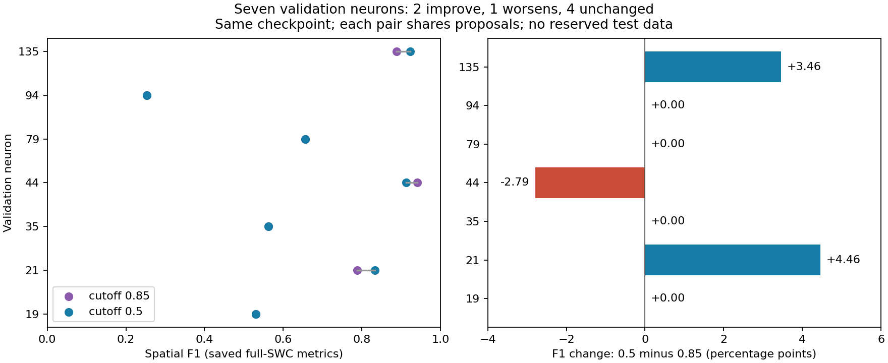
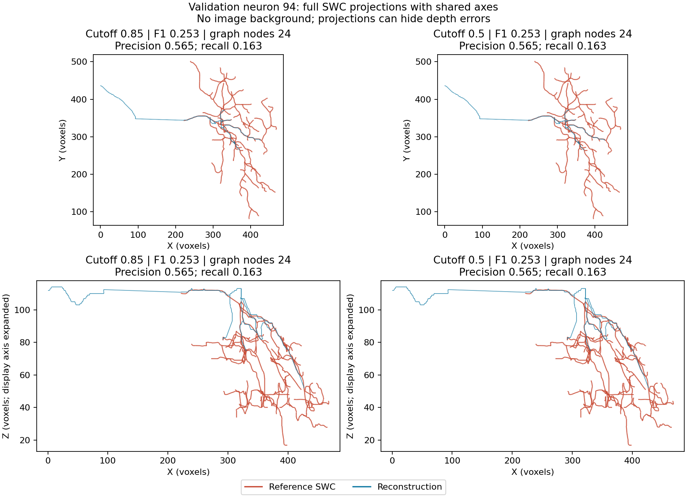

# Seven-neuron cutoff results and development progress

**Subsequent checks completed:** [the full-volume loss audit](full_volume_selection_audit.md)
and [matched spatial global-selection control](global_coverage_comparison.md)
test the proposed next steps below. No production setting has been promoted.

The user-run comparison completed on 11 October 2026 in 27m52s: six new
pairs, with neuron 21 reused. All seven pairs and their frozen sources,
checkpoint, proposals, graph/SWC hashes and saved metric reports were verified.
The means were independently recomputed from the saved per-neuron scores.
No new inference, training or tracing was run during summarization.

**Lowering the graph cutoff is a useful change for some cases, but does not
solve the main reconstruction losses. No production cutoff is promoted.**

## Measured outcome

Means weight each of the seven validation neurons equally. Spatial scores use
full SWCs resampled every voxel, with a six-voxel distance tolerance.

| Metric | Cutoff 0.85 | Cutoff 0.5 | Change, low minus high |
|---|---:|---:|---:|
| Spatial F1 | 0.6598 | 0.6671 | +0.0073 |
| Precision | 0.8078 | 0.7953 | -0.0125 |
| Recall | 0.6176 | 0.6413 | +0.0238 |
| Topology F1 | 0.6395 | 0.6363 | -0.0032 |
| Mean fallback bridges | 1.86 | 1.71 | -0.14 |

| Neuron | Spatial F1, 0.85 | Spatial F1, 0.5 | Change in percentage points |
|---|---:|---:|---:|
| 19 | 0.5300 | 0.5300 | 0.00 |
| 21 | 0.7880 | 0.8326 | +4.46 |
| 35 | 0.5627 | 0.5627 | 0.00 |
| 44 | 0.9404 | 0.9125 | -2.79 |
| 79 | 0.6560 | 0.6560 | 0.00 |
| 94 | 0.2533 | 0.2533 | 0.00 |
| 135 | 0.8882 | 0.9228 | +3.46 |

Two improve, one worsens, four are unchanged; median F1 change is zero.
Excluding the initially selected neuron 21, mean F1 change is only +0.00112.
This exclusion is descriptive, not an independent test or significance test.
Eight reserved test neurons remain untouched.



All foreground caps were satisfied. However, the graph threshold was raised
from the requested 5 to 32, 23, 181 and 15 on neurons 19, 35, 44 and 79,
respectively. Meeting a memory cap does not establish faint-branch retention.
Topology F1 uses an induced target on the selected nodes; it cannot independently
measure branches absent from that node set.

## What the unchanged cases tell us

The numerical graph arrays and SWC node geometry are exactly identical between
cutoffs on neurons 19, 35, 79 and 94. File hashes differ because saved metadata
and SWC comments record settings/paths; equality was checked on actual arrays.

| Neuron | Post-local proposals before global selection | Final proposals | Final minimum score | Final scores below 0.85 | Grid patches |
|---|---:|---:|---:|---:|---:|
| 19 | 57,705 | 4,096 | 0.9194 | 0 | 189 |
| 35 | 35,826 | 4,096 | 0.9212 | 0 | 256 |
| 79 | 25,652 | 4,096 | 0.8765 | 0 | 156 |
| 94 | 1,806 | 892 | 0.8030 | 87 | 11 |

On 19/35/79, the graph gate receives no scores between 0.5 and 0.85. Lowering it
therefore cannot change its eligible proposals. Earlier global selection combines
score ordering, sphere suppression and a 4,096-proposal limit. These observations
identify why the gate has no effect; they do not yet quantify how many useful
branches global selection removed or isolate the cap from suppression. Neuron 35
also hits the 256-patch preset limit, whose spatial coverage still needs auditing.

On 94, lowering the gate adds eligible proposals, but the adaptive selector returns
the same 24 score anchors. Its code chooses these anchors when their fallback
bridge count is below the existing trigger; it does not require 128 nodes or
check whole-neuron coverage. A connected sparse tree can satisfy this rule while
missing most annotated branches. Recall is 0.1633, and the projection shows many
missing reference branches and an off-reference trajectory. Earlier corrected-crop
evidence also found faint-signal losses before the model. This is a compounded
input/selection problem; 24 nodes alone is not proof that using 128 fixes it.



On 44, extra coverage comes with extra off-reference trajectories: precision
falls from 0.9229 to 0.8484, while recall rises from 0.9586 to 0.9871. On 135,
recall improves from 0.8081 to 0.8654, with little precision change. Full SWC
projections have shared axes, no image background, and can hide depth errors.

- [Neuron 44 regression](validation_graph_cutoff_results_seed0/neuron_0044_swcs.png)
- [Neuron 135 improvement](validation_graph_cutoff_results_seed0/neuron_0135_swcs.png)
- [Earlier neuron 21 improvement](graph_cutoff_results.md)

## Progress from the beginning of this chat

1. Established the real PN2 checkout, frozen neuron-disjoint split, visible
   runners/reports and user-launched GPU runs. The initial PN1-style baseline
   trained for 30 epochs and scored all seven mixed-domain validation neurons.
2. Implemented image-derived medial guides and trainable sampling, preserving
   every extracted guide vertex separately from the 512 encoder inputs.
   Integration worked; the three-arm pilot did not show a convincing overall
   benefit for auxiliary guide loss. Those results used the subsequently
   discovered incorrect image decoder.
3. Diagnosed and repaired PBD decoding, storage-range thresholding and absolute
   coordinate dependence. Reader checks against an independent implementation
   and translation tests establish actual correctness improvements.
4. Compared automatic masks and candidate selection. Permissive masks retain
   faint branches but also add background structure; no new mask was promoted.
5. Retrained matched raw/local-coordinate models on corrected data for five
   epochs. Local best validation loss is 1.74% lower; this is a modest training
   result, not proof of better whole-neuron reconstruction.
6. Audited score filtering, then tested the hypothesis with one full-volume
   pair and this seven-neuron extension. The gain generalizes unevenly and
   exposes earlier proposal selection and sparse-graph behavior.

The current evaluated model still uses the inherited encoder, pointwise
proposal head and geodesic graph machinery, with random point inputs. The
learned guide sampler is implemented but inactive in this repaired control.
PointNeXt, the query decoder and GATv2 have not been implemented. Stage 1 is
unfinished: this is corrected groundwork, not a completed high-end PN2 model.

## Comparison with the old model

| Evaluation | Neurons | Mean spatial F1 | Interpretation |
|---|---:|---:|---|
| Historical promoted PN1 guarded30, stable domain 100–162 | 63 | 0.8150 | Historical result on a different subset; decoder repairs were not applied |
| Initial PN1-style baseline in this chat, 30 epochs | Same seven | 0.3743 | Historical decoding/range pipeline |
| Early sampler pilot: random / learned no auxiliary / learned auxiliary | Same seven | 0.2306 / 0.2823 / 0.2340 | Five epochs; historical decoding/range pipeline |
| Current repaired local control, cutoff 0.85 / 0.5 | Same seven | 0.6598 / 0.6671 | Five epochs; corrected inputs and coordinate features |

The promoted PN1 spatial score is verified in the original checkout's saved
`tmp/paper_style_eval/guarded30_stable_100_162.json` (63 samples), and documented
in [the PN1 report](../pointneuron1_report.tex). Its topology score around 0.8295
is a different metric and must not be compared to current spatial F1.
The initial seven-neuron scores are saved in
[baseline_validation.json](baseline_validation.json).

Current reconstruction is substantially better than the early mixed-domain
runs as an observed whole-pipeline result. Reader, thresholds, crop generation,
coordinate features and training conditions differ, so this does not isolate a
PN2 architectural gain or prove superiority over the promoted PN1 model.
An actual comparison needs the same held-out neurons, corrected image handling,
inference coverage/budgets and evaluator, with training budgets stated explicitly.
Historical weights trained on incorrect data cannot simply be relabelled as a
corrected baseline. No such final matched PN1-versus-PN2 benchmark exists yet.

## Conceptual bottleneck and proposed next step

The pipeline repeatedly discards evidence:
image threshold -> candidate pool -> 512 input points -> pointwise proposals ->
global suppression/4,096 limit -> score gate -> spatial anchors/128-node maximum
-> traced tree. Full guides alone do not preserve all this information through
the later stages. A score ranks local confidence, not the value of a branch for
the complete arbor. Connectivity pressure assesses the nodes that survived,
and can accept a small connected fragment as satisfactory. Increasing recall
without learned rejection also adds false trajectories, as neuron 44 demonstrates.

These are supported bottleneck mechanisms, with different causes across sources.
At the time of this cutoff report, the fraction attributable to each stage was
unmeasured; the subsequent audit above now measures saved selection stages. A larger
encoder alone cannot reliably recover evidence excluded before it sees the image.

Recommended next diagnostic, pending discussion: measure reference segment and
terminal support on the saved pre-global proposals, final proposals and selected
graph nodes for the weak cases, holding weights/settings fixed. Separate this
center-support diagnostic from final SWC recall. It needs no new long run.
Then agree on an intervention at the measured loss stage, with a controlled
comparison; do not continue arbitrary threshold sweeps or retrain without a
specific hypothesis. The user requested this progress/conceptual review before
accepting that next diagnostic, then approved it and the spatial control above.

## Reproducibility

[Verified metrics, selection metadata and completed provenance snapshot](validation_graph_cutoff_results_seed0/summary.json)
are tracked alongside the figures. Raw models/proposals/graphs/SWCs and logs
remain in ignored `tmp/pointneuron2/local_runs/validation_graph_cutoffs_20261011`,
with reused neuron 21 under `graph_cutoffs_neuron21_20261011`.

CPU-only summarizer: [summarize_validation_cutoffs.py](../../scripts/pointneuron2/summarize_validation_cutoffs.py).
To repeat verification into a fresh report directory:

```powershell
Set-Location "C:\Users\Seywe\Documents\GitHub\PointNeuron\pointneuron2"
& .\tmp\pointneuron2\sampling_env\Scripts\python.exe `
  .\scripts\pointneuron2\summarize_validation_cutoffs.py `
  --comparison .\tmp\pointneuron2\local_runs\validation_graph_cutoffs_20261011\validation_comparison.json `
  --output-dir .\tmp\pointneuron2\local_runs\validation_cutoff_summary_repeat
```
