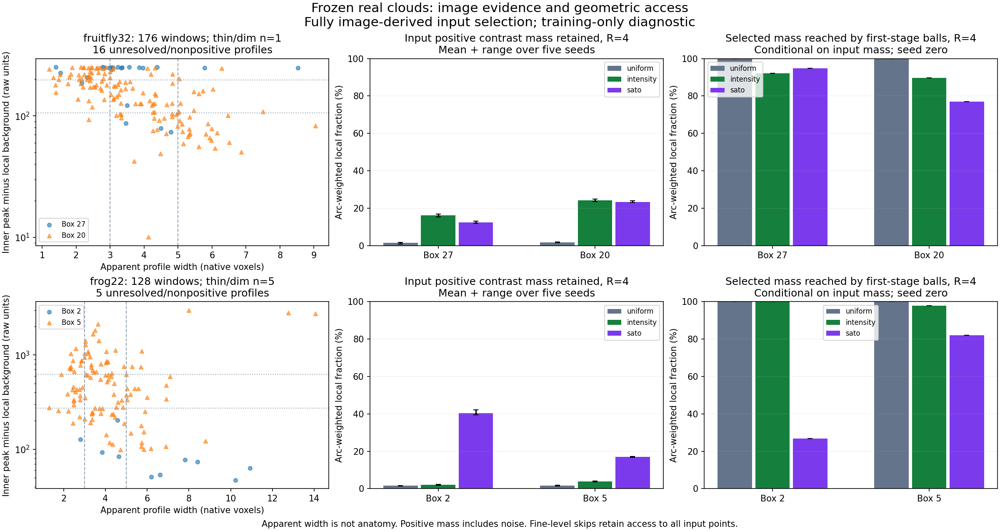

# Real-cloud contrast and PointNeXt geometric access

29 October 2026. **The bounded four-box audit completed. No sampler or encoder
architecture change is justified by this audit alone.** It shows substantial,
source-dependent selection effects and finite-neighborhood access restrictions.
It does not measure learned feature quality or reconstruction.

## What was run

The [fixed plan](real_branch_evidence_plan.md) and
[configuration](../configs/real_branch_evidence.json) selected the median-positive
and maximum-reference-length boxes from each of two already-inspected training
sources, before scoring the selectors. Actual distinct counts were 2,430, 6,912
and 20,736; clipped source depth was preserved. Each box compared its frozen
uniform/intensity/Sato clouds at the same count and five original seeds.

All 60 input arms completed. Twelve seed-zero traces used the actual pinned
native FPS and first-32 ball operators at all four stages, with fixed source-ID
hash order, clipped-box center and coordinate scale 64. One control held frog
box 5's Sato first-stage query positions fixed and changed support ordering only.
No field/guide, sampling or image normalization was rerun; no weights, model
inference, optimizer, GPU operation or training fit was involved.

There were 304 local reference-centered windows, sampled at a maximum four-voxel
arc step. Measurements use unique voxel centers in tangent-aligned slabs and
radii 1/2/4/8 voxels. Source-derived local background is subtracted identically
for all arms. Positive contrast mass means sum(max(I-background,0)); it includes
positive noise and can include unrelated visible structure. Its retained fraction
is not node recall, anatomical foreground precision or a reconstruction score.

## Input selection: neither weighted selector wins everywhere

The following is the **R=4** slice of the saved all-radius results, averaged over
five paired seeds. Values are arc-weighted means of local window fractions.
They are not whole-neuron mass fractions: windows may overlap. Local point counts
include all selected voxel centers inside the same measurement windows.

| Source / box | Input points | Mean local points, uniform / intensity / Sato | Positive contrast mass retained, uniform / intensity / Sato |
|---|---:|---|---|
| Fruitfly / 27 | 2,430 | 2.83 / 14.17 / 16.11 | 1.36% / 16.09% / 12.37% |
| Fruitfly / 20 | 6,912 | 3.09 / 16.60 / 26.14 | 1.65% / 24.09% / 23.34% |
| Frog / 2 | 20,736 | 3.00 / 3.40 / 67.92 | 1.55% / 1.99% / 40.34% |
| Frog / 5 | 20,736 | 3.08 / 5.86 / 27.13 | 1.61% / 3.77% / 17.10% |

Sato allocates substantially more evidence to the traced frog regions than raw
intensity weighting. In the fruitfly boxes, it selects more nearby points but
retains less positive contrast mass than intensity weighting. This distinguishes
point proximity/count from photometric evidence. Intensity weighting naturally
favors bright mass; this metric alone would not be a neutral full-reconstruction
objective. A distributed, lower-intensity set can still be more useful for
branch geometry. The earlier whole-image spatial-support results remain intact.

The saved evidence includes all four radii, width/contrast strata and five-seed
means/ranges, rather than selecting an operating point after scoring.

## First-stage grouping: access through one path, not total encoder loss

Among positive contrast mass already present in each input cloud, the union of
actual first-stage selected ball members reaches the following local fractions
at R=4. **These are seed-zero conditional window means**, not the five-seed means
above; multiplying the two tables is not a valid pooled estimate.

| Source / box | Uniform | Intensity | Sato |
|---|---:|---:|---:|
| Fruitfly / 27 | 100.00% | 92.05% | 94.77% |
| Fruitfly / 20 | 100.00% | 89.64% | 76.96% |
| Frog / 2 | 100.00% | 100.00% | 26.91% |
| Frog / 5 | 100.00% | 97.79% | 81.95% |

Weighted point clustering makes the K=32 limit active: Sato's first-stage query
balls are truncated in 31.96%, 27.49%, 12.13% and 36.05% of queries, respectively.
Global query fractions do not directly describe where the image contrast lies;
frog box 2 illustrates that distinction.

This establishes a restriction in the local abstraction route. It does **not**
establish that these points disappear from the encoder output. The architecture
also restores fine-level features using a skip path that exposes every input
point. Max aggregation is intended to summarize redundant members; preserving
100% raw intensity mass through every stage is not an architectural requirement.
Whether the available routes preserve useful branch information requires the
learned node task. No K/radius/normalization change follows from this proxy.

For frog box 5 Sato, original race ordering versus fixed hash ordering changes
36.05% of first-stage neighborhoods with the same query positions. The absolute
R=4 source-mass fraction reached changes from 11.11% to 11.50%, only **0.39
percentage points** on this control. Ordering matters, but this example does not
establish it as the sole major bottleneck or justify swapping to another operator.

## Thin/dim coverage and measurement limitations

Apparent radial-profile half-height widths were resolved for 283/304 windows;
21 were unresolved because of missing half-height crossing or a stronger outer
profile peak. Thin/intermediate/broad bins are exploratory native-voxel profile
widths, not verified anatomical caliber. Contrast classes are within-source
positive-profile terciles, fixed before scoring; they are not universal imaging
dimness thresholds. Reference radii are not used as caliber truth.

Only **six windows** fall jointly in the apparent-thin and relatively-dim class:
one in fruitfly box 20, one in frog box 2 and four in frog box 5. Fruitfly box 27
has none. These are local samples from just two training neurons, not six
independent neuron examples. This audit therefore **does not establish adequate
thin/dim retention across the data or future acquisitions**. Bins and cases were
not changed to manufacture that coverage.

All 176 fruitfly windows and three frog windows have source-bounding-cube clipping
flags. This is a conservative bounding-cube flag, not an exact missing-cylinder
fraction; actual profile/evidence windows use available source voxels. Box-domain
fractions are recorded separately. Unknown physical calibration, PSF, reference
offset, curved/crowded structure and background-shell contamination limit the
apparent-width and contrast interpretation. Unresolved windows remain in the
all-window retention results. Nothing untraced is assigned a background label.



## Verification and reproducibility

* Thirteen focused tests pass: known narrow/broad and dim/bright tubes, constant
  images, clipping, bright evidence outside radius two, stable source-ID ordering,
  arc sampling and independent point/voxel count equivalence. Noise-only images
  demonstrate that positive mass does not certify a neurite; a stronger neighboring
  tube is flagged as an unresolved width. This is not exhaustive PSF/noise validation.
* Both original image byte and decoded-pixel hashes match the frozen manifests.
  Cloud hashes, distinct within-box counts, source coordinates and raw intensities
  pass for every scored arm. Both reference byte hashes match; no alignment is fit.
* An independent KD-tree calculation uses only saved point attributes and the
  saved window/background metadata. It reproduces every input/first-group
  contrast fraction with **zero discrepancy**, and records local point counts,
  above-background counts and selected intensity/contrast medians.
* All twelve trace archives pass source-identity/shape checks at each stage:
  distinct quarter-count centroids and 32 in-support member identities per query.
* The core CPU scoring phase recorded **367.65 seconds**, excluding interpreter
  imports and subsequent point-count validation/plotting. There was no GPU or
  training run. Source and measurement script hashes are preserved with the run.

Raw results and trace arrays: `tmp/real_branch_evidence_20261029/`, including
`report.json`, `point_counts.json` and `summary.png`. The visible
[evidence summary](evidence/real_branch_evidence_20261029.json) preserves raw-file
hashes, all-radius stratified results, local point counts and stage statistics.
The source report is unchanged by the independent validator or plotting.

```powershell
Set-Location "C:\Users\Seywe\Documents\GitHub\PointNeuron\PN2"
# Read existing results only; new point-count file must not already exist.
& ..\pointneuron2\tmp\pointneuron2\sampling_env\Scripts\python.exe `
  .\scripts\validate_real_branch_counts.py .\tmp\real_branch_evidence_20261029\report.json
```

## Research decision

Keep both automatic weighted selectors as candidates. This audit explains why
neither point count, skeleton proximity nor brightness mass alone can select a
universal Phase 1 policy. It does not support another architectural repair from
an untrained neighborhood proxy. Do not expand this into repeated untrained
hierarchy sweeps simply to seek perfect retention.

The next useful milestone is a **specified few-box PointNeXt-to-Transformer
learnability task on automatic real inputs**, with target representation,
normalization, matching, confidence semantics and a fixed run cap agreed before
launch. Its purpose is to establish that the intended learned task works; it is
not a thin/dim generalization claim. A successful sanity fit enables the matched
selector/budget comparison. A failure should stop that comparison for an explicit
implementation/supervision/optimization audit, without automatically adding a
loss or extending training. No learned fit has been prepared or launched here.
