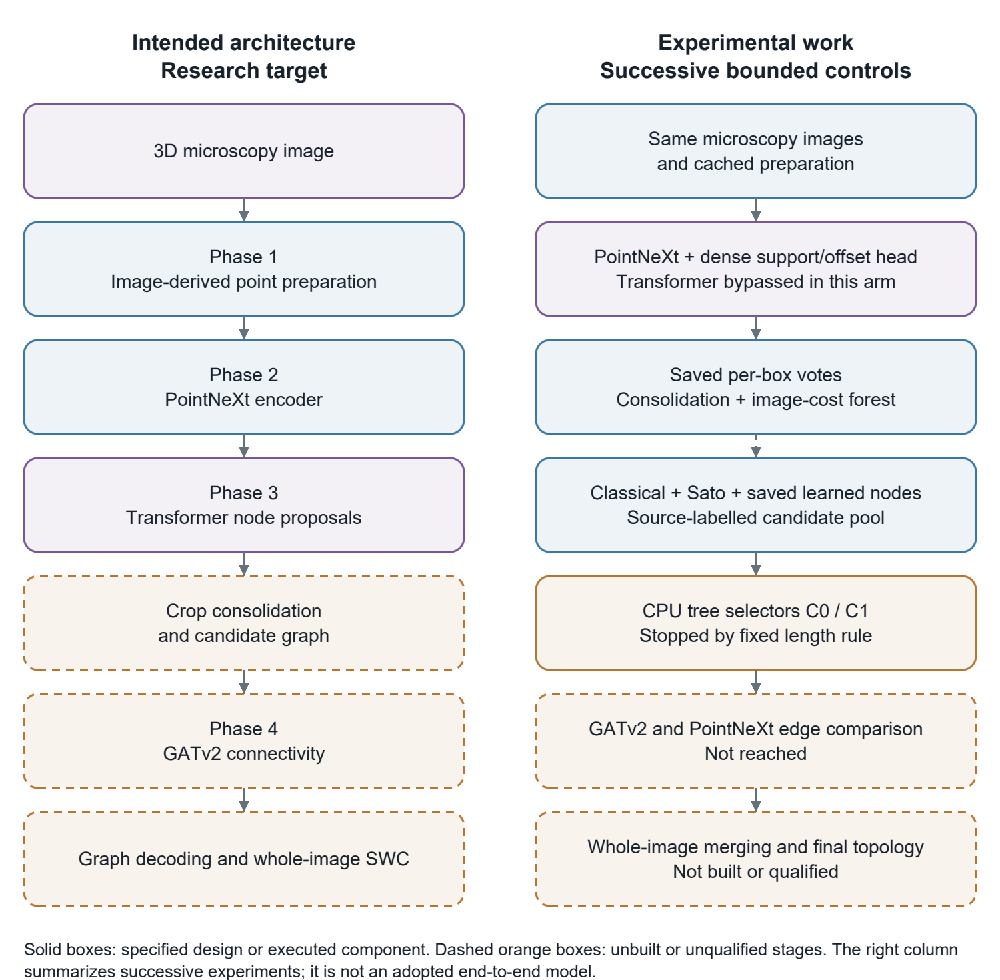
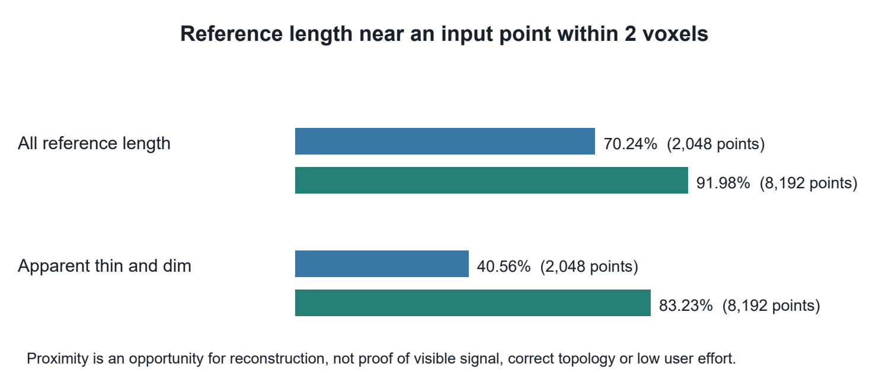
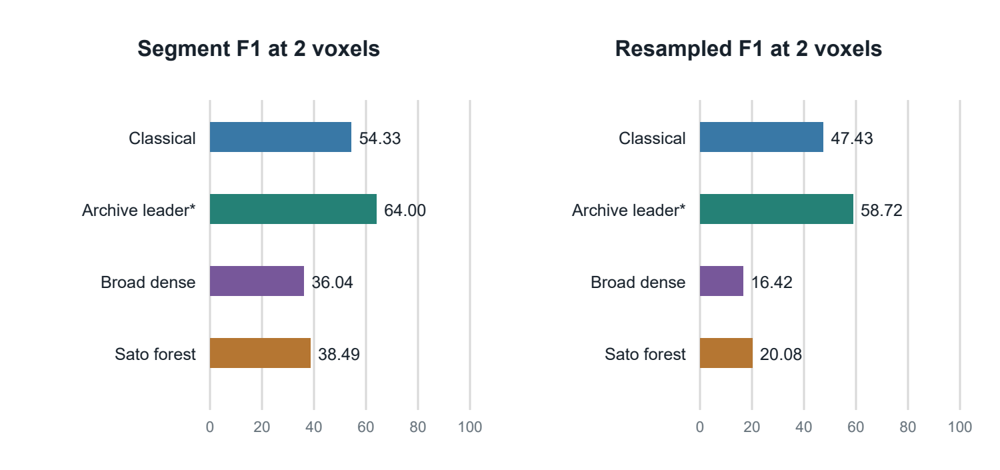
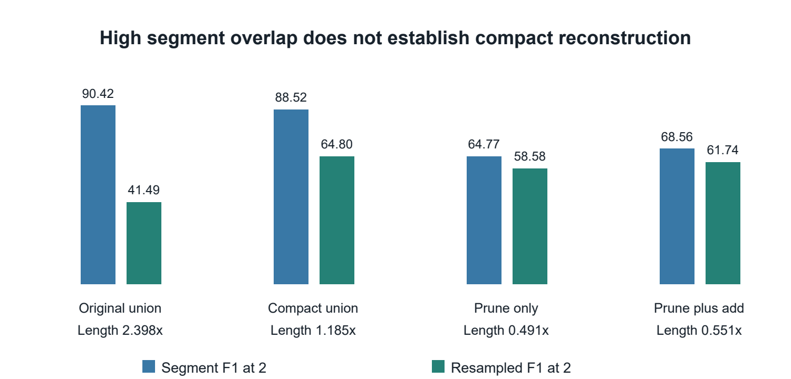
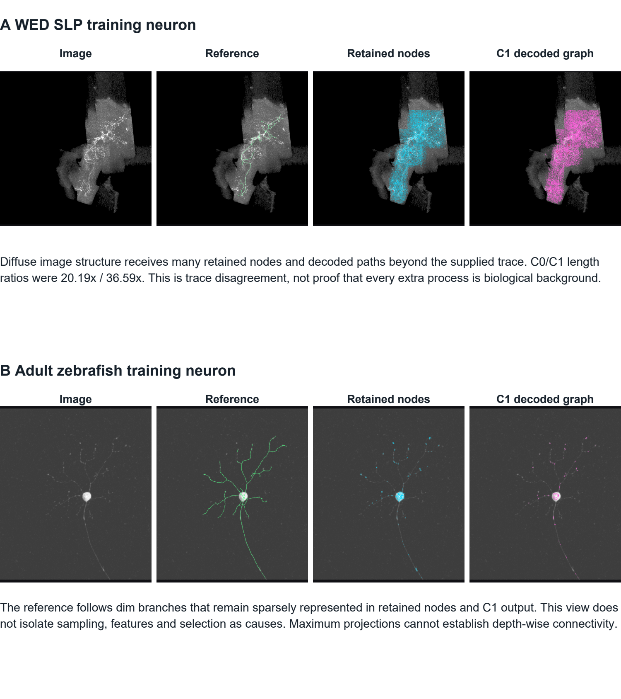
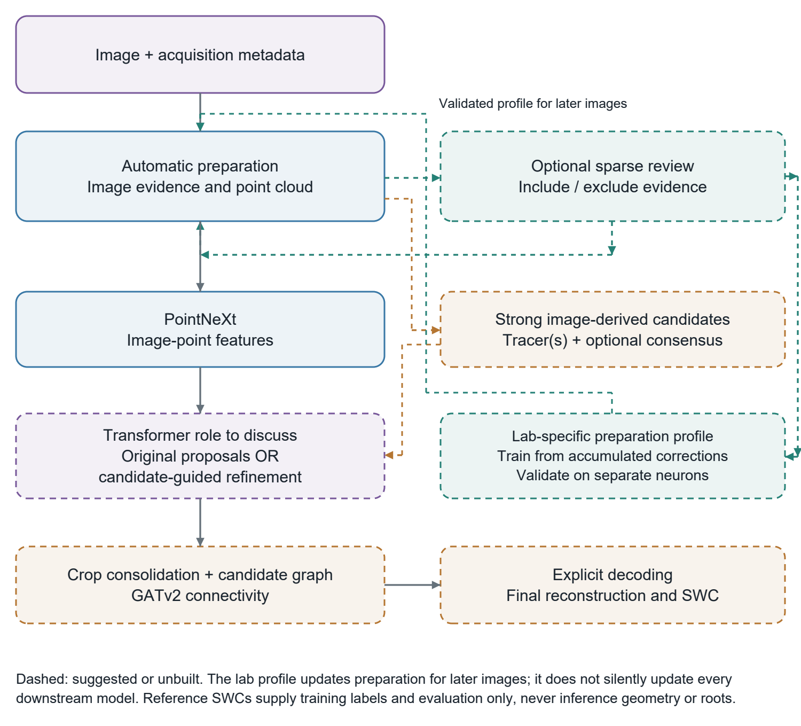

# PointNeuron 2 research progress report

Prepared for Dr Arij | 7 November 2026

[Download the PDF](PointNeuron2_Progress_Report_Dr_Arij_20261107.pdf) | [All development rows](development_results.csv) | [Unrounded summaries](development_summary.csv)

**Purpose.** We are investigating whether point-based image features and learned geometry/connectivity can improve neuronal reconstruction from 3D microscopy. This report summarizes the fresh PN2 experiments and requests agreement on the next research direction.

**Current conclusion.** The preparation, training and measurement infrastructure works, but no tested learned reconstruction has demonstrated an advantage over the strongest available automatic tracer on unseen neurons. The intended PointNeXt, Transformer and GATv2 architecture remains a research target. Its experimental bypasses are not adopted replacements.

### What has been established

We built image-derived point preparation, a native PointNeXt prototype, Transformer and dense-head experiments, candidate graphs, CPU selector controls, SWC export and matched geometric scorers. Audits progressively separated execution, fitting, transfer and reconstruction quality. The eight reserved neurons remain untouched. [S1-S10]

| Population | Neurons | Reference-present boxes | Role |
| --- | --- | --- | --- |
| Training | 33 | 460 | Model fitting and conditional selector CV |
| Development | 7 | 151 | Repeatedly inspected diagnostic comparison |
| Reserved | 8 | Not evaluated | No source images or annotations opened |

The broad dense-head experiment reached **36.04% / 67.54%** segment F1 at 2 / 6 voxels, compared with **54.33% / 69.14%** for the matched classical graph. A later archive comparison found a stronger descriptive leader at **64.00% / 73.12%**, subject to a coordinate-screen limitation. These are per-box results, not an assembled whole-neuron system. [S6, S7, S13]

### Decision requested

We seek agreement on whether to investigate sparse user-guided, lab-adaptive preparation and stronger image-derived candidates; what role the Transformer should play; and how to evaluate the contribution of point features and GATv2. No further training or architecture replacement is implied by this report. Five specific questions appear on page 10.

## Architecture and experimental departures

Figure 1. The intended pipeline and the experiments performed. The dense head and later CPU selectors are successive controls, not a validated replacement pipeline. Whole-image assembly and GATv2 were not completed. Reference SWCs supply training labels and evaluation only. [S6, S9, S16]

**Transformer status.** A geometric-query Transformer fitted the four-box training task successfully. The later dense curve-head arm bypassed its proposal role, with the user's agreement for that arm only. This departure from PDF Phase 3 awaits Dr Arij's approval. The broad 20-epoch failure was a dense-head result, not a 20-epoch Transformer result. [S3, S6]

**GATv2 status.** GATv2 was retained as the intended connectivity model. Simpler tree selectors were tested first and stopped under their criteria; GATv2 was not trained. No evidence here establishes that GATv2 would succeed or fail. [S9]

Other proposal elements remain incomplete: anatomical radius supervision, topology losses and multi-scale Transformer queries. Scaffold SWCs use placeholder radii. These experiments do not implement the complete PDF design. [S16]

## Cohort measurement and verification

### Why the controls were needed

A missing branch can arise from input sampling, proposal localization, selection or graph decoding. We therefore preserved cached inputs and compared saved outputs with no-learning controls before changing architecture. Reference SWCs were used for supervision and measurement, never to choose ordinary inference points, edges or roots. [S1, S4-S6]

| Measure | Definition and practical limit |
| --- | --- |
| Segment F1 | Directed arclength precision and recall against continuous polylines at 2 and 6 native voxels; maximum quadrature step 0.5 voxel. Close overlapping paths can all score well. |
| Resampled F1 | Skeletons uniformly resampled at 2-voxel arclength spacing, then maximum-cardinality one-to-one matching within 2 or 6 voxels. Penalizes extra samples; not a complete topology metric. |
| Length ratio | Predicted arclength / reference arclength. Per-neuron ratios in the detailed table; pooled ratio in aggregate rows. A short graph can still omit branches. |
| Aggregation | Pool box statistics within each neuron, then average the seven neuron F1 values equally. F1 is not recomputed from macro precision and recall. |

Figure 2. Saved input proximity measurements. Increased point count improves two-voxel support, especially in thin/dim strata, but does not prove that downstream learning preserves it. [S2]

**Verification.** Saved packets retain source coordinates, intensities and hashes. Synthetic and real-geometry controls checked segment scoring, sampling-phase/subdivision invariance, matching and duplicate sensitivity. Training execution verified optimizer state and exposure counts; these are execution checks, not reconstruction gains. [S3, S4, S6-S8]

**Scope.** The full grids contained 1,964 training and 415 development boxes. The 1,504 / 264 boxes without reference structure are annotation-unknown, not certified background. Tables here score only reference-present boxes. Development identities also appeared in historical PN1 work: they are fresh-PN2 gradient-disjoint diagnostics, not untouched final tests. All coordinates are native voxels; micron views rely on reported calibration and do not establish one physical tolerance across acquisitions. [S1, S11]

## Development reconstruction comparison

Same seven neurons and 151 reference-present boxes. All F1 values are percentages. The learned row is the terminal broad dense head after 9,200 updates, trained on 460 boxes from 33 neurons. [S6, S7, S13-S15]

| System | Seg 2 | Seg 6 | Res 2 | Res 6 | Length x |
| --- | --- | --- | --- | --- | --- |
| Classical | 54.33 | 69.14 | 47.43 | 54.72 | 0.918 |
| Archive leader* | 64.00 | 73.12 | 58.72 | 68.14 | 1.250 |
| Broad dense | 36.04 | 67.54 | 16.42 | 21.58 | 6.236 |
| Sato forest | 38.49 | 63.13 | 20.08 | 24.93 | 6.204 |

### Segment and resampled agreement tell different stories

Figure 3. The same saved graphs scored at two voxels. Full six-voxel values are in the table. The large drop for dense and Sato forests is consistent with their excess sampled geometry and length, rather than a useful compact trace. [S7, S14]

**Classical:** automatic whole-guide Otsu thresholding, 3D skeletonization and fixed terminal-spur pruning. **Sato:** ranked input points, top 512 before the fixed consolidation/forest recipe. **Broad dense:** PointNeXt support/offset votes, fixed cutoff/consolidation and the same forest family. These controls have different graph sizes; the length column makes that difference explicit. [S4-S7]

**Archive leader:** *neutube_updated* is the archive label, not the original NeuTube comparator or a reproduced installation. It is the descriptive best of 44 variants on this inspected development set, not a training-selected prospective control. The archive is parameter-optimized, and seed provenance is unresolved. [S13-S15]

*** Coordinate limitation.** The leader's Series017 case is zero under the frozen native-bounds screen, not measured zero geometric overlap. Its pooled length is 1.25017x, slightly above 1.25x; rounding is not a gate pass. No retrospective exclusion or rule relaxation was applied. See page 7. [S13]

## All seven development neurons

F1 values are percentages at 2 / 6 native voxels. Length is the per-neuron predicted/reference ratio. Each row pools only that neuron's scored boxes. [S7, S15]

| Neuron | System | Seg 2 | Seg 6 | Res 2 | Res 6 | Length x |
| --- | --- | --- | --- | --- | --- | --- |
| SLP fly alias 19 | Classical | 39.21 | 55.34 | 18.66 | 23.74 | 3.743 |
|  | Archive leader* | 77.23 | 91.25 | 70.15 | 86.19 | 0.915 |
|  | Broad dense | 15.38 | 38.38 | 6.96 | 9.06 | 18.655 |
|  | Sato forest | 25.61 | 56.74 | 13.29 | 16.98 | 9.574 |
| Frog alias 21 | Classical | 50.22 | 72.86 | 45.30 | 54.78 | 0.331 |
|  | Archive leader* | 70.46 | 81.31 | 63.99 | 75.06 | 0.720 |
|  | Broad dense | 50.77 | 86.03 | 24.23 | 30.34 | 4.453 |
|  | Sato forest | 56.42 | 80.09 | 33.54 | 40.06 | 2.396 |
| Human Allen alias 35 | Classical | 61.74 | 73.20 | 55.74 | 61.51 | 0.778 |
|  | Archive leader* | 68.92 | 76.18 | 65.25 | 71.15 | 1.606 |
|  | Broad dense | 30.60 | 58.82 | 15.39 | 20.22 | 6.688 |
|  | Sato forest | 25.86 | 45.19 | 13.85 | 17.16 | 8.498 |
| Series017 alias 44 | Classical | 74.82 | 85.41 | 69.50 | 79.41 | 0.696 |
|  | Archive leader* | 0.00 | 0.00 | 0.00 | 0.00 | 0.000 |
|  | Broad dense | 34.02 | 64.42 | 14.96 | 19.37 | 7.559 |
|  | Sato forest | 29.83 | 55.86 | 14.96 | 17.99 | 8.225 |
| Mouse RGC alias 79 | Classical | 61.93 | 83.35 | 57.07 | 70.97 | 0.655 |
|  | Archive leader* | 82.11 | 91.43 | 76.88 | 87.96 | 1.147 |
|  | Broad dense | 53.09 | 87.78 | 25.13 | 31.01 | 4.147 |
|  | Sato forest | 50.65 | 75.82 | 29.63 | 37.09 | 2.820 |
| Adult zebrafish alias 94 | Classical | 5.95 | 17.11 | 5.40 | 7.98 | 1.951 |
|  | Archive leader* | 61.27 | 75.77 | 55.27 | 69.13 | 0.902 |
|  | Broad dense | 17.18 | 49.77 | 11.13 | 21.14 | 5.747 |
|  | Sato forest | 12.30 | 32.90 | 8.15 | 14.52 | 7.798 |
| Janelia fly alias 135 | Classical | 86.43 | 96.69 | 80.31 | 84.62 | 0.742 |
|  | Archive leader* | 88.03 | 95.89 | 79.52 | 87.49 | 0.997 |
|  | Broad dense | 51.23 | 87.58 | 17.10 | 19.89 | 6.951 |
|  | Sato forest | 68.74 | 95.32 | 27.14 | 30.69 | 4.347 |

* Series017 archive values are protocol zeros caused by the bounds screen, including its reported length contribution. They do not describe the actual supplied SWC's overlap or length. No neuron was excluded. Full case IDs, unrounded values and status fields are in development_results.csv.

The classical graph is stronger than the broad dense head on five of seven neurons at two voxels and four of seven at six. The archive leader is contextual evidence with the caveats above; it was not selected before these development comparisons. [S6, S13]

## What the learning experiments established

### Transformer fitting was demonstrated

The geometric-query Transformer matched all **178 / 178** reference target nodes in four training boxes with zero accepted extras at the fixed inference cutoff. The motive was to test whether the model and supervision could fit a small, controlled task. It passed that fitting gate; it did not demonstrate unseen-neuron accuracy, connected reconstruction or whole-image quality. [S3]

### Dense curve supervision improved recall but failed its broad comparison

The dense support/offset experiment replaced exact target-grid supervision with projection to continuous reference curves. Its four-box fit reached 81.49% segment F1 at two voxels, but only 23.20% on development. Broader training raised development F1 to 36.04% and candidate-edge coverage to 81.69%, while two-voxel precision remained 24.80%. [S5, S6]

Broad training/development segment F1 at two voxels was 37.84% / 36.04%. The failure therefore cannot be reduced to the earlier small-fit transfer gap. Under the fixed 20-epoch recipe, both precision and useful compactness remained inadequate. This does not prove an asymptotic capacity limit or diagnose the cause as undertraining. [S6]

The broad-run gate required segment F1 at least 59.33% / 74.14%, plus wins on at least five of seven neurons at both tolerances. Actual wins were two / three. The run stopped without extension or threshold selection. [S6]

### Candidate and selector experiments exposed representation problems

We then formed classical/Sato/learned candidate pools and tested two edge-label contracts. C0 retained original dense-pool adjacency labels; C1 recomputed adjacency after image-only representative selection. CPU gradient-boosted trees were the simpler control before GATv2. [S9, S10]

| Training CV | Seg 2 | Seg 6 | Res 2 | Res 6 | Length x |
| --- | --- | --- | --- | --- | --- |
| C0 | 51.32 | 82.47 | 39.41 | 55.88 | 1.255 |
| C1 | 58.49 | 83.72 | 40.85 | 55.06 | 1.740 |

Both exceeded the fixed pooled length limit of 1.25x. C1 improved segment overlap while resampled agreement stayed weak and length increased. C0's unrounded ratio was 1.254998x, so it failed too. No final selector development comparison, PointNeXt-edge arm or GATv2 training followed. [S9, S10]

**CV limit.** Selector folds left out each training neuron, but upstream learned candidate positions and encoder features had already used all 33 neurons. These are conditional selector-only CV results, not strict full-pipeline leave-neuron-out performance. [S9]

## Oracle headroom and benchmark limitations

Figure 4. All four rows use reference-assisted decisions on the same development boxes. The initial 90.42% segment score passed at 2.40x length. Compaction reduced length and improved one-to-one agreement, correcting its interpretation. These are not learned model scores. [S7, S8, S12]

| Reference-assisted diagnostic | Seg 2 / 6 | Res 2 / 6 | Length x |
| --- | --- | --- | --- |
| Original union | 90.42 / 95.67 | 41.49 / 46.19 | 2.398 |
| Compact union | 88.52 / 95.10 | 64.80 / 72.54 | 1.185 |
| Classical prune only | 64.77 / 77.01 | 58.58 / 64.74 | 0.491 |
| Classical prune plus add | 68.56 / 80.43 | 61.74 / 68.54 | 0.551 |

Prune plus add reached 61.74% resampled F1 at two voxels, clearing the fixed 60% threshold for **drafting** an editing contract. Prune only reached 58.58%. That gate did not authorize a learner or prove transfer. The add search reached its 128-edit cap in 106 / 151 boxes; 97 used component drops to meet the budget. Its result is an achieved feasible solution, not a solved upper ceiling. [S12, S14, S17]

### Benchmark coordinate and availability caveats

The recovered archive supplied 237 SWCs across 44 variants and seven cases. Of 308 method/case slots, 208 passed, 71 were missing and 29 were rejected. Missing/rejected slots remained zeros; no file was repaired. Archive medians therefore include failure and availability effects. [S13, S14]

For the leader's Series017 file, one of 16 nodes lies 0.2044 voxel beyond the native voxel-cell bound, failing the fixed 99%-of-vertices screen and zeroing the entire case. That screen is coarse and sampling-density dependent; passing it also does not verify coordinate origin. A new boundary tolerance or offset correction is only a proposal, not an applied measurement fix. [S13]

Editing's apparent resampled margin over the archive leader is 3.02 points at two voxels and 0.40 at six, and depends on that protocol zero. No strong learned advantage follows. All results remain on record with unchanged gates. [S13, S14]

## Saved image review shows distinct failure modes

Figure 5. Two illustrative training neurons from the saved five-case review, not a random population sample. Four panels are reflowed from each unchanged XY sheet; full five-panel originals are linked in the figure folder. Green: reference; cyan: retained nodes; magenta: C1 decoded graph. C0 appears in the originals. [S11, S12]

Gold-to-ridge diagnostics across all 40 neurons found 16.60% of pooled training reference length and 15.06% of development length more than two voxels from the fixed intensity-ridge proxy. Weak/gapped signal and the proxy itself can cause offsets; this is not proof of wrong gold or permission to relabel. No neuron or annotation was removed. [S11, S12]

## Proposed direction for discussion

Figure 6. A possible research design, not the implemented current pipeline. Sparse corrections and lab adaptation are proposed additions; the original Transformer proposal role versus candidate-guided refinement remains a decision. GATv2 remains intended, but its contribution must be tested. [S16, S17; subsequent design discussion]

### A testable claim

The original proposal envisaged semi-automatic verification. A testable extension is to learn a lab-specific preparation profile from sparse corrections, improving later uncorrected neurons and reducing correction effort. Improvement only on the corrected image demonstrates interaction, not adaptation.

The proposed first test is a training-cohort simulated-user study with bounded include/exclude hints, a fixed simple downstream graph method, zero-correction controls and equal-budget output proofreading. Gold-directed hints are privileged and cannot establish real user time, error-discovery effort or fully automatic accuracy. Stroke extent and width must be bounded, not only their count.

Stronger tracer consensus, image-only editing units and a contextual Transformer are options to compare, not automatic additions. Source-group membership is not proof of laboratory independence. New models, QC rules, budgets and gates must be fixed prospectively; reserved neurons remain untouched. No new numerical success criterion is adopted here.

## Five questions for Dr Arij

The requested decisions concern the research framing and next bounded experiment. They do not ask for approval to claim a validated pipeline.

### 1 Research objective and interaction

Is a semi-automatic, lab-adaptive front end within the intended PN2 contribution, provided that zero-correction performance, correction effort and transfer to later uncorrected neurons are reported separately?

### 2 Approval of the architectural departure

Is learned refinement of strong image-derived candidates an acceptable framing? The current experimental arm bypassed Transformer proposals. May that departure be investigated further, while retaining point-feature learning and intended GATv2 connectivity as contributions to test?

### 3 A meaningful role for the Transformer

Should the next architecture retain independent node proposals, investigate candidate-guided refinement/confidence, or compare the two under one budget? What evidence should justify the Transformer and GATv2 beyond simpler selectors and decoding?

### 4 Evaluation and reference quality

Can we agree a coordinate/QC protocol and a prospective combination of segment agreement, one-to-one resampled agreement, length and topology checks? Full-cohort results should remain visible, and repeatedly inspected development data should not serve as final confirmation.

### 5 The next bounded study and final confirmation

Should the next step prioritize simulated sparse guidance and acquisition-group transfer, or stronger tracer-consensus headroom? Which budget and baseline should be fixed before results, and when should a frozen final protocol use the untouched reserved cohort?

### Status at the report cutoff

Stage 2 remains stopped. Its STOP receipt, failed gates, labels, checkpoints and outputs are unchanged. There has been no new GPU run, GATv2 training, neuron exclusion, relabeling, coordinate correction or reserved-data evaluation. The adaptive-front-end and editing designs remain proposals.

## Appendix source records and access

### Evidence access and reproducibility

The repository is public: [https://github.com/GraphiCortex/PointNeuron_Rec](https://github.com/GraphiCortex/PointNeuron_Rec). Source links below are pinned to evidence commit 8c363d3. On this branch the Git root is the local PN2 directory; GitHub paths therefore begin with docs/, not PN2/docs/.

Local root: C:/Users/Seywe/Documents/GitHub/PointNeuron/PN2/
Every source path below is relative to that root. The published report includes its numerical CSVs, figures and a source-hash manifest. Large checkpoints, caches and full local outputs under tmp/ are ignored and are not downloadable from GitHub.

**S1 Cohort and isolation**
[docs/node_cohort_preflight_results.md](https://github.com/GraphiCortex/PointNeuron_Rec/blob/8c363d3cc3a9c7698d367aa93b9b5d0ce0f63103/docs/node_cohort_preflight_results.md)

**S2 Input support audit**
[docs/evidence/curve_transfer_input_support_20261104.json](https://github.com/GraphiCortex/PointNeuron_Rec/blob/8c363d3cc3a9c7698d367aa93b9b5d0ce0f63103/docs/evidence/curve_transfer_input_support_20261104.json)

**S3 Transformer four box fit**
[docs/geometric_query_fit_results.md](https://github.com/GraphiCortex/PointNeuron_Rec/blob/8c363d3cc3a9c7698d367aa93b9b5d0ce0f63103/docs/geometric_query_fit_results.md)

**S4 Curve scoring controls**
[docs/curve_formulation_audit_results.md](https://github.com/GraphiCortex/PointNeuron_Rec/blob/8c363d3cc3a9c7698d367aa93b9b5d0ce0f63103/docs/curve_formulation_audit_results.md)

**S5 Four box transfer**
[docs/curve_transfer_development_results_20261104.md](https://github.com/GraphiCortex/PointNeuron_Rec/blob/8c363d3cc3a9c7698d367aa93b9b5d0ce0f63103/docs/curve_transfer_development_results_20261104.md)

**S6 Broad dense head result**
[docs/broad_curve_head_results_20261105.md](https://github.com/GraphiCortex/PointNeuron_Rec/blob/8c363d3cc3a9c7698d367aa93b9b5d0ce0f63103/docs/broad_curve_head_results_20261105.md)

**S7 Resampled and compact metrics**
[docs/evidence/resampled_compact_completed_20261105.json](https://github.com/GraphiCortex/PointNeuron_Rec/blob/8c363d3cc3a9c7698d367aa93b9b5d0ce0f63103/docs/evidence/resampled_compact_completed_20261105.json)

**S8 Compact oracle interpretation**
[docs/resampled_compact_results_20261105.md](https://github.com/GraphiCortex/PointNeuron_Rec/blob/8c363d3cc3a9c7698d367aa93b9b5d0ce0f63103/docs/resampled_compact_results_20261105.md)

**S9 Stopped selector results**
[docs/stage2_trees_results_20261106.md](https://github.com/GraphiCortex/PointNeuron_Rec/blob/8c363d3cc3a9c7698d367aa93b9b5d0ce0f63103/docs/stage2_trees_results_20261106.md)

**S10 Selector metrics and stop receipt**
[docs/evidence/stage2_trees_stopped_20261106.json](https://github.com/GraphiCortex/PointNeuron_Rec/blob/8c363d3cc3a9c7698d367aa93b9b5d0ce0f63103/docs/evidence/stage2_trees_stopped_20261106.json)

**S11 Post stop diagnostics**
[docs/post_stage2_diagnostics_results_20261106.md](https://github.com/GraphiCortex/PointNeuron_Rec/blob/8c363d3cc3a9c7698d367aa93b9b5d0ce0f63103/docs/post_stage2_diagnostics_results_20261106.md)

**S12 Post stop portable metrics**
[docs/evidence/post_stage2_diagnostics_completed_20261106.json](https://github.com/GraphiCortex/PointNeuron_Rec/blob/8c363d3cc3a9c7698d367aa93b9b5d0ce0f63103/docs/evidence/post_stage2_diagnostics_completed_20261106.json)

**S13 Benchmark comparison**
[docs/bigneuron_benchmark_results_20261106.md](https://github.com/GraphiCortex/PointNeuron_Rec/blob/8c363d3cc3a9c7698d367aa93b9b5d0ce0f63103/docs/bigneuron_benchmark_results_20261106.md)

**S14 Benchmark portable metrics**
[docs/evidence/bigneuron_benchmark_completed_20261106.json](https://github.com/GraphiCortex/PointNeuron_Rec/blob/8c363d3cc3a9c7698d367aa93b9b5d0ce0f63103/docs/evidence/bigneuron_benchmark_completed_20261106.json)

**S15 Benchmark per neuron measurements**
[docs/evidence/bigneuron_per_neuron_20261106.csv](https://github.com/GraphiCortex/PointNeuron_Rec/blob/8c363d3cc3a9c7698d367aa93b9b5d0ce0f63103/docs/evidence/bigneuron_per_neuron_20261106.csv)

**S16 Proposal implementation audit**
[docs/proposal_implementation_audit_20261104.md](https://github.com/GraphiCortex/PointNeuron_Rec/blob/8c363d3cc3a9c7698d367aa93b9b5d0ce0f63103/docs/proposal_implementation_audit_20261104.md)

**S17 Editing discussion draft**
[docs/classical_anchored_editing_contract_DRAFT_20261106.md](https://github.com/GraphiCortex/PointNeuron_Rec/blob/8c363d3cc3a9c7698d367aa93b9b5d0ce0f63103/docs/classical_anchored_editing_contract_DRAFT_20261106.md)

### Portable report package

docs/reports/progress_20261107/README.md
development_results.csv and development_summary.csv
source_manifest.json and figures/
PointNeuron2_Progress_Report_Dr_Arij_20261107.pdf

The original design and earlier academic report are retained in the main checkout under docs/Proposal.pdf and output/pdf/PointNeuron_Proposal_Revised_Dr_Arij_2026-10-08.pdf. They are historical context, not a source of the fresh PN2 scores.

## Full resolution saved review sheets

[WED SLP original five panel sheet](figures/alias020_XY_original.png)
[Adult zebrafish original five panel sheet](figures/alias093_XY_original.png)
