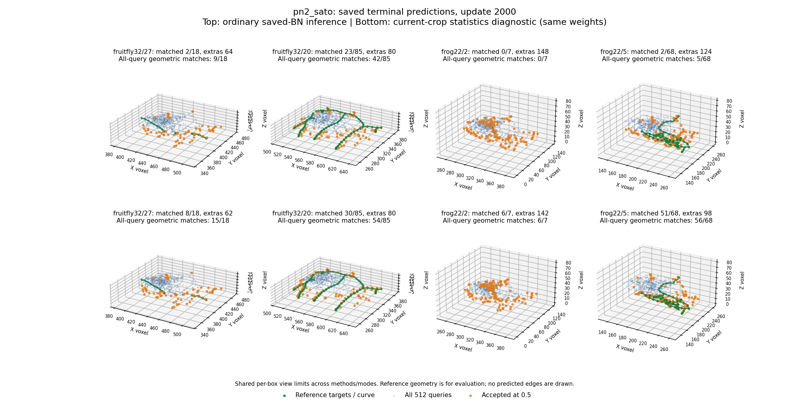
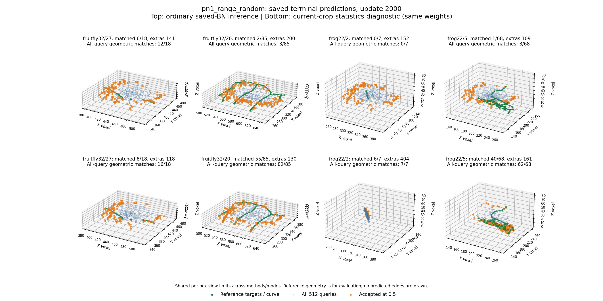

# Two-sampler node fit: execution completed, learnability failed

30 October 2026. Both user-launched fits reached 2000 updates, replayed their
timing prefixes exactly and saved complete states. **Both failed the frozen
learnability gate, substantially.** Neither qualifies for broader training or
selects a generally useful Phase 1 sampler. No extension, threshold adjustment,
inference-policy promotion or further fit was launched during this review.

This is the outcome of the [fixed recipe](sampler_node_fit.md), not a revised
criterion. The original `gate=False` results remain unchanged.

## Completed task and verification

Two independent fresh 1,688,518-parameter PointNeXt/Transformer models saw the
same four TRAINING boxes, 2048 slots, 512 queries and 18/85/7/68 targets. Only
point preparation differed. The threshold/random control is the correctly
decoded source-range comparator; it is not a trained PN1 model. Radius remained
unsupervised; there was no GAT, crop consolidation or reconstructed SWC.

All 4000 updates across the two arms are present and finite in the journals.
All ten saved prediction packet hashes match. Their node counts were replayed
independently using dense assignment with dummy miss slots, agreeing with the
original sparse maximum-cardinality evaluator. No new cutoff was selected.

All ten checkpoint completion hashes pass. Each terminal checkpoint matches
the model state used for its terminal evaluation. All sixteen BatchNorm layers
record 2000 training updates, running variances are positive and model states
finite. Adam clocks reach 2000. This rules out an incomplete fit or never-updated
BatchNorm buffers as the explanation; it does not certify every modeling choice.

The user reports 47m44s total. Recorded time after each initial evaluation is
15.81 minutes for threshold/random and 31.26 minutes for Sato. This difference
is descriptive: sequential runs and variable laptop/runtime conditions do not
establish an inherent twofold Sato compute penalty. Peak allocated GPU memory
is 0.233 GiB for both in this small experiment. The earlier short timing estimate
was heuristic and overestimated the observed paired duration.

## Terminal ordinary-inference result

These are maximum-cardinality one-to-one node matches within two native voxels,
with fixed used-slot cutoff 0.5. Extras are relative to the target discretization,
not verified biological background.

| Training box | Targets | Threshold/random: matched + extras | Sato: matched + extras |
|---|---:|---:|---:|
| Fruitfly 32 / 27 | 18 | 6 + 141 | 2 + 64 |
| Fruitfly 32 / 20 | 85 | 2 + 200 | 23 + 80 |
| Frog 22 / 2 | 7 | 0 + 152 | 0 + 148 |
| Frog 22 / 5 | 68 | 1 + 109 | 2 + 124 |

The gate required >=95% precision AND recall in every box. This is a serious
automatic-output failure, not a near miss caused by the final one or two labels.
Sato is better on some counts and worse on others, with poor outputs in both
arms. It is not defensible to select it as the winner from this result or to
claim PN2 reconstruction improvement over PN1.

## 1. A large train/inference normalization gap is established

The diagnostic uses exactly the same learned parameters and input points but
current-crop statistics. Dropout is zero, MHA fast-path switching is disabled,
and attention uses the same math backend. The relevant module-mode change in
this model is BatchNorm's current versus saved statistics. Diagnostic buffers
are restored and do not qualify the scored output.

For Sato, ignoring confidence and allowing all 512 queries to supply node matches:

| Training box | Ordinary inference: geometric matches | Current-crop diagnostic: geometric matches | Mean assigned distance: ordinary -> diagnostic |
|---|---:|---:|---:|
| Fruitfly 32 / 27 | 9 / 18 | 15 / 18 | 2.01 -> 1.42 voxels |
| Fruitfly 32 / 20 | 42 / 85 | 54 / 85 | 2.37 -> 1.78 voxels |
| Frog 22 / 2 | 0 / 7 | 6 / 7 | 3.56 -> 1.52 voxels |
| Frog 22 / 5 | 5 / 68 | 56 / 68 | 8.12 -> 1.20 voxels |

The threshold control has an even larger gap in several boxes: all-query
matches change from 3/85 to 82/85 in fruitfly tile 20, from 0/7 to 7/7 in frog
tile 2 and from 3/68 to 62/68 in frog tile 5. In the latter, mean assigned distance
changes from 13.79 to 1.18 voxels. These are geometric changes, not merely queries
crossing the confidence cutoff.

This reproduces the historical normalization problem on the fresh raw-image
pipeline. The selected ordinary-BN inference policy has not become reliable.
It is a model-interface/design issue to resolve before another sampler-quality
comparison, not evidence that Phase 1 removed all useful structure.

## 2. Current-crop statistics do not solve the node task

The diagnostic automatic accepted sets still fail:

| Training box | Threshold/random: matched + extras | Sato: matched + extras |
|---|---:|---:|
| Fruitfly 32 / 27 | 8 + 118 | 8 + 62 |
| Fruitfly 32 / 20 | 55 + 130 | 30 + 80 |
| Frog 22 / 2 | 6 + 404 | 6 + 142 |
| Frog 22 / 5 | 40 + 161 | 51 + 98 |

There is partial training-set geometry learning: current-crop mean assigned
distances are roughly 0.83-1.78 voxels across both models/boxes. However, the
confidence head does not select a compact accurate set. High-confidence unused
queries coexist with lower-confidence matched ones. Changing only inference
statistics would leave the main task unsuccessful.

Lowering a cutoff cannot create missing query locations. Even with all 512
queries, Sato's diagnostic recall is only 83.3%, 63.5%, 85.7% and 82.4%. None
can reach the frozen 95% recall by score threshold selection alone. The control
also lacks sufficient all-query recall in two boxes. The original cutoff/gate
therefore remain fixed; no threshold search or oracle node selection was used.

## 3. Extras are not solely a discretization-count artifact

An accepted query near a real reference curve can still be extra under a sparse
node representation. The read-only review therefore also measures distance to
the unchanged, precisely clipped continuous reference segments, separately
from distance to target nodes. This adds a diagnostic, not a replacement gate.

For Sato under current-crop statistics, accepted proposals within two voxels of
the reference curve number 10/70, 51/110, 14/148 and 63/149, respectively. Many
accepted proposals are far from the supplied curve, not merely redundant nodes
along it. Missing annotation can affect agreement, so these are not certified
biological false-positive rates. Nevertheless, the supplied reference is not
being reconstructed cleanly even in the diagnostic mode.

The close regular/required target pairs previously audited remain a legitimate
representation concern. They cannot by themselves explain these hundreds of
extras or the large normalization displacement. The experiment does not justify
another round of endpoint/crop-boundary pruning to make the gate easier.

The target phase is anchored on a full reference chain and can depend on
structure outside a crop. Whether exact interior-node usage is identifiable
from a local image is a broader design question. It is not demonstrated as the
cause of this finite training failure, and it must not be substituted for an
implementation audit. A future curve-faithful reconstruction should not be
judged solely by reproducing an arbitrary reference node phase.

## What this says about Phase 1

The sampler comparison has not been qualified by a working proposal model.
Earlier input-level evidence remains valid: hard gates exclude weak-region
evidence, while thresholded selection can be more efficient in bright regions.
These failed node fits do not establish which input policy generalizes.

The thresholded frog tile 2 cloud has only 195 distinct observations and no
two-voxel input support in the previously measured reference region, yet its
diagnostic all-query node matches reach 7/7. This demonstrates why a few-cloud
fit can memorize targets from scene/context identity without establishing local
image-evidence sufficiency. It neither restores discarded voxels nor invalidates
the input-retention measurements.

PointNeXt/Transformer jointly learned some training geometry; this does not
isolate PointNeXt's benefit or establish its reproduction quality. The full
intended architecture is neither validated nor disproved. It is specifically
the present encoder/proposal implementation, inference policy and training
recipe that failed this bounded gate.

## Research interpretation and proposed direction, not implemented

**Do not extend this run or start broader training now.** Preserve the failed
comparison. A new model-design discussion should address two separate contracts:

1. **Consistent normalization at inference.** GroupNorm is a concrete candidate
   because it computes statistics from the current input in both train/eval,
   and was designed to avoid batch-size dependence. That supports considering
   it for batch-one variable microscopy clouds; it does not prove it improves
   PN2. Changing the sixteen encoder normalizers would be an explicit model
   revision requiring fresh training, not a silent repair of these checkpoints.
   See [PyTorch GroupNorm](https://docs.pytorch.org/docs/stable/generated/torch.nn.modules.normalization.GroupNorm.html)
   and [Wu and He, Group Normalization](https://arxiv.org/abs/1803.08494).
2. **Geometric query and used-slot learning.** The current head starts from
   learned query tokens and regresses absolute crop-relative centers. Review
   whether image-derived geometric query initialization offers a better prior,
   and whether confidence is learning a stable, well-defined used-node task.
   [3DETR](https://openaccess.thecvf.com/content/ICCV2021/html/Misra_An_End-to-End_Transformer_Model_for_3D_Object_Detection_ICCV_2021_paper.html)
   provides a point-cloud precedent for non-parametric queries, while
   [DN-DETR](https://arxiv.org/abs/2203.01305) studies matching instability in
   object detection. These are relevant research leads, not evidence that PN2's
   matching is unstable or a license to add denoising/anchors automatically.

The saved snapshots do not establish iteration-to-iteration assignment churn,
classifier representational limits, the optimal LR or whether a longer allowance
would converge. Those remain untested. Any next proposal must distinguish those
hypotheses instead of treating a literature mechanism as the diagnosed cause.

Recommended sequence: specify and test **one normalization-only revision first**,
with GroupNorm the leading candidate. Its CPU train/eval computation should be
consistent by construction; keep queries, target policy, loss, clouds and cap
fixed in any subsequently agreed learned comparison. Use one frozen preparation
rather than repeat both sampler arms before the model is qualified. The saved
Sato/ordinary-BN fit is the corresponding baseline. This would require fresh
training, not conversion of these fitted parameters into a claimed successful
model. Functional train/eval consistency and the original 95% node gate are
separate verdicts. If consistency is fixed but node learnability still fails,
stop normalization variants and review the proposal/assignment formulation;
geometric query initialization remains a research candidate, not an automatic
addition. This sequence is proposed for discussion, not implemented or launched.

These candidate changes can retain Phase 1, PointNeXt, Transformer proposals
and GATv2. Geometric query initialization would change the proposal mechanism;
normalization would change encoder computation. Both need explicit explanation
and agreement before implementation. No new normalizer, query mechanism, loss,
manual mask, trained checkpoint or inference policy was adopted in this review.

## Saved outputs and reproduction

Raw training: `tmp/sampler_node_train_20261030/` (unchanged).
Read-only review: `tmp/sampler_node_review_verified_20261030/`.
The [visible evidence summary](evidence/sampler_node_fit_20261030.json) retains
terminal tables, history, hashes and checkpoint-state verification.

```powershell
& ..\pointneuron2\tmp\pointneuron2\sampling_env\Scripts\python.exe -B `
  .\scripts\review_sampler_node_fit.py `
  --run .\tmp\sampler_node_train_20261030 `
  --output .\tmp\a_fresh_saved_fit_review
```

This reads only the declared training references, saved predictions and locally
written hash-checked checkpoints on CPU. It executes no model forward and uses
no optimizer. All 80 mode/box/checkpoint node-count comparisons agree with the
saved evaluator. It does not open development/reserved images or modify source
data. The first review is preserved separately; the verified review adds
continuous-curve proximity to distinguish discretization extras from off-curve
proposals. No training or policy changes occur between reviews.

The figures share per-box limits across both methods/modes. Green shows reference
targets and sampled reference curves; faint blue shows all queries; orange shows
queries accepted at the frozen cutoff. There are no predicted edges.




